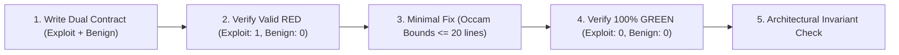

# TDD Orchestrator 2.0 (Mantis Block G & Contract-Driven Engine)

> **Iron Law of TDD**:
> **NO PRODUCTION CODE WITHOUT A FAILING TEST FIRST.**
> If you haven't seen the test fail for the exact expected reason, you are not writing verified code.

---

## 🛡️ Mantis Block G Dual-Pass Contract
To prevent **Lobotomized Patches** (AI patches that turn tests green by hardcoding `return 0` or stripping functionality), all TDD suites MUST implement dual-pass contracts:

1. **`test_exploit`**: Targets the defect or missing capability.
2. **`test_benign*`**: Exercises legitimate business logic in the same module.

---

## 🚦 Strict Exit Code Law (Harness² Disambiguation)
- **`returncode == 1` (RED_CONFIRMED)**: Pure assertion failure. The test correctly captured the bug/missing feature.
- **`returncode == 0` (GREEN_SAFE)**: Test passes completely.
- **`returncode >= 2` or `< 0` (INVALID_RED)**: Syntax error, `ImportError`, missing fixture, or timeout. Fix test contract first; NEVER proceed to production code.

---

## 🏛️ Domain-Specific Invariant Checks
1. **Vercel / React 19 Compiler Invariants**:
   - Ensure components remain statically analyzable without artificial `useMemo` hacks.
   - Guard against SSR hydration mismatches in client state.
2. **Supabase / PostgREST Invariants**:
   - All bulk queries must observe `CHUNK_SIZE <= 50`.
   - Never expose credentials to `anon` role.
