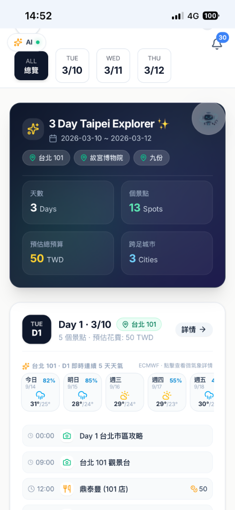
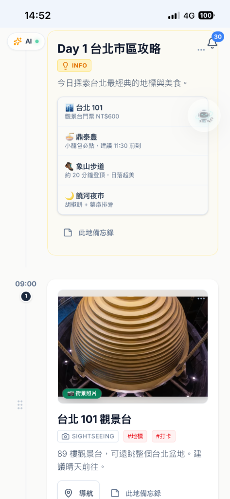
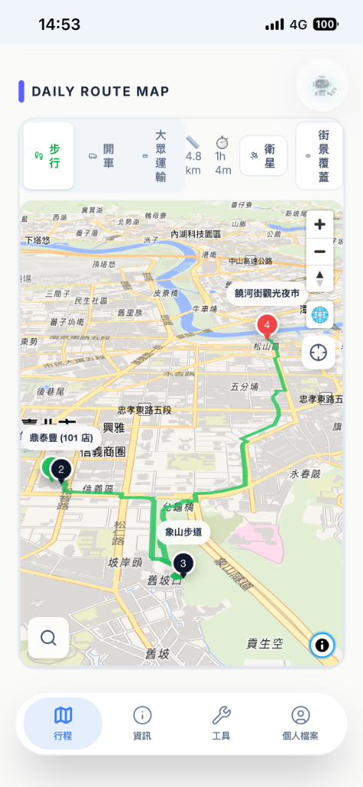
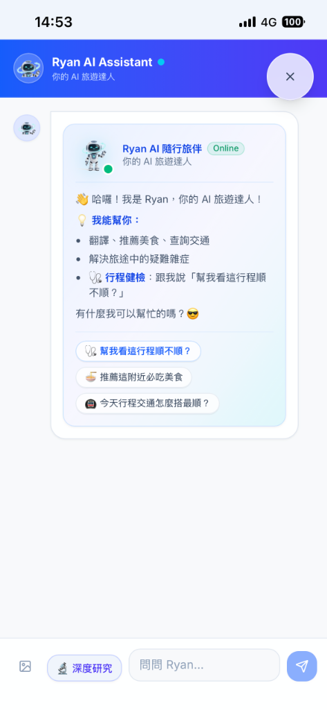
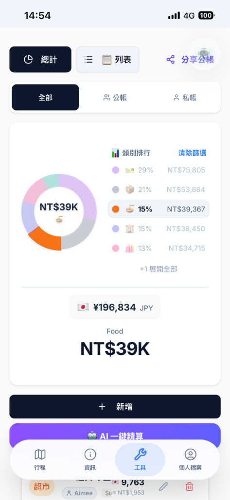
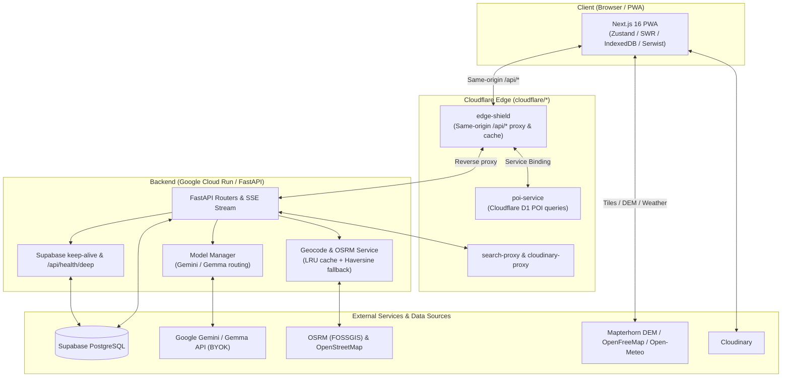

<p align="center">
  
  
  
  
  
</p>

<h1 align="center">Tabiji</h1>

<p align="center">
  <strong>A travel itinerary and expense-tracking PWA with offline caching, open-source map routing, and BYOK AI assistance</strong>
</p>

<p align="center">
  <strong>English</strong> | <a href="README.zh-TW.md">繁體中文</a>
</p>

<p align="center">
  
  
  
  
  
  
  
  
  
</p>

<p align="center">
  <a href="https://tabijiapp.com/">Live Demo (tabijiapp.com)</a> •
  <a href="https://travel-pwa-five.vercel.app/">Vercel Mirror</a> •
  <a href="#-features">Features</a> •
  <a href="#-tech-stack">Tech Stack</a> •
  <a href="#-system-architecture">Architecture</a> •
  <a href="#-getting-started">Getting Started</a> •
  <a href="docs/specs/README.md">Engineering Specs</a>
</p>

---

## ✨ Features

### 🤖 AI Travel Assistant (BYOK)
- **Bring Your Own Key (BYOK) Relay**: Users store their Gemini API key locally in the browser; the backend forwards requests in memory without persisting keys to a database or server logs.
- **Multi-Model Routing & Fallback**: Switches across Gemini Flash and Gemma models, falling back to secondary models when a rate limit is hit.
- **Structured Itinerary Actions**: Uses function calling and structured output parsing to render batch POI recommendation cards (`BatchPOIPreviewCard`) or add, update, and remove itinerary items directly from chat.
- **Context & Web Retrieval**: Includes the current itinerary structure, sliding-window chat history (with summarization for long threads), DuckDuckGo / Wikipedia search results, and flight lookups in chat prompts.

### 🗺️ Interactive Maps & Spatial Search
- **MapLibre GL Vector & Terrain Maps**: Combines OpenFreeMap vector tiles, Esri satellite imagery, and Mapterhorn 3D DEM terrain (enabled at camera pitch $\ge 30^\circ$ and unloaded at $\le 15^\circ$), using a static local Web Worker to comply with strict CSP rules.
- **OSRM Routing with Straight-Line Fallback**: Queries an in-memory LRU cache first and falls back to the FOSSGIS OSRM API; if an external request times out or no road network exists (e.g., ferry or island hops), it draws a Haversine great-circle line.
- **Multi-Source Geocoding & Reranking**: Combines a local MiniSearch offline index with 5 external sources (OSM, OpenTripMap, WikiVoyage, Wikipedia, Wikidata), ranking Top-K candidates by text similarity, distance decay, and country weighting, with antimeridian ($180^\circ$) bounding-box handling.
- **Street View & Route Playback**: Integrates Mapillary street-level imagery previews and sequential camera fly-to tours along daily stops.

### 📅 Trip Planning & Management
- **Multi-Trip & Realtime Sync**: Supports managing multiple trips, sharing read-only views via Next.js ISR links, and syncing collaborative edits via Supabase Realtime.
- **Trip Overview & Weather Forecast**: Displays a Day 0 summary view and a 5-day Open-Meteo weather forecast strip.
- **Drag-and-Drop & Multi-Segment Flights**: Reorders itinerary stops with `dnd-kit`, tracks multi-segment flights, and supports daily checklists and PDF export.
- **Booking Deep Links**: Generates parameterized referral links to external booking platforms (e.g., 12Go, Agoda).

### 💰 Expense Tracking & Splitting
- **Multi-Currency Conversion**: Supports 110+ ISO 4217 fiat currencies with destination-based default currency detection and exchange-rate conversion.
- **Receipt Upload & Parsing**: Uploads receipt photos to Cloudinary and optionally extracts itemized subtotal, tax, and tip via AI.
- **Shared & Private Ledgers**: Separates group split expenses from personal expenses with category breakdowns.
- **URL Deep Linking**: Supports opening specific tabs and scrolling directly to a target expense item via URL query parameters (e.g., `?tab=tools&expense_id=...`) using `react-virtuoso`.

### 📱 Offline PWA & Operations
- **Local-First Offline Support**: Uses Serwist for Service Worker caching and IndexedDB for local persistence, allowing offline viewing and queued edits that sync when reconnected.
- **Anonymous Recovery Keys**: Transfers account data across devices using a local UUID and recovery token (`tbj_rec_*`) without requiring email or phone registration, alongside data export and deletion endpoints.
- **Cloudflare Edge Workers**:
  - `edge-shield`: Proxies same-origin `/api/*` requests to Cloud Run to avoid cross-origin CORS preflights and caches common geocoding lookups.
  - `poi-service`: Serves POI lookups backed by Cloudflare D1.
  - `search-proxy` / `cloudinary-proxy`: Proxies external search and image requests.
- **Keep-Alive & Stale-State Cleanup**: Runs a periodic background query and exposes `/api/health/deep` (with a 60s memory lock) to keep Supabase free-tier projects active; the frontend confirms 404 responses twice before purging deleted trips from local state.

---

## 🏗️ Tech Stack

### Frontend
| Technology | Version | Purpose |
|------------|---------|---------|
| Next.js | 16.4 | App Router, ISR, Turbopack |
| React | 19.3 | UI framework (with React Compiler) |
| TypeScript | 5.9 | Static type checking |
| Tailwind CSS | 4.3 | Styling tokens & dark mode (`.dark`) |
| MapLibre GL | 6.9 | Vector maps, 3D terrain & static CSP worker |
| Zustand | 5.0 | Client state management |
| SWR | 2.5 | Data fetching & cache revalidation |
| Serwist | 9.5 | Service Worker & offline PWA caching |
| Framer Motion | 12.x | UI transitions |
| dnd-kit | 6.3 | Drag-and-drop itinerary sorting |
| Radix UI | Latest | Accessible UI primitives |

### Backend
| Technology | Version | Purpose |
|------------|---------|---------|
| FastAPI | Python 3.11+ | Async REST & SSE API framework |
| google-genai | Latest | Gemini / Gemma model calls & tool use |
| Supabase | PostgreSQL | Database, RLS policies & Realtime |
| HTTPX | Latest | Async HTTP client with connection pooling & SSRF checks |
| RapidFuzz | 3.14+ | Fuzzy string matching for geocoding rerank |
| SlowAPI | 0.1.10+ | API rate limiting |
| Prometheus Client | Latest | Metrics endpoint |

### Infrastructure
| Service | Purpose |
|---------|---------|
| Vercel | Frontend hosting & ISR |
| Google Cloud Run | Backend container hosting (`Dockerfile.prod`) |
| Cloudflare Workers & D1 | Same-origin API proxy (`edge-shield`), POI DB (`poi-service`), search & image proxies |
| Supabase | PostgreSQL database & Realtime channels |
| Cloudinary | Receipt and media image storage |

---

## 📐 System Architecture



> For detailed module specs and edge-case contracts, see [`docs/specs/README.md`](docs/specs/README.md).

---

## 🚀 Getting Started

### Prerequisites
- **Node.js** 20+
- **Python** 3.11+
- **Supabase** project (free tier works)
- **Gemini API Key** (obtainable from [Google AI Studio](https://aistudio.google.com/apikey) and entered inside the app's Profile page)

### 1. Backend (`backend/`)

```bash
cd backend

# Create and activate a virtual environment
python -m venv .venv
.venv\Scripts\activate      # Windows
# source .venv/bin/activate # macOS / Linux

# Install dependencies
pip install -r requirements.txt

# Create a .env file with the variables listed below
# Start the development server
uvicorn main:app --reload --port 8000
```

### 2. Frontend (`frontend/`)

```bash
cd frontend

# Install dependencies
npm install

# Create a .env.local file with the variables listed below
# Start the dev server (predev copies the MapLibre worker and builds the Service Worker)
npm run dev
```

Open [http://localhost:3000](http://localhost:3000).

### 3. Running Tests

```bash
# Frontend type check, lint, and Vitest unit tests
cd frontend
npx tsc --noEmit
npm run lint
npm run test:run

# Frontend Playwright E2E tests
npx playwright test

# Backend Pytest suite
cd ../backend
pytest
```

---

## 🔑 Environment Variables

### Backend `backend/.env`

| Variable | Required | Description |
|----------|----------|-------------|
| `SUPABASE_URL` | ✅ | Supabase project URL |
| `SUPABASE_KEY` | ✅ | Supabase Service Role Key (used by backend startup and queries) |
| `SESSION_SECRET_KEY` | Optional (Required in Prod) | JWT session signing secret (16+ random chars in production) |
| `VERCEL_PREVIEW_DOMAINS` | Optional | Comma-separated preview origins allowed for CORS |
| `TP_API_TOKEN` | Optional | Travelpayouts affiliate API token |

### Frontend `frontend/.env.local`

| Variable | Required | Description |
|----------|----------|-------------|
| `NEXT_PUBLIC_SUPABASE_URL` | ✅ | Supabase project URL |
| `NEXT_PUBLIC_SUPABASE_ANON_KEY` | ✅ | Supabase Anonymous Key |
| `NEXT_PUBLIC_API_URL` | Optional | Set to `http://localhost:8000` for local dev; leave empty in production when using Cloudflare same-origin `/api/*` |
| `NEXT_PUBLIC_CLOUDINARY_CLOUD_NAME` | Optional | Cloudinary cloud name for receipt uploads |

> [!NOTE]
> No **Gemini API Key** environment variable is needed on the server; users enter their own key in the in-app Profile page (BYOK).

---

## 🗄️ Database & Deployment

### Database Migrations (`backend/migrations/`)
The repository includes 28 SQL migration files in `backend/migrations/`. When initializing a new Supabase project, run them in filename order via the Supabase SQL Editor.

### Deployment
- **Frontend (Vercel)**: Connect the GitHub repository with Root Directory set to `frontend` and configure the `NEXT_PUBLIC_*` environment variables above.
- **Backend (Google Cloud Run)**: Build and deploy using `backend/Dockerfile.prod`:
  ```bash
  cd backend
  docker build -f Dockerfile.prod -t gcr.io/PROJECT_ID/tabidachi-backend .
  docker push gcr.io/PROJECT_ID/tabidachi-backend
  gcloud run deploy tabidachi-backend \
    --image gcr.io/PROJECT_ID/tabidachi-backend \
    --platform managed \
    --region us-central1 \
    --allow-unauthenticated
  ```
- **Edge Workers (Cloudflare)**: Each worker configuration resides in `cloudflare/<service>/wrangler.jsonc` and can be deployed independently with `npx wrangler deploy`.

---

## 📄 License & Intellectual Property

> [!NOTE]
> **Source-Available Notice**: Per Open Source Initiative (OSI) guidelines, non-commercial licenses are classified as **Source-Available** rather than OSI-approved Open Source.

- **Software Code**: Licensed under the [PolyForm Noncommercial License 1.0.0](LICENSE). Free for personal and non-commercial educational use; commercial deployment or derivatives require explicit permission.
- **Historical Releases**: Releases up to Git Tag `v1.0.0-mit-final` remain under the MIT License (see [NOTICE.md](NOTICE.md)).
- **Visual & Brand Assets**: "Backpack Traveler" illustrations, splash screen artwork, and logos are [All Rights Reserved](frontend/public/LICENSE-ASSETS.md). Brand usage guidelines are in [TRADEMARK.md](TRADEMARK.md).

---

<p align="center">
  Built by Ryan Su
</p>
