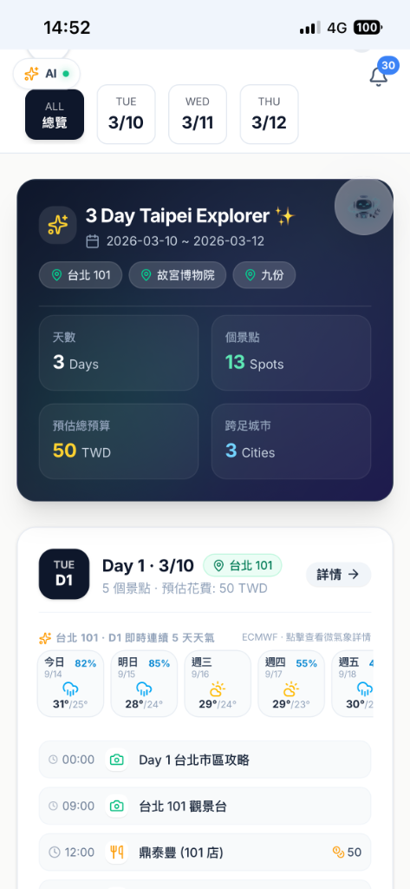
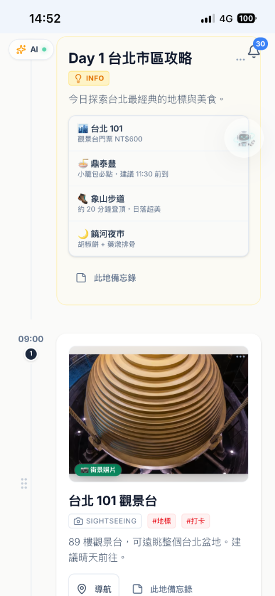
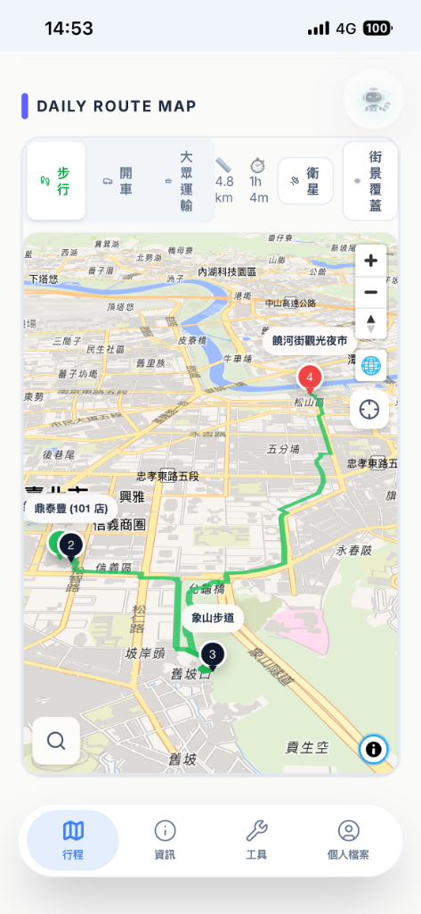
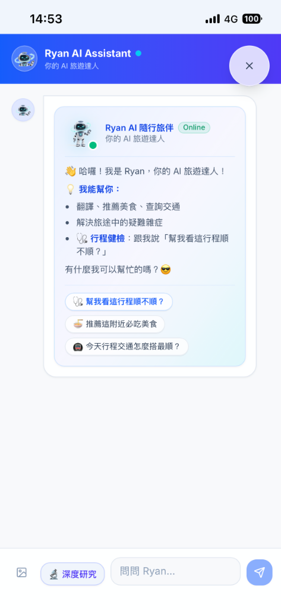
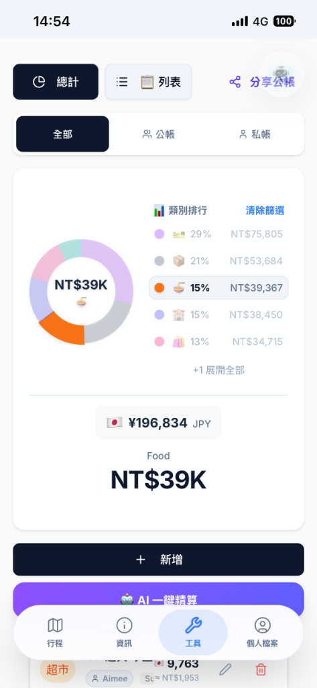
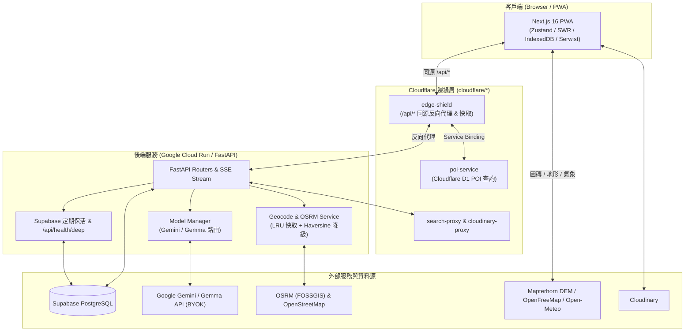

<p align="center">
  
  
  
  
  
</p>

<h1 align="center">Tabiji 旅路</h1>

<p align="center">
  <strong>結合離線快取、開源圖資路線規劃與 BYOK AI 助手的旅遊行程與記帳 PWA</strong>
</p>

<p align="center">
  <a href="README.md">English</a> | <strong>繁體中文</strong>
</p>

<p align="center">
  
  
  
  
  
  
  
  
  
</p>

<p align="center">
  <a href="https://tabijiapp.com/">Live Demo (tabijiapp.com)</a> •
  <a href="https://travel-pwa-five.vercel.app/">Vercel Mirror</a> •
  <a href="#-功能概覽">功能概覽</a> •
  <a href="#-技術棧">技術棧</a> •
  <a href="#-系統架構">系統架構</a> •
  <a href="#-快速開始">快速開始</a> •
  <a href="docs/specs/README.md">工程規格書</a>
</p>

---

## ✨ 功能概覽

### 🤖 AI 旅遊助手 (BYOK)
- **自帶金鑰轉發 (BYOK Relay)**：使用者的 Gemini API Key 儲存於瀏覽器本地，請求時由後端於記憶體內轉發呼叫，不寫入資料庫或伺服器日誌。
- **多模型路由與降級**：支援 Gemini Flash 與 Gemma 系列模型切換，當單一模型觸發速率限制時自動切換備援模型。
- **結構化行程操作**：透過 Function Calling 與結構化解析，在對話中產生批次景點推薦卡片 (`BatchPOIPreviewCard`)，或直接新增、修改、刪除行程節點。
- **上下文與外部檢索整合**：對話請求自動帶入當前行程結構、滑動視窗歷史（長對話自動摘要壓縮），並結合 DuckDuckGo / Wikipedia 搜尋與航班資訊補充回答。

### 🗺️ 互動地圖與空間檢索
- **MapLibre GL 向量與地形圖**：整合 OpenFreeMap 向量圖磚、Esri 衛星影像與 Mapterhorn 3D DEM 地形高程（相機傾角 $\ge 30^\circ$ 時載入地形，$\le 15^\circ$ 時卸載以節省資源），並使用本地靜態 Web Worker 滿足 CSP 限制。
- **OSRM 路線計算與直線備援**：路線規劃優先讀取後端記憶體 LRU 快取，未命中時查詢開源 OSRM (FOSSGIS) 路網；若遇跨海離島或外部服務逾時，則降級繪製 Haversine 大圓直線。
- **多來源地名檢索與重排 (Geocoding)**：整合本地 MiniSearch 離線索引與 5 個外部圖資來源（OSM、OpenTripMap、WikiVoyage、Wikipedia、Wikidata），依字義相似度、空間距離衰減與國別權重進行 Top-K 排序，並處理跨 180° 換日線的邊界框計算。
- **街景與視角巡覽**：整合 Mapillary 街景預覽，並支援依行程順序自動切換地圖相機視角。

### 📅 行程規劃與管理
- **多行程與多人同步**：支援建立多筆行程、透過公開連結分享（Next.js ISR），並利用 Supabase Realtime 進行多人同步更新。
- **行程總覽與天氣預報**：提供行程封面統計（Day 0 總覽）與 Open-Meteo 5 日天氣預報帶。
- **拖拉排序與多航段管理**：使用 `dnd-kit` 進行景點拖拉排序，支援跨日或多航段航班紀錄、每日檢查清單與 PDF 匯出。
- **外部預訂連結**：內建交通與住宿平台（如 12Go、Agoda 等）參數化跳轉連結。

### 💰 記帳與分帳工具
- **多幣別與匯率換算**：支援 110+ 種 ISO 4217 法定貨幣，依目的地自動預設幣別並提供即時匯率換算。
- **收據圖片上傳與解析**：透過 Cloudinary 儲存收據照片，可由 AI 協助辨識明細金額（小計、稅金、小費）。
- **公私帳分離與圖表統計**：支援旅伴分帳、個人私帳紀錄與類別佔比統計。
- **URL 深層連結定位**：支援從 Web Push 推播或網址參數（如 `?tab=tools&expense_id=...`）直接開啟對應分頁，並透過 `react-virtuoso` 捲動定位至指定項目。

### 📱 離線 PWA 與系統維運
- **Local-First 離線讀寫**：使用 Serwist 管理 Service Worker 快取與 IndexedDB 本地儲存，斷網時可瀏覽既有行程並暫存修改，恢復連線後背景同步。
- **匿名恢復金鑰**：無需綁定信箱或手機，以本地 UUID 搭配恢復碼 (`tbj_rec_*`) 進行跨裝置資料轉移，並提供資料匯出與刪除介面。
- **Cloudflare 邊緣代理群**：
  - `edge-shield`：將前端 `/api/*` 同源請求轉發至 Cloud Run 後端，減少跨網域 CORS Preflight 並快取常見地理搜尋。
  - `poi-service`：基於 Cloudflare D1 的 POI 資料查詢服務。
  - `search-proxy` / `cloudinary-proxy`：負責外部搜尋與圖片資源代理。
- **連線保活與狀態校正**：後端內建背景定時查詢與 `/api/health/deep` 健康檢查端點（含 60 秒節流鎖）以維持 Supabase 免費方案活躍；前端針對已刪除之失效行程具備 404 二次確認清理機制。

---

## 🏗️ 技術棧

### Frontend
| 技術 | 版本 | 用途 |
|------|------|------|
| Next.js | 16.4 | App Router, ISR, Turbopack |
| React | 19.3 | UI 框架 (啟用 React Compiler) |
| TypeScript | 5.9 | 靜態型別檢查 |
| Tailwind CSS | 4.3 | 樣式系統與深色模式 (`.dark`) |
| MapLibre GL | 6.9 | 向量地圖、3D 地形與靜態 CSP Worker |
| Zustand | 5.0 | 客戶端狀態管理 |
| SWR | 2.5 | 資料抓取與快取同步 |
| Serwist | 9.5 | Service Worker 與離線 PWA 快取 |
| Framer Motion | 12.x | 介面過場動畫 |
| dnd-kit | 6.3 | 行程卡片拖拉排序 |
| Radix UI | Latest | 無障礙基礎 UI 元件 |

### Backend
| 技術 | 版本 | 用途 |
|------|------|------|
| FastAPI | Python 3.11+ | 非同步 REST / SSE API 框架 |
| google-genai | Latest | Gemini / Gemma 模型呼叫與工具調度 |
| Supabase | PostgreSQL | 資料庫、RLS 權限控制與 Realtime 同步 |
| HTTPX | Latest | 非同步 HTTP 客戶端（連線池與 SSRF 防護） |
| RapidFuzz | 3.14+ | 字串模糊比對與地名重排計算 |
| SlowAPI | 0.1.10+ | API 速率限制 |
| Prometheus Client | Latest | 系統指標暴露 |

### Infrastructure
| 服務 | 用途 |
|------|------|
| Vercel | 前端託管與 ISR 渲染 |
| Google Cloud Run | 後端容器託管 (`Dockerfile.prod`) |
| Cloudflare Workers & D1 | 同源 API 代理 (`edge-shield`)、POI 資料庫 (`poi-service`)、搜尋與圖片代理 |
| Supabase | PostgreSQL 資料庫與即時廣播 |
| Cloudinary | 收據與媒體圖片儲存 |

---

## 📐 系統架構



> 詳細模組設計與邊界條件請參閱 [`docs/specs/README.md`](docs/specs/README.md)。

---

## 🚀 快速開始

### 前置需求
- **Node.js** 20+
- **Python** 3.11+
- **Supabase** 專案（免費方案即可）
- **Gemini API Key**（可於 [Google AI Studio](https://aistudio.google.com/apikey) 取得，在 App 內的個人設定頁填入即可）

### 1. 後端啟動 (`backend/`)

```bash
cd backend

# 建立並啟用虛擬環境
python -m venv .venv
.venv\Scripts\activate      # Windows
# source .venv/bin/activate # macOS / Linux

# 安裝相依套件
pip install -r requirements.txt

# 新增 .env 檔案並填入必要環境變數（見下方說明）
# 啟動開發伺服器
uvicorn main:app --reload --port 8000
```

### 2. 前端啟動 (`frontend/`)

```bash
cd frontend

# 安裝相依套件
npm install

# 新增 .env.local 檔案並填入必要環境變數（見下方說明）
# 啟動開發伺服器（predev 會自動複製 MapLibre worker 並建置 Service Worker）
npm run dev
```

啟動後開啟 [http://localhost:3000](http://localhost:3000)。

### 3. 執行測試

```bash
# 前端型別檢查、Lint 與 Vitest 單元測試
cd frontend
npx tsc --noEmit
npm run lint
npm run test:run

# 前端 Playwright E2E 測試
npx playwright test

# 後端 Pytest 單元與整合測試
cd ../backend
pytest
```

---

## 🔑 環境變數

### 後端 `backend/.env`

| 變數名稱 | 必填 | 說明 |
|----------|------|------|
| `SUPABASE_URL` | ✅ | Supabase 專案網址 |
| `SUPABASE_KEY` | ✅ | Supabase Service Role Key（後端初始化與查詢使用） |
| `SESSION_SECRET_KEY` | Optional (Prod 必填) | JWT Session 簽章密鑰（生產環境需為 16 字元以上隨機字串） |
| `VERCEL_PREVIEW_DOMAINS` | Optional | 額外允許 CORS 之預覽網域清單（以逗號分隔） |
| `TP_API_TOKEN` | Optional | Travelpayouts 聯盟連結 Token |

### 前端 `frontend/.env.local`

| 變數名稱 | 必填 | 說明 |
|----------|------|------|
| `NEXT_PUBLIC_SUPABASE_URL` | ✅ | Supabase 專案網址 |
| `NEXT_PUBLIC_SUPABASE_ANON_KEY` | ✅ | Supabase Anonymous Key |
| `NEXT_PUBLIC_API_URL` | Optional | 本地開發時指向 `http://localhost:8000`；線上環境由 Cloudflare Worker 同源代理 `/api/*`，可留空 |
| `NEXT_PUBLIC_CLOUDINARY_CLOUD_NAME` | Optional | Cloudinary Cloud Name（用於收據圖片上傳） |

> [!NOTE]
> **Gemini API Key** 無須配置於伺服器環境變數中，由使用者在前端「個人設定 (Profile)」頁面自行輸入（BYOK 模式）。

---

## 🗄️ 資料庫與部署

### 資料庫遷移 (`backend/migrations/`)
專案包含 28 個 SQL migration 檔案，位於 `backend/migrations/`。初始化全新 Supabase 專案時，請依檔名編號順序於 Supabase SQL Editor 執行。

### 部署方式
- **Frontend (Vercel)**：連結 GitHub 儲存庫並將 Root Directory 設為 `frontend`，配置上述 `NEXT_PUBLIC_*` 環境變數即可自動部署。
- **Backend (Google Cloud Run)**：使用 `backend/Dockerfile.prod` 建置容器映像並部署至 Cloud Run：
  ```bash
  cd backend
  docker build -f Dockerfile.prod -t gcr.io/PROJECT_ID/tabidachi-backend .
  docker push gcr.io/PROJECT_ID/tabidachi-backend
  gcloud run deploy tabidachi-backend \
    --image gcr.io/PROJECT_ID/tabidachi-backend \
    --platform managed \
    --region us-central1 \
    --allow-unauthenticated
  ```
- **Edge Workers (Cloudflare)**：各 Worker 設定位於 `cloudflare/<service>/wrangler.jsonc`，可透過 `npx wrangler deploy` 獨立部署。

---

## 📄 授權條款與智慧財產權

> [!NOTE]
> **Source-Available Notice**: 依據 Open Source Initiative (OSI) 定義，非商業授權條款屬於 **Source-Available（原始碼公開）**，而非傳統 OSI 認證之開放原始碼授權。

- **程式碼授權**：採用 [PolyForm Noncommercial License 1.0.0](LICENSE)，免費供個人與非商業教育用途使用；商業部署或衍生應用需取得明確授權。
- **歷史版本**：Git Tag `v1.0.0-mit-final`（含）以前之歷史版本維持 MIT 授權（詳見 [NOTICE.md](NOTICE.md)）。
- **視覺與品牌資產**：「背包旅人」插畫、啟動畫面與 Logo 均受 [All Rights Reserved](frontend/public/LICENSE-ASSETS.md) 保護，品牌使用規範請見 [TRADEMARK.md](TRADEMARK.md)。

---

<p align="center">
  Built by Ryan Su
</p>
