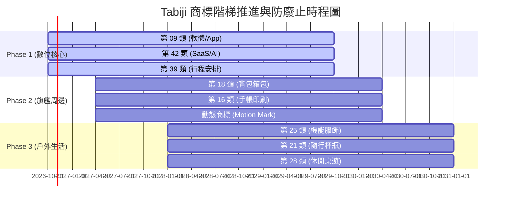

# Tabiji 全球商標註冊佈局與送件申請卷宗 (Trademark Filing Dossier)

> **專案代號**: Tabiji (tabijiapp.com)  
> **申請人**: Ryan Su (專案創辦人，以自然人名義送件，享有即時在先申請日，公司成立後辦理移轉)  
> **送件管道**: 智慧財產局「e 網通 (TIPONet)」線上電子送件 (享受每類 NT$ 2,400 最低規費)  
> **制定版本**: 2026 旗艦版 (依據 TIPO / JPO / USPTO 最新審查標準)  
> **最新狀態 (Status)**:  
> - ✅ **Phase 1 兩案已於 2026-10-13 完成 TIPO 電子送件！**  
> - 🔒 **法定在先申請日**: `2026-10-13` (已鎖定台灣優先在先權)  
> - ⏱️ **巴黎公約 6 個月國際優先權時鐘**: `2026-10-13` ~ `2027-04-13` (可延伸向日本 JPO 或美國 USPTO 主張台灣優先權)  
> **關聯研發文檔**: [`docs/research/tabiji-ip-protection-licensing-trademark-research-2026.md`](file:///d:/Project/Tabidachi/travel-pwa/docs/research/tabiji-ip-protection-licensing-trademark-research-2026.md)  

---

## 一、 核心商標註冊四大案卷與已送件狀態 (Core Filings & Filing Ledger)

為構建堅不可摧的品牌護城河，本專案將商標拆分為四大獨立案卷，進行互補性確權：

| 案卷代號 | 商標類型 | 申請圖樣 / 標樣 | 實體來源圖資 | 送件狀態與案號 | 涵蓋類別 |
| :--- | :--- | :--- | :--- | :--- | :--- |
| **案卷 1：主品牌文字商標** | 文字商標 (Word Mark) | **Tabiji 旅路** （中英複合文字標樣） | 純文字標樣（系統自動產圖） | ✅ **已送件 (2026-10-13)** 收文案號：待登錄 | 第 09, 42, 39 類 |
| **案卷 1B：彩色 App Icon** | 圖形商標 (Device Mark) | **旭日回眸旅人 t 字路** | [`docs/legal/trademark/tipo_assets/dossier_app_icon_color.png`](file:///d:/Project/Tabidachi/travel-pwa/docs/legal/trademark/tipo_assets/dossier_app_icon_color.png) | ✅ **已送件 (2026-10-13)** 收文案號：待登錄 | 第 09, 42, 39 類 |
| **案卷 2：手寫草寫字標** | 字型商標 (Stylized Mark) | **tabiji** (日式手寫草寫體) | [`docs/legal/trademark/tipo_assets/dossier_02_cursive_stylized_mark.png`](file:///d:/Project/Tabidachi/travel-pwa/docs/legal/trademark/tipo_assets/dossier_02_cursive_stylized_mark.png) | ⏳ 儲備（Phase 2） | 第 09, 42 類 |
| **案卷 3：背包旅人立繪圖形** | 圖形商標 (Device Mark) | **掀蓋雙肩包回眸旅人** | [`docs/legal/trademark/tipo_assets/dossier_03_person_device_mark.png`](file:///d:/Project/Tabidachi/travel-pwa/docs/legal/trademark/tipo_assets/dossier_03_person_device_mark.png) | ⏳ 儲備（Phase 2/周邊） | 第 18, 16 類 |
| **案卷 4：三幕開屏動態商標** | 動態商標 (Motion Mark) | **極光墨暈連筆飛機 2 秒動態** | [`docs/legal/trademark/tipo_motion_trademark_application.md`](file:///d:/Project/Tabidachi/travel-pwa/docs/legal/trademark/tipo_motion_trademark_application.md) | ⏳ 儲備（Phase 2/進階） | 第 09, 42 類 |

---

## 二、 尼斯分類 8 大類標準商品與服務細項清冊 (Nice Classification 12th Edition)

依據 TIPO 官方最新規範之「商品及服務名稱分類檢索系統」，預先指定各類別之標準詞（避免收到補正通知）：

### 【第一梯隊：數位核心（Phase 1 立即送件）】

#### 1. 第 09 類（電腦軟體、行動應用、演算法）
- `0901` 電腦軟體（可下載）
- `0901` 行動電話用應用軟體（可下載）
- `0901` 旅行行程規劃用電腦程式
- `0901` 具備人工智慧功能之旅遊路線規劃軟體
- `0901` 電子地圖資料庫軟體
- `0901` 電子憑證管理軟體
- `0901` 全球衛星定位系統（GPS）接收軟體

#### 2. 第 42 類（雲端平台、SaaS、技術研發）
- `4209` 軟體即服務（SaaS）
- `4209` 雲端運算服務
- `4209` 行程生成人工智慧演算法之雲端託管服務
- `4209` 電腦軟體設計、維護與線上諮詢
- `4209` 提供線上不可下載之旅遊行程資料庫檢索平台

#### 3. 第 39 類（旅遊安排、交通導航、行程指引）
- `3901` 旅遊行程安排服務
- `3901` 旅遊導航路線規劃服務
- `3901` 旅客運輸之路線導引資訊提供
- `3901` 代訂機票、火車票及交通工具租賃服務
- `3901` 透過網際網路提供之即時旅遊交通資訊

---

### 【第二梯隊：文創與旗艦周邊（Phase 2 配合產品募資/打樣送件）】

#### 4. 第 18 類（旅行箱包、後背包、皮夾）
- `1801` 雙肩背包（Backpacks）
- `1801` 旅行背包、掀蓋式後背包
- `1801` 旅行箱、登機箱
- `1801` 護照夾、旅行用皮夾、證件套
- `1801` 登山袋、行李袋

#### 5. 第 16 類（手帳、文具、印刷旅行地圖）
- `1601` 旅行記事本、旅行手帳本
- `1601` 印刷之旅遊指南書籍
- `1601` 旅行明信片、書籤、貼紙
- `1601` 印刷之地圖、手繪旅行地圖折頁
- `1601` 筆記本、手帳用紙製文具

---

### 【第三梯隊：戶外與生活風格（Phase 3 供應鏈成型後送件）】

#### 6. 第 25 類（旅行服飾、機能穿搭）
- `2501` 旅行防風長外套、風衣
- `2501` 戶外防潑水夾克、衝鋒衣
- `2501` 遮陽帽、旅行漁夫帽、毛帽
- `2501` T恤、休閒排汗衫
- `2501` 輕量健走鞋、旅行用便鞋

#### 7. 第 21 類（隨行保溫瓶、野營杯具）
- `2101` 旅行隨行保溫瓶、真空保溫杯
- `2101` 戶外露營便攜水杯
- `2101` 環保旅行餐具組
- `2101` 便攜式咖啡杯

#### 8. 第 28 類（休閒玩具、野營休閒用具）
- `2801` 旅行主題桌上遊戲（Board games）
- `2801` 旅行撲克牌
- `2801` 露營休閒娛樂器材

---

## 三、 商標法第 63 條「三年不使用廢止」階梯時程表與規費試算

### 1. 階梯送件時程矩陣 (Three-Phase Moat Timeline)

### 2. TIPO 規費試算表 (官方電子送件費用)
- **電子送件規費基準**：每類商品 20 項以內為 **NT$ 2,400**（紙本為 NT$ 3,000）。
- **註冊公告費**：每類審查核准後領證費為 **NT$ 2,500**。

| 申請梯隊 | 涵蓋類別 | 案卷組合 | 預估申請規費 (NT$) | 註冊領證規費 (NT$) | 總規費預算 (NT$) | 商業使用證據要求 |
| :--- | :--- | :--- | :--- | :--- | :--- | :--- |
| **Phase 1 (即刻送件)** | 09, 42, 39 | 文字「Tabiji 旅路」 圖形「揹包旅人」 | 3類 × 2案 × 2,400 = **14,400** | 3類 × 2案 × 2,500 = **15,000** | **29,400** | **100% 就緒**（已有線上運行程式碼、tabijiapp.com 網域、GitHub 代碼庫）。 |
| **Phase 2 (第 6~12 月)** | 18, 16 + 動態 | 圖形「揹包旅人」 字標「tabiji」 動態商標 (09/42) | 4案 × 2,400 = **9,600** + 動態 2類 4,800 = **14,400** | 4案領證 10,000 + 動態 5,000 = **15,000** | **29,400** | 需檢附實體後背包打樣、手帳印刷品發票或募資上線頁面。 |
| **Phase 3 (第 18~24 月)** | 25, 21, 28 | 文字 + 圖形 | 3類 × 2案 × 2,400 = **14,400** | 3類 × 2案 × 2,500 = **15,000** | **29,400** | 需檢附成衣服飾吊牌、保溫瓶銷售電商訂單憑證。 |
| **合計總預算** | **全 8 大類** | **完整護城河** | **NT$ 43,200** | **NT$ 45,000** | **NT$ 88,200** | 分 3 年分段支出，杜絕因未使用被撤銷之浪費。 |

---

## 四、 跨國優先權佈局策略 (Cross-Border Paris Convention Strategy)

依據《保護工業產權巴黎公約》（Paris Convention）第 4 條：
1. **6 個月國際優先權期間 (6-Month Priority Window)**：
   - 自台灣 TIPO 提出第一件商標申請日起算 **6 個月內**，前往日本專利商標局 (JPO)、美國專利商標局 (USPTO) 或歐盟智慧財產局 (EUIPO) 提出申請時，得主張以台灣申請日為其國際申請日！
2. **戰略實施路徑**：
   - **Day 1**: 於台灣 TIPO 送出 Phase 1 (09, 42, 39)；
   - **Month 5**: 評估日本海外市場迴響，若進軍日本，即向 JPO 主張台灣優先權送件；
   - **Month 5.5**: 若前進歐美市場，透過馬德里協定（Madrid Protocol）或 USPTO 主張台灣優先權。
