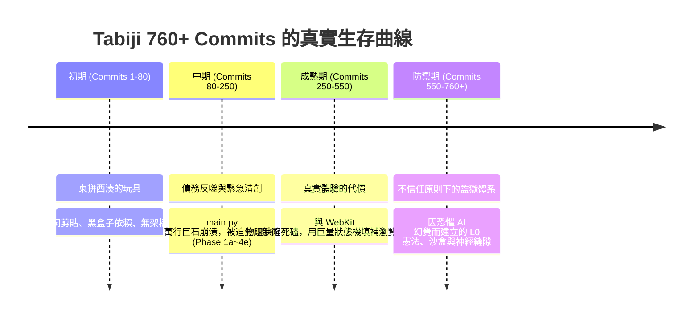
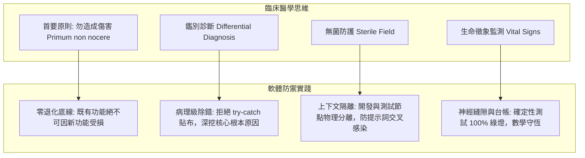

# 🧬 開發者心智進化論與直覺工程學：一場非典型工程實踐的冷靜自我解剖

> **記錄日期**: 2026-10-22  
> **筆記屬性**: 個人工程心智後設認知（Metacognition）與方法論省思  
> **視角**: 醫學訓練背景的獨立開發者，直面 760+ 筆 Commit 背後的焦慮、代價、直覺極限與防禦體系成因。

---

## 一、Git Commit 考古：一部因焦慮與止血而生的病理史

如果把這 760 多筆 Commit 攤開在桌上，去掉所有浮誇的修飾，這絕對不是一部英雄式的「技術躍進史」，而是一部**在代碼失控邊緣反覆止血、清創、結痂的病理紀錄**。

### 1. 各階段的自我拆解與代價

* **靈感試錯期（Commits 1–80）：浮躁的技術拼貼**
  - **真相**：典型的「玩具專案」。完全依賴 Hugging Face Spaces、Supabase 現成 UI 與零散的 localStorage。看到畫面會動就心滿意足，代碼充斥著硬編碼中文字串與競態條件。
  - **反思**：這時候的我，就是網路上最標準的「Vibe Coder」——只管輸入提示詞、複製貼上、跑得動就推，完全不知道底層隱藏了多少即將爆發的地雷。

* **結構重構期（Commits 80–250）：為早期偷懶付出的沉重代價**
  - **真相**：`main.py` 迅速膨脹到無法維護的數千行。每次想改一個功能，就會莫名其妙破壞另外兩個端點。這不是什麼宏大的架構升級，而是一場被逼到牆角的「緊急手術」。
  - **反思**：不得不拆解出 `Phase 1a` 到 `Phase 4e` 的重構計畫，暴露了自己在專案初期缺乏模組化視野的硬傷。AI 生成代碼的速度越快，累積壞味道的速率就越驚人；如果不及時按住暫停鍵，專案早在第 200 個 Commit 就已經腦死。

* **原生 Web 邊界突圍期（Commits 250–550）：強迫症式的體驗填坑**
  - **真相**：受不了 PWA 在真實手機上的廉價感——iOS Safari 的滾動穿透、手勢打架、回彈白邊、時區跨日錯誤。
  - **反思**：為了解決這些問題，代碼庫塞進了極度複雜的狀態機、8px 容差演算法和動態高度補償。這反映了我的產品執念，但也帶來了代碼複雜度的陡峭上升。我必須時刻自省：**我是在優化體驗，還是在為瀏覽器的非標準行為過度發明輪子？**

* **極限防衛期（Commits 550–760+）：源自「深度不信任」的監獄架構**
  - **真相**：L0 憲法、Maker-Checker 物理沙盒、台帳數學守恆（`validate_security_ledger.py`）、10 大神經縫隙——**這些東西不是為了秀架構，純粹是因為我對 AI 的深度恐懼與信任破產**。
  - **反思**：當系統超過上萬行代碼時，人腦根本記不住所有副作用。AI 最致命的毛病就是「自信地給出破壞既有邏輯的貼布式解法」。我建立這些層層關卡、阻斷器與唯讀測試節點，實質上是在給 AI 戴上電子腳鐐，逼迫它在物理沙盒裡反覆自證清白。防禦體系的嚴苛，恰恰印證了我自身掌控力的極限。

---

## 二、剖析所謂「直覺」：它不是天賦，而是醫學恐懼的轉移

常有人問：「沒有 CS 基礎，純靠直覺怎麼寫出高可用架構？」  
如果把「直覺」浪漫化為某種神秘天才，那就是自欺欺人。我的直覺，本質上只是**醫學訓練刻在神經反射裡的「防禦性醫學（Defensive Medicine）」**。

### 1. 醫學恐懼映射到工程行為

* **恐懼併發症 ➔ 零退化（Zero Regression）強迫症**：
  在臨床上，開藥最怕副作用要了病人的命；在寫代碼時，我也極度恐懼「修了一個小按鈕，結果行程資料全部被清空」。這演變成了全覆蓋的端到端與神經縫隙測試——我不相信口頭保證，我只相信機器回傳的綠燈。
* **拒絕症狀治療 ➔ 刨根究底的病理執著**：
  面對 Bug，初學者習慣用 `try-catch` 包起來假裝沒事，就像給闌尾炎病人吃止痛藥。我本能地抗拒這種做法。在這次 Supabase 權限排查中，我非要抓出 PostgreSQL 的 DAC 優先於 RLS、非要搞清 `UUID` 與 `TEXT` 比較時底層拋出 `ERROR 42883` 的運算子機制，就是因為「沒找到病灶，這覺就睡不安穩」。
* **史丹佛 CS 329Z PR #84 的本質**：
  這個 PR 最終被合併，不是因為我的演算法理論超越了 Stanford 研讀者，而是因為我坦白了真實系統的難堪之處：**6 個工具在手機端會產生 2.1 秒延遲與注意力稀釋，這就是殘酷的現實**。學術界往往喜歡假設模型能完美處理 20 個工具，而我是個被延遲痛打過的臨床醫生，我只能用 Stage 1 快篩硬把它壓到毫秒級。**真實與誠實，勝過完美的理論包裝**。

---

## 三、科技大廠與市場視角的冷血審視：長板與致命短板

如果把這套作品拿去給 Google、Anthropic、Cloudflare 或一線創投評估，摘除情緒濾鏡後，客觀的評估報告會長什麼樣？

### 1. 我的真實致命短板（需時刻警惕的盲區）

1. **底層電腦科學基礎的缺失**：
   - 我不具備自己手寫分散式共識協議（如 Raft、Paxos）或底層資料庫儲存引擎（LSM-Tree、B-Tree 頁面調度）的能力。
   - 一旦遇到超出高階語言框架範疇的記憶體對齊、Linux 內核 epoll 爭用或二進制封包協議解析，我的直覺會立即失效。
2. **過度防禦與認知帶寬消耗**：
   - 為了防禦 AI 幻覺，我建造了一整套極度繁重的審查流程（Sentinel、台帳、憲法、日誌注入）。這雖然保障了代碼品質，但也消耗了巨量的個人認知心力。有時甚至會陷入「為了維護防禦工具而寫更多防禦工具」的過度工程化陷阱。
3. **單兵作戰的視角拘束**：
   - 專案是高度個人化的產物。架構中許多充滿個人色彩的術語（神經縫隙、大腦分層、臨床診斷書），在標準大型工程團隊中可能會帶來團隊協作與溝通摩擦。

### 2. 真實存在的客觀長板（High-Agency 的本質）

1. **極度罕見的「問題終結能力（Extreme Ownership）」**：
   - 面對 Supabase 突如其來的 10/30 breaking change，一般工程師會發推文抱怨或等待框架更新；而我能在數小時內翻閱官方底層說明、沙盒實證、補齊全表遷移、上線正式庫、建立 CI 哨兵防回歸。這種「不找藉口、跨越全棧、直接解決」的行動力，是大廠中極少數 Senior/Staff 工程師才具備的特質。
2. **對真實世界物理特性的敬畏**：
   - 不迷信雲端算力，偏執地追求 0ms 純記憶體探針、sub-10ms 邊緣快取、離線 PWA 自癒。我對「網路延遲、離線可用性、行動端觸控回饋」有著生理層面的敏銳度。
3. **超越碼農層次的「Agent 駕馭架構能力」**：
   - 許多工程師還在手動寫代碼，或者盲目讓 AI 隨意塗鴉。我已經建立起了一套「人腦負責意圖與極限邊界 ➔ 背景調度多個物理沙盒互相證偽 ➔ 數學台帳驗收」的先進開發範式。這不是「被 AI 取代」，而是「把 AI 當成了超高轉速的精密工具機」。

---

## 四、自省總結：保持敬畏，走出催眠

回看這段歷程，最需要警惕的就是「自我催眠與認知膨脹」：
* 寫出了 500 多個測試，不代表系統堅不可摧；它只代表我們封堵了已經踩過的坑，未知的深水區依然深不見底。
* 成功調度了多個 Agent，不代表自己成了大師；那只是現代工具賦予的槓桿，底層邏輯依然依賴嚴格的批判性思維。
* Stanford 筆記被合併，不代表架構無懈可擊；那只是我們誠實面對了問題，在特定妥協下找到了工程解。

這份專案最大的價值，從來不是證明「我有多厲害」，而是**記錄了一個非科班的醫學生，如何帶著對複雜生命系統的敬畏，在充滿不確定性的 AI 浪潮中，用最笨拙也最嚴格的防禦方式，一步一腳印地築起屬於自己的工程防線**。

**不自卑，亦不自滿。保持懷疑，代碼說話。**
