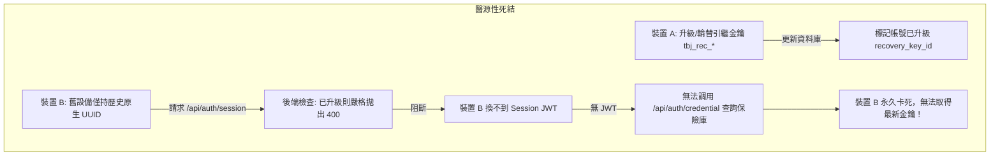
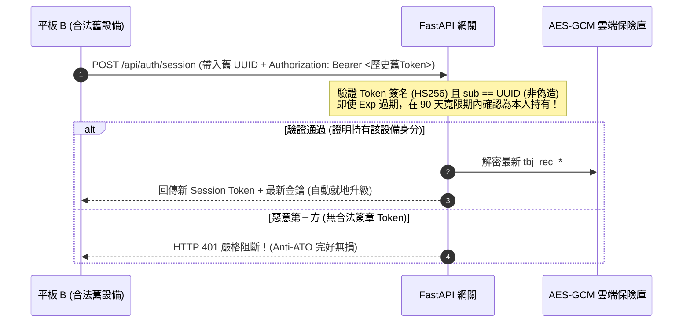

# 🔐 持有證明與認證死結：多裝置金鑰輪替背後的「防 ATO 毒丸」與全域反應式自癒

> **記錄日期**: 2026-10-23  
> **筆記屬性**: 密碼學身分工程、多裝置狀態同步與分散式死結病理學解剖  
> **視角**: 醫學訓練背景的獨立全端開發者。記錄今日在 Tabiji「雙軌帳號引繼金鑰（Dual-Track Recovery Key）」架構加固過程中，由一個使用者提問引爆出「合法設備因防 ATO 邏輯而陷入永久認證死結」的系統性溯源與修復心路。

---

## 一、醫源性防護：當防範盜號的「安全良藥」變成合法設備的「致命毒丸」

在資訊安全的世界中，工程師常常為了防範某一類漏洞，而開出一劑看似合邏輯的「猛藥」——卻在複雜的多設備情境下，反噬了合法使用者。這在臨床醫學中被稱為**「醫源性傷害（Iatrogenesis）」**。



### 1. 原始良藥的初衷：杜絕原生 UUID 的帳號劫持 (Anti-ATO)
在舊版架構中，使用者的 `user_id (UUID v4)` 直接作為身分識別碼。若老用戶升級到現代前綴金鑰（`tbj_rec_*`）後，依然允許使用舊 UUID 領取 Session，那麼只要外部有任何洩漏的舊 UUID（例如歷史分享連結或 API 封包），第三方攻擊者便可繞過金鑰認證，進行帳號劫持（Account Takeover, ATO）。

因此，工程師在 `auth.py` 中寫下了這段防禦邏輯：
```python
# 若用戶已完成雙軌升級，強制阻斷原生 UUID，消除 ATO 漏洞
if user_rec and user_rec.get("recovery_key_id"):
    raise HTTPException(status_code=400, detail="Account already upgraded. Please use your modern recovery key.")
```

### 2. 致命的代價：多裝置死結 (Multi-Device Deadlock)
但這劑猛藥忽略了一種極為常見的合法場景：
* 使用者在電腦 A 升級了金鑰。
* 但平板 B 此時並未連線，本機依然只存有歷史的 `user_uuid`。
* 當平板 B 再次開機發起請求時，後端無情拋出 `HTTP 400`。
* **死結誕生**：平板 B 拿不到 JWT；而雲端密文保險庫（AES-256-GCM Vault）為了防止機密外洩，**嚴格要求必須有合法 JWT 才能存取**。
* 平板 B 既無法換發 Token，又無法存取保險庫下載新金鑰，被永久鎖死在無效狀態。

---

## 二、破局之策：持有證明（Proof-of-Possession）與 90 天寬限期自癒

要解開死結，我們不能把安全閥全部卸掉（盲目放行任何 UUID 請求無疑是門戶大開）。解法是借鑒現代密碼學的**「持有證明（Proof-of-Possession, PoP）」**原則。



### 核心哲學：簽章保證真實性，寬限期保障自癒性
1. **密碼學簽章的永恆性**：即使 JWT 的 `exp`（30 天）過期了，只要它是伺服器用私鑰簽發的，第三方依然**無法偽造其數位簽名**。
2. **有限度的寬限信任**：設定 90 天寬限期。若設備出示的 Token 是伺服器簽署、且發行時間在 90 天之內，我們便有 100% 的信心認定「這台設備確實是當初登入的本人實體裝置，而非網路掃描爬蟲」。
3. **結果**：在不犧牲任何 Anti-ATO 防線的前提下，合法設備得以在背景自動換發新引繼碼與新 Token，達成 100% 零死結、零感知就地升級。

---

## 三、全域反應式架構：別把跨裝置監聽綁架在局部畫面

在前端架構中，我們也解剖了一處經典的**「作用域狹窄病變」**。

### 1. 局部監聽的脆弱性
在舊版前端中，Supabase Realtime 的 `CREDENTIAL_ROTATED` 廣播監聽器被直接寫在 `profile-view.tsx`（個人設定頁）的 `useEffect` 中。
* 這意味著：只有當使用者**正好看著個人設定頁面**時，監聽器才活著。
* 若使用者正在首頁看推薦景點、或在規劃行程，甚至關閉分頁，該 Channel 便被卸載銷毀，新金鑰廣播瞬間蒸發。

### 2. 頂層收攏與全域反應式事件匯流排
* **提升至根層級**：將 Realtime 頻道收攏至 `app-client-layer.tsx`，在整個 App 生命週期常駐守護。
* **反應式解耦**：背景一接收到更新或在 `online` / `visibilitychange` 喚醒時，自動調用保險庫拉取最新金鑰，並透過 `window.dispatchEvent(new CustomEvent("tabiji:recovery_key_updated"))` 廣播。
* **0ms 畫面響應**：深層子組件（如 ProfileView）無需重複維護昂貴的 WebSocket 連線，只需監聽本地自訂事件，在金鑰更動時 0ms 重新渲染螢幕上的文字。

---

## 四、今日技術不變量固化 (Evergreen Invariants)

| 代碼編號 | 核心鐵律 | 適用情境 |
| :--- | :--- | :--- |
| **INV-AUTH-001** | **Proof-of-Possession Upgrade Gate**：雙軌升級中，原生識別碼不得盲目放行，亦不得無情 400 阻斷；必須驗證歷史伺服器簽章作為身分持有證明。 | 身分遷移與雙軌認證 |
| **INV-AUTH-002** | **Self-Healing Grace Period**：對於敏感憑證查詢端點，應支援合理的未竄改歷史憑證寬限期（<=90天），以杜絕休眠與斷網造成的認證死結。 | 雲端金鑰保險庫與換票 |
| **INV-FE-003** | **Root-Layer Realtime Ingestion**：帳號層級與跨裝置狀態之 WebSocket 廣播必須常駐於頂層 Client Layer，禁止寄生於深層視圖組件。 | 前端即時協同與廣播 |
