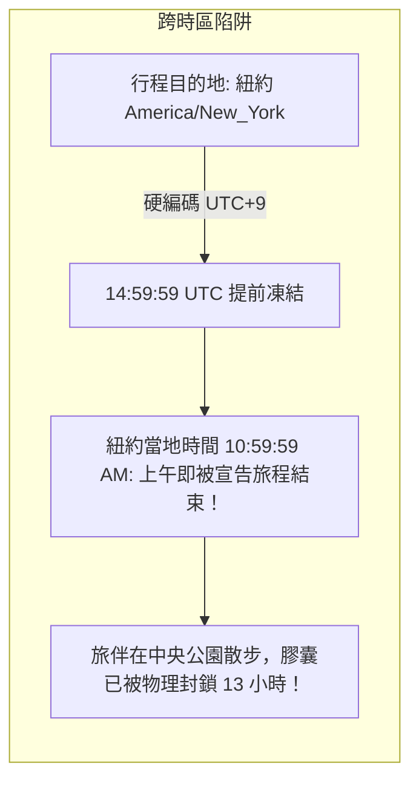
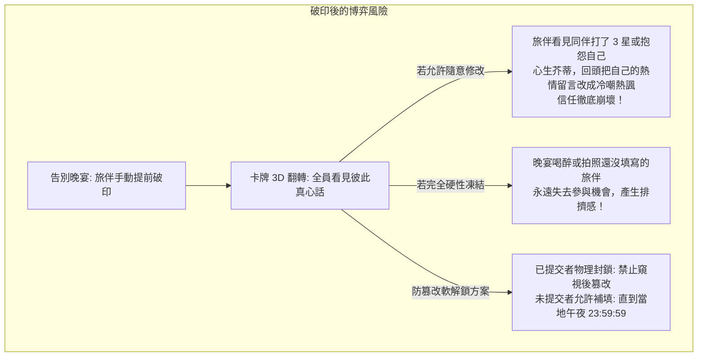

# ⏳ 時空邊界與防篡改信任：時光膠囊背後的跨時區陷阱與軟解鎖哲學

> **記錄日期**: 2026-10-23  
> **筆記屬性**: 工程心智後設認知（Metacognition）與人際博弈病理學解剖  
> **視角**: 醫學訓練背景的獨立開發者。記錄今日在「旅伴時光膠囊」架構設計中，直面跨時區時間換算陷阱、提前開箱後的防篡改機制，以及「測試資料殘留遮蔽真實時鐘」的認知盲區。

---

## 一、跨時區陷阱：地球自轉與被「東京時間」綁架的時鐘

在旅遊應用中，時間永遠不是單純的 UTC，也不是單純的客戶端本地時間，而是「旅程目的地的時間脈動」。



### 1. 傲慢的預設值（Default Anchor Bias）

在舊版 `compute_trip_end_utc` 實作中，代碼裡寫著：
```python
# 23:59:59 Asia/Tokyo (UTC+9) is 14:59:59 UTC
# If no explicit timezone, assume UTC+9 anchor
return datetime(parts[0], parts[1], parts[2], 14, 59, 59, tzinfo=timezone.utc)
```
這是典型的「地理認知偏見」——因為開發者在東亞（UTC+8 / UTC+9），測試時多以日本為範例，便潛意識認為全天下的旅行都在 UTC+9 的午夜結束。

### 2. 殘酷的時差現實

當使用者在紐約（EDT，UTC-4）旅行時，最後一天的當地午夜 23:59:59 實際上是 UTC 的翌日 03:59:59。
而系統在 14:59:59 UTC 就自作主張把時光膠囊全部凍結——**相當於紐約時間最後一天上午 10:59:59，旅伴還在吃早午餐，App 就粗暴地宣告「旅程已結束，禁止填寫真心話」**。提早了整整 13 個小時！
若是在夏威夷（UTC-10），提早時間更是高達 19 小時。

### 3. 病理重構：動態目的地邊界換算

- **解法**：全面廢棄寫死 UTC+9 的便宜行事，改為從行程第一筆景點座標、城市代碼反查真實 IANA 時區（如 `America/New_York`、`Europe/Paris`），使用 Python 3.9+ `zoneinfo` 精確換算最後一日的當地 `[00:00:00, 23:59:59]`。
- **守則**：所有涉及跨日業務邏輯（膠囊封存、今日天氣、每日記帳），其時間基準必須錨定在**「目的地當地時區」**，任何硬編碼時區皆為潛伏定時炸彈。

---

## 二、防篡改軟解鎖：人際博弈與「脆弱的信任體系」

在實體世界中，「時光膠囊」是在大家都回國後才開封。
但在數位旅程中，旅伴們往往在行程最後一天的「告別晚宴」圍坐在一起，希望能現場一起點擊開箱、看彼此寫了什麼真心話。

這引出了一個致命的博弈論邊界：**如果膠囊提前解鎖了，但午夜還沒到，這段時間內旅伴是否還能編輯？**



### 1. 極端情境下的兩難困境

- **若完全允許修改**：旅伴 A 看了旅伴 B 寫的吐槽，回頭偷偷把自己原本充滿感激的心得改成冷嘲熱諷。數位世界的心情揭曉，變成了反向討好或報復性修改的修羅場。
- **若全面硬性凍結（Hard Freeze）**：旅伴 C 在告別晚宴前忙著打包行李還沒來得及寫，盛典一開，系統立即宣布凍結，C 永遠無法再補上一句回憶，這份遺憾將永久烙印在整趟旅程中。

### 2. 「防篡改軟解鎖（Anti-Tampering Soft Unlock）」哲學

我們在後端 [`backend/routers/capsules.py`](file:///d:/Project/tabiji/travel-pwa/backend/routers/capsules.py) 確立了非對稱保護不變量：
```python
if bool(trip.get("is_capsule_unlocked", False)):
    # 檢查該使用者今天是否已有提交記錄
    if existing_entry:
        raise HTTPException(status_code=403, detail="時光膠囊已提前破印揭曉。為防止偷看他人心得後篡改，已揭曉之條目嚴禁修改。")
    # 未提交者則放行新增，直到當地午夜 hard freeze
```

這項設計在冷酷的代碼中落實了細膩的心理學平衡：
1. **保護既有成果的真實性**：一旦你的心得被他人看見，它就被不可逆地釘在時光軸上，禁止事後掩飾。
2. **包容遲到者的溫度**：晚宴結束回到飯店、夜深人靜時，還沒填寫的旅伴依然可以在當地午夜 23:59:59 前補上自己的真心話，完成拼圖。

---

## 三、盲點解剖：測試資料殘留如何遮蔽真實時鐘

今天最驚心動魄的一刻，是使用者在審查截圖時冷靜地說了一句：
> **「但是你這個是 10 月 25 結束欸」**

這句話如同一記重錘，敲碎了所有自動化測試全綠帶來的虛假安全感。

### 1. 偽證的誕生

- 畫面上明確顯示：今日為 `2026-10-23 (Day 14)`，旅程結束日為 `2026-10-25 (Day 16)`。
- 我們剛剛才信誓旦旦地制定了「最後一天破印守衛（Last-Day Gate）」，規定 10/23 絕不可提前解鎖。
- 但 Chrome DevTools 截圖中，按鈕赫然寫著：`已破印 盛典解鎖 🎉`，點擊直接打開了 3D 盛典。

### 2. 根因追查：資料庫殘留毒丸

回溯發現，該測試行程在 10/14 初次建立時，被人工或早期測試腳本寫入了 `is_capsule_unlocked = true`。
後端在處理請求時，因為欄位已為 `true`，直接繞過了時間校驗。
而我們在前端截圖時，沈浸在「3D 盛典與翻牌動畫運作完美」的視覺滿足中，**大腦選擇性忽視了畫面上的真實日期與結束日期的邏輯矛盾**。

### 3. 後設認知反思

- **工具綠燈不等於業務正確**：19 個 pytest 全部 PASS、TypeScript 0 錯誤、ESLint 0 警告，但沒有任何一個測試告訴我們「這個特定的測試行程在資料庫裡的狀態早已違背了它自己的日期邏輯」。
- **合成資料的腐爛性**：開發環境中的靜態 Mock 與測試記錄會隨著功能迭代而「腐爛（Rot）」。若不主動清空與對齊真實世界邊界，它就會成為認知盲區的最大溫床。
- **人類審查不可替代之處**：AI 善於嚴格執行局部約束，但人類開發者能夠一眼跨越維度，把「頂部的日期標籤」與「底部的卡片狀態」進行語意對齊。這再次印證了憲法中「人類主權」與雙重覆核（Maker-Checker）的不可或缺。

---

## 四、資產固化總結

本次經驗沉澱為 Tabiji 核心架構庫的三大永恆守則：
1. **[INV-TEMPORAL-DESTINATION-TIMEZONE]**：所有旅遊跨日事件的邊界，必須以「目的地真實時區之 00:00:00 與 23:59:59」為唯一度量衡。
2. **[INV-CAPSULE-ANTI-TAMPER-SOFT-UNLOCK]**：破印後的時光膠囊實施非對稱編輯權限——已提交者物理封鎖、未提交者寬限至午夜。
3. **[INV-STORAGE-SHARED-DEVICE-DUAL-KEY]**：本機快照儲存凡涉及私密或個別使用者狀態，鍵值必須採 `[module]_[tripId]_[userId]` 雙重隔離，杜絕共用設備穿透。
