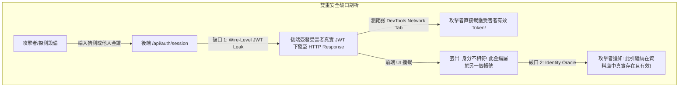
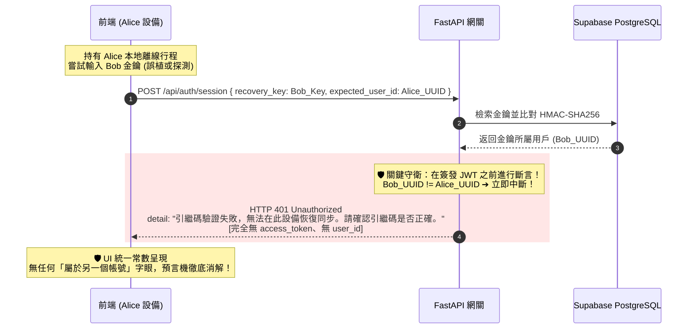

# 🛡️ 預言機消解與傳輸層零洩漏：從使用者直覺到 Local-First 認證防線的深度病理學解剖

> **記錄日期**: 2026-10-24  
> **筆記屬性**: 資訊安全架構、分散式離線同步 (Local-First Sync)、密碼學側信道防護  
> **視角**: 醫學訓練背景的獨立全端開發者。記錄 Tabiji 系統中，如何從一個看似單純的 UI 回復提示，經過使用者直覺式叩問，引爆出「身分枚舉預言機」與「網路傳輸層 JWT 提前外洩」雙重深層架構漏洞，並最終演繹成一套完整的零洩漏原地重錨定（In-Place Re-anchoring）體系。

---

## 一、臨床叩問：一句「不可以告訴別人吶」引爆的雙重安全破口

在分散式與離線優先（Local-First）的 PWA 應用中，多裝置認證管理是極具挑戰性的課題。當裝置 A 輪替了現代引繼金鑰（`tbj_rec_*`），長時間處於離線或休眠的裝置 B 在開機後，必然會因攜帶舊 Token 而遭遇 `HTTP 401 Unauthorized`。

舊版系統的直覺設計是：「跳出登出按鈕，讓使用者登出後重新登入」。然而在 Local-First 架構中，**登出意味著呼叫 `localStorage.clear()`**——使用者在離線期間辛辛苦苦建立的數天行程、記帳、相片，將被無差別全數抹除！更甚者，背景同步引擎在遭遇 401 時，竟會將其當作瞬態錯誤重試 3 次，隨後**永久丟棄未同步之突變隊列**。

為了解決這個痛點，我們初步設計了「原地重新驗證彈窗（`SessionReauthModal`）」，並在客戶端加上一道看似完美的「防呆校驗」：
```typescript
// 舊版看似完美的防呆校驗
if (currentUuid && data.user_id.toLowerCase() !== currentUuid.toLowerCase()) {
    throw new Error("🚨 身分不相符：此引繼碼屬於另一個帳號！為保護此設備上的現有行程，禁止原地覆蓋。");
}
```

就在此時，使用者提出了一句極其敏銳、直指本質的質疑：
> **「此引繼碼屬於另一個帳號，不可以顯示啊，不可以告訴別人吶，這相當于說你看這是別人的！」**

這句話在瞬間擊碎了所有工程師自以為安全的防線，直穿出底層被忽視的兩大深層破口：



---

## 二、病理深度解剖：預言機與傳輸層外洩的機制

### 1. 使用者枚舉預言機 (User Enumeration Oracle)
在密碼學中，任何能根據輸入返回不同系統反應（狀態碼、錯誤字串、執行時間）的機制，都被稱為「預言機（Oracle）」。
- 當系統提示「引繼碼格式無效」或「無效金鑰」時，攻擊者知道該字串無效。
- 但當系統提示「此引繼碼屬於另一個帳號」時，系統無意間充當了**存在性預言機**——它向探測者證實了：「你剛才隨機探測或拼湊的這把金鑰，在我們的資料庫中**真實存在、格式合法且已綁定活躍用戶**」。
- 這種資訊洩漏為攻擊者縮小暴力破解與字典攻擊的搜尋空間提供了巨大的技術支點。

### 2. 網路傳輸層 Token 提前外洩 (Wire-Level JWT Exposure)
比 UI 提示更致命的是資料流的順序錯誤（Sequence Flaw）：
- 客戶端在發起 `POST /api/auth/session` 時，原本只傳入 `{ recovery_key: key }`。
- 後端資料庫檢索成功後，在伺服器端**無條件簽發了該金鑰擁有者的全新 JWT**，並將其序列化在 JSON Response 中傳回給客戶端。
- 前端代碼雖然在收到 Response 後執行了 `if (data.user_id !== currentUuid)` 拋出 Error，並阻止將 Token 寫入 LocalStorage。
- **但傷害已經物理發生**：受害者的最高權限 JWT 已經穿過公網、經過網卡、進入了瀏覽器的記憶體與 DevTools Network Tab。任何惡意擴充套件、XSS 腳本或肉眼偷窺，都能在此時將該 Token 複製帶走，達成完整的帳號劫持！

---

## 三、治本之策：Zero-Wire-Leak 架構與四重防衛閉環

為了徹底消解這兩個深層漏洞，我們構建了一套由後端主權守門、傳輸層零洩漏、UI 常數統一與冷卻窗口組成的四重防衛閉環：



### 1. 伺服器端契約擴充與先驗阻斷 (`expected_user_id`)
在 `SessionRequest` 中引入 `expected_user_id`。後端在資料庫查到對應用戶後，**嚴格在呼叫 `create_session_jwt` 之前進行身分斷言**：
```python
# backend/routers/auth.py:208-215
if body.expected_user_id:
    if user["id"].strip().lower() != body.expected_user_id.strip().lower():
        raise HTTPException(status_code=401, detail=UNIFORM_AUTH_ERROR)
```
- **核心成果**：身分不符時，伺服器根本不生成 JWT，HTTP 回應酬載中完全不存在 `access_token` 或 `user_id`。
- **舊版相容與防繞過**：舊版 UUID 遷移路徑同樣加入此檢查，杜絕透過 Legacy 格式繞過的可能。

### 2. 統一常數回傳 (Constant-Time / Constant-Error Defense)
無論是金鑰格式錯誤、Hash 檢驗失敗、查無此用戶、還是 `expected_user_id` 身分不符，後端與前端拋出的錯誤訊息均嚴格收斂為唯一的標準常數：
> **`"引繼碼驗證失敗，無法在此設備恢復同步。請確認引繼碼是否正確。"`**

不提供任何區分存在與否的細部資訊，將枚舉預言機的訊噪比降至物理極限。

### 3. Outbox 401 物理凍結機制 (`SyncEngineControl.pause`)
徹底解決 401 重試導致資料遭 dequeue 的致命傷：
- 遭遇 401 時，立即觸發 `SyncEngineControl.pause()` 並退出回放循環。
- 絕不遞增 `retryCount`，絕不呼叫 `dequeue`。
- 原地重錨定成功後，呼叫 `SyncEngineControl.resume()`，佇列中的未同步修改以全新 Token 完美重放寫入雲端。

### 4. 5000ms 在途請求冷卻窗口 (`lastRestoredAt Grace Window`)
重錨定完成當下標記 `lastRestoredAt = Date.now()`。在此後 5 秒內，由先前攜帶過期 Token 所發出的在途 (in-flight) 請求若陸續返回 401，會被廣播攔截器靜默吸收，不再反覆喚醒彈窗，徹底根治介面重複震盪（Modal Thrashing）。

---

## 四、工程哲學反思：人類直覺與機器證偽的共生

這場攻防歷程給了我們三個極為深刻的工程啟示：

1. **人類的「常識性直覺」往往是突破複雜架構盲點的最高階探針**  
   AI Agent 和資深架構師在構思安全防禦時，常常陷入「邊界防禦（Perimeter Defense）」與「功能實現」的思維框架中，自以為加上了 `Wrong-User Guard` 就是負責任的表現。只有當人類站在最純粹的常識視角提出「這等於告訴別人這是別人的啊」時，才一針刺破了掩蓋在複雜邏輯之下的資訊洩漏破口。

2. **「零信任」必須落實到最後 1 Bit 的傳輸層**  
   任何「先拿到資料、再由客戶端判斷要不要用」的設計，在資安防護上都是自我欺騙。傳輸層必須遵從最小權限原則——身分未核實前，1 Bit 的機密 Token 都不該離開伺服器記憶體。

3. **物理沙盒是將直覺轉化為鋼鐵架構的唯一路徑**  
   從使用者的直覺出發，經過 Security Sentinel 撰寫 In-Memory PoC 物理重現漏洞、合成 Mantis 補丁、在真實 FastAPI 路由中斷言零洩漏，再到 Chrome DevTools MCP 實體遙測確認 DOM 與 Network Tab。直覺給出了方向，而物理證偽賦予了工程代碼無可摧毀的生命力。
