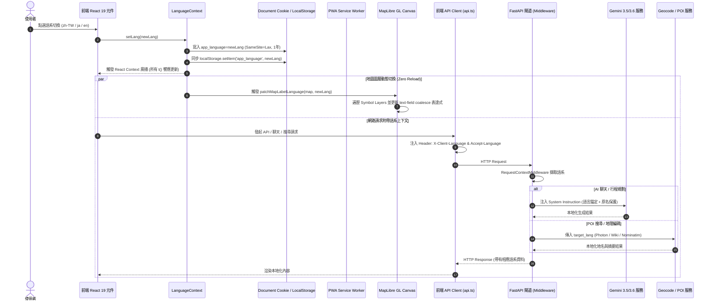

# Tabidachi 全鏈路多語系架構升級調研報告 (2026)
> 本報告作為匯入 NotebookLM 進行獨立研究與多輪驗證之 Knowledge Base 素材包。
> 涵蓋範圍：Next.js 16 PWA、MapLibre GL 向量圖塊動態切換、FastAPI 後端路由、Gemini/LLM 語系錨定與地理編碼 (Geocoding)。

---

## 壹、核心技術流程 (Core Execution Flow & Topology)

### 1. 全端語系信號流生命週期 (Full-Stack Language Lifecycle)
在現代化 Local-First PWA 架構下，全端語系信號流必須維持「單一真實來源 (Single Source of Truth)」，並兼顧零佈局偏移 (Zero-CLS) 與伺服器端渲染 (SSR) 支援：



### 2. PWA 離線單一 Shell 與 Zero-FOUC 水合流程
- **架構決策**：在 Next.js 16 App Router 中，避免使用子路徑路由（如 `/[locale]/...`），統一採用根路由 + Cookie / Client State 驅動。
- **Zero-FOUC 注入機制**：在 `app/layout.tsx` 的 `<head>` 區段注入極小型的同步 inline script，於瀏覽器繪製 DOM 前讀取 cookie 或 localStorage，立即修正 `<html lang="...">` 與根元素 class，防止水合階段出現字體或語系閃爍。
- **編譯期 TypeScript 字典 (Zero-Runtime-Fetch)**：翻譯資料以模組化 TS 檔案（`core.ts`, `timeline.ts`, `expense.ts`, `chat.ts` 等）靜態打包進 Bundle，具備完全的 Template Literal Types 檢查，在 PWA 離線狀態下 100% 具備完整字典，不需向伺服器非同步拉取 JSON 檔。

### 3. MapLibre 向量圖塊動態標籤拓撲重編排 (`patchMapLabelLanguage`)
- **無重載熱切換 (Zero Tile Reload)**：MapLibre GL 支援在運行時直接調用 `map.setLayoutProperty(layerId, 'text-field', expression)`。這避免了呼叫 `map.setStyle()` 導致整個 WebGL Canvas 上下文重建、瓦片重新下載與白屏閃爍。
- **過濾機制 (Filter Pipeline)**：
  1. 僅針對 `layer.type === 'symbol'`。
  2. 檢查 `layer.layout['text-field']` 是否引用了 `name` 相關欄位。
  3. **道路盾牌與編號保護**：若 layout 包含 `ref`, `shield`, `route`, `network` 等特徵，嚴格排除，避免國道/高速公路編號（如「國道1號」「E1」「Route 66」）被強制替換成地名。

---

## 貳、網路大神爭議點與避坑指南 (Debates, Gotchas & Edge Cases)

### 1. 路由架構之爭：Subpath (`/[locale]/...`) vs. Cookie-Based
- **官方 / SEO 推薦做法**：Vercel 與 next-intl 官方指南在常規網站上強烈推薦 Subpath，因為便於 Googlebot 抓取各語系的 URL。
- **大神實戰踩坑紀錄 (X / Reddit / V2EX 2025-2026)**：
  - **PWA Service Worker 快取風暴**：Subpath 模式會導致 PWA Service Worker 必須為 `/zh-TW/`, `/ja/`, `/en/` 分別快取完全相同的靜態 HTML Shell。當用戶離線啟動 PWA 時，如果 URL 因重導向未完全匹配已快取路徑，將直接觸發「離線恐龍頁 (Offline Dino Page)」。
  - **動態參數長度爆炸**：旅遊類應用通常在 URL 攜帶多天行程 ID、經緯度、日期範圍等查詢參數。若疊加語系前綴，在跨平台（LINE、WeChat、社群預覽）分享時容易產生無效 URL 或多次 301/302 跳轉導致快取失效。
  - **結論**：對於高度互動型、本地離線優先 (Local-First) 的 PWA 工具，採用 **Cookie-Based + Single URL Shell** 是保證極限秒開與離線可靠性的最優解。

### 2. MapLibre 向量瓦片語言切換之暗坑
- **CJK 豆腐塊 (Missing Glyphs □□□)**：
  - 開源向量圖資（如 OpenFreeMap, Carto, OpenMapTiles）的 Glyphs 字體堆疊多為英文字型（如 `Open Sans Regular`）。當切換到中文繁體或日文時，若 MapLibre 未配置 `localIdeographFontFamily` 或合適的 CJK 字型堆疊，WebGL 將無法渲染漢字與假名，全部退化為方塊豆腐。
  - **解法**：在 Map 初始化時指定 `localIdeographFontFamily: 'sans-serif'`，讓瀏覽器本地 OS 向量字型引擎渲染 CJK 字符；並在 `patchMapLabelLanguage` 中動態修正 `text-font`。
- **圖資 Tag 不一致 (OpenStreetMap Historic Tags)**：
  - OSM 歷史資料中，中文字段存在 `name:zh-Hant`, `name:zh-TW`, `name:zh_hant`, `name:zh`, `name:latin` 等多種非標準命名。
  - **解法**：必須採用多階梯 `coalesce` 表達式：
    ```json
    ["coalesce", ["get", "name:zh-Hant"], ["get", "name:zh-TW"], ["get", "name:zh"], ["get", "name:en"], ["get", "name:latin"], ["get", "name"]]
    ```

### 3. LLM / Gemini 語言漂移 (Language Drift) 與專有名詞災難
- **現象**：
  - 當用戶與 AI 助手對話時，若輸入中夾雜日文景點名稱（如「澀谷 Sky」、「清水寺」）或英文航班代號（如「NH852」），Gemini 會錯誤判定對話語系，並在後續幾輪自動切換為英文或簡體中文。
  - 另一極端是「過度翻譯 (Over-Translation)」：模型擅自將日本地標直譯為不知所云的中文或英文（例如將「六本木ヒルズ」直譯成奇怪詞彙，導致用戶在 Google Maps 找不到）。
- **解法 (System Instruction 雙重錨定架構)**：
  1. **頂層優先級語言宣告**：在 System Instruction 首行明確宣告當前前端語系：
     `[CRITICAL OUTPUT LANGUAGE]: You MUST output your final conversational response strictly in {client_language} (e.g., zh-TW Traditional Chinese).`
  2. **專有名詞原名保護 (Original POI Preservation)**：
     `[PROPER NOUN INTEGRITY]: Always preserve the original Japanese Kanji/Kana name alongside the translation (e.g., "清水寺 (Kiyomizu-dera)"). Never fabricate or phonetically corrupt official location names.`

---

## 參、GitHub 原始碼層級驗證 (Source-Code Verification)

### 1. 開源成熟實作比對 (`sucary/achizu`: `labelLanguage.ts`)
經由 GitHub MCP 調研之實際生產程式碼，驗證出關鍵實作邏輯：
- **安全圖層過濾 (Shield Protection)**：
  ```typescript
  const referencesRouteOrShield = (value: unknown): boolean => {
      if (typeof value === 'string') return /\b(ref|shield|route|network)\b/i.test(value);
      if (Array.isArray(value)) return value.some(referencesRouteOrShield);
      if (value && typeof value === 'object') return Object.values(value).some(referencesRouteOrShield);
      return false;
  };
  ```
  *證實*：未過濾 `shield` 的圖層切換會破壞地圖道路編號標籤。
- **日文與繁中 Fallback 梯隊**：
  ```typescript
  // ja: name:ja -> name_ja -> name -> name:en -> name_en -> name:latin
  // zh-Hant: name:zh-Hant -> name_zh-Hant -> name:zh-TW -> name:zh -> name:en -> name
  ```

### 2. Tabidachi 現有程式碼盲區與破綻審核 (Audit Findings)

| 模組 / 檔案 | 目前現狀 | 破綻與降級風險 | 升級目標 |
| :--- | :--- | :--- | :--- |
| `frontend/lib/LanguageContext.tsx` | 僅支援 `'en' \| 'zh'` | 缺少日本旅遊核心語言 `'ja'`；`formatDate` 僅簡單以 `toLocaleDateString` 輸出 | 擴充為 `'zh' \| 'ja' \| 'en'`，並整合完整 `Intl` 格式化模組 |
| `frontend/lib/constants.ts` | 寫死 `CHINESE_LABEL_EXPRESSION` | 地圖永遠強制繁體中文，切換為英文或日文時地圖毫無反應 | 替換為動態產生 `getMapLabelExpression(lang)` |
| `frontend/components/day-map.tsx` | 僅在 onLoad 呼叫一次 `setLayoutProperty` | 語系切換時地圖不更新，需重新整理頁面才可能生效 | 監聽 `lang` 變化，以 `patchMapLabelLanguage` 熱更新圖層 |
| `frontend/lib/api.ts` | 未傳遞 `X-Client-Language` 標頭 | 後端無法得知用戶當前語系，永遠視為預設語系 | 封裝全域 fetcher，自動夾帶 `X-Client-Language` 與 `Accept-Language` |
| `frontend/components/chat-widget.tsx` | 傳入 `client_time`, `client_timezone` 但無 `client_language` | AI 無法得知前端語系，易發生語言漂移 | 注入 `client_language: lang` 至 Chat API Payload |
| `backend/services/geocode_service.py` | 寫死 `"Accept-Language": "zh-TW,zh,en"` | 無法根據用戶當前語系返回日文/英文 POI 建議與地址 | 依請求標頭動態調整查詢語系 |
| `backend/services/poi_service.py` | 寫死 `poi["resolved_language"] = "zh-TW"` | 維基百科與 Wikidata 摘要永遠抓取繁體中文 | 依請求語系動態查詢 Wikipedia API (zh.wikipedia / ja.wikipedia / en.wikipedia) |

---

## 肆、功能性對應「全面轉換」實施矩陣 (Full Functional Coverage Matrix)

為滿足「不能只是半吊子」的要求，語系切換必須覆蓋以下 6 大維度：

1. **靜態 UI 與按鈕文字**：全站字典擴充補齊 `zh` (繁中), `ja` (日文), `en` (英文)。
2. **向量地圖底圖 (MapLibre)**：POI、道路、地名標籤熱切換，保留道路盾牌，CJK 字型不缺漏。
3. **AI 智慧助手與行程生成**：System Instruction 強制綁定語系、動態行程生成輸出相應語言。
4. **地理搜尋與 POI 檢索 (Geocoding & Wiki)**：Photon, Nominatim, Wikipedia, Wikidata 依照當前語系反解。
5. **本地化格式引擎 (Localization Engine)**：
   - 日期與時間格式（日本年號/格式、中文年月日、西曆格式）。
   - 幣別與匯率格式（JPY ¥, TWD NT$, USD $）。
   - 相對時間（「3 分鐘前」、「剛剛」、「3分前」）。
6. **使用者自訂資料動態翻譯 (UGC Translation Integration)**：
   - 行程中用戶輸入的中文備註，在切換到日文/英文時提供一鍵 AI 即時翻譯或雙語對照展示。
