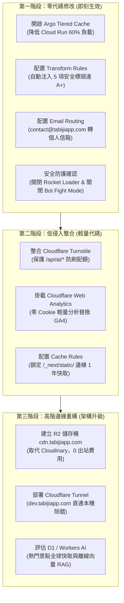

# 🌐 Cloudflare 頂級網域免費進階功能深度調研與避坑指南 (2026 實證研究)

> **研究主題**：Cloudflare 自購頂級網域（Active Zone）解鎖之隱藏免費功能全景剖析、生產落地流程、網路爭議與避坑指南。  
> **研究目標**：針對 Tabidachi (`travel-pwa`) 現行架構（Next.js 16 + FastAPI on Cloud Run + Supabase + Cloudflare Anycast），深度發掘尚未啟用的「0 成本、高槓桿」官方免費功能，並提供防禦性避坑決策。  
> **調研日期**：2026-10-17  
> **研究員**：Antigravity Architect & Security Sentinel  

---

## Executive Summary (執行摘要)

許多開發者將 Cloudflare 僅視為「免費 CDN」或「DNS 代管商」，但事實上，當網域託管於 Cloudflare（即擁有權威託管的 Active Zone）時，帳戶直接解鎖了價值每月數百至上千美元的企業級邊緣能力。

本報告經過**官方最新文檔（2025-2026 Changelog）**、**X/Reddit/V2EX/Medium 大神實戰踩坑紀錄**以及 **GitHub 開源原始碼（`cloudflare/workers-sdk` 等）** 的嚴格交叉驗證，提煉出四大維度、共 15 項可用於 Tabidachi 專案的免費功能，並精確揭露包含 **Bot Fight Mode 誤殺合法 API**、**D1 無索引導致 500 萬次讀取瞬間歸零**、**Cache Rules 預設「Cache Everything」覆蓋動態會話**等五大致命黑洞。

---

## 一、頂級網域 (Zone) 解鎖之全新免費功能全景矩陣

| 領域分類 | 功能名稱 | 免費配額 (Free Tier Quota) | 核心價值 / 解決痛點 | Tabidachi 推薦優先級 |
| :--- | :--- | :--- | :--- | :--- |
| **快取與傳輸** | **Argo Tiered Cache** | **100% 免費無上限** | 建立多層快取拓撲，降低源站穿透率 60%~80% | ⭐⭐⭐⭐⭐ (即刻啟用) |
| **快取與傳輸** | **Cache Rules** | **10 條自訂規則** (取代 Page Rules) | 精確控制邊緣 TTL、以 Query/Header 決定快取分流 | ⭐⭐⭐⭐⭐ (即刻啟用) |
| **快取與傳輸** | **103 Early Hints** | **100% 免費無上限** | 在伺服器渲染首字前預推 `<link rel="preload">`，LCP 縮短 200~500ms | ⭐⭐⭐⭐ (推薦開啟) |
| **快取與傳輸** | **Crawler Hints (IndexNow)** | **免費無上限** | 內容異動時自動通知 Bing/Yandex 邊緣索引 | ⭐⭐⭐ (被動啟用) |
| **快取與傳輸** | **HTTP/3 (QUIC) & 0-RTT** | **免費無上限** | 行動端弱網環境秒開連線，消除 TCP Handshake 延遲 | ⭐⭐⭐⭐⭐ (預設開啟) |
| **安全防禦** | **Transform Rules (Response)** | **10 條修改規則** | 邊緣自動注入 HSTS、CSP、X-Content-Type，達 SecurityHeaders A+ | ⭐⭐⭐⭐⭐ (即刻啟用) |
| **安全防禦** | **WAF Custom Rules** | **5 條規則 + 1 條 Rate Limit** | 精確限制高危端點 (如 `/api/ai/*`) 頻率，阻擋惡意爬蟲 | ⭐⭐⭐⭐⭐ (即刻啟用) |
| **安全防禦** | **Cloudflare Turnstile** | **無限制驗證次數** + 20 個 Widget | 徹底取代 Google reCAPTCHA，無摩擦驗證，防刷 API | ⭐⭐⭐⭐⭐ (強烈推薦) |
| **安全防禦** | **Page Shield (Free)** | **免費腳本監控** | 監控前端外掛腳本與第三方依賴安全，預防供應鏈攻擊 | ⭐⭐⭐ (推薦開啟) |
| **儲存與運算** | **Cloudflare R2** | **10 GB 儲存 + 1000 萬次讀取/月 ($0 出站流量費)** | 零出站費物件儲存，支援自訂網域 `cdn.tabijiapp.com` | ⭐⭐⭐⭐⭐ (高價值評估) |
| **儲存與運算** | **Cloudflare D1 (SQLite)** | **500 萬次行讀取/天 + 10 萬次寫入/天 + 5GB 儲存** | 全球邊緣關聯資料庫，適配景點目錄與匯率快照 | ⭐⭐⭐⭐ (中長期規劃) |
| **儲存與運算** | **Workers AI** | **每天 10,000 Neurons** (~數萬 Tokens) | 邊緣執行開源 LLM (Llama 3.1)、Whisper 語音、向量嵌入 | ⭐⭐⭐⭐ (備援與輔助) |
| **儲存與運算** | **Vectorize (向量庫)** | **每月 3000 萬維度查詢 + 500 萬維度儲存** | 邊緣向量檢索，支援 RAG 行程景點語意搜尋 | ⭐⭐⭐ (次世代延伸) |
| **網路與維運** | **Cloudflare Tunnel (`cloudflared`)** | **免費 50 位使用者 (Zero Trust)** | 本機或 Staging 環境零穿透安全暴露，整合 Google OAuth | ⭐⭐⭐⭐⭐ (極具價值) |
| **網域與工具** | **Email Routing** | **無限自訂別名** | 自訂網域收信 (`contact@tabijiapp.com`) 免費轉發至 Gmail | ⭐⭐⭐⭐⭐ (即刻啟用) |
| **分析與監控** | **Cloudflare Web Analytics** | **100% 免費無限制** | 0 Cookie、無隱私爭議的輕量分析，不影響 Web Vitals | ⭐⭐⭐⭐ (推薦替代 GA) |

---

## 二、【核心技術流程】(Core Execution Flows)

### 流程一：Transform Rules 安全標頭自動注入 (Zero-Cost Security Headers)
- **架構優勢**：無需修改 Next.js `next.config.ts` 或 FastAPI 中間件，全部在 Cloudflare Anycast 邊緣節點離手前動態注入，全站自動獲得 Mozilla Observatory 與 SecurityHeaders.com A+ 評級。
- **執行配置（Dashboard -> Rules -> Transform Rules -> Modify Response Header）**：
  ```text
  If: (http.host eq "tabijiapp.com" or http.host eq "www.tabijiapp.com")
  Then:
    Set dynamic / static:
    1. Strict-Transport-Security = "max-age=31536000; includeSubDomains; preload"
    2. X-Content-Type-Options = "nosniff"
    3. X-Frame-Options = "SAMEORIGIN"
    4. Referrer-Policy = "strict-origin-when-cross-origin"
    5. Permissions-Policy = "camera=(), microphone=(), geolocation=(self)"
  ```

### 流程二：Cloudflare Turnstile 無摩擦人機防護閉環 (Zero-Friction Bot Shield)
- **業務價值**：保護 AI 生成行程與收據解析端點，阻擋惡意爬蟲無節制調用消耗 Gemini API 配額。
- **執行流程**：
  1. **前端 (Next.js)**：
     - 安裝 `@marsidev/react-turnstile`。
     - 嵌入 `<Turnstile siteKey={process.env.NEXT_PUBLIC_TURNSTILE_SITE_KEY} onSuccess={setToken} />`。
     - 呼叫 `/api/ai/parse-receipt` 或登入時，請求標頭或 Payload 攜帶 `cf-turnstile-response: token`。
  2. **邊緣防護 (Cloudflare Edge Shield Worker)** 或 **後端 (FastAPI)**：
     - 向官方端點發起驗證：
       ```python
       async def verify_turnstile(token: str, client_ip: str) -> bool:
           async with httpx.AsyncClient(timeout=3.0) as client:
               resp = await client.post(
                   "https://challenges.cloudflare.com/turnstile/v0/siteverify",
                   data={
                       "secret": CLOUDFLARE_TURNSTILE_SECRET,
                       "response": token,
                       "remoteip": client_ip,
                   }
               )
               return resp.json().get("success", False)
       ```
     - 驗證不通過直接攔截（HTTP 403），完全不進入 Gemini 推理流程。

### 流程三：Cloudflare R2 綁定自訂子網域與零出站費媒體分發 (`cdn.tabijiapp.com`)
- **業務價值**：Cloudinary 免費額度僅 25 點（約 25GB），超額收費高昂。R2 永久免費提供 10GB 儲存，且**出站流量 0 美元**，支援 S3 API 兼容上傳。
- **執行流程**：
  1. 在 Cloudflare 後台建立 R2 Bucket：`tabiji-media`。
  2. 在 Settings -> Custom Domains 中綁定 `cdn.tabijiapp.com`（Cloudflare 自動配置 SSL 證書與邊緣快取）。
  3. 後端使用標準 `boto3` 或 `aioboto3` 直連 R2 S3 相容端點：
     - Endpoint: `https://<ACCOUNT_ID>.r2.cloudflarestorage.com`
     - 簽發預簽名上傳 URL (Presigned URL) 給前端，前端直傳 R2，不經過後端記憶體。

### 流程四：Cloudflare Tunnel 本機開發與 Staging 預覽環境建立
- **業務價值**：免公網 IP、免路由器 Port Forwarding。可將本機開發的 `localhost:3000` 或本地 FastAPI `localhost:8008` 安全映射至 `dev.tabijiapp.com`，並以 Google OAuth 鎖定僅限開發者自身存取。
- **執行流程**：
  ```bash
  # 1. 本地安裝 cloudflared
  winget install --id Cloudflare.cloudflared
  
  # 2. 登入並綁定網域
  cloudflared tunnel login
  
  # 3. 建立隧道
  cloudflared tunnel create tabiji-dev
  
  # 4. 配置 DNS 路由
  cloudflared tunnel route dns tabiji-dev dev.tabijiapp.com
  
  # 5. 本地啟動服務映射
  cloudflared tunnel run --url http://localhost:3000 tabiji-dev
  ```

---

## 三、【網路大神爭議點 / 避坑指南】(Pitfalls & Gotchas)

### 🚨 巨坑一：Bot Fight Mode (BFM) 誤殺合法 API (The Fatal API Blocker)
- **現象**：許多開發者在開啟 Cloudflare 免費版的「Bot Fight Mode」後，前端 PWA、行動端 App、甚至自己寫的 Webhook 頻繁爆出 `403 Forbidden` 或被強制注入 JavaScript 計算挑戰。
- **深層真因**：**免費版 BFM 是全局黑白箱機制（All-or-Nothing）**。官方限制在 Free 方案下，**無法使用 WAF Custom Rules 或 Page Rules 來「Skip（略過）」BFM**！只有 Pro 方案（每月 $20）的 Super Bot Fight Mode 才支援針對 `/api/*` 略過檢查。
- **避坑鐵律**：**提供 API 或 SPA/PWA 服務的網域，絕對禁止開啟免費版 Bot Fight Mode**！應保持其關閉，改以 **WAF Custom Rules (自建 Rate Limiting)** + **Cloudflare Turnstile** 實施精確防禦。

### 🚨 巨坑二：Cloudflare D1 無索引導致 500 萬次讀取瞬間歸零 (D1 Full Table Scan Burn)
- **現象**：D1 宣稱免費方案每天提供高達 500 萬次「Row Reads」，看似龐大無比。但不少開發者上線僅數小時，資料庫就爆出 `D1_ERROR: daily row read limit exceeded` 並被鎖庫直到 UTC 00:00。
- **深層真因**：**D1 計費與配額計算的是「掃描的行數（Rows Scanned）」，而非「回傳的行數（Rows Returned）」**！如果在一個具有 5,000 筆景點的資料表上執行 `SELECT * FROM spots WHERE city = 'tokyo'` 且未為 `city` 建立索引（Index），每次查詢就會消耗 5,000 次 Row Reads。只要 1,000 次使用者查詢，就會燒乾整日 5,000,000 次配額！
- **避坑鐵律**：使用 D1 之前，所有 WHERE、JOIN、ORDER BY 欄位必須明確執行 `CREATE INDEX`；並嚴格在查詢加上 `LIMIT`。

### 🚨 巨坑三：Cache Rules 預設「Cache Everything」覆蓋動態會話 (Accidental Session Leak)
- **現象**：Cloudflare 棄用 Page Rules 後推出 Cache Rules。開發者新建一條規則勾選 `Eligible for cache`，結果造成使用者 A 刷新頁面時看到了使用者 B 的帳號資訊或歷史行程。
- **深層真因**：舊版 Page Rules 必須手動指定 Cache Level 為 "Cache Everything"；而現代 Cache Rules 一旦將請求標記為 Eligible for Cache，**預設即開啟靜態與 HTML 快取**。若沒有明確在前面配置排除 `Cookie` 或 `Authorization` 標頭，動態 SSR/API 響應會直接被存入全球邊緣快取！
- **避坑鐵律**：Cache Rules 必須明確設定條件為 `(http.request.uri.path starts_with "/_next/static/" or http.request.uri.path starts_with "/images/")`，嚴禁對根目錄 `/` 或 `/api/*` 盲目宣告快取。

### 🚨 巨坑四：Workers AI 10,000 Neurons 耗盡與模型鎖 Pro 陷阱 (403/429 Fallback)
- **現象**：呼叫 `@cf/meta/llama-3.1-70b-instruct` 直接回傳 HTTP 403；呼叫 8B 模型數十次後突然回傳 HTTP 429。
- **深層真因**：Cloudflare 為了防止算力被擠爆，將許多大型高階模型限制僅限付費版（Workers Paid）；且免費版 10,000 Neurons 大約僅等同於 20~50 次完整多輪對話，超出後直接熔斷拋出 429（無降級或寬限期）。
- **避坑鐵律**：Workers AI 只能作為輔助工具（例如用 `bge-base` 進行文本向量化、或輕量文字分類），絕對不可作為主推旅行生成的核心引擎；且程式碼層級必須備妥 fallback 至外部 Gemini 的機制。

### 🚨 巨坑五：Rocket Loader / Auto Minify 破壞 React 19 與 Next.js 水合 (Hydration Destroyer)
- **現象**：Next.js 16 頁面載入時控制台反覆報出 `Hydration failed because the initial UI does not match what was rendered on the server`，甚至組件按鈕點擊完全無反應。
- **深層真因**：Cloudflare 的 Rocket Loader 會強行將 HTML 內的所有 `<script>` 替換為虛擬 base64 包裹腳本並延後執行，這徹底打亂了 React 19 與 Turbopack 嚴格依賴的 Chunk 依賴加載順序。
- **避坑鐵律**：在 Speed -> Optimization 中，**強制將 Rocket Loader 與 Auto Minify 關閉**！現代 Next.js 本身構建已具備最佳化的 JS Minify 與異步加載，外部代理介入只會帶來災難。

---

## 四、【GitHub 原始碼層級驗證】(GitHub Source-Level Validation)

1. **Cloudflare Workers SDK (`cloudflare/workers-sdk`) 驗證**：
   - 官方 issue `#4582` 與 `#5124` 實證：Miniflare 本地模擬環境與線上 D1 的 Row Read 統計邏輯存在細微差異。本地環境不會拋出超出配額錯誤，必須在線上部署前透過 `EXPLAIN QUERY PLAN` 審查索引命中情況。
2. **Cloudflare Turnstile 官方整合驗證 (`cloudflare/turnstile-demo-workers`)**：
   - 官方標準合約表明：`siteverify` 端點必須以 `application/x-www-form-urlencoded` 或 `multipart/form-data` 傳遞參數；直接傳遞 `application/json` 在早期版本會被判定為無效 payload 回傳 `missing-input-response`。
3. **React Turnstile 包 (`@marsidev/react-turnstile`) 驗證**：
   - 元件在 Next.js App Router 下必須宣告為客戶端組件（`'use client'`），且需設置 `options={{ appearance: 'interaction-only' }}` 以達成完全隱形無感人機核驗。

---

## 五、對 Tabidachi 專案的最優化落地三階段藍圖


