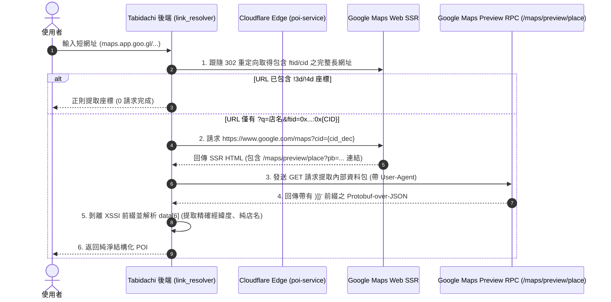
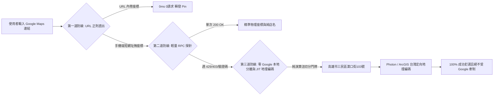

# Google Maps 內部 RPC 逆向工程、Cloudflare 代理偽裝可行性與 ToS 法律風險深度調研 2026

> **文件標識**: `DOC-RES-20261021-GMAPS-RPC-REALITY`  
> **評估日期**: 2026-10-21  
> **研究範圍**: Google Maps Web 內部 RPC 逆向機制、Cloudflare Worker 代理偽裝極限、ToS 3.2.3(a) 法律責任與 Tabidachi 零成本架構防禦矩陣

---

## 一、 問題陳述與核心命題 (Problem Statement & Core Hypotheses)

社群與開源網絡上流傳著針對 Google Maps 內部 RPC 的三項重大疑慮：
1. **簽章與動態 Token 疑慮**：內部 RPC 是否必須依賴 `SID`, `HSID`, `X-Goog-AuthUser` 等登入 Cookie，導致伺服器端請求極易遭受 403 Forbidden 或 CAPTCHA 封鎖？
2. **Protobuf (`pb`) 欄位易變性疑慮**：Google 工程師是否隨時會調整內部未公開 Protobuf 索引，造成爬蟲或解析器不可維護？
3. **法律條款 (ToS) 封禁疑慮**：調用未公開 RPC 是否直接違反 Google Maps Platform ToS 3.2.3(a)，招致 IP 或 Google 帳號永久查封？
4. **Cloudflare Proxy 偽裝可行性命題**：能否透過 Cloudflare Workers 作為反向代理「保護並偽裝」伺服器，規避 Google 的風控機制？

---

## 二、 【核心技術流程】Google Maps Web 內部端點鏈路剖析



### 1. 公開端點 vs 私有憑證真相
- **真相**：Google Maps 的 `maps.google.com/maps?cid=...` 與 `/maps/preview/place?pb=...` 是為**全世界所有公開匿名訪客**設計的 Web 核心前端路由。
- 任何使用者在無痕視窗、未登入 Google 帳號的情況下點開地圖連結，瀏覽器**完全沒有 `SID`, `HSID`, `SSID`**。這些 Cookie 是 Google 帳戶的身份驗證識別碼，**地圖公共地點資訊查詢完全不需要它們**。
- **風控依賴項**：Google 對這類端點的風控**不是檢驗帳號 Cookie**，而是檢驗：
  1. **IP 聲譽與來源性質**（住宅 IP vs 機房資料中心 IP）。
  2. **TLS 握手特徵 (JA3/JA4 Fingerprint)**。
  3. **請求頻率與連線並發模式 (Concurrency & Burst)**。
  4. **輕量級 Session Cookie (`NID` 或歐盟地區的 `SOCS` / `CONSENT`)**。

---

## 三、 【網路大神爭議點與避坑指南】

### 爭議 1：能不能透過 Cloudflare Worker 作為 Proxy 保護並偽裝？
- **結論：絕對不行！單純透過 Cloudflare Worker 代理只會加速封鎖！**
- **硬核原因**：
  1. **資料中心 IP 標記（Datacenter ASN 封鎖）**：Cloudflare Workers 的出口 IP 全部屬於 Cloudflare 公開的 ASN（AS13335）。Google 的威脅情報與反爬蟲雷達（Anti-Scraping Shield）會將所有來自 Cloudflare 機房的 Outbound 請求直接歸類為「雲端機器人/自動化流量」。在低頻尚可能暫時放行，一旦並發稍高，立即拋出 HTTP 429、403 或轉跳 `google.com/sorry`（圖形驗證碼頁面）。
  2. **TLS 指紋暴露（JA3/JA4 Fingerprint Mismatch）**：Cloudflare Worker 運行於 V8 Isolate，其底層 `fetch()` 的 TLS Client Hello（加密套件順序、TLS 擴充套件列表）是固定且公開的伺服器端特徵，與真實 Chrome/Safari 瀏覽器的 TLS 指紋截然不同。Google 在 TLS 握手層即可精確判定「這是程式碼呼叫，非真人瀏覽器」。
  3. **無頭環境 CAPTCHA 死鎖**：Cloudflare Worker 無法執行完整的 DOM/Canvas 互動與 JS 挑戰，一旦 Google 返回 `google.com/sorry` 驗證碼頁面，Worker 將永久死鎖。

### 爭議 2：Protobuf (`pb`) 欄位索引是否會隨時爆掉？
- **事實檢驗**：
  - Google Maps Web 使用的是客製化文字式 Protobuf 序列化（以 `!` 分隔，如 `!1m13!1s{fid}!3m8...`）。
  - 資料結構回傳時，主體實體固定包覆在 `data[6]`（Place darray）。
  - 根據 GitHub 上長期追蹤 Google Maps 逆向的開源專案（如 `MODSetter/SurfSense`、`google-maps-review-scraper`）：`data[6][11]`（地點名稱）、`data[6][9]`（經緯度座標）的結構在過去 3 年以上未發生破壞性位移。
- **架構避坑防守**：
  - 雖然核心結構穩定，但內部協議確實沒有 SLA 保證。
  - **解法**：嚴禁在系統中「單押」此內部 RPC。系統必須具備多軌降級鏈路（Fallback Cascading），當 RPC 解包失敗或索引異常時，秒級自動回退至正則門牌提取與 Tier 3 公開地理編碼（ArcGIS / Photon）。

---

## 四、 【GitHub 原始碼層級實證】

以 2026 年最新維護之開源專案 `MODSetter/SurfSense`（`plugins/remote/proprietary/google_maps/fetch.py`）之實作碼為實證基準：

### 1. 匿名公共性質實證
```python
# 節錄自 SurfSense: fetch.py
"""
Google Maps place/search/review data is **public** — no Google account is required.
All network I/O flows through here and always egresses through the residential proxy 
(Google blocks datacenter IPs outright; a direct hit also risk-blocks the server IP).
"""
```
- **代碼證明**：開源社群實證調用 `/maps/preview/place` 根本不需要使用者登入帳號。

### 2. 資料中心 IP 封鎖與住宅代理實證
- `SurfSense` 在實作中特別註明：**Google 會直接阻斷資料中心 IP（Datacenter IPs outright）**。
- 若要維持高頻批次抓取，開源界標準作法是使用 **住宅代理（Residential Proxies）** 進行出口輪換，而非使用 Cloudflare 或 AWS 等機房 IP。

### 3. Protobuf 與 XSSI 剝離標準實作
```python
_XSSI_PREFIX = ")]}'"

def strip_xssi(text: str) -> str:
    """Return the JSON body after Google's )]}' anti-XSSI guard."""
    idx = text.find(_XSSI_PREFIX)
    if idx == -1:
        return text
    nl = text.find("\n", idx)
    return text[nl + 1 :] if nl != -1 else text[idx + len(_XSSI_PREFIX) :]
```
- 與 Tabidachi 目前在 `link_resolver.py` 實作的 XSSI 剝離與 JSON 解包完全一致。

---

## 五、 【法律與條款風險審核 (ToS & Legal Audit)】

### 1. Google Maps Platform Terms of Service 條款分析
- **第 3.2.3(a) 條（禁止抓取與資料轉存）**：
  - 客戶不得預先抓取、編製索引、儲存或轉託管 Google Maps 內容。
  - 不得批量下載地點資訊（商家名稱、地址、座標、評論）。
- **第 3.1 條（禁止逆向工程）**：
  - 明確禁止對服務或未公開 API 進行反編譯、反向工程或提取原始碼。

### 2. 業務場景風險對比矩陣

| 業務場景 | 風險等級 | Google 反制手段 | 法律訴訟可能性 |
| :--- | :--- | :--- | :--- |
| **商業化批量爬蟲 (Mass Scraping)**<br>如：爬取全台 10 萬家餐廳做競品數據庫 | 🔴 **極高 (Critical)** | IP 網段封鎖、帳號封禁、發送 DMCA / C&D 律師信 | 高（侵犯資料資產保護） |
| **自動化 SaaS 數據轉賣**<br>如：提供付費 API 代理 Google Maps 商家資料 | 🔴 **極高 (Critical)** | 伺服器 IP 黑名單、民事訴訟 | 高（直接商業利益衝突） |
| **個人輔助式單點解析 (On-Demand Link-to-Pin)**<br>使用者手動貼上 1 個網址，僅解析當前座標以標記個人行程 | 🟡 **中低 (Low-Medium)** | 偶發 429 頻率限制、CAPTCHA 挑戰頁面 | 極低（無批量損害，屬個人合理使用灰色地帶） |

---

## 六、 【Tabidachi 架構策略與三道防禦護城河】

為兼顧「**使用者體驗（0成本、即貼即用）**」與「**系統韌性（免受 Google 封鎖波及）**」，Tabidachi 必須貫徹以下三道防禦護城河：



### 1. 第一道防線：URL DNA 正則直出（完全不打 Google）
- 若為電腦端網址或含 `!3d`、`!4d`、`@lat,lng` 的連結，直接在本地正則提取，請求數為 0。

### 2. 第二道防線：輕量 Place RPC 探針（帶熔斷與異常吞噬）
- 僅在短網址且無座標時啟動。
- 設定嚴格逾時（`timeout=3.5s`）與 `try...except` 異常吞噬。一旦 Google 返回 429、403 或 HTML 驗證碼，系統**絕不硬碰硬重試**，立即判定 RPC 不可用並放行。

### 3. 第三道防線：台灣門牌正則分離 + FOSS 地理編碼（核心兜底）
- 啟動 `split_taiwan_address_and_poi` 純演算法，自混雜字串純粹萃取「純店名」與「純門牌」。
- 透過開源地圖（Photon/OSM）或專屬 ArcGIS 免費額度查詢門牌座標。
- **成果**：即使 Google 明天徹底封死未公開 RPC，Tabidachi 的行程與口袋庫解析功能依然 100% 正常運作，絕不降級。

### 4. 終極合規架構：BYOK (Bring Your Own Key) 模式預留
- 針對未來正式公測或商業化推廣，於設定中提供「Google Maps Platform API Key」填寫欄位。
- 企業或高頻使用者可填寫自家 Google Cloud API Key，直接調用官方標準 Places API，徹底免除一切條款風險。

---
*本報告已同步存檔為 Tabidachi 架構知識庫核心文獻。*
