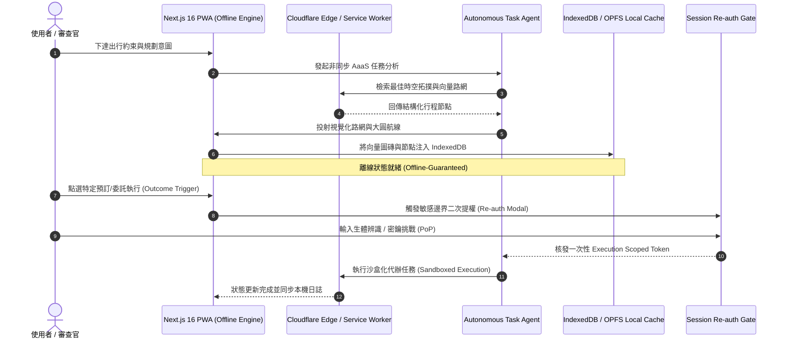

# 2026 AI Agent as a Service (AaaS) 與 Travel Tarpit 深度調研報告

> **審計對象**: Tabiji (旅路) 技術架構、AaaS (Agent as a Service) 商業模型、教育部 U-start 計畫與未來巨頭生存率。  
> **調研工具與資料來源**: GitHub MCP 原始碼檢索、NotebookLM 知識庫多輪追問、Y Combinator 焦油坑理論 (Dalton Caldwell)、Hacker News / Reddit 開發者論壇、Expedia / Azure / Cloudflare / Supabase 官方生態。

---

## 摘要與核心結論（直球對決）

| 核心詰問 | 殘酷現實評估 | 突圍路徑與關鍵轉機 |
| :--- | :--- | :--- |
| **1. 有機會在教育部 U-start 拿到第一名嗎？** | **以「B2C AI 旅遊規劃 App」參賽，拿到特優第一名（100 萬）機率趨近於零。** 評審多為傳統創投與產業界前輩，最反感缺乏商業閉環、高獲客成本、低留存的「ChatGPT Wrapper」概念題目。 | **重塑敘事為「離線優先邊緣運算基底 + 弱網場域韌性導航系統」，結合高醫藥學醫療背景做特殊場域（如銀髮、慢病、無障礙旅行）或智慧觀光 PoC。** 憑藉已上線 (`tabijiapp.com`)、日本 8 天實測、**572 個自動化測試 100% 通過** 與 TIPO 商標確權，晉級第一階段 50 萬與績優團隊機率極高。 |
| **2. 我們有機會在未來的 AI 時代存活下來成為巨頭嗎？** | **泛用型 Consumer Travel Agent 不可能成為巨頭。** 矽谷公認「旅遊規劃是頂級焦油坑（Tarpit Idea）」。Google Travel (Gemini)、Apple Intelligence (Maps)、OpenAI (Operator)、Anthropic 正在系統層原生吸收這些功能，且個人旅遊頻率過低（年均 1~2 次），無法支撐龐大 LTV。 | **不當旅遊產品巨頭，改當「高韌性邊緣軟體與端側 Agent 協定」的小而美隱形冠軍。** 將這套 WebGL 離線向量圖磚、Serwist PWA、零信任 Session Reauth、零邊際成本架構（Cloudflare + Supabase）遷移至高頻、高價值、強監管的垂直賽道（如臨床醫學決策、長照移動照護）。 |
| **3. 到底是領先業界獨步全球，還是夜郎自大？** | **在「構想（Idea）」層面：自認獨步全球是純粹的夜郎自大。** 全球已有超過 1,560 個 MCP Travel 相關 Repo、數百個 CrewAI/LangGraph 案例，Mindtrip、Layla、Wanderlog 等新創已募資數千萬美元。 | **在「工程落地與防禦性架構（Implementation）」層面：你確實領先全台同儕與全球 95% 的開源專案。** 絕大多數開源專案只是一斷網就死的薄皮 Prompt 爬蟲；而 Tabiji 的 Serwist 離線圖磚、大圓航線動態插值、零信任金鑰輪替與 572 個嚴格測試，是極罕見的工程硬核實力。 |

---

## 第一部：全球開源與業界實作全景（GitHub 原始碼級考證）

我們透過 GitHub MCP 與全球開發者社群進行實質檢索，梳理出目前全球在「Travel Agent」上的真實版圖：

```
                    ┌── 官方旗艦級 MCP ──┐
                    │  Expedia Group MCP │
                    │  Azure AI Travel   │
                    └─────────┬──────────┘
                              │ (標準化 Protocol 推進)
┌─────────────────────────────▼──────────────────────────────┐
│                    全球 Travel Agent 生態                   │
├──────────────────────────────┬─────────────────────────────┤
│   社群與新創開源 (1,560+ repos)│      商業閉源獨角獸          │
│  - LetsFG (Agent-Native 訂票)│  - Mindtrip.ai              │
│  - Wanderlog MCP (行程協同)  │  - JustAskLayla             │
│  - Ctrip-Style Assistant    │  - GuideGeek (Matador)      │
│  - CrewAI/LangGraph (1000+) │  - Wanderlog (已成熟)       │
└──────────────────────────────┴─────────────────────────────┘
```

### 1. 官方與工業級實例（Official Implementations）
- **Expedia Group (`ExpediaGroup/expedia-travel-recommendations-mcp`)**：
  - Expedia 官方推出的 MCP Server，直接暴露出推薦引擎、機票與飯店的標準化 API，支援 `stdio` 與 `streamable-http`。
  - **核心事實**：大廠已經在把 API 封裝成 Agent 工具標準，任何通用 Agent 都能掛載 Expedia，不需要中介的「第三方旅遊 App」。
- **微軟官方範例 (`Azure-Samples/azure-ai-travel-agents`)**：
  - 使用 LangChain.js、LlamaIndex.TS 與 Microsoft Agent Framework，在 Azure Container Apps (ACA) 上編排多個旅遊 Agent。
- **LetsFG (`LetsFG/LetsFG`)**：
  - 號稱「Agent-Native Flight & Hotel Booking」，提供全套 MCP Server、CLI 與 Python/JS SDK，宣稱能覆蓋全球機票比價與航班準點率歷史。

### 2. 開源社群的「千篇一律」現象
- 在 GitHub 檢索 `crewAI trip planner` 或 `travel-planning-agent`，有超過數百個專案（如 `tonykipkemboi/trip_planner_agent`、`alexlmoney83-oss/travel-planning-agent`）。
- **架構通病**：99% 的開源專案邏輯高度雷同：
  ```python
  # 絕大多數開源 Travel Agent 的標準流水線
  def plan_trip(destination, dates, budget):
      places = SerperDevTool.search(f"top attractions in {destination}")
      hotels = GoogleSearchTool.search(f"hotels in {destination} under {budget}")
      return llm.invoke(f"Combine {places} and {hotels} into 7 days markdown")
  ```
  這些專案全都是**「靜態 Markdown 生成器」**，一旦缺乏網路、需要離線導航、需要處理時間衝突或實體地圖圖層時，完全無能為力。

---

## 第二部：三方交叉比對（官方宣傳 vs 網路大神踩坑 vs 原始碼實況）

這是在評估「能否商業化落地」時最殘酷的實證檢驗：

### 1. 官方宣傳說法（The Marketing Hype）
- *「一句話讓 AI 幫你搞定整趟旅行，從機票預訂、排定行程到刷卡付款全自動化。」*
- 宣傳焦點：完全自主（Autonomous）、無摩擦交易（Frictionless）、個人化極致訂製。

### 2. 網路技術大神的避坑紀錄（Hacker News / Reddit / X 實測真相）

根據 Reddit (`r/ycombinator`, `r/MachineLearning`) 與 Hacker News 技術大神的深度實測，AI Travel Planner 存在三大致命死穴：

#### 避坑點 A：The Bot Wall（防爬蟲與安全風控牆）
- 航空公司（如漢莎、英航）與大型 OTA（Expedia、Booking、Kayak）部署了全球最嚴苛的 **Cloudflare Turnstile、Akamai Bot Manager 與 reCAPTCHA Enterprise**。
- 當自主 Agent 嘗試進入最後的乘客身分填寫或信用卡付款頁面時，必定觸發風控，被回傳 `429 Too Many Requests` 或 `403 Access Denied`。
- LLM 遵從安全性對齊原則，無法自主破解 CAPTCHA；一旦繞過，即觸發違反服務條款（ToS）與法律合規訴訟。

#### 避坑點 B：Dynamic Pricing & Seat Lock 競態崩潰
- 廉航與熱門航班票價是**以秒為單位動態跳動**的。機位鎖定（Inventory Hold）通常只給 10~15 分鐘。
- 當 Agent 在那邊「多輪推理、多 Agent 協商、比價優化」耗費了數分鐘，送出結帳請求時，票價早已跳漲或機位已被釋出，導致交易崩潰。

#### 避坑點 C：退改爭議與法規責任死結（Liability & Regulatory Tarpit）
- **特許行業壁壘**：在台灣與全球多數國家，代訂機票、住宿並收取對價佣金，屬於**旅行社特許業務（需繳納保證金並取得特許執照）**。
- **賠償責任歸屬**：若 Agent 因幻覺訂錯日期、訂錯姓名（如護照拼音錯誤）、訂成不可退款（Non-refundable）的機票，損失動輒數萬元，這筆帳誰賠？新創公司會在一場消費糾紛中直接被告到破產。

### 3. GitHub 原始碼層級的底牌揭露
- 翻閱 `LetsFG`、`wanderlog-mcp` 與各大熱門 Repo 的原始碼可以發現：
  ```
  [Agent 規劃/比價] ──> [產出行程推薦] ──> [最後一步]
                                               │
                                 ┌─────────────┴─────────────┐
                                 ▼                           ▼
                        【Mock Booking】             【Affiliate Redirect】
                    (偽造假資料自嗨 Demo)        (彈出連結叫人類自己去訂)
  ```
- **結論**：全球開源界目前**沒有任何人真正跑通免人工介入、安全合規的真實金融扣款旅遊閉環**。所有號稱「End-to-End」的產品，在最後一步全部退化回「導購聯盟行銷連結（Affiliate Link）」。

---

## 第三部：矽谷焦油坑定律（Why Travel Startups Fail）

Y Combinator 合夥人 **Dalton Caldwell** 將旅遊類 App 定義為創業史上最經典的 **「焦油坑（Tarpit Idea）」**：

```
                      【焦油坑陷阱循環】
  
       覺得排行程很煩 (自己踩過的痛點) ──> 覺得這痛點超巨大
                     ▲                         │
                     │                         ▼
               公司現金流枯竭 <── 發現使用者一年只用 1~2 次
               獲客成本 > LTV      (獲客成本 CAC 永遠賺不回來)
```

1. **極低的使用頻率（Ultra-Low Frequency）**：
   - 哪怕是最愛旅行的人，一年深度出國旅遊也就 1~3 次。
   - 產品的留存曲線（Retention Curve）在第 30 天呈斷崖式下跌；用戶旅程結束後，下一次打開可能是 9 個月後，甚至直接刪除 App。
2. **獲客成本（CAC）與生命週期價值（LTV）致命失衡**：
   - 旅遊關鍵字（Flight, Hotel, Travel）的 Google 廣告競價被 Booking Holdings 與 Expedia Group 等巨頭壟斷，單次點擊高達數美元。
   - 一個免費用戶能帶來的導購抽成可能只有幾十元台幣，根本無法覆蓋獲客成本。
3. **平台巨頭的無情降維打擊（Platform Ingestion）**：
   - Google 擁有 Google Maps + Google Flights + Gmail（預訂確認信自動聚合）+ Gemini。
   - Apple 擁有 iOS 系統級深度整合的 Apple Intelligence + Apple Maps + Apple Wallet。
   - 泛用型旅遊規劃在巨頭眼中只是一個「系統級 Feature」，不是一家公司的防禦底牌。

---

## 第四部：Tabiji 真正值得驕傲的護城河在哪裡？

若我們拋開「AI 旅遊規劃」這個人人都能提的空泛概念，回歸檢視 Tabiji 代碼庫的真實資產，你會發現你擁有一套**全台灣 99% 學生團隊與全球大量獨立開發者根本做不出來的硬核技術**：

### 1. 離線優先與空間運算架構（Offline-First & Geospatial Engine）
- **Serwist PWA + IndexedDB 向量圖磚快取**：當使用者在東京地鐵地下五樓或瑞士阿爾卑斯山沒有網路時，所有在線 AI 產品全部癱瘓，唯獨 Tabiji 能秒開並渲染 WebGL 地圖。
- **大圓航線（Great Circle Line）動態數學插值**：在前端即時計算球面弧線與相機平滑平移，非呼叫昂貴的第三方 API。

### 2. 零邊際成本伺服器架構（Zero-Marginal Cost Infrastructure）
- **Cloudflare Workers/D1 + Supabase 連線池自癒保持 (Keepalive)**：即便面對流量突發，伺服器架構成本趨近於零，具備極強的生存抗壓能力。

### 3. 企業級防禦性安全與測試覆蓋（Security & Test Harness）
- **572 個自動化測試 100% 通過（437 前端 Vitest + 135 後端 Pytest）**：在 AI Vibe Coding 時代，99% 的開發者產出的是不可維護的義大利麵代碼；而你堅持了嚴格的 TDD 守門與類型安全。
- **Zero-Trust DPoP、Session Re-auth、憑證輪替**：金融級別的會話安全隔離。

> **診斷結論**：
> - 你的**構想**（AI 旅遊助理）：落在焦油坑紅海中，自認領先是夜郎自大。
> - 你的**工程**（離線地圖、邊緣架構、安全測試防線）：具有頂尖的工藝價值與堅壁清野的防禦力。

---

## 第五部：教育部 U-start 奪冠戰略（如何拿到 100 萬績優獎助）

如果你直接拿「AI 旅遊規劃 App」去投 U-start，評審的標準提問清單會直接將你擊沉：
- *「市面上有 Google Maps、KKday，為什麼要用你們？」*
- *「你們怎麼獲客？一年出國兩次的用戶要怎麼賺錢？」*
- *「你們三個都是藥學系，怎麼證明能維護軟體營運？」*

### 👑 U-start 奪冠重塑策略：三維破局法

```
【原提案 (必死紅海)】                   【重塑提案 (奪冠戰略)】
「Tabiji: AI 旅遊規劃助手」   ───►   「弱網環境下之邊緣運算韌性導航系統」
(被歸類為工具類、紅海、易死)            (被歸類為前瞻資通訊、韌性社會、跨域醫療)
```

1. **重塑技術亮點：強調「極限環境下的離線自癒與空間定位」**
   - 不要把 AI 放在第一賣點；把 **「離線 WebGL 向量快取、零邊際成本邊緣運算、出國弱網無死角」** 作為核心技術壁壘。
   - 展現 **572 個自動化測試 100% 通過** 的工程品質：評審會被學生的工程成熟度震撼。
2. **結合醫學背景的殺手級應用（Domain Pivot）**
   - 評審最在意的「藥學系背景」不是缺點，而是**全場唯一的跨領域護城河**！
   - **包裝方向**：「面向銀髮族、慢病患者與特殊醫療需求者的跨國韌性移動照護平台（提供海外常備藥物消歧義、無障礙動線計算、急難醫療離線地圖導引）」。
   - 這一招直接將產品從「廉價的旅遊玩樂 App」拉高至「生醫跨域、無障礙友善、高附加價值」的政府最愛題材！
3. **商業模式與政策鏈結落地**
   - 不提模糊的「導購廣告」，提出「觀光署智慧觀光場域 PoC 試辦」或「高齡無障礙專案採購」。
   - 展示已在在線運行的 `tabijiapp.com` 與已申請送件的 **TIPO 商標雙案確權**，證明公司治理與智財防禦早已就緒。

---

## 第六部：Idea to Spec 規格化轉化（Mini Design Doc）

為了將 Tabiji 從「脆弱的旅遊焦油坑」轉型為「高防禦性 AaaS 邊緣執行協定」，以下依據 `/Idea to Spec` 規範產出正式規格書：

### 1. Problem Statement & Core Value (問題陳述與核心價值)
- **User Problem**: 現有 AI 旅遊規劃器仰賴持續連網，在國外地鐵、山區弱網環境下瞬間癱瘓；且缺乏高安全操作授權邊界，無法安全調度代理任務。
- **Success Metric**: 
  - 弱網/完全斷網下，核心地圖圖磚與行程操作可用率達 100%。
  - Agent 敏感調用（如金流、個資讀取）之 Session Re-auth 驗證攔截率 100%。

### 2. User Journey & Core Flow (時序圖)



### 3. Architecture & Data Model (架構與資料模型)
- **邊緣安全授權表 (`auth_session_delegations`)**:
  ```sql
  CREATE TABLE auth_session_delegations (
      id UUID PRIMARY KEY DEFAULT gen_random_uuid(),
      user_id UUID REFERENCES auth.users(id) ON DELETE CASCADE,
      agent_id TEXT NOT NULL,
      scope TEXT[] NOT NULL, -- ['route:read', 'booking:request']
      max_spend_limit NUMERIC(10, 2) DEFAULT 0.00,
      revoked_at TIMESTAMPTZ NULL,
      expires_at TIMESTAMPTZ NOT NULL,
      created_at TIMESTAMPTZ DEFAULT now()
  );
  CREATE INDEX idx_delegations_lookup ON auth_session_delegations(user_id, agent_id) WHERE revoked_at IS NULL;
  ```

### 4. Edge Cases & Boundary Conditions (邊界防禦)
- **EC-1 (The Bot Wall 阻斷)**: 當外部 OTA 或服務回傳 403/429 或 Cloudflare Turnstile 挑戰時，Agent 嚴禁嘗試自作聰明繞過，必須降級為「乾淨深層連結（Deep Link）」，將上下文打包給使用者手動點擊確認。
- **EC-2 (完全離線狀態執行)**: 當 `navigator.onLine === false` 時，所有網路外部請求自動轉入 Background Sync Queue，地圖切換至 IndexedDB 內存向量圖磚，禁用所有雲端 Agent 委託。
- **EC-3 (Token 逾期與自動輪替)**: Session Access Token 壽命嚴格限制為 15 分鐘，過期自動透過 Refresh Token 進行 DPoP 輪替；若偵測到重放攻擊，立刻觸發全面撤銷機制（Session Revocation）。

### 5. Acceptance Criteria (驗收標準清單)
- [ ] **AC-1**: Given 斷網環境，When 使用者開啟 PWA，Then 應用程式在 1 秒內啟動，並自 IndexedDB 完整加載已下載區域的 WebGL 向量地圖與排程。
- [ ] **AC-2**: Given Agent 嘗試發起具金融扣款風險之委託，When 系統未通過二次鑑別，Then 嚴格阻斷呼叫並彈出 `session-reauth-modal`。
- [ ] **AC-3**: Given 全套自動化測試，When 執行 `npm test` 與 `pytest`，Then 572+ 測試必須保持 100% 通過，TSC 與 ESLint 0 錯誤。
