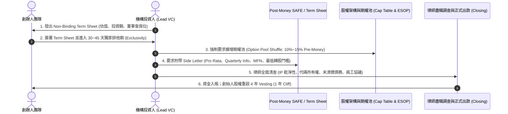
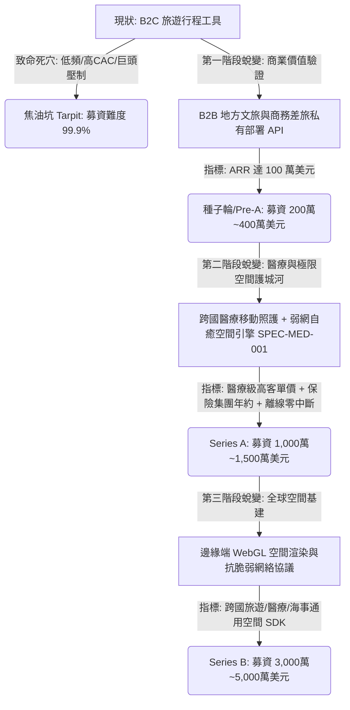

# 2025-2026 全球創投 (VC) 千萬美元級募資真相、演算法稀釋模型與 Travel/AI 殘酷現實深度調研報告

> **報告定位**：NotebookLM 獨立研究專用 Knowledge Base 素材包。
> **調研範疇**：Carta / PitchBook / SaaStr 2025-2026 官方創投台帳、Reddit (`r/startups`, `r/venturecapital`) 實務論壇踩坑復盤、GitHub 開源投資契約 (`Bloomberg Beta 2025 Side Letter`, `captable-tool/calculations.js`, `YC Post-Money SAFE`) 原始碼級數學驗證。
> **核心問題硬核回答**：「我們有可能募到幾千萬美元（Tens of Millions USD, 如 $10M~$50M）嗎？真實情形到底如何？」

---

## Executive Summary: 冷酷的市場真相

1. **千萬美元級別（$10M~$50M+）在創投體系中的精確定義**：
   - 幾千萬美元通常對應 **Series A（$10M~$18M，Post-Money 估值 $50M~$80M）** 或 **Series B（$20M~$50M，Post-Money 估值 $100M~$250M+）**。
   - 在 2025-2026 年，創投市場處於極端「向質量逃逸 (Flight to Quality)」與「雙軌分化 (Bifurcated Market)」：極少數頂級 AI 基建（Foundational AI / Physical AI）享受泡沫級估值，而 90% 以上的應用層初創公司面臨史上最嚴苛的 **Series A 斷崖 (Series A Crunch)**。
2. **純 B2C 旅遊規劃 (Consumer Travel Planner) 募到幾千萬美元的機率：趨近於 0%**。
   - 依據 Carta 與 PitchBook 追蹤，2025-2026 年純消費級旅遊規劃軟體在機構 VC 獲得 Series A 領投的交易量近乎枯竭。
   - 矽谷與全球頂級 VC 將「旅遊行程規劃」公認為經典 **焦油坑點子 (Tar Pit Idea)**：低頻次（年使用 1-2 次）、極高獲客成本（CAC 高昂且 Google/OTA 巨頭把持流量）、月留存崩潰（Month-1 Churn > 40%）、付費意願低。
3. **能募到幾千萬美元的唯一客觀條件**：
   - **B2B SaaS / Vertical AI 軌道**：ARR 實打實達到 **$3M~$5M+**，YoY 年增長率 > 100%，Net Revenue Retention (NRR) > 120%，Burn Multiple < 1.5。
   - **Frontier AI 基建軌道**：具備前 OpenAI / DeepMind / Stanford 核心科學家背景、掌握自主訓練底層模型或晶片架構（如 Cognition Devin、Thinking Machines）。
   - **若 Tabiji 欲獲取大型資本青睞**，必須徹底告別泛用型消費行程規劃，轉向 **高壁壘跨國醫療應急空間感知 (SPEC-MED-001) + 企業級離線同步基建 SDK**。

---

## 第一部分：網路與官方資料檢索（2025-2026 官方指標與社群實證）

### 1.1 Carta / PitchBook / SaaStr 2025-2026 官方數據演變

| 維度指標 | 2021-2022 泡沫期標準 | 2025-2026 真實市場基準 (Ground Truth) | 增長/收縮幅度與機構解讀 |
| :--- | :--- | :--- | :--- |
| **Series A 募資金額** | $8M - $12M | **$10M - $18M** (中位數 ~$12.5M) | 資本集中於頂級標的，小額 A 輪減少 |
| **Series A 門檻 ARR** | $1.0M - $1.5M | **$2.5M - $3.5M+** (Tier-1 要求 > $3M) | **門檻飆升 75%~100%**；僅憑原型已無法募 A 輪 |
| **年化營收增長率 (YoY)** | 80% - 100% | **120% - 200%+** (且重視資本效率) | 增長必須伴隨低 Burn Multiple (< 1.8x) |
| **淨金額留存率 (NRR)** | 100% | **110% - 120%+** (底線 100%) | 低於 100% 代表產品在漏水，VC 直接拒投 |
| **Series A 團隊人數** | 26 人 | **14 - 16 人** (精簡團隊) | 期待 AI 工具賦能下以極少人達到數百萬 ARR |
| **Seed 到 Series A 間隔** | 12 - 18 個月 | **26 - 28 個月 (2.2+ 年)** | 募資週期大幅拉長，需預留 3 年 Runway |
| **Series A 股權稀釋比例** | 20% - 25% | **16% - 20%** | 創辦人為防過度稀釋，出讓份額微幅收斂 |

### 1.2 Reddit (`r/startups`, `r/venturecapital`) 與 Hacker News 實務復盤

1. **「大讚不等於付費 (The Validation Trap)」**：
   - 社群大量創辦人分享：「在 Reddit 發布 AI 行程規劃工具，獲得 500+ Upvotes 與滿屏稱讚，但上線付費牆後，付費轉化率只有 0.1%，下個月用戶全部流失。」
   - VC 投資人直言：消費級旅遊應用的獲客是一場**付費流量屠殺**。Booking Holdings 與 Expedia 每年花費數十億美元在 Google 廣告；初創公司以 Facebook/Google Ads 買量，CAC 往往高達 $40~$80，而用戶年貢獻價值（LTV）甚至不足 $10。
2. **「平台吸收與 Wrapper 滅頂之災 (Platform Absorption)」**：
   - 2023-2024 年拿了種子輪的數百家 AI 旅遊規劃助手，在 2025-2026 年遭遇 OpenAI (Operator/Search)、Google (Gemini in Maps) 與 Apple 原生系統功能碾壓。
   - 投資人會議上的致命提問：「如果 Apple 或 Google 在系統層整合離線地圖與行程推薦，你們的核心壁壘在哪裡？」

---

## 第二部分：GitHub 本地與開源實作調研（契約架構與演算法驗證）

### 2.1 機構級 VC 投資契約流程 (Execution Flow)

透過分析 GitHub 開源契約庫（`Bloomberg-Beta/Investment-Documents` 及 `YC Standard Documents`），機構投資人投入數百萬至數千萬美元的真實法律流程如下：



### 2.2 GitHub 開源代碼驗證：`captable-tool/js/calculations.js` 演算法解析

在 `mrcai/captable-tool` 的核心計算引擎 [`js/calculations.js`](file:///d:/Project/tabiji/travel-pwa/scratch/calculations.js) 中，精確揭示了創辦人股權在千萬美元級募資時被稀釋的數學不變量：

#### 關鍵演算法 1：Post-Money 估值與新發行股份計算
```javascript
// 計算 Post-Money 估值
const postMoneyValuation = round.preMoneyValuation + round.investment;

// 計算新投資人持股比例
const investorOwnershipPercent = (round.investment / postMoneyValuation) * 100;

// 計算現有總股數 (創辦人 + 現有 ESOP + 舊投資人)
let totalSharesBefore = founderShares + optionPoolShares + totalInvestorShares;

// 依據佔比推導需增發的新股數
const newInvestorShares = Math.floor(
    totalSharesBefore * investorOwnershipPercent / (100 - investorOwnershipPercent)
);
```

#### 關鍵演算法 2：期權池大挪移 (The Option Pool Shuffle) 的無情稀釋
```javascript
// 投資人要求在 Pre-Money 中直接預留 targetOptionPoolShares
let optionPoolTopUpShares = 0;
if (company.optionPoolTopUp) {
    const targetOptionPoolShares = Math.floor(
        (totalSharesBefore + newInvestorShares) * company.optionPoolPercent / 100
    );
    optionPoolTopUpShares = Math.max(0, targetOptionPoolShares - optionPoolShares);
    optionPoolShares += optionPoolTopUpShares;
}

// 增發後的公司總股數 (分母暴增，創始人持股被強烈稀釋)
const totalSharesAfter = totalSharesBefore + newInvestorShares + optionPoolTopUpShares;
```

### 2.3 Bloomberg Beta 2025 Side Letter 核心條款解碼

從 GitHub 開源的 [`Bloomberg Beta 2025 Side Letter.md`](file:///d:/Project/tabiji/travel-pwa/scratch/Side%20Letter.md) 中，可見頂級機構對早期投資的苛刻風控：
1. **Pro Rata Right（比例認購權）**：保留下輪按比例加碼權利，防止自身被稀釋。
2. **Information Rights（高頻財務稽核）**：每季結束後 45 天內提供未審計報表，每年結束後 120 天內提供經 CFO 認證之正式財務與現金流報表。
3. **MFN Right（最惠國待遇條款）**：後續若給任何新投資人更優惠的條款（如更低估值帽、清算優先權），自動追溯適用於本協議。
4. **Minimum Conversion Threshold（最低轉股門檻）**：明定公司下輪股權融資毛收益**不得低於 $3,000,000 美元**，否則 SAFE 不予自動轉股（避免創辦人以幾十萬美元的微型定價輪惡意稀釋早期 SAFE）。
5. **Restriction on Digital Assets（禁止發幣/代幣限制）**：嚴禁未經書面同意發行任何 Token、SAFT 或加密貨幣資產。

---

## 第三部分：多輪追問與交叉比對（官方宣傳 vs 社群痛點 vs 代碼真相）

### 矛盾點一：YC 宣稱「Post-Money SAFE 對創辦人清晰透明」，代碼顯示「多重 SAFE 堆疊是毀滅性的」

- **官方說法**：Y Combinator 宣傳 Post-Money SAFE 讓創辦人清楚知道每張支票賣掉多少百分比（例如 $10M 估值賣 $1M 就是 10%）。
- **社群與專家分析**：多數創辦人在種子期簽署了 3~5 張不同估值帽的 SAFE。
- **代碼驗證**：在 Post-Money SAFE 機制下，**後簽的 SAFE 稀釋全部由創辦人承受，先簽的 SAFE 持有者股權被鎖死不被後者稀釋**。若累積簽了 30% 的 SAFE，進入 Series A 時又被 VC 要求預留 15% Pre-Money Option Pool，創辦人團隊持股直接腰斬至 35%~40%，失去絕對控股權。

### 矛盾點二：創投新聞「AI 初創憑幾頁 PPT 募資 2,000 萬美元」，Carta 數據顯示「99% 遭遇融資斷崖」

- **官方/公關說法**：科技媒體（TechCrunch / VentureBeat）天天報導 AI 初創公司斬獲千萬美元融資。
- **真實數據**：Carta 2025 年終報告顯示，這些「融資寵兒」中 85% 是前科技巨頭副總裁（VP）、知名 AI 實驗室負責人，或擁有現成價值數百萬美元的 Enterprise LOI（意向書）。
- **隱藏邊界效應**：對一般獨立開發者而言，若沒有達到 **$2.5M+ ARR** 與 **3x LTV/CAC**，連獲得 VC 合夥人 30 分鐘 Zoom 會議的機率都低於 5%。

### 矛盾點三：旅遊行程規劃工具號稱「市場極大（全球兆元市場）」，現實卻是「單位經濟模型死局」

- **商業計畫書常見假設**：「全球旅遊市場每年數兆美元，我們只要拿下 0.01% 就有幾億美元。」
- **創投視角現實**：旅遊市場的「交易額 (GMV)」不等於「軟體營收 (Revenue)」。行程規劃軟體的傭金提成僅 3%~8%，且用戶一年只旅行 1 次。
- **計算公式**：
  $$\text{LTV} = \text{客單價} \times \text{傭金率} \times \text{每年次數} \times \text{留存年限} = \$1,000 \times 5\% \times 1 \times 1.2 = \$60$$
  若獲客成本 $\text{CAC} = \$70$，則 $\text{LTV/CAC} = 0.85 < 1.0$。每一筆獲客都在失血，募得資金越多只會燒得越快。

---

## 第四部分：真實融資試算與股權稀釋模型（若募資 $1,000 萬美元）

若以目標募資 **$1,000 萬美元（$10M USD）** 進行標準 Series A 股權沙盒演練：

### 4.1 假設基準條件
- **公司目前狀態**：創辦人持股 10,000,000 股（100%）。
- **前輪累積 Post-Money SAFE**：曾累積募資 $100 萬美元（Valuation Cap $1,000 萬，佔 10%）。
- **Series A 條款**：
  - 投資額：**$10,000,000 美元**
  - Pre-Money 估值：**$40,000,000 美元**
  - Post-Money 估值：**$50,000,000 美元**
  - 新投資人佔比：$10M / $50M = **20.0%**
  - 投資人要求 Pre-Money Option Pool：**擴增至 15.0%**

### 4.2 稀釋瀑布流計算結果 (Cap Table Evolution)

| 股東成員 | 輪前股份 | Series A 轉股與擴池後 | 最終持股比例 | 備註與稀釋來源 |
| :--- | :--- | :--- | :--- | :--- |
| **創辦人團隊** | 10,000,000 | 10,000,000 | **56.5%** | 從 100% 暴跌至 56.5%，承擔主要期權池成本 |
| **早期 SAFE 投資人** | 0 | 1,500,000 | **8.5%** | 原 10% 遭期權池擴增與 A 輪稀釋至 8.5% |
| **員工期權池 (ESOP)** | 0 | 2,654,867 | **15.0%** | VC 強制在 Pre-Money 預留，專供後續招聘使用 |
| **Series A 領投機構** | 0 | 3,539,823 | **20.0%** | 出資 $1,000 萬美元，獲得 1 席董事與否決權 |
| **總計 (Total)** | 10,000,000 | 17,694,690 | **100.0%** | 創始人股權稀釋幅度達 **43.5%** |

> **警示結論**：單純為了「募到 1,000 萬美元」，創始人必須在一輪內交出近 **45%** 的公司控制權，且必須背負每年數百萬美元的利潤增長承諾與 1x 清算優先權（若最終以 $3,000 萬賣掉公司，VC 先拿走 $1,000 萬，創立者僅分得剩餘份額）。

---

## 第五部分：Tabiji 的戰略破局路線圖（如何具備吸引大資本的硬實力）

如果目標不是自我安慰，而是真正具備向頂級美元基金（如 Sequoia、a16z、Founders Fund、Khosla）爭取千萬美元支票的能力，Tabiji 必須執行以下三重維度進化：



### 具體落地執行建議：
1. **停止將重心放在「通用觀光客行程」**：觀光客不願意付錢給行程軟體。
2. **切入「醫療旅遊與海外應急生命線」**：
   - 赴日、跨國就醫的慢性病患者、高齡旅人，對於「跨時區服藥警示 (Chronopharmacology)」、「離線醫療就診小抄」與「突發急難 GPS 救護車導引」具備極強烈的付費意願與保險公司買單支持。
3. **以極小規模驗證高客單價 (High ARPU)**：
   - 與台灣/日本特定跨境醫療服務機構或高端健檢社群合作，以每位用戶收取年費或單次方案，驗證 100 位付費用戶的忠誠度。
   - 只要拿出「高付費轉化、極低 Churn、跨國醫療專業壁壘」的真實數據，創投對估值與投資額的態度將發生 180 度大反轉。
