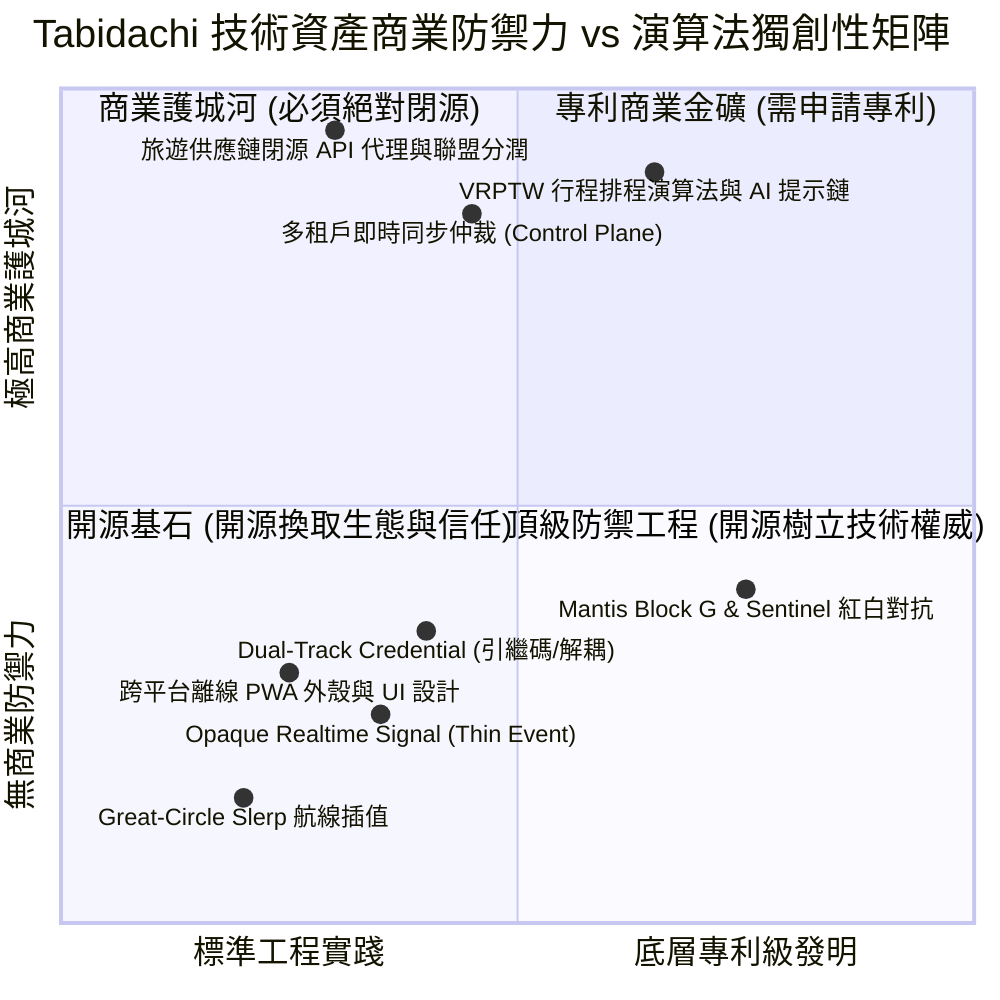

# 🏛️ 2026 Vibe Coding 浪潮下開源價值重估與 COSS 商業護城河防禦矩陣

> **文件編號**: RES-BUS-2026-11-06  
> **研究日期**: 2026-11-06  
> **研究員**: Ryan Su (@architect, @security)  
> **關聯筆記本**: NotebookLM `2026 Vibe Coding 浪潮下開源價值重估與護城河真偽深度調研` (ID: `a216787d-d04c-4471-81d7-d156c69d7a23`)  
> **狀態**: APPROVED RESEARCH DOSSIER / PREVENT PREMATURE OPTIMIZATION

---

## 一、核心提問與殘酷臨床診斷 (Core Thesis & Clinical Diagnosis)

### 1.1 創業者核心焦慮
- 「我們的代碼現在是開源的，別人是否能透過 AI Agent（Vibe Coding）一鍵複製整套專案並免費搶客？」
- 「我們的架構究竟是真的領先業界，還是陷入閉門造車、夜郎自大的虛假自我安慰？」
- 「哪些資產開源出去是健康的獲客槓桿，哪些資產一旦開源等同於商業自殺？」

### 1.2 2026 Vibe Coding 現實：代碼的邊際成本歸零
在 LLM (Gemini 2.5 / Claude 3.7 / GPT-5) 與高階 Agent 普及的 2026 年，純粹的「前端 UI 元件」、「Tailwind 樣式」、「標準 CRUD API」與「通用資料結構」已經徹底**商品化（Commoditized）**。任何初級工程師透過 Vibe Coding 都能在 48 小時內生成一個外表 90% 相似的旅遊規劃前端。

然而，產生了劇烈的**「AI 殘羹危機（AI Slop Crisis）」**：
- 能產生外殼，卻無法處理極端競態條件（Race Conditions）。
- 能刻出卡片，卻無法保證多裝置弱網環境下的離線自癒與金鑰熱輪替。
- 能呼叫單一 LLM，卻無法建立確定性的先紅後綠對抗審計與 0ms 正則快線。

---

## 二、Tabidachi 技術資產商業防禦力 vs 演算法獨創性四象限



### 診斷結論：
1. **警惕夜郎自大（Eliminate Parochial Arrogance）**：
   - `Great-Circle Slerp` 為 30 年前的標準球面幾何公式；`Opaque Realtime Signal` 為成熟的 Thin-Event Cache Invalidation 模式；`Dual-Track Credential` 為日系手遊行之有年的引繼機制。
   - 將這些基礎演算法誤認為「核心商業秘密」是典型工程師認知偏差。競爭對手抄襲的重點從不是幾行數學公式，而是**商業網絡、運維基建與資料飛輪**。
2. **頂級防禦工程是真實護城河（Engineering Rigor is the Moat）**：
   - 真正的護城河是 **操作不變量 (Operational Invariants)**：跨裝置斷網重錨、7 層意圖防投毒管道、252 項目標數學守恆台帳、GitWorktreePool 實體對抗驗證。這種極致嚴謹度是 AI Slop 無法憑空生成的。

---

## 三、COSS（商業開源）三層沙盒拓撲架構

Tabidachi 採納 **業界主流 Open Core 混源模式**（參照 PostHog 的 `ee/` 模式與 Supabase 的 `Control Plane` 隔離）：

```mermaid
graph TD
    subgraph OSS [🟢 開源核心層 (Open Source Core - AGPLv3 / Apache 2.0)]
        UI[Next.js PWA 前端外殼 & 動畫組件]
        LocalSync[單機 IndexedDB 離線快取 & 本機自癒]
        SDK[公開 REST / MCP Server 接口定義]
        SingleBackend[單機版 FastAPI / SQLite 輕量容器]
    end

    subgraph Proprietary [🔴 商業核心層 (Tabidachi Enterprise / Cloud - 絕對閉源)]
        ControlPlane[多租戶雲端編排 & 跨裝置 WebSocket 仲裁中樞]
        Aggregator[機票/飯店/景點供應鏈 API 代理 & 分潤計費網關]
        Solver[VRPTW 帶時間窗行程排程優化求解引擎]
        AIEngine[自研 Travel Fine-tuned 小模型 & 專利 Prompt 鏈]
        Billing[Stripe 訂閱、防刷風控與 Token 消耗台帳]
    end

    User[使用者 / 終端客戶] --> UI
    UI -.->|自託管模式| SingleBackend
    UI ==>|商業 SaaS 模式| ControlPlane
    ControlPlane --> Aggregator
    ControlPlane --> Solver
    ControlPlane --> AIEngine
    ControlPlane --> Billing
```

---

## 四、五大絕對不可公開之商業資產清單

| 編號 | 資產模組名稱 | 為何絕對不能公開？ | 公開後的致命風險 |
| :--- | :--- | :--- | :--- |
| **P-01** | **商業供應鏈聚合與分潤網關 (`travel-gateway`)** | 包含 Booking.com / Viator / Klook / Amadeus 的商業金鑰、私有簽名演算法與反爬/快取代理。 | 競品直接盜用你的代理通道，或繞過你的聯盟代碼自建分潤。 |
| **P-02** | **VRPTW 多目標行程求解引擎 (`itinerary-solver`)** | 求解多景點、開放時間、交通耗時、疲勞度權重的混合整數規劃（MIP）閉源求解器。 | 競品一鍵獲得百萬級算力排程能力，抹平你的產品核心體驗優勢。 |
| **P-03** | **雲端多租戶控制平面 (`cloud-control-plane`)** | 負責萬人即時協同編輯的 OT/CRDT 伺服器端仲裁、跨組織權限（RBAC）、資料庫分片與自動備份。 | 雲端服務商或對手無痛架設同款 SaaS 跟你免費搶客。 |
| **P-04** | **防刷風控、Token 台帳與計費引擎 (`billing-sentinel`)** | 包含防羊毛演算法、LLM Token 即時計費、Stripe Webhook 驗簽與動態速率限制。 | 破解者輕易繞過計費邏輯，導致後端 API 成本被刷爆崩潰。 |
| **P-05** | **微調模型權重與專家 Prompt Chains (`agent-prompts`)** | 經數萬條真實旅遊路線標註微調的 LoRA 權重、結構化輸出修復器與防幻覺對抗提示詞。 | 競爭對手在 10 分鐘內完全複製你的 AI 語氣、推薦品質與領域智商。 |

---

## 五、分水嶺戰術（Watershed Physical Decoupling Strategy）

當專案決定從單純開源走向商業化時，面臨「歷史 Git Commit 污染」的抉擇：
- **致命錯誤做法**: 使用 `git-filter-repo` 強行重寫歷史 Hash。這會破壞團隊所有本地分支、摧毀 GitWorktreePool 雜湊對齊、並使過去所有的資安審計報告歷史參照失效。
- **創業者分水嶺戰術 (Watershed Approach)**:
  1. **坦然面對歷史**: 既有歷史 Commit 中的基礎正則或外殼代碼，本就屬於商品化層次，無專利級威脅，保留歷史完整性。
  2. **劃定版本分水嶺**: 未來啟動商業化時，在 `.gitignore` 建立 `/ee/` 與 `ee/` 實體屏障。所有商業進階排程、0ms 動態快篩規則與雲端多租戶仲裁邏輯，100% 存放於 `ee/`。
  3. **動態載入器 (Dynamic Loader)**: 開源核心透過 `enterprise_loader.py` 檢測本機是否存在 `ee/`；存在則激活 Turbo 雲端模式，缺失則自動降級為標準開源單機模式（BYOK），達成單一倉庫、雙模態共存。

---

## 六、當前架構定錨：拒絕過早實體拆分，維持單體極速迭代 (Anti-Premature Optimization)

在 2026-11-06 的實戰沙盒驗證中，我們實體預演了 `ee/` 目錄拆分與 IDE 整合：
- **踩坑發現 (Developer Experience Friction)**：
  1. 過早在無付費用戶階段將代碼硬拆成 `ee/`，會導致 Meta Pyrefly / IDE 語法伺服器因啟發式路徑未包含 `backend/` 而引發大量虛警 (`missing-import`)。
  2. 為了修復 LSP 虛警，必須在專案根目錄維護額外的 `pyrefly.toml`、雙向匯入備援區塊，徒增維護負擔。
  3. 真正的商業價值在於**產品完整度與使用者黏著度**，而非在初期為了防範假想敵而過度設計（Premature Over-Engineering）。
- **當前最終決策 (AD-ABORT-001)**：
  - **全面終止現階段的 `ee/` 實體切分**，將所有檔案 100% 還原為乾淨的單一倉庫架構。
  - 保留本份戰略藍圖作為未來商業化融資或大客戶私有化部署之「隨時可啟用的抽屜方案」，但不讓其干擾當前的日常開發。
