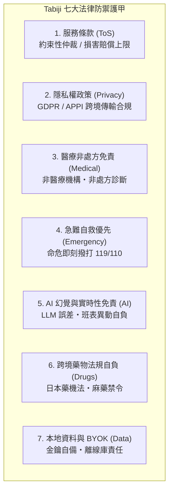
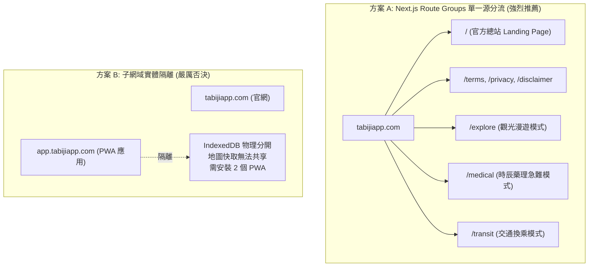

# 2026 Tabiji 官方總站 (Marketing Portal)、法律免責護甲 (Legal Disclaimers) 與網域路由架構深度調研

> **檔案狀態**: 🟢 已核准 (Ground Truth)  
> **建立日期**: 2026-11-08  
> **關聯規格**: `SPEC-ARCH-002` (單一源多形態架構), `SPEC-MED-001` (跨國時辰藥理與急難導引)  
> **NotebookLM 研究筆記本 ID**: `9b6cff80-0ff4-4cba-8106-435e0fd056da`  

---

## Executive Summary (執行摘要)

本報告針對使用者提出之核心課題：「**建立 Tabiji 官方總站、配置法律條款保護開發者與平台、探索後綴網域/路徑配置策略，並進行冷酷的產業實況審核（領先全球 vs 夜郎自大）**」進行全景式地質探勘與法規技術推演。

### 核心結論：
1. **真實現狀冷酷審查**：
   - 建立「官方門戶網站（Marketing Portal）+ 法律免責條款（ToS / Privacy / Disclaimers）+ 核心應用（App）」在現代軟體與網際網路產業是**最基本的及格線（Table Stakes）**。
   - 世界上 100% 的商業軟體（Supabase, Vercel, Linear, Perplexity, Cal.com, Ada Health）皆採用此標準拓撲。
   - **非但不是「獨步全球」，Tabiji 過去沒有官方介紹頁與法律條款，反而是「極度危險的裸奔」**。Tabiji 涉及跨時區服藥建議、急診導引與海外旅遊，一旦使用者發生醫療副作用或海外糾紛，缺乏約束性仲裁與醫療免責條款將直接導致開發者個人暴露於巨額連帶侵權訴訟風險中。
2. **七大法律護甲（保護自身與平台的必備條款）**：
   - 服務條款 (Terms of Service, 含約束性仲裁與集體訴訟棄權)
   - 隱私權政策 (Privacy Policy, 跨境傳輸符合 GDPR, 台灣個資法, 日本 APPI)
   - 醫療與時辰藥理非醫囑免責聲明 (Medical & Chronopharmacology Non-Advice Disclaimer)
   - 緊急危難自救優先協議 (Emergency Crisis Override Protocol - 撥打 119/110 原則)
   - AI 幻覺與實時性免責條款 (Generative AI Hallucination & Accuracy Waiver)
   - 跨境藥品管制責任自負 (Cross-Border Pharmaceutical Importation Assumption of Risk)
   - BYOK 與本地資料主權免責 (BYOK & Data Storage Shield)
3. **網域與後綴架構最佳實踐**：
   - 堅持 **單一源路由分組（Single-Origin Route Groups）**：主網域 `tabijiapp.com/` 作為官方總站，`/explore`、`/medical`、`/transit` 作為應用子路徑，法律條款置於 `/terms`、`/privacy`、`/medical-disclaimer`。
   - 嚴禁拆分為 `app.tabijiapp.com`，否則將摧毀 PWA Service Worker 的 50MB 離線瓦片共享機制與 IndexedDB 本地資料庫。

---

## 1. 產業現狀與殘酷真相審核（領先業界 vs 夜郎自大）

### 1.1 全球頂級企業與開源獨角獸對照矩陣

| 平台 | 官方總站 (Portal/Marketing) | 應用程式入口 (App Entry) | 法律條款中心 (Legal Hub) | 架構實作方式 |
| :--- | :--- | :--- | :--- | :--- |
| **Supabase** | `supabase.com/` | `supabase.com/dashboard` | `supabase.com/legal` (`/terms`, `/privacy`) | 單一網域，Route 分流 |
| **Vercel** | `vercel.com/` | `vercel.com/[team]/[project]` | `vercel.com/legal/terms` | 單一網域，動態 Rewrite |
| **Linear** | `linear.app/` | `linear.app/login` $\rightarrow$ `/workspace` | `linear.app/terms`, `/privacy` | 單一網域，SPA Client 轉向 |
| **Perplexity** | `perplexity.ai/` | `perplexity.ai/` (直接為搜尋應用) | `perplexity.ai/hub/legal/terms-of-service` | 應用即門戶，頁尾掛載法律中心 |
| **Cal.com** | `cal.com/` | `cal.com/app` 或 `cal.com/[username]` | `cal.com/terms`, `/privacy` | Next.js Route Groups |
| **Ada Health** | `ada.com/` | 行動 App 導流 + Web 評估器 | `ada.com/terms-of-service`, `/medical-disclaimer` | 醫療級嚴格 Clickwrap 免責 |

### 1.2 審查結論：夜郎自大還是領先？
- **夜郎自大維度**：認為「做個總站介紹我們在做什麼、放法律條款、加個網址前綴/後綴」是什麼創新的突破。事實上，在網路世界上線 30 年來，這就是標準公版（Standard Practice）。
- **實質威脅警報**：Tabiji 目前直接把未登入者導向一個空洞的暱稱輸入框（`landing-page.tsx`），沒有首頁介紹、沒有產品展示、沒有條款保護。這不是「簡約」，而是「未完工的半成品」。
- **真正能領先業界的點**：
  並非「做官網」，而是**「以單一源 Next.js 16 App Router Route Groups，實現 0ms 無縫銜接的 PWA 離線首頁與多形態旅人工作台，並在醫療模式中實裝軍規級的 Clickwrap 法律免責防護圈」**。

---

## 2. 保護平台與開發者的七大法律免責護甲 (Legal Protection Framework)

醫療、旅遊、AI 是全球法律訴訟風險最高的三大領域交集。若無嚴密條款，使用者在旅途中若因遵照 AI 建議服藥導致過敏休克、或因航班延誤錯過重要行程，均可能在美國、日本或台灣向開發者提告求償。

### 2.1 條款 1：服務條款 (Terms of Service)
- **核心目的**：確立契約關係、限制損害賠償、杜絕集體訴訟。
- **關鍵條款條文**：
  - **責任上限條款 (Limitation of Liability)**：在法律允許的最大範圍內，Tabiji 對任何間接、附帶、懲罰性損害（包括但不限於行程延誤、醫療費用、精神慰撫金）概不負責；任何情況下的累積賠償上限不得超過使用者過去 12 個月支付給 Tabiji 的總額（若為免費版，則上限為 100 美元或新台幣 3,000 元）。
  - **約束性仲裁與放棄集體訴訟 (Binding Arbitration & Class Action Waiver)**：所有爭議均以中華民國仲裁協會於台北進行個別仲裁，使用者明確同意放棄以原告或集體訴訟成員身分提起訴訟。
  - **準據法與管轄權**：以中華民國法律為準據法，並以臺灣臺北地方法院為第一審管轄法院。

### 2.2 條款 2：隱私權政策 (Privacy Policy)
- **核心目的**：符合 GDPR（歐盟）、CCPA（加州）、個人資料保護法（台灣）以及個人情報保護法（日本 APPI）。
- **關鍵規範**：
  - 明確揭露蒐集資料種類：暱稱、旅行目的地、行程規劃、裝置端離線快取。
  - **敏感健康資訊 (Special Category Data) 告知**：使用者於醫療模式輸入之自選藥物與備忘錄，僅儲存於使用者本機之 IndexedDB，未經使用者主動點擊雲端同步，伺服器絕不主動採集或轉賣給保險公司或廣告商。
  - **第三方傳輸揭露**：使用 Supabase (資料庫)、Google Cloud Run (API 運算)、Google Gemini / Claude (AI 推論)、Cloudinary (圖片快取)。

### 2.3 條款 3：醫療與時辰藥理非醫囑免責聲明 (Medical Non-Advice Disclaimer)
- **核心目的**：避免觸犯台灣《醫師法》第 28 條（密醫罪）、日本《醫師法》第 17 條（無資格醫業禁止）與《藥機法》。
- **關鍵法定用語**：
  > 「Tabiji 所提供之時辰藥理（Chronopharmacology）計算、跨時區服藥時差提醒、外語症狀描述對照小抄及醫療院所資訊，**純屬一般生活習慣輔助與公開衛教資訊整理，絕不構成、亦不得取代專業醫師、藥師或其他執業醫事人員之醫療診斷、治療建議或處方**。使用者於調整任何藥物服用劑量或時間前，必須諮詢其主治醫師或專業藥師。」

### 2.4 條款 4：緊急危難自救優先協議 (Emergency Crisis Override Protocol)
- **核心目的**：防止使用者在遭遇休克、心肌梗塞、大出血時仍花時間滑手機使用 App。
- **關鍵規範**：
  > 「**若您或同行者正處於威脅生命之緊急醫療危難或人身安全威脅中，請立即撥打當地緊急求救電話（日本：救護車 119、警察 110；台灣：119 / 110；歐盟：112；美國：911），或即刻前往最近之急診責任醫院就醫。切勿因閱讀或等待本應用程式之資訊而延誤急救時間。**」

### 2.5 條款 5：AI 幻覺與實時性免責條款 (Generative AI Hallucination & Accuracy Waiver)
- **核心目的**：免除大型語言模型（LLM）幻覺、不可抗力、班表異動之法律責任。
- **關鍵規範**：
  - 明確揭示本服務使用生成式 AI（Generative AI），模型輸出存在不可預測性、歷史資料時間差（Temporal Lag）或幻覺（Hallucination）。
  - 對於景點營業時間、公休日變更、新幹線/航班臨時取消、天候災害（如颱風、地震）導致之行程中斷，平台不提供任何明示或默示之保證。

### 2.6 條款 6：跨境藥品管制責任自負 (Cross-Border Pharmaceutical Importation)
- **核心目的**：海外各國管制藥物標準差異極大（如部分感冒藥含 Pseudoephedrine 於日本視為毒品禁藥違法）。
- **關鍵規範**：
  - 使用者應自行確認其攜帶出境與入境之藥物是否符合出發地、轉機地與目的地國家之海關及管制藥物法令。Tabiji 不對使用者遭海關沒收、扣留、裁罰或起訴承擔任何責任。

### 2.7 條款 7：BYOK 與本地資料主權免責 (BYOK & Data Storage Shield)
- **核心目的**：保護自備金鑰（BYOK）使用者與 IndexedDB 損毀責任。
- **關鍵規範**：
  - 使用者自行輸入之第三方 API Key（如 Google Gemini Key）僅儲存於本機記憶體或 LocalStorage，金鑰外洩或帳單超額由使用者自負。
  - 離線資料之定期匯出備份義務歸屬於使用者。

---

## 3. 網域架構與路由策略（後綴網域要怎麼搞？）

### 3.1 業界三大路由拓撲方案深度評估

| 評估維度 | 方案 A：單一源路徑分流 (`tabijiapp.com/...`) | 方案 B：子網域隔離 (`app.tabijiapp.com`) | 方案 C：根目錄兼併 (`tabijiapp.com/` 直接為 App) |
| :--- | :--- | :--- | :--- |
| **SEO 累積** | 🟢 **100% 匯聚**於 `tabijiapp.com` | 🔴 權重被子網域稀釋，外鏈無法互通 | 🟡 缺乏官網長尾關鍵字，SEO 覆蓋率低 |
| **PWA 快取** | 🟢 **同一 Service Worker**，50MB 離線地圖與醫療紀錄完全共享 | 🔴 **瀏覽器安全隔離**，離線地圖需重複下載，桌面會產生兩個圖示 | 🟢 單一 SW 共享 |
| **新客轉換率** | 🟢 訪客先看到精緻官網與功能亮點，點擊「開始體驗」平滑進入 App | 🟡 需跨子網域跳轉，觸發硬重載 | 🔴 訪客一進來就看到暱稱輸入框，不知道這是什麼直接跳出 |
| **法律合規** | 🟢 官網頁尾隨時可查閱 `/terms`、`/privacy`，合規標準度 100% | 🟢 可掛載法律頁面 | 🔴 介面過度擁擠，條款無處安放 |
| **維護成本** | 🟢 **單一 Next.js 專案**，單一 Vercel 部署，零額外 DNS/CORS 設定 | 🔴 需配置 Wildcard SSL、CORS 白名單、Cookie Domain 共享 | 🟢 維護成本低但產品不完整 |

### 3.2 決策推導：方案 A (Route Groups)
- **首頁定位 (`/`)**：轉型為**高視覺衝擊力、專業權威的官方行銷總站**。展示「AI 空間感知」、「離線優先地圖」、「跨時區時辰藥理」三大王牌功能，並附帶使用者見證、安全背書與頁尾法律矩陣。
- **應用模式入口**：
  - 官網頂部與 Hero 區放置「開始旅程 / 啟動應用」按鈕，點擊直通 `/explore`。
  - 若使用者已在手機將 PWA「加入主畫面」，其 `manifest.json` 中配置 `start_url: "/explore"`，使其點擊桌面圖示直接進入應用工作台，繞過行銷頁，保有原生 App 體驗。
- **法律中心 (`/legal`)**：
  - `/terms` $\rightarrow$ 服務條款
  - `/privacy` $\rightarrow$ 隱私權政策
  - `/medical-disclaimer` $\rightarrow$ 醫療與急難免責聲明

---

## 4. GitHub 原始碼層級實作避坑指南

### 4.1 Next.js 16 雙 Layout 穿透陷阱
- **避坑痛點**：若在 `app/(marketing)/layout.tsx` 與 `app/(app)/layout.tsx` 分別宣告 `<html>` 與 `<body>`，Next.js 會將其視為完全獨立的 Root Layout。當使用者從官網點擊「啟動應用」進入 `/explore` 時，瀏覽器會觸發硬重載（Full Page Navigation），導致已載入的字體、Tailwind 樣式與快取全部丟失。
- **官方解法**：
  - 在 `app/layout.tsx` 保留唯一的 `<html>` 和 `<body>`，注入共用的 Geist 字型、ThemeProvider 與基礎中繼標籤。
  - 在 `app/(marketing)/layout.tsx` 僅包裹官網頂部導覽列（MarketingNav）與法律頁尾（Footer）。
  - 在 `app/(app)/layout.tsx` 包裹 PWA Shell、狀態監控與離線 Service Worker 註冊。

### 4.2 Clickwrap 法律免責強制彈窗合規設計
- **合規痛點**：法院實務（如美國與歐盟判例）普遍認定「網頁底端放一個 Privacy 連結（Browsewrap）」在人身傷害或醫療訴訟中效力薄弱。
- **防禦實作**：
  - 當使用者首次點擊切換進入 `/medical`（醫療急難模式）時，系統必須彈出阻斷式 Modal（Clickwrap）：
    1. 顯示核心醫療非處方與 119 急救優先聲明。
    2. 強制使用者勾選「我已年滿 18 歲，理解此功能非醫療診斷，遇急難將優先撥打當地求救電話」。
    3. 點擊「同意並啟用」後，將 `has_accepted_medical_disclaimer: "v1.0-20261108"` 寫入本地 IndexedDB 並附加時間戳記。
    4. 未勾選前，嚴禁載入時辰藥理試算器。

---

## 5. 結論與行動清單

1. **認清現實**：官方總站與法律條款是不可或缺的基石，做這件事是為了讓 Tabiji 從「個人實驗室玩具」蛻變成「具備商業防護力的生產級產品」。
2. **架構定錨**：維持單一網域 `tabijiapp.com`，利用 Next.js 16 Route Groups 乾淨切分 `(marketing)` 與 `(app)`。
3. **法律完備**：草擬七大免責條款，並在醫療模組前置 Clickwrap 法律盾牌。

