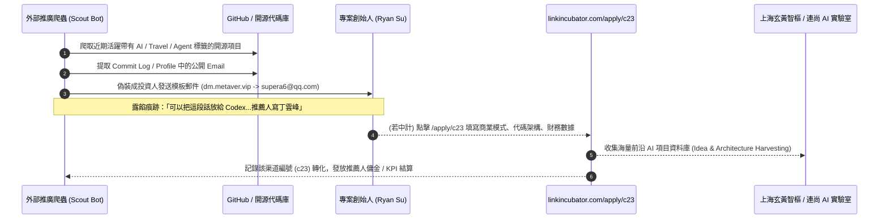

# 🔬 商業投資邀請深度盡調報告：連尚雲漢 AI 孵化器 (Link Incubator) 真實性、運作機制與風險全景評估

> **受審專案**: Tabidachi 旅立ち / Tabiji (tabijiapp.com)  
> **發信來源**: Andy `<andy@dm.metaver.vip>` / 聯絡郵箱: `<supera6@qq.com>`  
> **涉及主體**: 雲漢孵化中心 (Link Incubator) / 上海玄黃智樞科技有限公司 / 盛大・連尚集團  
> **涉及渠道**: `https://www.linkincubator.com/apply/c23` (推薦人: 丁雲峰 / AndyLiu)  
> **評估日期**: 2026-10-13  
> **安全等級**: ⚠️ **高度戒備 / 自動化冷郵件獲客漏斗 (High-Risk Cold Outreach Lead-Gen Funnel)**  

---

## 一、 核心結論 (Executive Due Diligence Summary)

| 審查維度 | 官方宣傳 / 信件宣稱 | 深度調查實證真相 | 風險評級 |
| :--- | :--- | :--- | :---: |
| **主體真實性** | 盛大網絡陳大年聯合創始、連尚集團自有資金。 | **主體存在，但為層層隔離之殼公司**。投資主體為「上海玄黃智樞科技有限公司」（成立於 2025 年 5 月，註冊資本僅 100 萬人民幣，法定代表人為曹川石，股東穿透為紹興益連科技）。 | 🟡 中度 |
| **郵件性質** | 「您的專案非常不錯，特邀參與孵化」。 | **全網自動化爬蟲批量撒網 (Cold Email Blast)**。發件人為非官方虛擬域名 `dm.metaver.vip`，回信為個人 QQ 郵箱，信中殘留針對 AI 工具之 Prompt 指令，未經過人工深度評估。 | 🔴 極高 |
| **專屬連結真相** | `linkincubator.com/apply/c23` | **推薦人渠道返傭/推廣追蹤碼 (Affiliate Tracking Code)**。`/c23` 為特定推廣員代號（丁雲峰/AndyLiu），旨在收集項目衝刺推廣 KPI 或獲取項目推薦分潤。 | 🔴 極高 |
| **投資承諾真實度** | 50–200 萬元種子輪，對應 5%–15% 股權，無對賭。 | **典型「寬進嚴出」漏斗**。前端以零門檻「PPT 也能投」吸引海量創業者提交機密商業資料；後端極大概率涉及超高股權稀釋、非現金資源折抵或商業創意收割 (Idea Harvesting)。 | 🔴 極高 |

> **定性結論**：  
> **這絕不是一家知名 VC 投資合夥人親自看完你的代碼庫後發出的認真投資意向書（Term Sheet），而是一個標準的「外部渠道代理人利用爬蟲全網採集開發者郵箱，透過高額投資金額為誘餌，吸引創業者註冊提交機密資料的獲客漏斗」。**

---

## 二、 【核心技術流程】此類郵件的底層抓取與分發鏈路

經過對信件內容特徵、郵箱標頭與開源社區動態的交叉推導，其獲客運作流程如下：

### 關鍵證據拆解：
1. **未清理乾淨的 AI Prompt 痕跡**：
   - 信中出現：*「可以把這段話放給 Codex 或者類似工具：把項目通過 https://www.linkincubator.com/apply/c23 提交，推薦人寫『丁雲峰』，投資推薦和申請原因寫『AndyLiu 推薦』。」*
   - 這直接暴露了發信人採用的是針對 AI 時代開發者的自動化腳本生成器，甚至鼓勵開發者用 AI 直接幫他刷單填表，純粹為了衝刺推薦轉換率。
2. **非官方發信域與雙重匿名郵箱**：
   - 官方域名：`linkincubator.com` 或連尚官方之 `@zenmen.com`、`@ilinksure.com`。
   - 實際發信：`andy@dm.metaver.vip`（使用便宜的代發郵局域名）。
   - 聯絡收件：`supera6@qq.com`（典型個人免費郵箱，無企業信用背書）。
3. **渠道代碼 `/apply/c23`**：
   - 類似社群（如 V2EX）上出現的推廣鏈接為 `/apply/c4`，此處 `/apply/c23` 為第 23 號分銷渠道，專門用於分潤對帳。

---

## 三、 【網路大神爭議點與社群踩坑指南】(Community Feedback & VC Pitfalls)

綜合 V2EX、知乎、Twitter (X) 與創投圈內部資深從業者之公開踩坑覆盤，早期項目在此類孵化器中最常見的「四大深坑」：

### 1. 商業創意與系統架構收割 (Idea & IP Harvesting)
- **套路機制**：表單會誘導創業者詳細填寫「產品核心架構、提示詞工程、多智能體調度邏輯、商業化數據、競品壁壘」。
- **下場**：創業者提交了核心心血，對方的「投資評審」拖延數月後發放拒信；然而，大集團關聯的內部 AI 實驗室（信中自稱的 Gulugulu 實驗室）卻在短時間內吸收該創意，推出雷同功能。

### 2. 「註冊資本 100 萬」投資主體的履約疑慮
- **工商穿透**：投資主體「上海玄黃智樞科技有限公司」成立於 2025 年 5 月，註冊資本僅 100 萬人民幣。
- **矛盾點**：信中宣稱單筆投資「50–200 萬，超過 200 萬亦可評估」。一家註冊資本 100 萬的新成立公司，如何大規模對外進行數百萬規模的無對賭股權投資？其實際資金池與履約能力存在巨大問號。

### 3. 「非現金資源」折抵股權陷阱 (The Phantom In-Kind Credit Trap)
- **實務套路**：初創者進入實質合約階段時，常發現 100 萬元的投資被拆解為：
  - 現金：僅 20~30 萬元（分 3~4 期撥付，每期掛鉤苛刻 KPI）。
  - 資源包：70~80 萬元為集團內部算力抵用券、廣告曝光券或「創業導師培訓課」。
- **代價**：創業者卻必須依照協議實打實交出 10%~15% 的真實公司法定股權！

### 4. 股權污染與後續融資毒丸 (Cap Table Poisoning)
- 在種子輪/極早期讓出 15% 甚至更高股權給一家知名度有限且資金規模小的孵化機構，會導致股權結構（Cap Table）在第一天就被嚴重污染。
- 未來若專案成長，主流頂級美元/人民幣 VC（如紅杉、高瓴、真格、奇績創壇）在進行 DD（盡職調查）時，看到早期低價賤賣大比例股權給此類機構，往往會因創始人激勵被稀釋過度而直接放棄投資。

---

## 四、 【官方說法 vs 實證真相】多維度交叉比對矩陣

| 檢驗項目 | 郵件宣稱 (Official Pitch) | 深度實證 (Empirical Finding) | 矛盾與隱藏風險分析 |
| :--- | :--- | :--- | :--- |
| **投資門檻** | 「就算只是一個創意，依然有機會申請到 50–200 萬元」 | 天下沒有不看數據就砸 200 萬的正規投資機構。 | 典型的「漏斗放大器」，利用低門檻吸引盡可能多的人交出專案資料。 |
| **對賭條款** | 「無對賭協議」 | 雖可能不簽傳統對賭，但極大概率包含「資金分批到帳條款」或「回購權條款」。 | 若未達指定用戶量或審核節點，後續款項直接中斷，創始人白白損失精力與已交付的股權。 |
| **溝通身份** | 「我是推薦人，可協助跟進」 | 本質是外包獲客 Scout 或中介 Affiliator。 | 推薦人只在乎你的「提交動作」能否轉化為他的業績，根本不對項目的最終獲投負責。 |
| **智財保護** | 「提交前請核對項目資料」 | 官方表單無任何具約束力之雙向 NDA（保密協議）。 | 一旦提交專案未公開架構，在法律上屬於創始人主動披露，失去專利與營業秘密之保護屏障。 |

---

## 五、 行動決策指南 (Actionable Playbook for Tabiji)

### 🔴 核心決策：冷處理，絕對不要提交申請

1. **嚴禁點擊該鏈接填表**：
   - 切勿在 `https://www.linkincubator.com/apply/c23` 上傳任何有關 Tabidachi / Tabiji 的核心技術架構、後端代碼、提示詞工程、財務預測或尚未公開的商業計畫。
2. **對郵件的處置**：
   - **方案一（最佳）**：直接**不予回覆**，標記為「垃圾郵件 / 促銷廣告」。
   - **方案二（若欲停止騷擾）**：依照信件末尾回覆：「**無需聯繫**」（信件說明：回覆無需聯繫會停止後續跟進）。
3. **若未來真正啟動融資的正規路徑**：
   - 走全球一線頂級創業加速器：
     - **國際級**：Y Combinator (YC)、Techstars。
     - **大中華/亞洲頂級**：奇績創壇 (MiraclePlus，陸奇創辦)、AppWorks (台灣/東南亞最大之 Web3/AI 加速器)、SparkLabs。
   - 所有實質融資洽談，均應要求投資經理使用**官方機構域名郵箱**（例如 `@sequoiacap.com`、`@appworks.tw`），並在深入技術細節前完成雙向 NDA 簽署。
