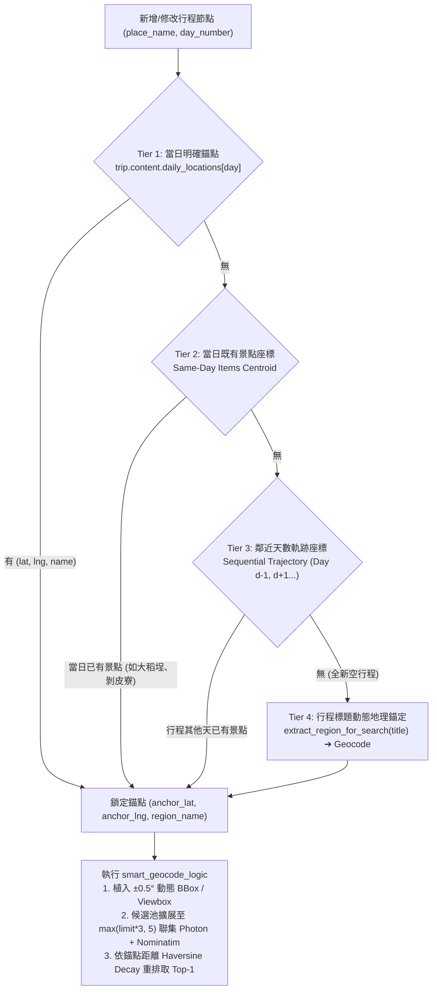

# 修復計畫 (v2 — 全球通用空間錨定版)：MCP 真實分潤連結導出 ✕ 4 層動態空間錨點引擎

## 1. 核心問題與審核發現 (Executive Audit Summary)

針對原計畫 (v1) 進行全景式程式碼稽核後，確認原計畫若僅依賴靜態字典（`LOCATION_KEYWORDS` 僅 9 國、`COUNTRY_BOUNDS` 僅 20 國、`LANDMARKS_DB` 手動補表），**無法做到全球 190+ 國與所有城市通用**，且原系統中已存在兩套未統一的錨定機制（[`ai.py#L421-L443`](file:///d:/Project/tabiji/travel-pwa/backend/routers/ai.py#L421-L443) 的 `Dynamic Anchor` 與前端 [`location-resolver.ts#L112-L173`](file:///d:/Project/tabiji/travel-pwa/frontend/lib/location-resolver.ts#L112-L173) 的 `resolveDayLocation` 四層備援），同時發現 [`geocode_service.py`](file:///d:/Project/tabiji/travel-pwa/backend/services/geocode_service.py) 內部存在 4 個阻礙全球錨定的底層漏洞：

1. **[`extract_region_for_search`](file:///d:/Project/tabiji/travel-pwa/backend/services/geocode_service.py#L1847-L1855) 切割英文/年份標題時產生垃圾前綴**：
   - 原本寫法 `parts = clean.split(" "); return parts[0]`，遇到你的真實行程標題 `"3 Day Taipei Explorer ✨"` 時，會抽出 **`"3"`**！遇到 `"2026 巴黎自由行"` 會抽出 **`"2026"`**！導致 `smart_geocode_logic` 第 1981 行拼出 `"3 龍山寺"` 送給 Photon。
2. **[`smart_geocode_logic`](file:///d:/Project/tabiji/travel-pwa/backend/services/geocode_service.py#L2053-L2060) 在 `limit=1` 時提早 `break`，導致 Nominatim 與距離重排 (`rerank_top_k`) 完全失效**：
   - 當 `mcp.py`、`ai.py`、`trips.py` 傳入 `limit=1` 時，第 2053 行 `effective_limit = 1`。只要 Photon 投機搜尋回傳 1 筆錯誤結果，第 2058 行 `if len(all_results) >= effective_limit: break` 就會**直接跳過 Nominatim 搜尋**，且讓第 2147 行的 `rerank_top_k` 只有 1 筆候選可排，使 `proximity_decay`（距離衰減權重 30%）形同虛設！
3. **[`normalize_for_fuzzy`](file:///d:/Project/tabiji/travel-pwa/backend/services/geocode_service.py#L259-L271) 詞尾無差別抹除 + [`translate_famous_landmark`](file:///d:/Project/tabiji/travel-pwa/backend/services/geocode_service.py#L1428-L1486) 無視空間距離與國別**：
   - `"龍山寺"` 切掉 `"寺"` 與首爾 `"龍山站"` 切掉 `"站"` 後都變成 `"竜山"`（100% 碰撞），且在無視當前行程錨點座標 `(25.046, 121.505)` 與相隔 1,480 公里的情況下直接觸發 `INSTANT RETURN` 秒回首爾座標。
4. **分潤連結寫死無效網域 `tabiji.app` 與測試假 ID `TABIJI_AFF_888`**：
   - [`mcp.py`](file:///d:/Project/tabiji/travel-pwa/backend/routers/mcp.py#L1152-L1227) 與 [`affiliate.py`](file:///d:/Project/tabiji/travel-pwa/backend/routers/affiliate.py#L14-L18) 未接上真實 Travelpayouts (`marker=602410`) 導購規則。

---

## 2. 全球通用 4 層動態空間錨定架構 (Global 4-Tier Spatial Anchoring)

不依賴手動維護地標字典，而是將前端 [`location-resolver.ts`](file:///d:/Project/tabiji/travel-pwa/frontend/lib/location-resolver.ts#L112) 與後端 [`ai.py`](file:///d:/Project/tabiji/travel-pwa/backend/routers/ai.py#L596) 的錨定邏輯，收斂為後端共用的 **`resolve_trip_spatial_anchor(trip, day_number, existing_items)`**（由近而遠 4 層決定論錨定，全球任何國家/城市皆適用）：

### 為什麼這套機制 100% 全球通用？
- **以你的台北行程為例**：Day 1 已經有「大稻埕迪化街 `(25.0551, 121.5083)`」與「剝皮寮歷史街區 `(25.0368, 121.5022)`」。
  - **Tier 2** 直接算出當日空間錨點為 **`(25.0460, 121.5053)`（台北萬華區）**。
  - 搜尋「龍山寺」時，距離錨點 `0.95 km` 的「艋舺龍山寺 `(25.0372, 121.4999)`」獲得 `proximity_decay = 0.994`；而距離錨點 `1,480 km` 的首爾龍山區獲得 `proximity_decay = 0.092`（且若 `LANDMARKS_DB` 命中結果距離錨點 `> 300 km` 則禁止秒回）。
  - 即使全球任何一個冷門城市（如冰島阿克ureyri、秘魯庫斯科、摩洛哥馬拉喀什）完全不在 `LANDMARKS_DB` 或 `COUNTRY_BOUNDS` 字典中，只要有行程標題或任一既有景點座標，Nominatim `viewbox` + Photon `lat/lon/bbox` + `rerank_top_k` 距離衰減都會自動將搜尋鎖定在該城市半徑內！

---

## 3. 具體程式碼變更明細 (File-by-File Changes)

### 3.1 [`backend/services/geocode_service.py`](file:///d:/Project/tabiji/travel-pwa/backend/services/geocode_service.py)
1. **重構 `extract_region_for_search(region: str)`（第 1847-1855 行）**：
   - 支援中英文與年份噪音剝離（移除 `\b\d+\s*(?:days?|nights?|d\d*n?)\b`、`\b(?:19|20)\d{2}\b`、`in|to|at|for|trip|travel|itinerary|explorer|adventure|vacation|tour|guide`、以及 Emoji 符號），並優先匹配已知地名或保留完整乾淨目的地詞組（例如 `"3 Day Taipei Explorer ✨"` ➔ `"Taipei"`，`"2026 北海道 5 日遊"` ➔ `"北海道"`）。
2. **新增全球通用錨點解析器 `resolve_trip_spatial_anchor(trip: dict, day_number: int = 1, existing_items: list = None) -> dict`**：
   - **Tier 1**：讀取 `trip.get("content", {}).get("daily_locations", {}).get(str(day_number))` 的 `lat, lng, name`。
   - **Tier 2**：計算 `existing_items` 中 `day_number == target_day` 的有效座標中位數 `(anchor_lat, anchor_lng)`。
   - **Tier 3**：依序向前後天數 (`abs(d - day_number)`) 尋找最近的有效景點座標。
   - **Tier 4**：若為全新空行程，用清理後的 `region_term = extract_region_for_search(trip_title)` 取得目的地中心座標。
   - **動態 BBox 生成**：一旦取得 `(anchor_lat, anchor_lng)`，若呼叫端未提供 `bbox`，自動生成區域視窗 `bbox`（`min_lng,min_lat,max_lng,max_lat`，半徑 ±0.8° 約 85km）供 Photon 與 Nominatim `viewbox` 偏置使用，並由座標反推所在國碼（若落於 `COUNTRY_BOUNDS` 內）。
3. **修復 `smart_geocode_logic` 三大缺陷（第 1857-2162 行）**：
   - **缺陷 1（地標秒回防呆，第 1943-1963 行）**：`translate_famous_landmark` 命中後，除了檢查 `country_code` 是否衝突外，**若呼叫端已提供空間錨點 `(lat, lng)`，計算地標與錨點之 `haversine_km(lat, lng, lm_lat, lm_lng)`；若距離 `> 300 km`（跨城/跨國同名碰撞），嚴禁觸發 `INSTANT RETURN`，強制退回即時搜尋**！
   - **缺陷 2（`limit=1` 提早斷路，第 2053-2096 行）**：將內部檢索候選池容量改為 `candidate_pool_limit = max(limit * 3, 5)`，確保即使 `limit=1`，Photon 與 Nominatim（含 `viewbox` 偏置）都能共同提供候選點進入 `rerank_top_k`，最後再由 `rerank_top_k(..., limit=limit)` 取第 1 名。
   - **缺陷 3（`normalize_for_fuzzy` 詞尾碰撞，第 259-271 行）**：將 `"駅"` 統一為 `"站"`，不再將 `"寺"`、`"站"`、`"神社"`、`"城"`、`"市場"` 等互斥類別字尾切除成短短 2 字詞根（僅在字數 `> 3` 時移除通用尾詞 `"店"`）。

### 3.2 [`backend/routers/mcp.py`](file:///d:/Project/tabiji/travel-pwa/backend/routers/mcp.py) & [`backend/routers/trips.py`](file:///d:/Project/tabiji/travel-pwa/backend/routers/trips.py)
1. **在 `mcp.py` 注入 MCP 協定層級 AI 行為規範 (`initialize.instructions` + `tools/list` Schema)**：
   - 於 [`mcp.py`](file:///d:/Project/tabiji/travel-pwa/backend/routers/mcp.py#L943-L953) 的 `initialize` 回應中新增標準 `instructions` 欄位，並同步強化 `tools/list` 工具與參數描述，在外部 AI（Perplexity、Claude、ChatGPT）連線時直接下達協定級強制指引（無須等人類使用者手動提醒）：
     - 新增或修改景點前，必須先透過 `list_user_trips` / `get_trip_itinerary` 確認行程目的地與當日所在區域。
     - 遇到全球同名景點（如「龍山寺」、「東照宮」、「中國城」），必須自動冠上該行程所屬城市/區域前綴（如 `"台北 艋舺龍山寺"`）。
     - 若不確定精確經緯度，省略 `lat`/`lng` 交由 Tabiji 空間錨點引擎自動解析，並完整保留回傳之 `tp.media` 分潤訂票連結。
2. **在 `mcp.py` (`manage_itinerary_node` 第 1168-1190 行) 與 `trips.py` (`create_item` 第 1531-1542 行) 接入 `resolve_trip_spatial_anchor`**：
   - 查詢該行程既有項目後，先呼叫 `anchor = await resolve_trip_spatial_anchor(trip, day_idx, existing_items)` 取得 `{lat, lng, region, country, bbox}`。
   - **外部 AI 座標防呆校驗**：若外部 AI 傳入 `p_lat, p_lng`，但與錨點 `(anchor["lat"], anchor["lng"])` 距離 `> 500 km`（或不在目標國境內），自動丟棄該異常座標，改用錨點參數呼叫 `smart_geocode_logic`。
3. **將 `mcp.py`（第 1152、1205、1227 行）的分潤連結改為呼叫 `build_affiliate_url`**，輸出真實 `https://tp.media/r?marker=602410&p=4110&u=...`。

### 3.3 [`backend/routers/affiliate.py`](file:///d:/Project/tabiji/travel-pwa/backend/routers/affiliate.py)
- 移除測試佔位符 `TABIJI_AFF_888` / `TABIJI_AFF_999` / `TABIJI_BOOKING_111`。
- 對齊前端 [`frontend/lib/affiliate-config.ts`](file:///d:/Project/tabiji/travel-pwa/frontend/lib/affiliate-config.ts)，使用 `TP_MARKER = os.getenv("NEXT_PUBLIC_TP_MARKER", os.getenv("TP_MARKER", "602410")).strip()` 建構 Travelpayouts 官方跳轉鏈（Klook `p=4110`、KKday `p=9074`、Booking `c84`、Trip.com `c121`），並維持 Open Redirect 白名單與惡意字元攔截。

---

## 4. 被刪除內容審查 (Deletion Audit)

| 檔案 | 刪除/替換項目 | 原職責 | 承接機制 |
| :--- | :--- | :--- | :--- |
| [`backend/routers/affiliate.py`](file:///d:/Project/tabiji/travel-pwa/backend/routers/affiliate.py#L14-L18) | 假佔位符 `TABIJI_AFF_888`, `TABIJI_AFF_999`, `TABIJI_BOOKING_111` | 模擬分潤轉址 | 由 `build_affiliate_url` 以真實 `TP_MARKER` (`602410`) 產生 `tp.media` / Travelpayouts 追蹤網址承接 |
| [`backend/routers/mcp.py`](file:///d:/Project/tabiji/travel-pwa/backend/routers/mcp.py#L1152-L1227) | 硬編碼 `https://tabiji.app/go/klook/...` | 產生票券導購連結 | 由 `build_affiliate_url("klook", destination=..., item=...)` 輸出真實 `tp.media` 連結承接 |
| [`backend/services/geocode_service.py`](file:///d:/Project/tabiji/travel-pwa/backend/services/geocode_service.py#L265-L267) | 無差別切除 `["站", "駅", "神社", "寺", "城", "市場"]` 字尾 | 模糊比對字尾正規化 | 保留場所類別字尾（僅同義轉換 `"駅" -> "站"`），並加上 300km 空間錨點距離守衛 |
| [`backend/services/geocode_service.py`](file:///d:/Project/tabiji/travel-pwa/backend/services/geocode_service.py#L1854-L1855) | `parts = clean.split(" "); return parts[0]` | 提取行程標題首詞 | 由支援中英文天數/年份剝離的 `extract_region_for_search` 承接 |
