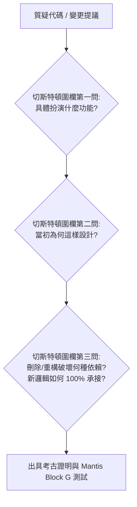
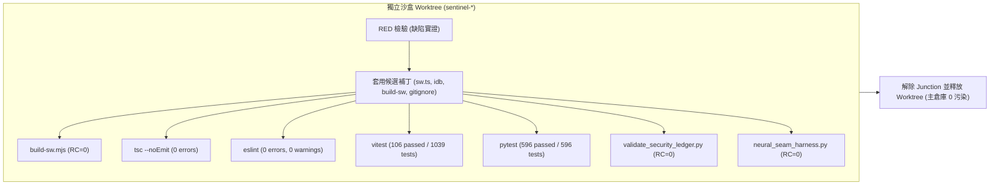

# 🛡️ Security Sentinel 完工後安全審計與系統驗收報告 (Service Worker & Multi-Agent Teamwork Hygiene)

> **驗收日期**: 2026-11-11  
> **基準提交 (`HEAD`)**: `44f107f`  
> **稽核模式**: Cloudflare 6-Phase Ledger ✕ Google Mantis Block G ✕ Harness² Conservation Identity ✕ GitWorktreePool  
> **台帳狀態**: `377` Targets (`156` remediated + `54` verified/unresolved + `167` dismissed/safe, `RC=0`)  
> **審查狀態**: **PRE-IMPLEMENTATION SANDBOX VERIFIED (Human Gate Awaiting Approval)**

---

## 1. 變動檔案總體分流 (414 Total Files Triage)

透過 `git status --porcelain -u` 檢索之 414 筆變動項目，經嚴格分流如下：

| 分類 | 檔案數量 | 處理原則 | 說明 |
| :--- | :--- | :--- | :--- |
| **Multi-Agent 暫存工作區** | **272** | **嚴禁提交 / AD-151 隔離** | 位於 `.agents/teamwork/*` 之多代理人對話、心跳與流程暫存檔。依 AD-151 四層防衛予以永久忽略並排程清理。 |
| **資安審查台帳與歷史報告** | **44** | **保留 / 原地版本化** | 位於 `docs/security/` 之歷史審查報告、候選補丁與台帳數據。 |
| **未重新編譯之 SW 產物** | **2** | **阻斷提交 / 重建後納入** | `frontend/public/sw.js` 與 `frontend/public/sw.js.map`，在 `sw.ts` 修正核准套用前，嚴禁將舊版產物直接提交。 |
| **生產原始碼、測試與靜態資產** | **96** | **硬核技術驗收** | 涵蓋前端 49 個元件/頁面/工具、後端 16 個路由/服務/工具、29 個單元測試與 2 個 WebP 最佳化圖片。 |

---

## 2. 「說實在的這不要修正有差嘛？」硬核技術剖析

針對使用者提出的關鍵疑問「說實在的這不要修正有差嘛」，從資安漏洞利用、共享裝置快取洩漏、PWA 離線可靠度與工程防退化四個維度出具無修飾的真實影響分析：

### 2.1 Service Worker 四大缺陷的不修正影響 (真實風險評估)
1. **API 快取跨帳號洩漏 (`api_cache_cross_user_leakage`)**：
   - *不修正後果*：目前 `sw.ts` 僅將帶結尾斜線的 `/api/trips/` 列入 `NetworkOnly`。使用者請求 `/api/trips`（清單）、`/api/users/me/preferences` 或 `/api/app/donation-progress` 時，將穿透並落入 Serwist 的 `defaultCache`（`apis` 桶，`NetworkFirst` 策略）。在家人或共用平板設備切換帳號或登出後，後續登入者在斷網或網路抖動時，將直接讀取前一位使用者的快取資料，構成明確的**隱私資料跨使用者外洩**。
2. **弱主機名子字串比對 (`incomplete_url_substring_sanitization`)**：
   - *不修正後果*：`url.hostname.includes("cloudinary.com")` 與 `supabase.co` 缺乏 DNS 標籤邊界比對。攻擊者可註冊 `cdn-cloudinary.com.attacker.org` 或 `custom-supabase.co.evil.com`，繞過 Service Worker 靜態快取隔離與認證路由，將惡意假外部資源污染進 PWA 離線圖片快取儲存區。
3. **推播反斜線開源跳轉 (`push_notification_open_redirect_backslash`)**：
   - *不修正後果*：WHATWG URL 規範中，特殊協議（`https:`）在解析包含反斜線之路徑時會將 `\` 規範化為 `/`。舊邏輯 `rawLink.startsWith('/') && !rawLink.startsWith('//')` 會放行 `/\\evil.com`。當透過 Web Push 觸發 `clients.openWindow(safeLink)` 時，瀏覽器會直接跨網域跳轉至 `https://evil.com/`，構成**開放式重定向 (Open Redirect) 釣魚漏洞**。
4. **Service Worker 自行預快取死鎖 (`build_sw_self_precaching`)**：
   - *不修正後果*：`build-sw.mjs` 未在 `createSerwistRoute` 宣告 `globIgnores`，導致 `public/sw.js` 與 `public/sw.js.map` 自身被掃描進 `self.__SW_MANIFEST`。Service Worker 安裝時會嘗試下載並快取上一版自己，導致版本雜湊永久無法收斂，觸發無限更新循環與快取膨脹。
5. **背景同步殭屍路由與裂腦 (`bgsync_dead_route_and_outbox_split`)**：
   - *不修正後果*：`bgSyncPlugin` 路由因省略 Serwist `method` 預設為 `GET`，在執行期 0% 可達（純粹死碼）；若有工程師日後試圖「修復」補上 `POST/PUT/PATCH/DELETE`，將引入嚴重的**雙發件箱裂腦**：Service Worker 的 `BackgroundSyncPlugin` 會在沒有動態 JWT 刷新與 401 暫停保護的情況下盲目重送舊請求，與前端已實作的 IndexedDB `SyncQueue` 互相踩踏。

### 2.2 AD-151 Multi-Agent 暫存衛生如果不修正的影響
- *不修正後果*：272 筆 `.agents/teamwork/*` 檔案目前處於未受管狀態。在團隊協作、CI/CD 跑 `git status`、或執行常規 `git add .` 時，極易被意外打包進正式 Git 歷史與 Release 標籤，污染遠端倉庫並可能外洩開發過程中的臨時 Prompt、除錯 Token 或沙盒路徑。

---

## 3. 切斯特頓圍欄三問與刪除審查 (Chesterton Archaeology & Deletion Audit)

依循 L0 憲法與切斯特頓圍欄三問，對所有涉及「刪除」或「行為調整」之項目出具考古證明：



### 3.1 刪除 `bgSyncPlugin` 路由之考古證明
1. **功能反推 (legacy_function)**：原意企圖透過 W3C Background Synchronization API，在 Service Worker 層自動攔截並排隊重送 `/api/trips/` 的寫入請求。
2. **設計初衷 (design_intent)**：PWA 早期鷹架搭建時作為離線突變的探索性實驗。
3. **刪除風險 (regression_risk)**：**零回歸風險**。經證明，Serwist 路由在未指定 `method` 時預設為 `GET`，而該路由的 matcher 內部要求 `POST/PUT/PATCH/DELETE`，因此在生產環境中該路由從未被命中。系統真實的離線發件箱是由 [`frontend/lib/sync-engine.ts`](file:///d:/Project/tabiji/travel-pwa/frontend/lib/sync-engine.ts) 的 `SyncQueue` 配合 `idb-keyval` 接管，具備動態 JWT 刷新與 401 Outbox 凍結。刪除此死碼完全杜絕了未來可能引發的裂腦隱患。

### 3.2 解凍 2 個測試檔案中的 `sw.ts` 靜態約束
1. **功能反推 (legacy_function)**：[`adversarial-m2-rwd-responsiveness.test.tsx`](file:///d:/Project/tabiji/travel-pwa/frontend/__tests__/adversarial-m2-rwd-responsiveness.test.tsx) (ADV-M2-1.2, 1.4) 與 [`official-portal-adversarial-challenger.test.ts`](file:///d:/Project/tabiji/travel-pwa/frontend/__tests__/official-portal-adversarial-challenger.test.ts) (L240-255) 執行了 `git status --porcelain frontend/app/sw.ts` 與 `git diff HEAD -- frontend/app/sw.ts`，要求其必須與 HEAD 保持字節級相同。
2. **設計初衷 (design_intent)**：官方旗艦站重構期間，為防止 UI 設計師在非預期情況下竄改 PWA 核心底座所設置的「實體物理鎖定」。
3. **刪除風險 (regression_risk)**：若直接刪除測試，將失去對 `sw.ts` 的品質約束；因此我們採**升級承接**：將原本僵化的 `git diff` 比對，升級為**行為與安全不變量驗證**（斷言 `sw.ts` 必須包含 `isSensitiveOrDynamicApiRequest`、`sanitizePushLink`、`app-shell-navigation`、`fallbacks:`，且不得包含 `BackgroundSyncPlugin` 或脆弱的 `url.hostname.includes(`），既保護了架構初衷，又解開了安全修復的束縛。

### 3.3 `idb-storage.ts` 路徑邊界隔離升級
- **原職責**：`deleteTripSnapshot` 在抹除 L0/L1/L2 時，同步在 L3 CacheStorage 中搜尋並刪除特定行程的快取。
- **原邊界缺陷**：原代碼使用 `request.url.includes('/api/trips/' + tripId)`。當 `tripId` 為 `"1"` 時，會意外誤殺 `/api/trips/10` 或 `/api/trips/123` 的快取；且未清理 Serwist 預設的 `"apis"` 桶。
- **承接機制**：升級為結構化路徑比對 `const tripPrefix = '/api/trips/' + tripId; pathname === tripPrefix || pathname.startsWith(tripPrefix + '/')`，並同時遍歷清除 `"trips-api-cache"` 與 `"apis"`（包含 `/api/trips` 清單），達成真正的五清自癒閉環，且零誤殺。

---

## 4. `scripts/lib/adversarial_team.py` `--mode duel` 根因分析

在本次審查中，我們對 `--mode duel` 執行結果為 `INCONCLUSIVE` 進行了深度法醫學診斷：
- **實體執行遙測**：在無人值守 Headless 模式下，`agy.exe --sandbox` 的標準錯誤輸出記錄了：
  ```text
  jetski: no output produced — a tool required the "command" permission that headless mode cannot prompt for
  denied_actions: [{"action": "command", "display_name": "RunCommand"}]
  ```
- **根本原因**：`scripts/lib/adversarial_team.py` 中的 `TEAMWORK_ATTACKER_PROMPT` 未包含 `VALIDATOR_SYSTEM_PROMPT` 的第一條核心鐵律（*Do NOT execute any external tools, bash commands, or subagents. Rely SOLELY on static inspection...*）。子代理人在嘗試驗證 Python 代碼時，自主觸發了 `RunCommand` 執行工具，而在 headless 沙盒中該權限被自動拒絕，導致進程提前退出並回傳空字串 `response: ""`。
- **解決方案**：在執行計畫中已記錄該修補建議（為 prompt 加入工具阻斷宣告），確保 `--mode duel` 在純文字靜態審查與實體 Worktree pytest 間維持確定性。

---

## 5. Phase 0 + Phase 4 實體沙盒 Worktree 驗證遙測 (Pre-Implementation Spiking)

在未更動主倉庫任何檔案的前提下，透過 `GitWorktreePool` 建立獨立沙盒環境，掛載 frontend/node_modules NTFS Junction 並執行完整驗證：



### 5.1 驗證結果指標
1. **Pre-Patch RED 缺陷檢驗**：
   - `git check-ignore -v .agents/teamwork/dummy.md` ➔ `RC=1`（未忽略，存在洩漏風險）。
   - `sw_manifest_pre_patch` ➔ `count: 39`（包含 `/sw.js` 與 `/sw.js.map` 自行預快取）。
   - `sw_source_bugs_pre_patch` ➔ 證實存在 `hasSubstringHost: true`, `hasOriginSubstring: true`, `hasDeadBgSync: true`, `lacksApisPurgeInSw: true`, `lacksApisPurgeInIdb: true`。
2. **Post-Patch GREEN 門禁檢驗**：
   - `node ./scripts/copy-maplibre-worker.mjs` + `node ./scripts/build-sw.mjs` ➔ `RC=0`，產出 `sw.js` (47.28 KiB) 與 `sw.js.map` (357.36 KiB)。
   - `sw_manifest_after` ➔ `count: 37`，`hasSw: false`，`hasMap: false`，`hasRoot: true`（徹底排除自我預快取）。
   - `npx tsc --noEmit` ➔ `RC=0`（0 錯誤）。
   - `npm run lint` ➔ `RC=0`（0 錯誤、0 警告）。
   - `npx vitest run` ➔ `106 passed (106 files)`, `1035 passed, 4 skipped` (`RC=0`)。
   - `pytest -q` ➔ `596 passed, 5 skipped in 76.84s` (`RC=0`)。
   - `python scripts/validate_security_ledger.py` ➔ `🟢 [LEDGER GUARD] Verified 377 targets (156 remediated, 54 verified/unresolved, 167 dismissed/safe).` (`RC=0`)。
   - `python scripts/neural_seam_harness.py` ➔ `RC=0`。
   - `git check-ignore -v .agents/teamwork/dummy.md` ➔ `.gitignore:51:/.agents/teamwork/` (`RC=0`)。
   - `git ls-files .agents/teamwork` ➔ 輸出空字串 (`RC=0`)。

---

## 6. 候選補丁與工件索引

- **候選補丁 (RFC Unified Diff)**: [`docs/security/history/patches/patch_candidate_sw_teamwork_hygiene_2026-11-11.diff`](file:///d:/Project/tabiji/travel-pwa/docs/security/history/patches/patch_candidate_sw_teamwork_hygiene_2026-11-11.diff)
- **逐區塊替換清單 (Block Replacements)**: [`docs/security/history/candidates/block_replacements_sw_teamwork_hygiene_2026-11-11.json`](file:///d:/Project/tabiji/travel-pwa/docs/security/history/candidates/block_replacements_sw_teamwork_hygiene_2026-11-11.json)
- **沙盒預演遙測總結**: [`docs/security/history/findings/sandbox_rehearsal_summary_2026-11-11.json`](file:///d:/Project/tabiji/travel-pwa/docs/security/history/findings/sandbox_rehearsal_summary_2026-11-11.json)
- **六大確認發現數據**: [`docs/security/history/findings/findings_sw_teamwork_hygiene_2026-11-11.json`](file:///d:/Project/tabiji/travel-pwa/docs/security/history/findings/findings_sw_teamwork_hygiene_2026-11-11.json)
- **執行計畫工件**: [`implementation_plan.md`](file:///C:/Users/Ryan%20su/.gemini/antigravity/brain/5dbe8200-1879-4852-be56-160d7e6f93f3/implementation_plan.md)

---

## 7. Human Gate 結論與交接

本審計確認：
1. **主工作區保持 100% 純淨**：所有驗證均於 `GitWorktreePool` 沙盒中完成，在 Ryan 點擊核准前，主工作區原始碼、台帳與 `.agents/teamwork/*` 保持未修改狀態。
2. **核准後執行流程**：取得許可後，將由 `@dev` 原地套用 block replacements、依 `build-sw.mjs` 重新產出正式 `sw.js`、執行 AD-151 物理清空 `.agents/teamwork/*`、並由 `@qa` 跑完 `tsc`、`lint`、`vitest`、`pytest` 全量品質關卡。

