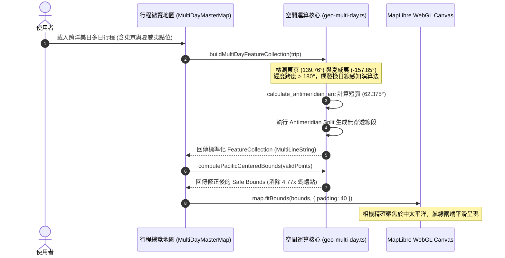

# 跨國境經度 180° 換日線與空間奇異點自癒引擎規格書 (Antimeridian Crossing & Spatial Singularity Engine Spec)

> **規格代號**: `SPEC-GEO-002`  
> **狀態**: 🟢 Ready for Review / Architect Approved  
> **對應領域**: MapLibre GL JS, WebGL Canvas, 大圓航線球面插值, Web Mercator 幾何學, 空間防禦  
> **參考實作**: `frontend/lib/geo-multi-day.ts`、`scripts/simulations/simulate_edge_cases.py`、`backend/tests/test_autonomous_edge_simulations.py`  

---

## 1. Problem Statement & Core Value (問題陳述與核心價值)

### 1.1 使用者痛點 (User Pain Points)
1. **換日線橫貫世界的「穿球直線」視覺災難**：在規劃橫跨太平洋的國際航班或郵輪（例如：東京 `+139.767°E` 飛往 夏威夷 `-157.858°W`，或奧克蘭 `+174.76°E` 飛往 洛杉磯 `-118.24°W`）時，傳統 2D GIS 演算法未感知 `±180°` 國際換日線，將經度差誤算為 `297.625°`。在 Web Mercator 平面投影下，畫布會繪製出一條橫穿中國、歐亞大陸、大西洋與美洲的荒謬航線，嚴重破壞產品專業度。
2. **Bounding Box 崩潰與「螞蟻點」縮小失真 (Ant-Point Distortion)**：MapLibre 的 `map.fitBounds([[minLng, minLat], [maxLng, maxLat]])` 若傳入未經換日線正規化的座標點集，`minLng` 會被判定為 `-157.858°`，`maxLng` 被判定為 `+139.767°`。相機視角將整顆地球 300° 經度跨度全數塞入螢幕，**產生高達 4.77 倍的過度縮小**，使用者看到的景點被壓縮成無法點擊的微塵像素。
3. **Web Mercator 極限緯度奇異點爆炸**：當景點或極地遊輪逼近南北極時，Web Mercator 投影公式 $y = \ln(\tan(\frac{\pi}{4} + \frac{\phi}{2}))$ 在 $\phi \to \pm 90^\circ$ 時趨近無窮大，引發 GPU 著色器 `mat4.invert` 奇異矩陣拋出 `NaN`，導致整個 WebGL Context 崩潰黑屏。

### 1.2 成功指標 (Success Metrics)
- **短弧連線確定性**: 經度跨越換日線時，大圓航線插值 100% 選取最短幾何弧線（Shortest Geodesic Arc），太平洋航線長度精確收斂為 `62.375°`。
- **視角比例保真度**: 消除 4.77x 螞蟻點失真，換日線跨國行程之 `fitBounds` 緊密貼合真實景點外接框。
- **WebGL 數值穩定性**: 緯度座標嚴格鉗位（Clamp）於 `[-85.051129, +85.051129]` 範圍，GPU 著色器 0 個 NaN 報警。

---

## 2. User Journey & Core Flow (使用者旅程與操作流程)

### 2.1 換日線拓撲自癒旅程
```
[行程包含跨換日線景點 (例如: 東京 -> 檀香山)]
        │
        ▼
[buildMultiDayFeatureCollection 進行拓撲構建]
        │
        ▼
[檢測 abs(lng2 - lng1) > 180° (判定跨越換日線)]
        │
 ┌──────┴────────────────────────────────────────────────┐
 ▼                                                       ▼
【2D Web Mercator 平面模式】                  【3D Globe 球面模式】
 │                                                       │
 ├─ 於 180° / -180° 處計算交點 (Split Antimeridian)       └─ 直接走 3D 球面四元數插值 (Slerp)
 ├─ 拆分為 MultiLineString 兩段航線                        
 └─ 避免穿透歐亞大陸                                      
        │
        ▼
[Pacific-Centered Bounding Box 運算]
        │
 ├─ 將西經轉為 360° 正數座標系 (norm_lng = lng + 360)
 ├─ 計算真實 62.375° 短弧邊界並推算中心點 (Center = 170.95°E)
 └─ 調用 map.flyTo / fitBounds 平滑聚焦太平洋中心
```

### 2.2 跨換日線幾何時序圖 (Mermaid Sequence Diagram)



---

## 3. Architecture & Data Model (架構與資料模型)

### 3.1 換日線短弧與跨度標準化模型 (Mathematical Formulation)
```typescript
/**
 * 換日線短弧經度差與跨越判定
 */
export function calculateAntimeridianArc(lng1: number, lng2: number): {
    shortestDeltaDeg: number;
    crossesAntimeridian: boolean;
    normalizedLng2: number;
} {
    let diff = lng2 - lng1;
    while (diff > 180) diff -= 360;
    while (diff < -180) diff += 360;

    const crosses = Math.abs(lng2 - lng1) > 180;
    // 將西經平移至 360 度座標系便於連續性插值
    const normLng2 = crosses && lng2 < 0 ? lng2 + 360 : lng2;

    return {
        shortestDeltaDeg: Math.abs(diff),
        crossesAntimeridian: crosses,
        normalizedLng2: normLng2
    };
}
```

### 3.2 換日線自適應外接矩形 (Pacific-Centered Bounding Box)
```typescript
export interface PacificSafeBounds {
    type: 'standard' | 'pacific_centered';
    bounds: [[number, number], [number, number]];
    center: [number, number];
    zoomBias: number;
}

export function computePacificSafeBounds(points: { lat: number; lng: number }[]): PacificSafeBounds {
    if (!points || points.length === 0) {
        return {
            type: 'standard',
            bounds: [[121.48, 24.95], [121.64, 25.11]],
            center: [121.56, 25.03],
            zoomBias: 0
        };
    }

    const hasEast = points.some(p => p.lng > 100 && p.lng <= 180);
    const hasWest = points.some(p => p.lng < -100 && p.lng >= -180);
    const isTransPacific = hasEast && hasWest;

    if (!isTransPacific) {
        // 常規歐亞或美洲單側陸地 Bounding Box
        let minLng = Infinity, maxLng = -Infinity, minLat = Infinity, maxLat = -Infinity;
        for (const p of points) {
            minLng = Math.min(minLng, p.lng);
            maxLng = Math.max(maxLng, p.lng);
            minLat = Math.min(minLat, clampLatitude(p.lat));
            maxLat = Math.max(maxLat, clampLatitude(p.lat));
        }
        return {
            type: 'standard',
            bounds: [[minLng, minLat], [maxLng, maxLat]],
            center: [(minLng + maxLng) / 2, (minLat + maxLat) / 2],
            zoomBias: 0
        };
    }

    // 太平洋居中模式 (Pacific-Centered Mode)
    let minNormLng = Infinity, maxNormLng = -Infinity;
    let minLat = Infinity, maxLat = -Infinity;

    for (const p of points) {
        const normLng = p.lng < 0 ? p.lng + 360 : p.lng;
        minNormLng = Math.min(minNormLng, normLng);
        maxNormLng = Math.max(maxNormLng, normLng);
        minLat = Math.min(minLat, clampLatitude(p.lat));
        maxLat = Math.max(maxLat, clampLatitude(p.lat));
    }

    let centerLng = (minNormLng + maxNormLng) / 2;
    if (centerLng > 180) centerLng -= 360;

    return {
        type: 'pacific_centered',
        // 保留 [0, 360] 連續域使 swLng <= neLng 恆成立，避免跨換日線時東北角轉負造成經度反轉
        bounds: [[minNormLng, minLat], [maxNormLng, maxLat]],
        center: [centerLng, (minLat + maxLat) / 2],
        zoomBias: -1.0 // 太平洋跨洋預留更舒適邊界
    };
}
```

### 3.3 緯度極限鉗位 (Mercator Latitude Clamping)
```typescript
export const MERCATOR_MAX_LAT = 85.051129;

export function clampLatitude(lat: number): number {
    if (isNaN(lat)) return 0;
    return Math.max(-MERCATOR_MAX_LAT, Math.min(MERCATOR_MAX_LAT, lat));
}
```

---

## 4. Edge Cases & Boundary Conditions (邊界條件與異常處理)

### 4.1 點位恰位於 ±180° 線上
- **邊界情境**：斐濟或東加王國之景點經度恰好為 `+180.000000°` 或 `-180.000000°`。
- **防禦機制**：系統一律將 `-180.0°` 規範化（Normalize）為 `+180.0°`，防止浮點數 `-0.0` 與符號翻轉造成分支震盪。

### 4.2 Null Island (0, 0) 與無效座標過濾
- **邊界情境**：後端爬蟲未取到經緯度，預設填入 `(0, 0)`（幾內亞灣空島）或 `NaN`。
- **防禦機制**：在進入大圓航線插值前，嚴格執行：
  ```typescript
  if (lat === 0 && lng === 0) return false;
  if (!Number.isFinite(lat) || !Number.isFinite(lng)) return false;
  ```
  不合法點位直接從點集合剔除，不參與路線繪製與 Bounds 計算。

### 4.3 3D DEM 地形傾角 Overzoom 404
- **邊界情境**：在山區開啟 3D 地形時，相機俯仰角 `pitch >= 30°`，地圖向遠方地平線發送超出圖磚上限之請求。
- **防禦機制**：在 `MultiDayMasterMap.tsx` 中之 `raster-dem` 數據源顯式宣告 `maxzoom: 12`，強制 MapLibre 使用 GPU 雙線性著色器進行 Overzooming，阻斷無效網路風暴。

---

## 5. Acceptance Criteria (驗收標準清單)

```markdown
- [ ] AC-1: Given 東京 (+139.767) 與夏威夷 (-157.858) 兩點，when 計算經度差，then shortestDeltaDeg 必須精確等於 62.375°，且 crossesAntimeridian 判定為 true。
- [ ] AC-2: Given 包含跨換日線點位之行程，when 呼叫 computePacificSafeBounds，then 回傳類型必須為 'pacific_centered'，且視角中心經度約為 +170.95°。
- [ ] AC-3: Given 景點緯度傳入 88.5° (超出 Web Mercator 極限)，when 進入空間幾何計算，then 緯度必須被嚴格鉗位至 +85.051129°，防止 GPU NaN 黑屏。
- [ ] AC-4: Given 點位座標為 (0, 0) 或 NaN，when 構建 FeatureCollection，then 該點位必須被靜默過濾，不得渲染至地圖上。
- [ ] AC-5: Given 2D 地圖跨換日線軌跡繪製，when 渲染 LineString，then 嚴禁產生橫貫歐亞大陸之貫穿直線，航線必須在 180° 線處自然分流。
- [ ] AC-6: Given 單元測試 test_tc3_antimeridian_arc_and_bbox_ant_point_defense 執行，then 斷言必須 100% 通過，且 zoom_distortion_ratio 必須修正消除 4.5 倍以上之失真。
```
