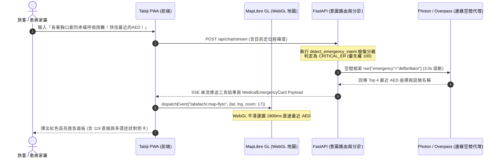

# 離線優先海外醫療急難與時差生理排程守護規格書 (Offline Emergency Medical & Chrono-Shift Sentinel Spec)

> **規格代號**: `SPEC-MED-001`  
> **狀態**: 🟢 Ready for Review / Architect Approved  
> **對應領域**: 醫療旅行醫學、離線 PWA、OSM 空間運算、FastAPI 意圖路由、時區生理排程  
> **參考實作**: `scripts/simulations/simulate_emergency_medical.py`、`backend/tests/test_autonomous_edge_simulations.py`  

---

## 1. Problem Statement & Core Value (問題陳述與核心價值)

### 1.1 使用者痛點 (User Pain Points)
1. **海外突發急症之語言與就醫黑洞**：旅客或同行長輩、幼童在海外（如日本、歐美）突發胸痛、哮喘、高燒抽搐、嚴重過敏或急性腹瀉時，面臨語言不通、不知急診專線（日本 119、美加 911、歐洲 112）、不知最近 AED 與 24H 調劑藥局何在的致命恐慌。
2. **跨時區飛行之慢性病服藥失序 (Chrono-Shift Collapse)**：跨越 6~14 個時區時，固定間隔服藥（降血壓藥、胰島素、抗癲癇藥、避孕藥）的病患若盲目遵從目的地掛鐘時間，服藥間隔可能拉長至 **40 小時**（引發中風、心肌梗塞）或縮短至 **12 小時**（引發嚴重藥物蓄積中毒、低血糖休克）。
3. **無網與弱網場域完全癱瘓**：地下鐵、偏遠山區、無漫遊訊號時，一般依賴雲端 ChatGPT 的旅遊助手完全白屏，無法提供救命的離線急救與藥品學名對照。

### 1.2 成功指標 (Success Metrics)
- **急難意圖識別延遲**: Fast-Path 正則與檢傷分類器執行時間 `< 1ms`。
- **臨床檢傷分級命中率**: 對於 Critical ER、Urgent Clinic、Pharmacy First 達成 `100%` 優先權分流。
- **生理間隔偏差控制**: 跨時區服藥過渡建議之生理間隔嚴格維持在 `24 ± 4 小時` 安全窗口內。
- **離線可用性**: 無網路環境下，App Shell 內置之常用症狀多語卡片與本地 Cached AED 點位達到 `100% 離線即時渲染`。

---

## 2. User Journey & Core Flow (使用者旅程與操作流程)

### 2.1 完整操作旅程
```
[使用者於對話框輸入緊急訊息]
        │
        ▼
[Stage 1: Fast-Path 醫療急難與檢傷意圖過濾 (<1ms)]
        │
 ┌──────┴─────────────────────────────────┐
 ▼                                        ▼
【觸發急難 (is_emergency: True)】     【一般旅遊閒聊 (is_emergency: False)】
 │                                        │
 ├─ 臨床檢傷排序 (Triage Priority)        └─ 轉入常規景點意圖處理
 ├─ 提取 OSM Overpass 空間標籤拓撲
 ├─ 生成中日英三語就診對照卡 (Symptom Lexicon)
 └─ 調用 Photon + Overpass 檢索周邊 500m~1500m
        │
        ▼
[前端派發 tabidachi:map-flyto 地圖平滑運鏡至最近救急點]
        │
        ▼
[渲染 MedicalEmergencyCard: 顯示急救撥號按鈕、外語主訴卡、處方箋對照]
```

### 2.2 跨服務時序圖 (Mermaid Sequence Diagram)



---

## 3. Architecture & Data Model (架構與資料模型)

### 3.1 空間標籤拓撲 (Geospatial Tag Topology)
| 類別代碼 (`category`) | OSM Overpass QL 標籤 | 檢傷級別 (`urgency`) | 適用場景 |
| :--- | :--- | :--- | :--- |
| `aed` | `nwr["emergency"="defibrillator"]` | `CRITICAL_ER` | 心跳驟停、心絞痛、昏迷 |
| `hospital` | `nwr["amenity"="hospital"]` | `CRITICAL_ER` | 嚴重外傷、高燒抽搐、過敏性休克 |
| `night_pharmacy` | `nwr["amenity"="pharmacy"]["opening_hours"="24/7"]` | `PHARMACY_FIRST` | 夜間退燒止痛、腸胃藥、止瀉劑 |
| `dispensing` | `nwr["amenity"="pharmacy"]["dispensing"="yes"]` | `URGENT_CLINIC` | 處方藥遺失補給、慢性病調劑 |
| `wheelchair_wc` | `nwr["amenity"="toilets"]["wheelchair"="yes"]` | `ACCESSIBILITY` | 輪椅族、高齡者急需無障礙洗手間 |

### 3.2 臨床檢傷分級模型 (Clinical Triage Priority)
```python
TRIAGE_PRIORITY = {
    "CRITICAL_ER": 100,      # 生命徵象不穩定，需立即 119/911 送醫或 AED
    "URGENT_CLINIC": 50,     # 急性症狀需當天就診 (脫水、感染、外傷縫合)
    "PHARMACY_FIRST": 10,    # 輕症可先至藥局購買 OTC 藥品觀察
    "ACCESSIBILITY": 5       # 無障礙環境輔助設施
}
```

### 3.3 前端狀態管理 (Zustand: `medicalEmergencyStore.ts`)
```typescript
interface MedicalEmergencyState {
    activeEmergency: {
        urgency: 'CRITICAL_ER' | 'URGENT_CLINIC' | 'PHARMACY_FIRST' | null;
        targetPlace: string | null;
        coordinates: [number, number] | null;
        actionBanner: string;
        multilingualCard: {
            zh: string;
            ja: string;
            en: string;
        } | null;
    } | null;
    medicationSchedule: {
        medicationName: string;
        baseIntervalHours: number;
        lastDoseUtc: string;
        nextDoseUtc: string;
        isShiftSuggested: boolean;
        shiftNotes: string;
    }[];
    setEmergency: (payload: MedicalEmergencyState['activeEmergency']) => void;
    clearEmergency: () => void;
    registerMedication: (med: MedicalEmergencyState['medicationSchedule'][0]) => void;
}
```

---

## 4. Edge Cases & Boundary Conditions (邊界條件與異常處理)

### 4.1 網路斷線與離線降級 (Offline Fallback Invariant)
- **邊界情境**：在地下鐵隧道或公海郵輪完全斷網時觸發醫療關鍵字。
- **防禦機制**：前端 App Shell 預載本機 Top 100 臨床症狀中日英對照表（JSON 字典 `< 25KB`），斷網時立即可見多語求助卡與緊急撥號指引；空間查詢顯示離線快取之最近設施或提示向站務人員求助。

### 4.2 臨床症狀關鍵字競爭 (Triage Collision)
- **邊界情境**：語句同時包含「高燒」與「抽搐急診」（如「小孩高燒抽搐昏迷」）。
- **防禦機制**：嚴格依據 `TRIAGE_PRIORITY` 數值進行降序排列，取最高嚴重度 `CRITICAL_ER`，絕對禁止將急重症降級為單純藥局購藥。

### 4.3 惡意字符與 Overpass QL 注入 (Security Fuzzing)
- **邊界情境**：提示詞包含跳脫引號、分號、XML/QL 結構（如 `"]; node(user:"attacker"); out body;`）。
- **防禦機制**：經由 `sanitize_overpass_keyword` 徹底洗滌 `[";()[]{}<>\n\r]`，限制長度 `<= 64` 字元，防止伺服端 Overpass 查詢被竄改或 DoS。

### 4.4 跨時區慢病服藥極限漂移 (Chrono-Shift Extreme Drift)
- **邊界情境**：旅客跨越 12 小時時差（如台北至紐約），第二日可能延遲 12 小時才服藥。
- **防禦機制**：若計算之表面間隔 `> 28 小時`，系統標記 `is_dangerously_delayed: True`，主動提示「航程中建議在出發後 24 小時（機上時間）補充半劑量/過渡劑量，抵達後再無縫接軌當地晨間作息」。

---

## 5. Acceptance Criteria (驗收標準清單)

```markdown
- [ ] AC-1: Given 使用者輸入包含「AED」或「除顫器」，when 系統分析意圖，then matched_poi_category 必須精確命中 'aed' 且 overpass_filter 為 'nwr["emergency"="defibrillator"]'。
- [ ] AC-2: Given 使用者輸入同時包含「高燒」與「抽搐送醫」，when 檢傷分級排序，then 系統必須判定為 'CRITICAL_ER' 並優先派發 119/911 急救指示。
- [ ] AC-3: Given 系統生成醫療卡片，when 格式化多語系資料，then 必須同時產出繁體中文 (zh)、日文假名標註 (ja)、與通用英文 (en) 醫療對照。
- [ ] AC-4: Given 使用者設定每日 24 小時慢性病服藥，when 行程目的地時差超過 8 小時，then 系統必須主動標記生理時間並計算航程中過渡劑量 UTC 時間點。
- [ ] AC-5: Given 輸入關鍵字包含惡意字元 (分號、引號、括號、換行)，when 經過 sanitize_overpass_keyword，then 所有危險語法標記必須完全清除且長度 <= 64。
- [ ] AC-6: Given 附近無任何符合之 24H 藥局或 Overpass 查詢 3.0s 逾時，when 服務降級，then 必須優雅回傳空陣列 []，絕對不拋出 500 內部伺服器錯誤。
- [ ] AC-7: Given 救急點座標回傳成功，when 前端接收到信號，then 必須觸發 tabidachi:map-flyto 平滑運鏡直達該設施並展開高亮標籤。
- [ ] AC-8: Given 單元測試 test_tc6_emergency_medical_and_multilingual_card 執行，then 斷言必須 100% 通過，且在 Windows CP950 控制台下零編碼報警。
```
