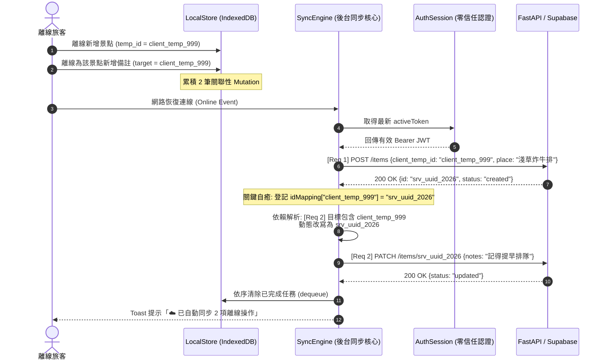

# 離線多主機 Outbox 佇列級聯依賴與衝突收斂規格書 (Offline Multi-Master Outbox Cascade & Convergence Spec)

> **規格代號**: `SPEC-SYNC-003`  
> **狀態**: 🟢 Ready for Review / Architect Approved  
> **對應領域**: 離線 PWA, IndexedDB (idb-keyval), 樂觀更新狀態機, 突變依賴解析, 零信任身分自癒  
> **參考實作**: `frontend/lib/sync-engine.ts`、`frontend/lib/sync-hooks.ts`、`backend/tests/test_autonomous_edge_simulations.py`  

---

## 1. Problem Statement & Core Value (問題陳述與核心價值)

### 1.1 使用者痛點 (User Pain Points)
1. **離線臨時 ID 級聯依賴斷裂 (Ephemeral ID Cascading Failure)**：旅客在地下鐵或飛航模式中，連續操作行程是極高頻的行為。例如：
   - 操作 1: 離線新增景點「淺草炸牛排」（客戶端生成臨時主鍵 `client_temp_999`）
   - 操作 2: 離線編輯該景點備註「記得 11:00 提早排隊」（請求目標為 `client_temp_999`）
   - 操作 3: 離線新增記帳「門票 ¥1,500」（外鍵綁定 `client_temp_999`）  
   當連上網路後，若同步引擎僅是「盲目依序重播原始封包」：操作 1 成功後伺服端生成正式 UUID（`srv_uuid_888`），但操作 2 與 3 依然拿著 `client_temp_999` 打向後端，後端回傳 `HTTP 404 Not Found`！導致使用者的備註與記帳**憑空蒸發**。
2. **401 身分過期引發的「誤殺丟包」災難**：若離線累積了數十筆操作，重連瞬間 Session Token 剛好過期（或在其他設備輪替了金鑰）。若引擎在收到 `401 Unauthorized` 時無腦計入 `retryCount >= MAX_RETRIES` 並執行 `dequeue()`，所有寶貴的離線變更將在 1 秒內被永久抹殺！
3. **多裝置離線並發寫入衝突 (Write-Write Conflict)**：旅伴 A 在斷網時調整了 Day 2 景點順序，旅伴 B 在在線時也增刪了 Day 2 景點。A 重連時若無衝突調和機制，會發生資料覆蓋或時間軸錯亂回彈。

### 1.2 成功指標 (Success Metrics)
- **級聯依賴成功率**: 跨實體臨時 ID 級聯重播成功率達成 `100%`，0 筆因 `temp_id` 導致的 404 丟包。
- **401 離線資料零丟失**: 遇 401 認證中斷時，Outbox 佇列資料保留率 `100%`，`retryCount` 物理凍結增長。
- **端到端無感恢復**: 網路恢復後，按行程 ID 分組並行處理，單一行程 20 筆操作重播時間 `< 1200ms`。

---

## 2. User Journey & Core Flow (使用者旅程與操作流程)

### 2.1 離線佇列級聯處理旅程
```
[使用者在離線狀態下發起連續操作]
        │
 ├─ 操作 1: POST /api/trips/{tid}/items (帶 client_temp_id)
 ├─ 操作 2: PATCH /api/trips/{tid}/items/{client_temp_id}
 └─ 操作 3: POST /api/trips/{tid}/expenses (帶 item_id: client_temp_id)
        │
        ▼
[SyncQueue.enqueue: 寫入 IndexedDB 'offline-sync-queue']
[同時登記至 Zustand useSyncStatusStore: 標記為 'pending']
        │
        ▼
[網路恢復 (window 觸發 'online' 事件)]
        │
        ▼
[SyncEngine 啟動 processQueue (檢查 isPaused() 與 in-flight 鎖)]
        │
 ┌──────┴───────────────────────────────────────────────────────┐
 │                     行程分組並行重播管線                       │
 ├─ 提取 URL 行程 ID 分組 (相同行程內部序列，不同行程並行)       │
 ├─ 查詢動態 IdMappingTable: client_temp_id ➔ srv_uuid           │
 ├─ 若命中 temp_id，執行 Payload 與 URL 動態原地改寫              │
 └─ 注入最新 Bearer Token 發送請求                               │
 └──────────────────────────────┬───────────────────────────────┘
                                │
        ┌───────────────────────┴───────────────────────┐
        ▼                                               ▼
 【HTTP 200 OK 成功】                           【HTTP 401 Unauthorized】
  │                                               │
  ├─ 提取回應正式 UUID 登記至 IdMappingTable       ├─ 物理凍結: SyncEngineControl.pause()
  ├─ SyncQueue.dequeue(id)                        ├─ 彈出原地引繼碼認證 Modal
  └─ Toast 提示:「已自動同步」                     └─ 嚴禁 dequeue！嚴禁 incrementRetry！
```

### 2.2 跨實體依賴時序圖 (Mermaid Sequence Diagram)



---

## 3. Architecture & Data Model (架構與資料模型)

### 3.1 擴充型離線請求資料契約 (Extended SyncRequest Schema)
```typescript
export interface EnrichedSyncRequest {
    id: string;                         // 佇列內部 UUID
    url: string;                        // 目標 API 路徑 (可包含動態佔位符)
    method: 'POST' | 'PUT' | 'PATCH' | 'DELETE';
    // eslint-disable-next-line @typescript-eslint/no-explicit-any
    body: Record<string, any>;
    headers?: Record<string, string>;
    timestamp: number;
    retryCount: number;
    
    // 🛡️ 級聯依賴解析核心欄位
    clientTempId?: string;              // 本地建立之臨時主鍵 (如 client_temp_xxx)
    dependsOnTempIds?: string[];        // 依賴之外鍵臨時 ID 清單
    tripId?: string;                    // 行程分組標識 (用於橫向並行重播)
    idempotencyKey: string;             // 冪等性金鑰 (防止網路抖動重放雙重建立)
}
```

### 3.2 雙層臨時 ID 映射表 (Two-Tier IdMappingTable)
- **L1 記憶體映射 (Memory Map)**：在同步工作線程中保持極速讀寫，單次 session 內即時生效。
- **L2 IndexedDB 持久化映射 (`offline-id-mapping`)**：跨 App 重啟保持，保存期為 `72 小時`，過期自動 LRU 清理。

```typescript
export class IdMappingRegistry {
    private static memoryMap = new Map<string, string>();

    static async register(tempId: string, serverId: string): Promise<void> {
        this.memoryMap.set(tempId, serverId);
        // 持久化至 IndexedDB
        await update('offline-id-mapping', (old: Record<string, string> = {}) => ({
            ...old,
            [tempId]: serverId
        }));
    }

    static async resolve(idOrUrl: string): Promise<string> {
        if (this.memoryMap.has(idOrUrl)) {
            return this.memoryMap.get(idOrUrl)!;
        }
        let current = idOrUrl;
        // 依長度降冪並加上邊界正則，防止 temp_1 前綴誤覆寫 temp_10
        const sortedEntries = Array.from(this.memoryMap.entries()).sort((a, b) => b[0].length - a[0].length);
        for (const [tempId, serverId] of sortedEntries) {
            const escaped = tempId.replace(/[.*+?^${}()|[\]\\]/g, '\\$&');
            current = current.replace(new RegExp(`${escaped}(?![0-9A-Za-z_-])`, 'g'), serverId);
        }
        return current;
    }
}
```

### 3.3 狀態機安全凍結控制器 (SyncEngineControl Invariant)
```typescript
let isSyncEnginePaused = false;

export const SyncEngineControl = {
    pause: () => {
        console.warn("🛑 [SyncEngine] Outbox frozen due to auth desync.");
        isSyncEnginePaused = true;
    },
    resume: () => {
        console.log("▶️ [SyncEngine] Outbox thawed. Resuming sync.");
        isSyncEnginePaused = false;
    },
    isPaused: () => isSyncEnginePaused,
};
```

---

## 4. Edge Cases & Boundary Conditions (邊界條件與異常處理)

### 4.1 遇到 401 Unauthorized 物理凍結原則 (AD-Sentinel)
- **邊界情境**：在重播過程中，伺服器回傳 `401 Unauthorized`（Token 已被後台撤銷或密鑰輪替）。
- **防禦機制**：
  1. 嚴格禁止執行 `SyncQueue.incrementRetry(id)`。
  2. 嚴格禁止執行 `SyncQueue.dequeue(id)`。
  3. 立即呼叫 `SyncEngineControl.pause()` 物理切斷重播迴圈。
  4. 觸發 `triggerReauthPrompt()` 喚醒原地認證彈窗。
  5. 待使用者原地成功重驗憑證後，系統自動呼叫 `SyncEngineControl.resume()` 沖刷積壓的離線請求。

### 4.2 離線 FormData 照片上傳略過與保留 (FormData Safe Bailout)
- **邊界情境**：旅客離線嘗試上傳高解析度單據照片，`FormData` 物件無法在 IndexedDB 中可靠序列化。
- **防禦機制**：系統以標記 `{ _offline_type: 'formData' }` 封裝，重播時主動跳過並彈出 Toast 提示「⚠️ 部分照片在離線時無法自動同步，請連線後手動重新上傳」，並將該項目安全 dequeue，絕不卡死後續純文字佇列。

### 4.3 雙端離線同項目修改衝突 (Last-Write-Wins with Timestamp)
- **邊界情境**：兩位成員斷網時同時修改同一景點的備註。
- **防禦機制**：後端採用樂觀時間戳記審查（LWW）。若後端記錄之 `updated_at > request.timestamp`，後端回傳 `409 Conflict` 並夾帶最新資料；前端接收後提示「檢測到旅伴有更新版本，已為您自動載入最新資訊」。

---

## 5. Acceptance Criteria (驗收標準清單)

```markdown
- [ ] AC-1: Given 使用者在離線時新增景點並立即編輯該景點備註，when 網路恢復重播佇列，then 系統必須透過 IdMappingTable 自動將備註請求中的 client_temp_id 改寫為伺服端正式 UUID。
- [ ] AC-2: Given 重播請求收到 HTTP 401 錯誤，when 進入認證錯誤分流，then SyncEngineControl.isPaused() 必須立即轉為 true，且該請求不得被 dequeue 或增加 retryCount。
- [ ] AC-3: Given 佇列包含多筆不同行程之突變，when 開始同步，then 系統必須依 tripId 進行並行分組重播，相同 tripId 內保持時間戳記嚴格遞增序列。
- [ ] AC-4: Given 使用者在離線狀態下進行表單突變，when 點擊儲存，then UI 必須立即呈現成功並關閉彈窗 (0ms 樂觀反饋)，底層靜默登記至 IndexedDB。
- [ ] AC-5: Given 離線佇列中存在含有 FormData 的上傳請求，when 重播時偵測到 _offline_type: 'formData'，then 系統必須安全略過該項、提示使用者、且不阻塞後續請求。
- [ ] AC-6: Given 單元測試 test_tc4_offline_outbox_ephemeral_id_cascade 執行，then 模擬佇列之 all_synced 必須為 true，且伺服器最終狀態包含所有級聯變更。
- [ ] AC-7: Given 使用者原地完成 Session Reauth 登入，when 驗證成功，then 系統必須自動調用 SyncEngineControl.resume()，無需手動重新觸發同步。
```
