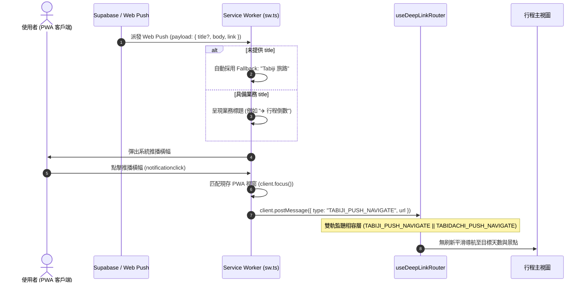

# Tabiji UI 分享元資料與 Supabase 推播系統品牌遷移工程規格書
# (Tabiji UI Metadata & Supabase Web Push Rebranding Spec)

> **版本**: 1.0.0  
> **狀態**: Ready for Implementation (Interview Completed via /grill-me)  
> **建立日期**: 2026-10-14  
> **架構決策指引**: [tabiji-rebranding-and-pwa-migration-spec.md](file:///d:/Project/Tabidachi/travel-pwa/docs/specs/branding/tabiji-rebranding-and-pwa-migration-spec.md)  
> **負責角色**: @architect ➔ @dev ➔ @qa  

---

## 1. Problem Statement & Core Value (問題陳述與核心價值)

### 1.1 使用者痛點與背景需求 (Problem Statement)
- 專案已全面確立新品牌名稱 **`Tabiji 旅路`** 與頂級網域 `tabijiapp.com`。
- 然而在現有程式碼中，**外部行程分享頁面 (PublicTripView)**、**社群分享標題 (ShareButton)**、以及 **Supabase Web Push 推播通知體系**（Service Worker 預設通知標題、跨進程 postMessage 通訊類型、推播廣播維護腳本）仍殘留舊有名稱 `Tabidachi`。
- 此不一致性會導致：
  1. 訪客接收分享連結或查看未登入行程時，頁腳出現「由 Tabidachi 旅立ち 提供技術支援」，造成品牌認知混亂。
  2. 桌面與行動端接收系統推播通知時，若通知無標題，會顯示舊版預設字樣。
  3. 若直接粗暴更換 Service Worker 的跨進程訊息協議（如 `TABIDACHI_PUSH_NAVIGATE`），已將 PWA 加入主畫面之老使用者在尚未更新 Service Worker 前，點擊推播通知將無法喚醒 App 內的平滑定向路由（Navigation Deadlock）。

### 1.2 核心指標 (Success Metrics)
1. **品牌 100% 一致性**：所有公眾分享 URL、分享對話框標題、頁面 Title、推播 Fallback 標題統一顯示為 **`Tabiji 旅路`**。
2. **推播路由零斷裂 (Zero Navigation Disruption)**：透過雙軌訊息接收機制（Dual-Message Listener），新舊 Service Worker 派發之跳轉訊號（`TABIJI_PUSH_NAVIGATE` 與 `TABIDACHI_PUSH_NAVIGATE`）均能 100% 觸發前端平滑切換，無重新整理或死跳轉。
3. **最小侵入性 (Minimal Blast Radius)**：組件內部純私有通訊（如 `tabidachi-focus-map-activity`）嚴格維持現狀，將異動範圍嚴格限定於「UI 對外呈現層」與「推播通知鏈路」。

---

## 2. User Journey & Core Flow (使用者旅程與操作流程)

### 2.1 外部訪客瀏覽與社群分享流程
```
[建立者點擊分享按鈕] 
   └── 複製或發起 Web Share API ➔ 標題: "{行程名稱} | Tabiji 旅路"
[外部訪客開啟 share/[shareCode]] 
   ├── 瀏覽器標籤頁 Title ➔ "{行程名稱} | Tabiji 旅路"
   └── 捲動至頁面底端 ➔ 呈現「由 Tabiji 旅路 提供技術支援」與品牌圖騰
```

### 2.2 系統推播通知與喚醒時序圖 (Mermaid Sequence Diagram)


---

## 3. Architecture & Data Model (架構與資料模型)

### 3.1 UI 對外分享與元資料異動清單
| 檔案路徑 | 原始程式碼 (`Tabidachi`) | 目標更新 (`Tabiji 旅路`) |
| :--- | :--- | :--- |
| [`PublicTripView.tsx#L142`](file:///d:/Project/Tabidachi/travel-pwa/frontend/app/share/[shareCode]/PublicTripView.tsx#L142) | `<p>由 Tabidachi 旅立ち 提供技術支援</p>` | `<p>由 Tabiji 旅路 提供技術支援</p>` |
| [`share/[shareCode]/page.tsx#L32`](file:///d:/Project/Tabidachi/travel-pwa/frontend/app/share/[shareCode]/page.tsx#L32) | `title: '行程不存在 \| Tabidachi 旅立ち'` | `title: '行程不存在 \| Tabiji 旅路'` |
| [`share/[shareCode]/page.tsx#L37`](file:///d:/Project/Tabidachi/travel-pwa/frontend/app/share/[shareCode]/page.tsx#L37) | `title: `${trip.title} \| Tabidachi 旅立ち`` | `title: `${trip.title} \| Tabiji 旅路`` |
| [`ShareButton.tsx#L32`](file:///d:/Project/Tabidachi/travel-pwa/frontend/components/itinerary/ShareButton.tsx#L32) | `title: `${tripTitle} \| Tabidachi`` | `title: `${tripTitle} \| Tabiji 旅路`` |

### 3.2 Supabase 推播與 Service Worker 架構異動

#### 1. Service Worker 預設標題與訊息通道 ([`frontend/app/sw.ts`](file:///d:/Project/Tabidachi/travel-pwa/frontend/app/sw.ts))
- **預設標題更新**：
  ```typescript
  // Line 255
  const title = data.title || "Tabiji 旅路";
  ```
- **推播導航訊息升級**：
  ```typescript
  // Line 277
  client.postMessage({ type: "TABIJI_PUSH_NAVIGATE", url: link });
  ```
- **背景離線突變隊列標籤**：
  ```typescript
  // Line 9
  const bgSyncPlugin = new BackgroundSyncPlugin("tabiji-offline-mutations", {
    maxRetentionTime: 24 * 60,
  });
  ```

#### 2. 深層路由雙軌相容監聽器 ([`frontend/lib/hooks/useDeepLinkRouter.ts`](file:///d:/Project/Tabidachi/travel-pwa/frontend/lib/hooks/useDeepLinkRouter.ts))
- 升級為支援新舊訊息識別碼之雙軌轉發器：
  ```typescript
  // Line 117
  const isPushNavigate =
    (event.data?.type === "TABIJI_PUSH_NAVIGATE" || event.data?.type === "TABIDACHI_PUSH_NAVIGATE") &&
    event.data?.url;

  if (isPushNavigate) {
    const rawUrl = event.data.url as string;
    // 執行既有之平滑換頁邏輯
  }
  ```

#### 3. 推播狀態同步 CustomEvent 雙軌派發 ([`frontend/lib/hooks/usePushNotifications.ts`](file:///d:/Project/Tabidachi/travel-pwa/frontend/lib/hooks/usePushNotifications.ts))
- 監聽與派發機制加入相容過渡：
  - 主要派發：`"tabiji-push-status-change"`
  - 相容支援：同時監聽 `"tabiji-push-status-change"` 與 `"tabidachi-push-status-change"`

#### 4. 全站推播廣播維護腳本 ([`scripts/broadcast.ps1`](file:///d:/Project/Tabidachi/travel-pwa/scripts/broadcast.ps1))
- 註解與控制台輸出對齊：
  ```powershell
  # Line 3
  Tabiji 旅路 全站廣播推播腳本

  # Line 51
  Write-Host "📡 Broadcasting to all Tabiji users..." -ForegroundColor Cyan
  ```

---

## 4. Edge Cases & Boundary Conditions (邊界條件與異常處理)

1. **老舊 Service Worker 快取未即時更新 (Stale SW Cache)**：
   - 使用者主畫面的 PWA 可能在數小時或數日內未連網更新 `sw.js`。
   - **防禦**：`useDeepLinkRouter` 透過布林條件 `(type === "TABIJI_PUSH_NAVIGATE" || type === "TABIDACHI_PUSH_NAVIGATE")` 保持雙向相容。
2. **推播通知標題為空或未定義**：
   - 若後端發送之 WebPush 封包缺少 `title` 欄位。
   - **防禦**：`sw.ts` 採用 `data.title || "Tabiji 旅路"`，確保系統通知欄 100% 具備品牌字樣。
3. **特殊字元與 Emoji 編碼破壞**：
   - 行程名稱中可能帶有日文漢字、平假名或飛機 Emoji（如 `✈️ 東京春櫻漫步`）。
   - **防禦**：`share/[shareCode]/page.tsx` 使用模板字串動態嵌入，`broadcast.ps1` 維持 UTF-8 輸出 byte 串流，避免亂碼。

---

## 5. Acceptance Criteria (驗收標準清單)

- [ ] **AC-1 (分享頁面標題)**: 瀏覽 `/share/{shareCode}` 時，HTML `<title>` 正確顯示 `${trip.title} | Tabiji 旅路`；若行程不存在則顯示 `行程不存在 | Tabiji 旅路`。
- [ ] **AC-2 (分享頁底端署名)**: 於 `/share/{shareCode}` 滾動至底部，技術支援署名文字顯示為 `由 Tabiji 旅路 提供技術支援`。
- [ ] **AC-3 (社群分享彈窗)**: 於行程清單點擊分享按鈕喚起原生 Web Share API，分享標題前綴或後綴為 `| Tabiji 旅路`。
- [ ] **AC-4 (推播點擊平滑路由)**: Service Worker 收到推播通知後，點擊推播橫幅能正確派發 `TABIJI_PUSH_NAVIGATE`，前台 `useDeepLinkRouter` 成功接收並在無刷新情況下跳轉對應行程天數。
- [ ] **AC-5 (老用戶推播向後相容)**: 人工模擬舊版 SW 派發 `TABIDACHI_PUSH_NAVIGATE`，前台仍可 100% 正常響應並平滑跳轉。
- [ ] **AC-6 (推播預設 Fallback)**: 當推播封包無 `title` 欄位時，系統通知橫幅預設呈現 `Tabiji 旅路`。
- [ ] **AC-7 (全站廣播腳本)**: 執行 `.\scripts\broadcast.ps1`，控制台輸出顯示 `Broadcasting to all Tabiji users...`，且無任何編碼報錯。
- [ ] **AC-8 (型別檢查與回歸驗證)**: 執行 `npx tsc --noEmit` 與 `npm run test`（包括 `push-notifications.test.ts` 與 `deep-link-router.test.ts`），確認通過 0 錯誤。
