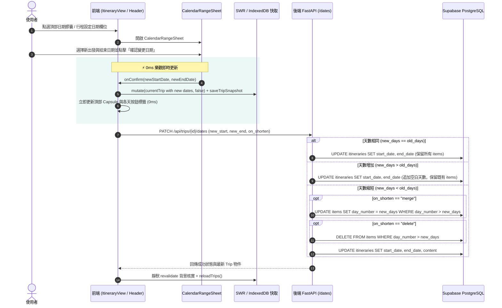

# 行程日期變更、天數生命週期與即時響應架構規格書 (Calendar Date Shift & Day Lifecycle Spec)

> **文件狀態**: Draft / Approved by User (via `/grill-me` 訪談對齊)  
> **關聯議題**: 
> 1. 日期切換無即時反映 (Issue 1)
> 2. 行程換日期時景點遺失或被壓縮覆蓋異常 (Issue 2)
> 3. 「刪除這一天」按鈕突兀、視覺破壞 (Issue 3)  
> **適用版本**: Next.js 16 + React 19 + SWR v2 + FastAPI + Supabase  

---

## 1. Problem Statement & Core Value (問題陳述與核心價值)

### 1.1 現行問題痛點
1. **日期切換無即時反映 (Issue 1)**：
   - 使用者在 `CalendarRangeSheet` 修改旅行日期後，行程時間軸頂部日期膠囊與各天星期標籤未即時更新，需手動退回首頁再重新點入行程才能看到新日期。
   - 根本原因：`executeDateRangeUpdate` 僅調用 `await reloadTripDetail()`，未進行 SWR 樂觀資料注入（Optimistic UI），且未同步通知全域 `reloadTrips()`，受限於 SWR 快取機制與 IndexedDB 唯讀快照延遲。
2. **行程改期之景點位移覆蓋災難 (Issue 2)**：
   - 原 3 天行程更改為另一個 3 天行程時，原 Day 1、Day 2 活動遺失或全數被覆蓋壓縮至第 1 天或最後一天。
   - 根本原因：後端 `PATCH /api/trips/{trip_id}/dates` 端點誤將「旅行日期改期」當作「以出發日絕對時間軸平移景點」，透過 `start_shift = (old_start - new_start).days` 大幅修改 `itinerary_items.day_number`，導致合法的相對天數序號（Day 1~3）遭到破壞與截斷。
3. **「刪除這一天」按鈕破壞視覺 (Issue 3)**：
   - 頂部水平滑動的日期按鈕列中，在當前選中天的膠囊正下方懸掛一個紅色的「刪除這一天」按鈕，造成垂直高度突兀不對稱，破壞 iOS 精品玻璃擬態，且具備高誤觸風險。

### 1.2 核心價值與成功指標
- **0ms 感知即時更新**：點擊「確認變更日期」後，頂部膠囊、天數列、各日星期資訊即時刷新，無任何畫面閃爍或需重新載入。
- **100% 行程完整保留**：天數相同時活動 100% 原樣對齊；天數變多時平滑追加空白天數；天數縮短時提供安全防禦合併/刪除確認。
- **乾淨對稱的頂部導覽列**：移除懸掛按鈕，天數膠囊維持極簡優雅，刪除天數功能收攏至「行程設定」的結構管理模組中。

---

## 2. User Journey & Core Flow (使用者旅程與操作流程)



---

## 3. Architecture & Data Model (架構與資料模型變更)

### 3.1 後端重構：`PATCH /api/trips/{trip_id}/dates`
- **廢棄邏輯**：徹底移除 `start_shift = (old_start - new_start).days` 及其對 `itinerary_items.day_number` 的位移與刪除邏輯。
- **全新原子邏輯**：
  ```python
  old_days = max(1, (old_end - old_start).days + 1)
  new_days = max(1, (new_end - new_start).days + 1)

  # 1. 天數縮短保護：僅在 new_days < old_days 時處理超出天數 (day_number > new_days)
  if new_days < old_days:
      excess_items = supabase.table("itinerary_items")\
          .select("id, day_number")\
          .eq("itinerary_id", trip_id)\
          .gt("day_number", new_days)\
          .execute()
      if excess_items.data:
          if request.on_shorten == "merge":
              for item in excess_items.data:
                  supabase.table("itinerary_items")\
                      .update({"day_number": new_days})\
                      .eq("id", item["id"])\
                      .execute()
              # 併入 content 相關欄位 (day_notes, checklists 等)
              for field in DAY_MAP_FIELDS:
                  if field in content and isinstance(content[field], dict):
                      for k in list(content[field].keys()):
                          if k.isdigit() and int(k) > new_days:
                              if isinstance(content[field].get(str(new_days)), list) and isinstance(content[field][k], list):
                                  content[field][str(new_days)].extend(content[field][k])
                              del content[field][k]
          else:
              # delete
              for item in excess_items.data:
                  supabase.table("itinerary_items").delete().eq("id", item["id"]).execute()
              for field in DAY_MAP_FIELDS:
                  if field in content and isinstance(content[field], dict):
                      for k in list(content[field].keys()):
                          if k.isdigit() and int(k) > new_days:
                              del content[field][k]

  # 2. 天數相等或增加：完全不更動既有 itinerary_items 與 content，100% 原位保留

  # 3. 原子寫入 itineraries 表
  supabase.table("itineraries").update({
      "start_date": request.start_date,
      "end_date": request.end_date,
      "content": content
  }).eq("id", trip_id).execute()
  ```

### 3.2 前端響應式樂觀更新與快取同步
- **`itinerary-view.tsx` 之 `executeDateRangeUpdate`**：
  1. 樂觀構建新 `optimisticTrip`：更新 `start_date` 與 `end_date`。
  2. 立即調用 `reloadTripDetail(optimisticTrip, false)` 與 `saveTripSnapshot(currentTrip.id, optimisticTrip)`。
  3. API 成功後調用 `await reloadTrips()` 與 `await reloadTripDetail()`，確保全域清單與當前行程雙向一致。
  4. 將 `onOpenDatePicker` 正確傳入 `<TripSettingsView>`，使設定視圖亦能開啟日曆變更並即時反映。

### 3.3 UI 結構重構：移除頂部懸掛刪除，整合至行程設定
- **`ItineraryHeader.tsx`**：
  - 移除選中天數膠囊下方的 `{totalDays > 1 && day === d && (<button ...>{t('iv_delete_this_day')}</button>)}`。
  - 恢復天數橫向滾動膠囊列的完全對齊與一致高度。
- **`TripSettingsView.tsx`**：
  - 新增「天數結構與日程管理」分組（Day Structure & Duration Management）。
  - 列出當前所有天數（Day 1 ~ Day N），顯示各天活動數量，並在天數大於 1 時提供受保護的「刪除此天」功能。

---

## 4. Edge Cases & Boundary Conditions (邊界條件與異常處理)

1. **跨月份與閏年日期計算**：
   - 使用 `split('-').map(Number)` 與本地時間 `new Date(y, m - 1, d)` 嚴格防禦時區穿透偏移（禁止直接使用 `new Date("YYYY-MM-DD")` 導致 UTC-0 減 1 天問題）。
2. **單日行程與極短行程變更**：
   - 當行程為 1 天（當日來回），`start_date === end_date`，禁止刪除唯一的一天（防禦最後一天刪除崩潰）。
3. **天數縮短且含有私人/鎖定項目**：
   - 合併 (merge) 時完整保留各活動的 `is_private`、`private_owner_id`、`sort_order`，避免權限遺失。
4. **網路中斷與伺服器失敗回滾**：
   - 若 `tripsApi.updateDates` 拋出錯誤，前端主動回復舊行程快照，並彈出錯誤 Toast。

---

## 5. Acceptance Criteria (驗收標準清單)

- [ ] **AC-1 (即時響應)**: 在 `CalendarRangeSheet` 中變更日期並確認後，頂部日期膠囊與各天星期標籤在 0ms 內即時變更為新日期，不需退出頁面再進來。
- [ ] **AC-2 (天數相等保留)**: 原 3 天行程更改為任意另外 3 天（無論提前或延後數月），Day 1、Day 2、Day 3 的所有活動、備忘與地點 100% 完整保留在原本的第 1、2、3 天中，絕無覆蓋或遺失。
- [ ] **AC-3 (天數變多追加)**: 原 3 天行程更改為 5 天行程時，Day 1~3 活動完整保留，Day 4 與 Day 5 正確顯示為空白日程。
- [ ] **AC-4 (天數縮短確認)**: 原 5 天行程縮短為 3 天時，若 Day 4 或 Day 5 有活動，彈出縮短天數警告對話框，選擇「合併」時活動移至 Day 3，選擇「刪除」時移除超出活動。
- [ ] **AC-5 (視覺美化與刪除遷移)**: 頂部行程時間軸膠囊列不再顯示懸掛的紅色「刪除這一天」按鈕，日期膠囊高度維持一致；在「行程設定」頁面中可清楚查看天數結構並安全執行刪除天數。
- [ ] **AC-6 (品質守門)**: 全端 TypeScript (`tsc --noEmit`) 零錯誤，全數單元與回歸測試通過。
