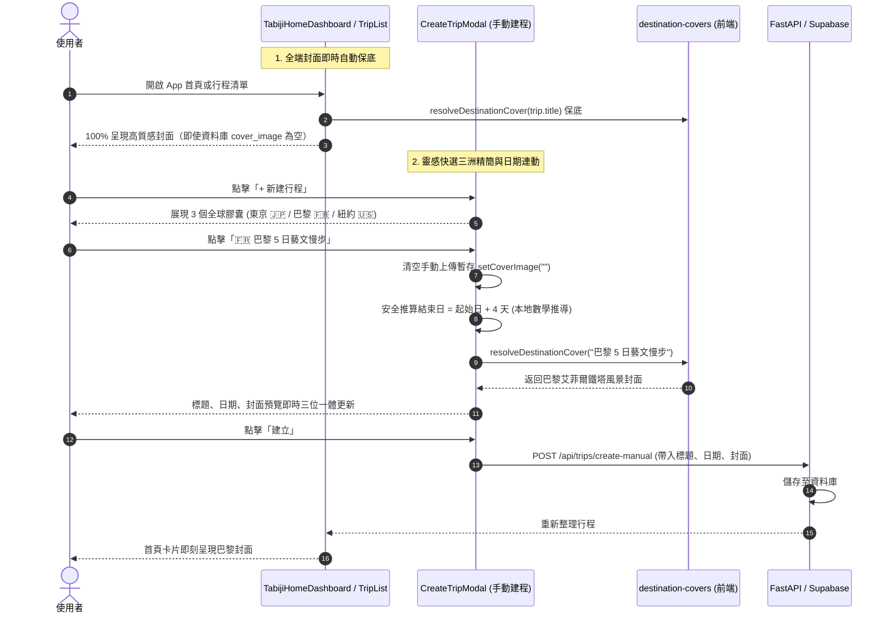

# 📋 規格說明書：全端行程封面統一自動解析 ✕ 創建行程全球靈感快選精簡 (Unified Trip Cover Pipeline & Global Inspiration Pills Spec)

> **文件狀態**：Approved by User ➔ Implementation Ready  
> **關聯模組**：
> - 前端：`TabijiHomeDashboard.tsx`, `TripList.tsx`, `TripDialogs.tsx`, `PublicTripView.tsx`, `destination-covers.ts`  
> - 後端：`backend/routers/trips.py`, `backend/services/cover_service.py`  
> **指令來源**：`/Idea to Spec` ✕ `/grill-me`

---

## 1. Problem Statement & Core Value (問題陳述與核心價值)

### 1.1 痛點診斷與代碼斷層證實 (Empirical Diagnosis)
1. **「封面顯示隨機性」之根本病灶**：
   - 使用者反映：「為什麼有的行程在首頁/清單看得到封面，有的卻是灰底色塊，非要點進去按設定齒輪才看得到預設風景照片？」
   - **程式碼斷層證實**：
     - 在設定齒輪視圖（`TripSettingsView.tsx:L93`），前端具備動態保底：
       `const displayCover = trip.cover_image || resolveDestinationCover(trip.title)`。
     - 但在首頁看板（`TabijiHomeDashboard.tsx:L226`）與行程清單（`TripList.tsx:L135`），代碼卻只有硬判定：
       `{trip.cover_image ? <Image ... /> : <空白深色漸層色塊 />}`。
     - 凡是「歷史行程」或「未寫入自訂封面」的行程，資料庫欄位為 `NULL`，導致列表頁只呈現空色塊，進入設定頁卻動態生出風景照，造成強烈的「隨機性/Bug 感」。
2. **手動建立行程之靈感快選臃腫與地域局限**：
   - 原有 5 個東亞按鈕（東京、京都、沖繩、北海道、香港）過度佔用手機螢幕空間，且與 Tabidachi 全球旅遊品牌形象脫節。
   - 原有日期推算採用 `new Date(startDate).toISOString().split('T')[0]`，在負時區或特定瀏覽器存在跨時區日期滑移（Timezone Drift $\pm 1$ 天）缺陷。

### 1.2 核心價值與成功指標 (Success Metrics)
- **全站高美感零灰底 (Zero Grayed-Out Cards)**：所有行程卡片（首頁、清單、公開分享頁）100% 統一掛載 `resolveDestinationCover(trip.title)`，歷史與新建行程全域秒開精美封面。
- **黃金 3 洲際靈感快選**：精簡為歐亞美 3 個 5 日經典膠囊（東京 🇯🇵 / 巴黎 🇫🇷 / 紐約 🇺🇸），中英雙語自適應。
- **本地無時區滑移推算**：以純數學 YMD 運算取代 `toISOString()`，保障全球所有時區天數推算 100% 精準。

---

## 2. User Journey & Core Flow (使用者旅程與操作流程)



---

## 3. Architecture & Data Model (架構與資料模型)

### 3.1 前端封面解析統一純函數 (Universal Presentation Helper)
在 `destination-covers.ts` 或共用模組宣告確定性解析 helper：
```typescript
export function getTripCoverUrl(coverImage?: string | null, title?: string): string {
    if (coverImage && coverImage.trim()) {
        return coverImage.trim();
    }
    return resolveDestinationCover(title);
}
```

### 3.2 靈感膠囊與安全日期資料結構
```typescript
export interface InspirationPillItem {
    id: 'tokyo' | 'paris' | 'nyc';
    emoji: string;
    days: number;
    titleZh: string;
    titleEn: string;
    labelZh: string;
    labelEn: string;
}

export const GLOBAL_INSPIRATION_PILLS: InspirationPillItem[] = [
    {
        id: 'tokyo',
        emoji: '🇯🇵',
        days: 5,
        titleZh: '東京 5 日自由行',
        titleEn: 'Tokyo 5-Day Explorer',
        labelZh: '🇯🇵 東京 5 日自由行',
        labelEn: '🇯🇵 Tokyo 5-Day',
    },
    {
        id: 'paris',
        emoji: '🇫🇷',
        days: 5,
        titleZh: '巴黎 5 日藝文慢步',
        titleEn: 'Paris 5-Day Cultural Stroll',
        labelZh: '🇫🇷 巴黎 5 日藝文慢步',
        labelEn: '🇫🇷 Paris 5-Day',
    },
    {
        id: 'nyc',
        emoji: '🇺🇸',
        days: 5,
        titleZh: '紐約 5 日都會探索',
        titleEn: 'NYC 5-Day Urban Discovery',
        labelZh: '🇺🇸 紐約 5 日都會探索',
        labelEn: '🇺🇸 NYC 5-Day',
    },
];

export function addDaysToLocalYMD(ymdStr: string, addDays: number): string {
    const parts = ymdStr.split('-').map(Number);
    if (parts.length !== 3 || parts.some(isNaN)) return ymdStr;
    const [year, month, day] = parts;
    const d = new Date(year, month - 1, day);
    d.setDate(d.getDate() + addDays);
    const y = d.getFullYear();
    const m = String(d.getMonth() + 1).padStart(2, '0');
    const date = String(d.getDate()).padStart(2, '0');
    return `${y}-${m}-${date}`;
}
```

### 3.3 後端端點強化 (`create-manual`)
在 `backend/routers/trips.py:create_manual_trip`：
```python
clean_cover = request.cover_image.strip() if (request.cover_image and request.cover_image.strip()) else resolve_destination_cover_url(request.title)
trip_data = {
    ...
    "cover_image": clean_cover
}
```

---

## 4. Edge Cases & Boundary Conditions (邊界條件與異常處理)

| 邊界情境 | 潛在風險 | 防禦策略 |
| :--- | :--- | :--- |
| **歷史髒資料或 NULL 封面** | 資料庫中存在早期建立的無封面歷史行程。 | 前端列表與首頁呼叫 `getTripCoverUrl`，無條件自動回退至目的地風景預設照，完全不影響後端資料表結構。 |
| **未命中城市關鍵字之特殊行程標題** | 標題如「秘密冒險 2026」，無城市別名匹配。 | `resolveDestinationCover` 內建 `DEFAULT_COVER_IMAGE`（經典自然旅人風景圖），保證 100% 回傳有效圖片。 |
| **使用者在不同時區操作建程** | 跨時區造成 `startDate + 4` 計算為 3 天或 5 天。 | 採用 `addDaysToLocalYMD`，純由數值解析年/月/日並以本地物件換日，徹底隔離 UTC 轉換副作用。 |
| **點選膠囊前已上傳過自訂圖片** | 舊上傳狀態殘留覆蓋新城市風景。 | 點選膠囊事件原子化執行 `setCoverImage("")`，明確將封面切換為目標城市預設。 |

---

## 5. Acceptance Criteria (驗收標準清單)

- [ ] **AC-1 (全站卡片無灰底色塊)**：首頁看板 (`TabijiHomeDashboard`) 與行程清單 (`TripList`) 渲染所有行程時，若 `trip.cover_image` 為空，一律正確呈現目的地預設封面風景圖。
- [ ] **AC-2 (設定視圖所見即所得)**：首頁/清單顯示的預設封面與點進齒輪設定 (`TripSettingsView`) 顯示之封面 100% 像素級一致。
- [ ] **AC-3 (靈感膠囊精簡為 3 項)**：手動建立行程對話框中，靈感膠囊恰好為 3 個（東京、巴黎、紐約）。
- [ ] **AC-4 (雙語無縫支援)**：切換語系後，膠囊標籤與填入標題自適應切換為中/英文。
- [ ] **AC-5 (無時區漂移日期推算)**：點擊任一膠囊，行程結束日嚴格等於 `起始日 + 4 天`（合計 5 整天），即使在跨月或閏年情境下均完全正確。
- [ ] **AC-6 (後端建程全面保底)**：後端 `create-manual` 端點若未接收封面，自動調用 `resolve_destination_cover_url` 寫入資料庫。
- [ ] **AC-7 (品質閘門 100% 綠燈)**：TypeScript 0 錯誤、ESLint 0 警告、Vitest 全量測試與 Playwright E2E 通過。
