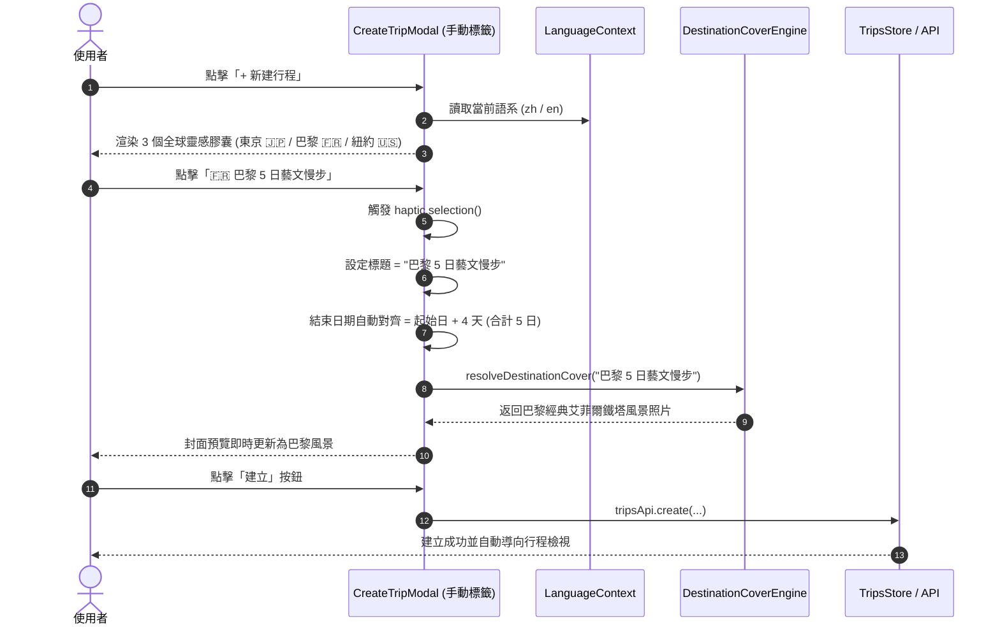

# 📋 規格說明書：創建行程「靈感快選」三洲全球化精簡架構 (Trip Creation Global Inspiration Pills Spec)

> **文件狀態**：Drafting ➔ Ready for Review  
> **關聯模組**：`frontend/components/itinerary/TripDialogs.tsx`, `frontend/lib/i18n/`, `frontend/lib/destination-covers.ts`  
> **指令來源**：`/Idea to Spec` ✕ `/grill-me`

---

## 1. Problem Statement & Core Value (問題陳述與核心價值)

### 1.1 使用者痛點 (User Problem)
- **視覺冗餘與選擇障礙**：現行手動建立行程對話框（`CreateTripModal`）內置 5 個靈感快選按鈕（東京、京都、沖繩、北海道、香港）。在 390px 窄螢幕手機上會折成 2~3 行，擠壓到下方的日期選擇器（`CalendarRangeSheet`）與建立按鈕。
- **地域局限與全球化品牌脫節**：現有 5 個範本全部偏重東亞單一地區，無法展現 Tabidachi 作為支援多幣別（JPY, EUR, USD, TWD 等）、跨洲際時區與地圖探索之「全球旅遊夥伴」品牌調性。
- **雙語體驗斷層**：原本的 `INSPIRATION_PILLS` 為寫死中文，當外語使用者切換為英文介面時，仍顯示繁體中文字串。

### 1.2 核心價值與成功指標 (Success Metrics)
- **黃金 3 選項**：精簡至 3 個經典按鈕，歐、亞、美洲三大洲各選一處世界級都會，維持單行或輕巧雙行極致呼吸感。
- **體驗對齊**：與 `AiImportTripWizard.tsx` (Commit 14cfcd3) 的全球三大 5 日示範行程達到產品級心智一致性。
- **封面管線自動聯動**：點擊快選膠囊填入標題的瞬間，即時透過 `resolveDestinationCover` 呼叫對應城市之高美感 WebP 封面圖。
- **i18n 完整相容**：繁體中文與英文自動適配，零硬編碼字串。

---

## 2. User Journey & Core Flow (使用者旅程與操作流程)

### 2.1 使用者操作旅程 (User Flow)


---

## 3. Architecture & Data Model (架構與資料模型)

### 3.1 靈感快選資料結構 (Inspiration Pill Schema)
```typescript
export interface InspirationPillItem {
    id: 'tokyo' | 'paris' | 'nyc';
    emoji: string;
    cityKey: string;
    days: number;
    titleZh: string;
    titleEn: string;
    labelZh: string;
    labelEn: string;
}
```

### 3.2 全球化三洲常數定義
```typescript
export const GLOBAL_INSPIRATION_PILLS: InspirationPillItem[] = [
    {
        id: 'tokyo',
        emoji: '🇯🇵',
        cityKey: 'tokyo',
        days: 5,
        titleZh: '東京 5 日自由行',
        titleEn: 'Tokyo 5-Day Explorer',
        labelZh: '🇯🇵 東京 5 日自由行',
        labelEn: '🇯🇵 Tokyo 5-Day',
    },
    {
        id: 'paris',
        emoji: '🇫🇷',
        cityKey: 'paris',
        days: 5,
        titleZh: '巴黎 5 日藝文慢步',
        titleEn: 'Paris 5-Day Cultural Stroll',
        labelZh: '🇫🇷 巴黎 5 日藝文慢步',
        labelEn: '🇫🇷 Paris 5-Day',
    },
    {
        id: 'nyc',
        emoji: '🇺🇸',
        cityKey: 'nyc',
        days: 5,
        titleZh: '紐約 5 日都會探索',
        titleEn: 'NYC 5-Day Urban Discovery',
        labelZh: '🇺🇸 紐約 5 日都會探索',
        labelEn: '🇺🇸 NYC 5-Day',
    },
];
```

### 3.3 表現層與狀態聯動邏輯
在 `TripDialogs.tsx` 中：
```tsx
const isZh = locale !== 'en';
const pills = GLOBAL_INSPIRATION_PILLS;

// JSX 渲染
{pills.map((pill) => {
    const label = isZh ? pill.labelZh : pill.labelEn;
    const tripTitle = isZh ? pill.titleZh : pill.titleEn;
    return (
        <button
            key={pill.id}
            type="button"
            onClick={() => {
                haptic.selection();
                setTitle(tripTitle);
                const startObj = new Date(startDate);
                const endObj = new Date(startObj);
                endObj.setDate(endObj.getDate() + (pill.days - 1));
                setEndDate(endObj.toISOString().split('T')[0]);
            }}
            className="px-2.5 py-1 text-xs rounded-full bg-stone-100 dark:bg-slate-800 text-slate-700 dark:text-slate-300 hover:bg-amber-50 dark:hover:bg-slate-700 hover:text-amber-700 dark:hover:text-amber-300 border border-stone-200/60 dark:border-slate-700/60 transition-colors cursor-pointer select-none active:scale-95"
        >
            {label}
        </button>
    );
})}
```

---

## 4. Edge Cases & Boundary Conditions (邊界條件與異常處理)

| 邊界情境 | 風險 / 現象 | 防禦策略 |
| :--- | :--- | :--- |
| **跨月與閏年日期計算** | 當起始日期為 2026-02-27，加 4 天可能引發時間戳溢位或格式錯誤。 | 使用標準 `Date` 物件的 `setDate(getDate() + (days - 1))`，由原生 JavaScript 引擎處理換月，最後格式化為 `YYYY-MM-DD`。 |
| **使用者已手動上傳封面照片** | 使用者先上傳了自己的照片，再點擊靈感快選，自訂封面被覆蓋。 | 保持既有邏輯：若 `coverImage` state 不為空，以使用者上傳的自訂圖片優先，不強制洗掉已上傳的圖片；僅在未上傳自訂圖片時由 `resolveDestinationCover(title)` 自動補位。 |
| **語言即時切換** | 使用者在開啟彈窗期間切換語言。 | 採用 `useLanguage()` 的動態 `locale` 判斷，響應式 Re-render 立即切換標籤與預設填入標題。 |
| **E2E 測試選擇器兼容** | 既有 Playwright 腳本以 `/(東京|京都|沖繩|北海道|香港)/i` 過濾按鈕。 | 同步更新 `frontend/tests/create_trip_flow.spec.ts` 匹配正則為 `/(東京|巴黎|紐約|Tokyo|Paris|NYC)/i`，防禦 CI 破裂。 |

---

## 5. Acceptance Criteria (驗收標準清單)

- [ ] **AC-1 (數量精簡)**: 在 `CreateTripModal` 手動建程模式中，靈感快選膠囊總數為恰好 3 個（東京、巴黎、紐約）。
- [ ] **AC-2 (全球洲際覆蓋)**: 涵蓋亞洲（東京 🇯🇵）、歐洲（巴黎 🇫🇷）與美洲（紐約 🇺🇸）三大世界級旅遊地。
- [ ] **AC-3 (天數一致性)**: 點擊任一膠囊，行程天數皆精準設定為 5 天（結束日 = 起始日 + 4 天）。
- [ ] **AC-4 (雙語支援)**: 在繁體中文下顯示「🇯🇵 東京 5 日自由行」、「🇫🇷 巴黎 5 日藝文慢步」、「🇺🇸 紐約 5 日都會探索」；在英文下顯示「🇯🇵 Tokyo 5-Day」、「🇫🇷 Paris 5-Day」、「🇺🇸 NYC 5-Day」。
- [ ] **AC-5 (封面自動預覽)**: 點擊任一膠囊，封面預覽即時自動對齊對應城市風景照。
- [ ] **AC-6 (品質閘門 100% 綠燈)**: TypeScript 0 錯誤、ESLint 0 警告、Vitest/Playwright 全數通過。
