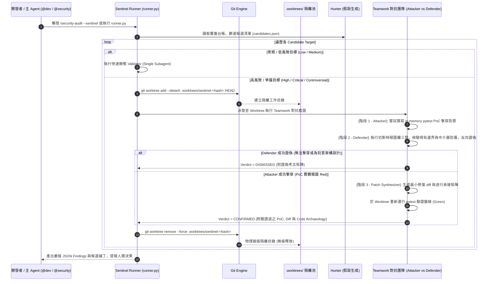

# 📐 SPEC-AGY-002: AGY CLI Boost & Teamwork Worktree 物理隔離與分層對抗哨兵架構規格書
*(AGY CLI Boost & Teamwork Worktree Isolation & Tiered Adversarial Sentinel Specification)*

- **版本**: 1.3.0
- **狀態**: Implemented & Verified (Dual-Tier Subagents + GitWorktreePool + Mantis Block G Benign Control + Mantis-Advise + Harness² Conservation)
- **負責角色**: System Architect (`@architect`) ✕ Security Auditor (`@security`)
- **關聯架構決策**: [AD-194 (跨會話實體隔離)](file:///d:/Project/tabiji/travel-pwa/docs/journals/2026-10-26-daily-report.md#L49-L58), [AD-195 (自適應資安發派)](file:///d:/Project/tabiji/travel-pwa/docs/journals/2026-10-26-daily-report.md#L8-L10), [SPEC-SEC-001 (Security Sentinel)](file:///d:/Project/tabiji/travel-pwa/.agents/skills/security-sentinel/SKILL.md)

---

## 1. Problem Statement & Core Value (問題陳述與核心價值)

### 1.1 使用者痛點 (User Problems)
1. **多代理人跨會話工作區碰撞 (AD-194 Multi-Agent Worktree Collision)**：
   - 當開發者同時開啟多個對話分頁（例如分頁 A 進行全域重構，分頁 B 進行邊界模擬），所有 Agent 預設共享同一個 Git 工作目錄 (`d:\Project\tabiji\travel-pwa`)。
   - 任何未受隔離的子代理人在主目錄生成臨時腳本、未完工檔案或修改現有代碼時，會直接污染其他會話的 `git status` 與測試環境，極易引發非預期的覆寫或錯誤 staging。
2. **單一代理人驗證深度不足與偽陽性率 (Shallow Validation & False Positives)**：
   - 現有 `runner.py` 僅派遣單一 `agy.exe -p --sandbox` 子進程進行靜態檢驗。在面對複雜的多檔案交互（如 JWT 簽發 ⇄ 中間件 ⇄ FastAPI 端點、Cloudflare Worker 標頭重寫）時，單一子進程容易產生誤判或無法自主實體運行 in-memory pytest 進行驗證。
3. **修復補丁未經實體綠燈檢驗與歷史意圖忽視 (Unverified Candidate Patches & Blind Deletions)**：
   - 傳統靜態補丁推導缺乏在乾淨隔離沙盒中實體套用並運行測試套件的自動閉環；且容易在重構中盲目刪除既有邊界防禦邏輯，引發切斯特頓圍欄式的靜默破壞。

### 1.2 核心價值與成功指標 (Core Value & Success Metrics)
- **零工作區殘留 (Zero Workspace Residue)**：Sentinel 與子代理人在獨立臨時 Git Worktree 中運行，主工作目錄保持 100% 潔淨，徹底杜絕 AD-194 碰撞。
- **雙向沙盒驗證 (Bi-Directional Worktree Spiking)**：不僅支援「完工後防禦審查」，更原生支援「開工前沙盒預演（Pre-execution spiking）」，在不動主分支的前提下實體驗證原型與假說。
- **100% 實體閉環 (100% Empirical Closed Loop)**：High/Critical 等級之確認漏洞必須在 Worktree 內運行真實 in-memory pytest 實體證偽（先紅後綠）。
- **切斯特頓圍欄與零偽陽性 (Chesterton's Fence & Zero False Positives)**：凡涉及刪除或行為質疑，必須完成三問考古（功能反推、設計初衷、刪除風險），未經對抗驗證的假想一律標記為 `DISMISSED`。

---

## 2. User Journey & Core Flow (使用者旅程與操作流程)

### 2.1 對抗式分層驗證管線 (Tiered Adversarial Flow)



### 2.2 雙向驗證：開工前沙盒預演 (Pre-Execution Worktree Spiking)
在 `/concise-planning` 規劃複雜架構變更時，若面臨不確定之跨模組依賴，系統可調用 `GitWorktreePool.acquire()`：
1. 鏡像目前變動檔案至獨立 Worktree。
2. 撰寫單元測試重現邊際問題或驗證候選方案（紅燈/綠燈）。
3. 驗證通過後釋放 Worktree，將確鑿結論反哺回 `implementation_plan.md`，使開工前成功率評分達 10/10。

---

## 3. Architecture & Data Model (架構與資料模型)

### 3.1 檔案樹結構與隔離拓撲 (File Topology)

```text
travel-pwa/
├── .gitignore                                 <-- [新增] 納入 .worktrees/
├── .worktrees/                                <-- [動態建立/銷毀] Worktree 隔離池
│   └── sentinel-7a8f9b2c/                     <-- 每個 Target 獨立乾淨工作區
│       ├── backend/
│       ├── frontend/
│       └── .git (gitdir pointer)
├── .agents/skills/security-sentinel/
│   ├── SKILL.md                               <-- 更新架構說明與工作流 (v2.2.0)
│   ├── templates/
│   │   └── finding-schema.json                <-- [升級] 包含 code_archaeology 物件定義
│   └── scripts/
│       ├── runner.py                          <-- [核心升級] 支援 worktree 與分層 Teamwork
│       └── lib/
│           ├── safe_subprocess.py             <-- [新增] 跨平台串流 IPC
│           ├── worktree_pool.py               <-- Git Worktree 生命週期管理器
│           └── adversarial_team.py            <-- Attacker vs Defender 對抗提示詞模板與考古常模
└── docs/specs/core-architecture/
    └── agy-worktree-sentinel-orchestration-spec.md  <-- 本規格書 (v1.2.0)
```

### 3.2 資料契約與候選格式 (Candidate & Verdict Schema)

#### Candidate Input (`candidates_<topic>_<date>.json`):
```json
{
  "id": "backend/services/intent_router.py",
  "file_path": "backend/services/intent_router.py",
  "attack_vector": "prompt_injection",
  "severity": "high",
  "hypothesis": "Sanitizer fails on zero-width space characters, allowing prompt override.",
  "escalate_teamwork": true
}
```

#### Finding Output (`findings_<topic>.json`):
```json
{
  "target_id": "backend/services/intent_router.py",
  "verdict": "CONFIRMED",
  "severity": "high",
  "reasoning": "Attacker successfully proved zero-width space bypass via in-memory test; Defender confirmed no existing regex covers \\u200b.",
  "worktree_verified": true,
  "poc_type": "pytest_in_memory",
  "poc_script": "def test_zero_width_bypass(): ...",
  "code_archaeology": {
    "legacy_function": "Old sanitizer stripped ASCII whitespace only.",
    "design_intent": "Originally intended for rapid regex matching against common prompt keywords.",
    "regression_risk": "Replacing regex directly could cause ReDoS on unanchored unicode inputs; solved via anchored replace."
  },
  "remediation_patch": "diff --git a/... b/...",
  "patch_test_passed": true
}
```

---

## 4. Edge Cases & Boundary Conditions (邊界條件與異常處理)

| 邊界場景 (Edge Case) | 潛在破裂風險 | 防禦與自癒機制 (Defensive Mechanism) |
| :--- | :--- | :--- |
| **Windows 檔案鎖死 (EBUSY / PermissionError)** | 刪除 worktree 時，Node.js 或 Python 解譯器仍佔用控制代碼導致 `git worktree remove` 拋錯。 | 實施 3 次指數退避重試；若仍失敗，標記為 `PENDING_PRUNE` 並於下次啟動時由 `worktree_pool.py` 自動清理。 |
| **IDE / Turbopack 遞迴監控爆炸** | Worktree 落在專案內，導致 Vite/Next.js watch 觸發全量熱重載。 | `.gitignore` 嚴格宣告 `.worktrees/`，`next.config.mjs` 鎖定 `turbopack.root = __dirname` (`frontend/`)，並於 `vitest.config.ts` 配置 `exclude: ['**/.worktrees/**']`。 |
| **對抗辯論死循環 (Thrashing Loop)** | Attacker 與 Defender 互相爭辯超過 3 輪無定論。 | 嚴格設定熔斷上限：每對抗輪次最多允許 2 輪反駁；若 2 輪內無法產出可運行的 PoC，自動落入 `DISMISSED`（疑罪從無原則）。 |
| **Pytest 環境報錯偽陽性 (`returncode >= 2`)** | `ModuleNotFoundError` 或 `SyntaxError` 回傳非零狀態碼被誤判為漏洞擊穿。 | 強制注入 `PYTHONPATH=<worktree>/backend`，且嚴格規定唯有 `returncode == 1` (`AssertionError`) 方為 `RED_CONFIRMED`；`returncode >= 2` 一律視為無效 PoC 並降級為 `DISMISSED`。 |
| **Dirty Working Tree 快照失真** | `git worktree add --detach HEAD` 未包含主工作區尚未 commit 的修改。 | `GitWorktreePool.acquire(mirror_files=[...])` 自動將主工作區受審檔案鏡像同步至 Worktree，並以 `_GIT_WORKTREE_LOCK` (`asyncio.Lock`) 防止併發 `.git/config.lock` 競爭。 |
| **超時中斷與殘留 Worktree** | 執行過程收到 `SIGINT` 或 Ctrl+C。 | Python `try...finally` 與 `.pending_prune` 確保所有由本進程建立之 worktree 均被立即清除。 |
| **考古欄位丟失或空結構** | 模型產出的 JSON 缺少 `code_archaeology` 或為 null。 | `normalize_code_archaeology()` 自動修補為含 `legacy_function`, `design_intent`, `regression_risk` 之常態 dict，防止 schema 驗證失敗。 |

| **功能閹割補丁 (Lobotomized Patch)** | 補丁藉由 return None / 0 或關閉正常邏輯來消弭報錯（看似變綠，實質破壞正常功能）。 | 實施 Mantis Block G Benign Control：PoC 必須包含 `test_benign*` 良性測試；補丁必須在未破壞良性輸入的前提下消除攻擊，否則自動拒絕並還原。 |
| **已知設計意圖重複質疑 (Design Intent Relitigation)** | 歷史上已確實驗證的架構決策（如 SSOT 動態累加、行程切換聊天重置）被重複質疑。 | 實施 Mantis-Advise：`runner.py` 自動載入 `docs/security/security-coverage-ledger.json` 之 `known_design_intents` 與過去 `DISMISSED` 紀錄，防禦性注入 Validator Prompt。 |
| **台帳計數狀態漂移 (Ledger Drift)** | 驗證結果與輸出計數脫節，導致審計報告失去真實性。 | 實施 Harness² Deterministic Identity Assertion：執行 `assert_findings_conservation`，保證 `confirmed + dismissed + inconclusive == total == len(findings)`。 |
| **外部部署依賴無法單機證偽** | 假說涉及外部網路、部署環境或外部服務。 | 實施 Cloudflare Blocker 規範：強制標記 `INCONCLUSIVE`，並填入具體 `validation_blocker` 與後續 `validation_plan`。 |

---

## 5. Acceptance Criteria (驗收標準清單)

```markdown
- [x] AC-1: Given 存在未被忽略的 .worktrees/ 目錄，When 執行 git status，Then 工作目錄保持 clean，無任何未追蹤項目。
- [x] AC-2: Given 執行 runner.py --candidates 包含 severity=high 的目標（或於 IDE 啟動原生 define_subagent 紅藍分身），When 啟動驗證，Then 自動建立獨立 detached worktree 並指派 Attacker vs Defender 對抗驗證。
- [x] AC-3: Given Attacker 產出 failing PoC (returncode == 1) 且 Defender 無法證偽，When 產出修復補丁，Then 該補丁必須於 worktree 內實體通過 pytest 綠燈 (returncode == 0) 方可標記為 patch_test_passed=True。
- [x] AC-4: Given 驗證完成（無論成功或異常退出），When 檢查 .worktrees/ 目錄，Then 臨時 worktree 均被完全釋放與刪除。
- [x] AC-5: Given 主對話樹在主工作區修改檔案，When 背景 Sentinel 在 worktree 運行，Then 兩者互不干擾、零檔案覆寫、零 Git index 碰撞。
- [x] AC-6: Given 任何涉及代碼刪除或行為質疑的審查，When 產出 Finding 或 Block Replacement，Then 必須填妥 code_archaeology 三問 (legacy_function, design_intent, regression_risk)。
- [x] AC-7: Given 開工前架構重構或高風險邊界改動，When 觸發 Pre-Execution Spiking，Then 能在 Worktree 內運行沙盒假說驗證，證偽或確認方案可行性後再落地主工作區。
- [x] AC-8: Given 補丁僅能消除漏洞但破壞正常良性輸入（閹割補丁），When 執行 Mantis Block G 檢驗，Then 補丁自動被阻斷並復原原始代碼。
- [x] AC-9: Given 產出 findings 輸出物件，When 執行 Harness² 守恆斷言，Then confirmed + dismissed + inconclusive == total == len(findings) 必須嚴格成立。
```
