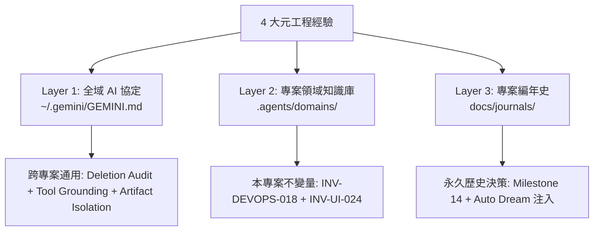
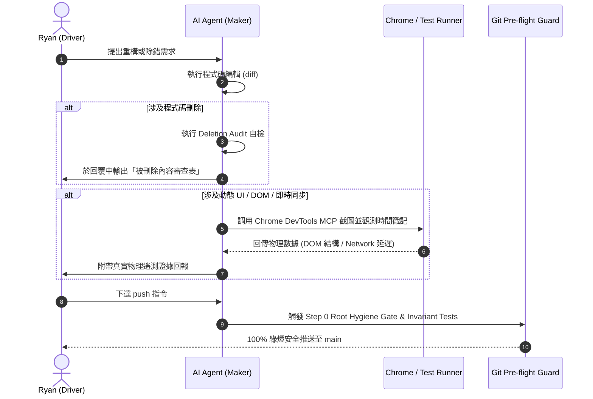

# 📋 系統規格書：人機協同駕駛與元工程經驗固化體系 (Meta-Engineering & Driver Insights Spec)

> **版本**: 1.0.0  
> **狀態**: Approved via `/grill-me`  
> **關聯原則**: 全域 AI 協定 (`~/.gemini/GEMINI.md`)、專案記憶憲法 (`.agents/memory.md`)  
> **核心目標**: 將本會話提煉之 4 項人機協同駕駛心法與架構經驗，制度化為「全域協定 + 領域不變量 + 自動化守門測試」三層立體防衛網。

---

## 1. Problem Statement & Core Value (問題陳述與核心價值)

### 1.1 使用者痛點 (User Problems)
1. **AI 隱性降級 (Silent Regression via Code Deletion)**: AI 在進行大規模重構或除錯時，常藉「精簡程式碼」之名，未經告知便刪除關鍵的防禦型程式碼、型別守衛或自癒邏輯。
2. **過度自信與幻覺保證 (Oral Assurance Fallacy)**: AI 在面對動態競態（如 0ms 樂觀反應、DOM 重繪、401 換票重試）時，習慣給出主觀口頭保證，但實際在瀏覽器中常因渲染延遲或 Event Loop 順序引發白屏或卡頓。
3. **UX 備援的粗暴設計 (Crude Recovery UI)**: 面對長連線斷線或丟包，直覺在畫面上增加「重新整理按鈕」，破壞極簡美感與視覺留白。
4. **環境污染痛點未徹底根治 (Superficial Fix for Root Hygiene)**: 諸如 `implementation_plan.md` 等中繼檔案反覆出現在專案根目錄，手動刪除後不久又被 Agent 誤產出並提交。

### 1.2 核心價值 (Core Value)
- 建立具備**硬約束**的人機協同駕馭協定，將程式碼審核權移交回人類主權。
- 透過**物理遙測 (Tool-Driven Grounding)** 取代口頭保證，確保所有動態效能具備真實數據背書。
- 確立**四層防禦縱深 (Defense in Depth)**，將低級環境錯誤徹底消滅於提交之前。

---

## 2. Architecture & Data Model (架構與分層規則模型)

### 2.1 三層立體固化拓撲 (3-Tier Persistence Topology)

### 2.2 規則定義與模型對應 (Invariants & Rules Schema)

| 規則識別碼 | 規則名稱 | 作用域 (Target Scope) | 強制執行標準 |
| :--- | :--- | :--- | :--- |
| **DRIVER-AUDIT-01** | 被刪除內容審查 (Deletion Audit) | `~/.gemini/GEMINI.md` | 凡 Git Diff 包含非格式/空白之程式碼刪除，AI 必須主動列出刪除清單、原職責與承接機制。 |
| **DRIVER-GROUND-01** | 物理遙測勝於口頭承諾 (Tool Grounding) | `~/.gemini/GEMINI.md` | 涉及動態 UI 反應、DOM 重繪、即時通訊或 401 換票時，AI 必須主動調用 Chrome DevTools MCP 或測試遙測。 |
| **DRIVER-ARTIFACT-01** | 工件先行與根目錄衛生 | `~/.gemini/GEMINI.md` | `implementation_plan.md` 僅限存放於 IDE Artifacts 目錄或專案規格庫，嚴禁裸存於專案根目錄。 |
| **INV-DEVOPS-018** | 痛點根治的四層防禦縱深法則 | `.agents/domains/devops_security.md` | 遇環境/目錄污染痛點，必須連動完成「規格歸檔 + .gitignore + push.md 守門員 + test_root_hygiene 測試」。 |
| **INV-UI-024** | UX 機能融合與雙軌自癒備援法則 | `.agents/domains/ios_ui.md` `.agents/domains/state_cache.md` | 狀態自癒備援操作嚴禁使用粗暴獨立按鈕，必須隱性融合於自然手勢（下拉）或既有資訊入口（通知鈴鐺）。 |

---

## 3. User Journey & Core Flow (操作流程與生命週期)

### 3.1 AI 程式碼修改與刪除審查流程 (Deletion Audit Lifecycle)

---

## 4. Edge Cases & Boundary Conditions (邊界條件與異常防護)

1. **僅刪除註解或空白字符**:
   - 不觸發 Deletion Audit 繁重回報，保持簡潔溝通。
2. **無頭瀏覽器環境異常 (如 Chrome MCP 端口佔用或超時)**:
   - 降級為本地單元測試遙測（如 `vitest run` 模擬 DOM 事件），並明確提示環境降級狀態，禁止退回口頭猜測。
3. **第三方套件升級引發之連帶刪除**:
   - AI 必須標明套件 API 變更對照表（Breaking Change Migration Matrix）。
4. **根目錄新增合法設定檔 (如新的 .editorconfig 或 linter config)**:
   - 必須同步將該檔名擴充至 `push.md` 與 `test_root_hygiene_sentinel.py` 之 `$whitelist`，杜絕假陽性阻斷。

---

## 5. Acceptance Criteria (驗收標準清單)

- [ ] **AC-1 (全域協定生效)**: `~/.gemini/GEMINI.md` 包含 Deletion Audit、Tool-Driven Grounding 與 Artifact 根目錄衛生三項明確條款。
- [ ] **AC-2 (專案領域記憶沉澱)**: `.agents/domains/devops_security.md` 包含 `INV-DEVOPS-018`；`.agents/domains/ios_ui.md` 與 `state_cache.md` 包含 `INV-UI-024`。
- [ ] **AC-3 (歷史日報存證)**: `docs/journals/2026-10-22-daily-report.md` 記錄 Milestone 14，且 Auto Dream JSON 包含上述兩條新不變量。
- [ ] **AC-4 (自動化守門員保護)**: `push.md` 與 `test_root_hygiene_sentinel.py` 嚴格將 `implementation_plan.md` 識別為違規中繼檔，測試 100% 通過。
