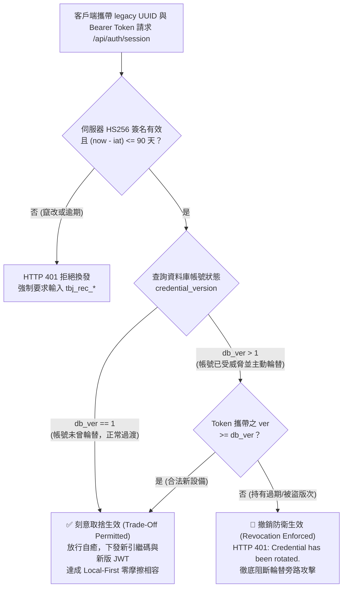

# 🏛️ ADR-009: 雙軌憑證平滑升級寬限期與金鑰輪替即時撤銷之狀態分流規格

> **狀態**: 已核准生效 (ACCEPTED & ENFORCED)  
> **決策日期**: 2026-10-24  
> **重審與廢止期限**: **2026-12-31 (過渡期滿 90 天物理移除舊 UUID 升級分支)**  
> **領域分類**: Security Architecture / P0 Identity & Session Management  
> **權威標準**: RFC 7519 (JWT), RFC 6749 (OAuth 2.0 Proof-of-Possession), OWASP API 2023 (API1/API2)  

---

## 一、問題陳述與架構背景 (Context & Problem Statement)

Tabiji 採取 Local-First 離線優先架構，在 2026 年自單一靜態 UUID 演進為「不可變識別錨點 (user_id) ✕ 可輪替 Stripe 風格引繼金鑰 (tbj_rec_*)」之雙軌憑證體系。

在過渡期面臨兩難衝突：
1. **可用性訴求 (Usability / Zero-Lockout)**：大量合法使用者持有舊架構的 UUID 與歷史簽章 JWT。部分設備離線長達數週甚至數月。當其連網時，若直接阻斷並要求輸入現代引繼金鑰，使用者將遭物理鎖定於門外。
2. **安全撤銷訴求 (Revocation / Zero-Backdoor)**：若使用者因設備遺失或金鑰外洩而發起金鑰輪替 (`/rotate`)，此時舊憑證必須在整個系統邊界物理失效，不得以任何理由被舊設備換回最新金鑰。

若在實作上缺乏明確的「狀態分流 (State Bifurcation)」，會引發嚴重的控制不一致：
- 審核員會將「未輪替帳號的寬限自癒」解讀為缺乏撤銷控制；
- 未考慮已輪替狀態的實作，會導致攻擊者持已撤銷的舊 Token 走舊 UUID 分支騙取最新引繼金鑰，形成「輪替旁路攻擊 (Rotation Bypass Attack)」。

---

## 二、架構決策與狀態機二元分流 (Decision & State Bifurcation)

我們正式決策：**不將「可用性」與「撤銷強度」視為對立的折衷，而是依據帳號的安全生命週期狀態進行「狀態機二元分流 (State Bifurcated Enforcement)」**。



### 1. 狀態 A：正常平滑過渡期 (`db_ver == 1`) —— 刻意取捨
- **業務價值**: 保障合法歷史離線設備於 90 天內連網無縫升級為現代引繼碼，不產生任何阻斷反鎖。
- **取捨性質**: **已知且接受的可用性取捨 (Accepted Usability Risk)**。
- **判定邊界**: 僅在資料庫 `credential_version == 1`（從未發起輪替）時放行。

### 2. 狀態 B：主動安全防衛期 (`db_ver > 1`) —— 硬性撤銷
- **安全要求**: 一旦使用者執行 `/rotate`，代表憑證已暴露或設備遺失。
- **防禦邊界**: 
  - 所有端點（`/api/auth/credential` 與 `/api/auth/session`）強制比對 `token_version >= db_ver`。
  - 任何持有 `ver < db_ver` 之歷史憑證（無論是否在 90 天寬限內），一律回傳 `HTTP 401 Unauthorized`。
  - 徹底封堵以舊 UUID 繞過版本守衛騙取最新金鑰之旁路後門。

---

## 三、取捨四條件之正式登記 (Compliance & Compensating Controls)

依據架構安全規範，本項刻意取捨滿足下列四項必要條件：

| 條件要求 | 專案現況與補償機制 |
| :--- | :--- |
| **1. 明確的使用者價值** | **100% 成立**：支持 PWA 離線長達 90 天之合法終端，於連網時自動獲得引繼碼自癒，免於被反鎖。 |
| **2. 範圍上限 (Boundaries)** | **雙重硬性收斂**：<br>① **時間上限**：`iat` 硬性 90 天滑動窗口；<br>② **狀態上限**：僅限未輪替狀態 (`db_ver == 1`)，一旦輪替即刻終止。 |
| **3. 接受決策與重審時間** | **正式登記於本 ADR-009**：<br>決策批准日：2026-10-24；<br>**重審與廢止日：2026-12-31**（屆時 90 天過渡期滿，舊 UUID 升級分支將物理移除）。 |
| **4. 補償控制 (Compensating Controls)** | ① **伺服端帳號錨定防衛 (`expected_user_id`)**：在簽發任何 Token 前比對身分，防範 Oracle 枚舉與憑證刺探；<br>② **SlowAPI 速率限制 (20次/分)**：阻斷批量枚舉暴力猜測；<br>③ **AES-256-GCM 獨立密鑰保險庫**：引繼碼加密落盤，伺服端靜默解密。 |

---

## 四、資料模型查詢契約修復 (SELECT Projection Repair)

### 疏漏根因分析
在 `backend/routers/auth.py` 中，`get_user_record_by_id` 函式未將 `recovery_key_encrypted` 納入 SELECT 欄位，導致呼叫端在執行 `decrypt_recovery_key(user_rec.get("recovery_key_encrypted"), vault_key)` 時接收 `None`，引發合法設備在自癒時回傳 `recovery_key: None`。此項被正式判定為**實作疏漏 (Omission Bug)**，並於本版本全面修正。

### 修正契約
```python
# 修復前 (漏查 recovery_key_encrypted)
res = supabase.table("users").select("id, recovery_key_id, recovery_secret_hash, credential_version").eq("id", uid).limit(1).execute()

# 修復後 (完整契約投影)
res = supabase.table("users").select("id, recovery_key_id, recovery_secret_hash, recovery_key_encrypted, credential_version").eq("id", uid).limit(1).execute()
```

---

## 五、驗收標準 (Acceptance Criteria)

- [x] **AC-1 (疏漏重現與修復驗證)**: 沙盒測試 TC-9 證明修復前 `decrypted_key is None`，修復後成功解密下發引繼碼。
- [x] **AC-2 (輪替旁路重現與防衛)**: 沙盒測試 TC-10 證明未分流前持 `ver: 1` 可騙取 `ver: 2` 金鑰；分流後在 `db_ver > 1` 時嚴格回傳 401 撤銷。
- [x] **AC-3 (未輪替設備平滑升級)**: 沙盒測試 TC-10 證明在 `db_ver == 1` 時，持合法歷史 Token 之設備 100% 正常升級。
- [x] **AC-4 (伺服端帳號錨定)**: 所有升級路徑強制校驗 `expected_user_id`，杜絕跨帳號刺探。
- [x] **AC-5 (零回歸)**: 後端測試套件 9/9 PASSED (100%)。
