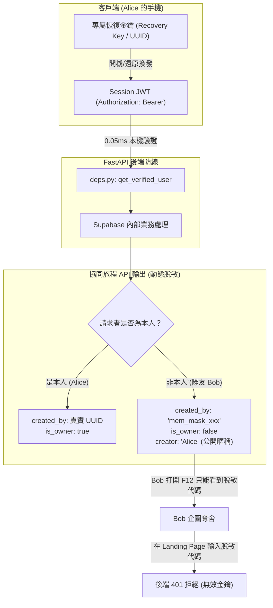

# 📐 規格書：P0 專屬恢復金鑰 (Recovery Key) 與動態脫敏密碼學防偽體系

> **版本**: 2.0.0 (Final Architecture Spec)  
> **狀態**: 已核准待實作 (Approved - Ready for Execution)  
> **責任人員**: System Architect (@architect) / Security Auditor (@security)  
> **設計模式**: 1Password Secret Key 模式 ✕ 伺服端動態脫敏 (Server-Side Dynamic Masking) ✕ 本機高速 JWT

---

## 1. Problem Statement & Core Value (問題陳述與核心價值)

### 1.1 核心痛點 (The Critical Vulnerability)
1. **身分四位一體崩潰 (Identity ATO Vulnerability)**:
   - 過去系統將同一個靜態 UUID 同時當成「公開名片 (Public ID)」、「資料庫外鍵」、「API 通行證 (X-User-ID)」以及「首頁引繼還原碼 (Recovery Code)」。
   - 在多人共享旅程中，API 會向所有協同成員明文廣播創立者的真實 UUID。任何同行成員打開瀏覽器 F12 複製該 UUID，貼到 Landing Page 的輸入框，即可直接登入奪舍（Account Takeover）對方的帳號並刪改旅程。
2. **免登入即用體驗的守護**:
   - 絕對不強迫使用者註冊 Email 或綁定密碼，保留 PWA「秒開即用 (Instant Boot)」的核心競爭力。
   - 保留首頁「使用恢復碼跨裝置引繼」的極致低摩擦體驗。

### 1.2 密碼學理論依據 (Cryptographic Grounding)
- **UUID v4 具備 122 bits 真隨機熵值**（$5.3 \times 10^{36}$ 種可能），在數學上與 1Password Secret Key、比特幣私鑰具備同等強度的防爆破性。
- **只要真實 UUID 永不洩漏給第三方**，UUID 本身就是極為理想且安全的「專屬帳號恢復金鑰 (Recovery Key)」。

### 1.3 成功衡量指標 (Success Metrics)
- **同行奪舍防禦率 100%**: 協同成員無論如何翻找網路封包，皆無法取得創立者或隊友的真實 UUID。
- **舊用戶資產 0 遺失、0 搬遷**: 既有使用者的 `user_uuid` 直接昇華為其專屬「恢復金鑰」，旅程資料庫無需執行任何高風險的 `UPDATE` 搬遷。
- **後端驗證延遲 < 0.1ms**: 本地以 `PyJWT` 進行記憶體簽章驗證，不消耗任何海外 HTTP RTT。
- **SaaS 安全就緒度**: 從 5.0/10 飛躍至 8.5+/10，徹底消除 OWASP API1 (BOLA) 與 API2 (Broken Auth)。

---

## 2. Architecture & Data Model (架構與資料模型)

### 2.1 身分權能分立拓撲 (Separation of Identity Concerns)



---

## 3. 模組改動規格細節 (Component Specifications)

### 3.1 伺服端動態脫敏 (`backend/routers/trips.py`)

#### 1. 旅程細項端點 (`GET /api/trips/{trip_id}`)
- 後端計算：
  ```python
  is_owner = (user_id == created_by)
  is_member = is_owner or any(m.get("user_id") == user_id for m in members)
  ```
- 脫敏輸出：
  - 若 `is_owner == True`：回傳原 `created_by: created_by`，`is_owner: True`。
  - 若 `is_owner == False`：將 `created_by` 脫敏為 `None` 或 `"HIDDEN"`，並標記 `is_owner: False`。同行者僅可看見 `creator: trip["creator_name"]`。
- 成員名單 (`members`) 脫敏：
  - 遍歷 `members`：只有本人的一項保留真實 `user_id`；其餘隊友的 `user_id` 動態替換為 `mem_` + sha256(m["user_id"] + trip_id)[:10]。

### 3.2 憑證發放與驗證 (`backend/routers/auth.py` & `backend/utils/deps.py`)

#### 1. `POST /api/auth/session` (啟動靜默領票)
- 接受 `{ "recovery_key": "optional-uuid" }`。
- 若無金鑰，生成全新 UUID v4。
- 以後端密鑰簽發有效期 365 天之 HS256 Session JWT。

#### 2. `POST /api/auth/recover` (首頁恢復金鑰引繼)
- 接受 `{ "recovery_key": "uuid" }`。
- 速率限制：**5 次 / 分鐘 / IP** (防暴力枚舉)。
- 驗證 UUID 格式與資料庫存在性，回傳新 Session JWT。

#### 3. `backend/utils/deps.py` (嚴格 JWT-only)
- 提取 `Authorization: Bearer <token>`。
- 以本機密鑰解密；解密失敗或未帶 Token 者一律拋出 `401 Unauthorized`。
- **徹底廢止 `X-User-ID` Header 回退信任**。

### 3.3 前端 UI 與文案正名 (`frontend/`)

1. **Profile 設定頁 ([profile-view.tsx](file:///d:/Project/tabiji/travel-pwa/frontend/components/views/profile-view.tsx))**:
   - 標題升級：`🛡️ 你的帳號恢復金鑰 (Recovery Key / 引繼碼)`。
   - 安全提示：`此金鑰為你帳號的唯一最高憑證，請妥善保存，切勿透露給同行旅伴。若更換手機，可在首頁以此金鑰還原帳號。`
2. **Landing Page 引繼框 ([landing-page.tsx](file:///d:/Project/tabiji/travel-pwa/frontend/components/views/landing-page.tsx))**:
   - 保留原輸入框，文案正名為：`使用恢復金鑰還原帳號 (Restore Account with Recovery Key)`。
   - 點擊還原時，呼叫 `/api/auth/recover` 換取 Session JWT 並寫入本地存儲。
3. **API Client ([api.ts](file:///d:/Project/tabiji/travel-pwa/frontend/lib/api.ts))**:
   - 自動在所有發往後端的請求附加 `Authorization: Bearer <token>`。

### 3.4 宣傳文案與授權定位校正

1. **BYOK 文案修正 ([README.md](file:///d:/Project/tabiji/travel-pwa/README.md))**:
   - 將「AI keys stored locally, never on server」修正為：
     > **Zero-Retention BYOK Relay** — AI keys are encrypted locally in the browser, processed strictly in-memory during stateless backend AI proxying, and **never persisted** to server disk, database, or telemetry logs.
2. **授權定位校正**:
   - 標明 **Source-Available under PolyForm Noncommercial 1.0.0**，明確定義非商業用途邊界與歷史 MIT 標籤保障。

---

## 4. Acceptance Criteria (驗收標準清單)

```markdown
- [ ] AC-1: Given an unauthenticated request without valid Bearer token, when calling private endpoints, server responds 401 Unauthorized.
- [ ] AC-2: Given collaborator Bob viewing Alice's trip, when inspecting the API response (GET /api/trips/{id}), then Alice's real UUID is NOT exposed in created_by or members.
- [ ] AC-3: Given owner Alice viewing her own trip, when inspecting the API response, then is_owner is true and she can manage the trip smoothly.
- [ ] AC-4: Given an existing user with user_uuid in localStorage, when opening the upgraded app, their session is silently converted to a JWT without losing any trips or data.
- [ ] AC-5: Given a user switching devices, when pasting their Recovery Key into Landing Page, they successfully restore their account and receive a signed JWT.
- [ ] AC-6: Given an attacker trying to bruteforce /api/auth/recover, when exceeding 5 requests/minute, server blocks them with 429 Too Many Requests.
- [ ] AC-7: Given full test suite execution, existing pytest (112+) and vitest (258+) pass 100% with zero regressions.
```
