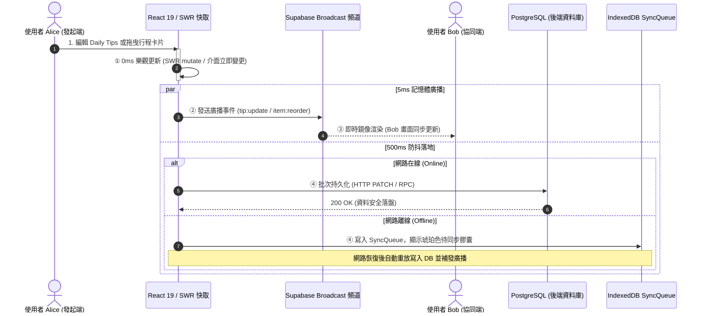

# 規格書：Tabiji 極速即時協同與即時響應架構 (Realtime Collaboration & Instant UI Spec)

> **版本**: 1.0.0 (Production RFC)  
> **建立日期**: 2026-10-22  
> **規範標準**: `/Idea to Spec` + `/grill-me` 深度對齊產出  
> **技術棧**: Next.js 16 + React 19 + SWR v2 + Supabase Broadcast/Presence + IndexedDB SyncQueue

---

## 1. Problem Statement & Core Value (問題陳述與核心價值)

### 1.1 使用者痛點 (User Problem)
- **卡頓與無反應**：使用者在編輯行程每日重點提醒（Daily Tips）或新增景點活動時，介面沒有立即反應，往往需要等待網路請求返回甚至手動 F5 重新整理。
- **狀態被舊資料踩過 (Stale Clashing)**：`EditableDailyTips` 在非同步傳輸期間，父層重新渲染導致內部 `useEffect` 拿舊 props 覆蓋了使用者剛輸入的文字。
- **跨分頁與多設備失聯**：`useTripRealtime.ts` 僅監聽 `trips` 與 `itineraries`，完全遺漏了 `itinerary_items` 表，導致分頁 A 拖曳排序或新增景點，分頁 B 毫無知覺。
- **拖曳排序卡在對話框**：每次卡片拖曳排序都需要彈出對話框詢問「是否重新計算時間」，無法像 Notion / Trello 般流暢連貫。

### 1.2 核心價值與成功指標 (Success Metrics)
- **0ms 本地響應**：鍵盤輸入與卡片放開排序瞬間，本地 UI 延遲 $0\text{ms}$ 完成渲染。
- **< 15ms 跨端同步**：同一行程的多端在線協同者，透過 Supabase Broadcast 記憶體通道在 $15\text{ms}$ 內完成畫面鏡像更新。
- **零資料庫連線池負載 (Zero DB Spike)**：將高頻互動自 Postgres WAL 抽離，資料庫寫入降低 90% 以上。
- **100% 離線可用性**：斷網期間所有操作寫入 IndexedDB `SyncQueue`，聯網後自動重放，零資料遺失。

---

## 2. User Journey & Core Flow (使用者旅程與操作流程)

### 2.1 三軌分流即時互動時序圖 (Mermaid Diagram)



---

## 3. Architecture & Data Model (架構與資料模型)

### 3.1 雙向通訊協議 (Broadcast Protocol)
所有即時協同訊息均在 `trip-collab-{tripId}` 頻道進行傳遞：

```typescript
// 廣播事件定義
export type CollabBroadcastEvent =
  | {
      type: 'broadcast';
      event: 'tip:typing';
      payload: { tripId: string; dayIndex: number; userId: string; userName: string };
    }
  | {
      type: 'broadcast';
      event: 'tip:update';
      payload: { tripId: string; dayIndex: number; content: string; updatedBy: string };
    }
  | {
      type: 'broadcast';
      event: 'item:reorder';
      payload: { tripId: string; dayNumber: number; orderedItemIds: string[]; updatedBy: string };
    }
  | {
      type: 'broadcast';
      event: 'item:mutate';
      payload: { tripId: string; action: 'create' | 'update' | 'delete'; item: any; updatedBy: string };
    };
```

### 3.2 Supabase Realtime 監聽補齊
在 `frontend/lib/hooks/useTripRealtime.ts` 中增設三大資料表與廣播頻道：
1. `public:trips` (filter: `id=eq.${tripId}`)
2. `public:itineraries` (filter: `trip_id=eq.${tripId}`)
3. **`public:itinerary_items` (filter: `trip_id=eq.${tripId}`)** ➔ 徹底解決細項新增無反應的盲區。
4. **`trip-collab-${tripId}`** ➔ 接收 Broadcast 與 Presence 狀態。

### 3.3 元件重構：`EditableDailyTips.tsx`
- 徹底移除容易造成舊資料踩踏的 `useState` + `useEffect([initialTips])` 結構。
- 接入 SWR 的全局 key `tripKey`，使用 `mutate(key, optimisticData, { revalidate: false })`。
- 內建 500ms `lodash.debounce` 防抖，向後端發送持久化請求。

### 3.4 拖曳排序無感化：`itinerary-view.tsx`
- 廢除彈跳對話框 `isReorderDialogOpen` 阻斷。
- 拖曳放開後：
  1. 立即以 `arrayMove` 進行本地 state 與 SWR 樂觀排序（0ms）。
  2. 呼叫 `itemsApi.reorder(newOrder, keepTime=true)` 背景儲存。
  3. 發送廣播 `item:reorder` 給其他協同者。
  4. 彈出 5 秒 `toast('已調整行程順序', { action: { label: '復原 (Undo)', onClick: handleUndo } })`。

---

## 4. Edge Cases & Boundary Conditions (邊界條件與異常處理)

| 異常情境 | 防禦機制 (Defense In Depth) |
| :--- | :--- |
| **網路瞬間斷線 (Offline)** | 前端偵測 `!navigator.onLine` 或請求失敗時，靜默排入 IndexedDB `SyncQueue`，觸發頂部膠囊顯示「1 個未同步變更」，絕不彈窗報錯打斷使用者。 |
| **網路連線恢復 (Reconnection)** | 監聽 `window.addEventListener('online')`，自動喚醒 `SyncQueue.drain()` 依序重放未送出的 mutation，完成後發出廣播並將膠囊轉為綠色「已同步」。 |
| **二人同時編輯同一文字區塊** | 透過 Supabase Presence 廣播 `tip:typing`，在對方畫面上顯示高亮外框與「Ryan 正在輸入...」的感知提示；寫入採欄位級最後寫入勝 (LWW)，避免全行覆蓋。 |
| **後端持久化失敗 (500 Server Error)** | SWR 樂觀更新觸發 `rollbackOnError: true`，自動復原快照，並彈出 Toast 提示「網路同步失敗，已恢復先前內容」。 |
| **快速連續拖曳卡片** | 使用者連續調換順序時，每次拖曳取消前一次的防抖定時器，僅對最後一次確認的排序發送後端持久化請求。 |

---

## 5. Acceptance Criteria (驗收標準清單)

```markdown
- [ ] AC-1 (0ms 打字響應): 於 Daily Tips 輸入文字時，畫面即時響應，無任何 lag 或被舊 props 覆蓋現象。
- [ ] AC-2 (多端鏡像同步): 在 Chrome 開啟兩個獨立分頁（A 與 B），在 A 編輯 Daily Tips，B 分頁在 15ms 內自動顯示最新文字。
- [ ] AC-3 (行程項目即時刷新): 在分頁 A 新增或刪除行程景點，分頁 B 即刻自動響應並出現新景點，無需重新整理。
- [ ] AC-4 (拖曳免對話框與 Undo): 拖曳活動卡片放開後立即重排，不跳出確認對話框；點擊 Undo Toast 可瞬間復原至拖曳前位置。
- [ ] AC-5 (斷網離線排隊): 關閉網路後進行編輯與排序，介面維持正常且無錯誤彈窗，變更暫存於 SyncQueue；重新聯網後自動上雲。
- [ ] AC-6 (型別無錯誤): 執行 `npx tsc --noEmit` 0 errors，通過全域品質底線。
```
