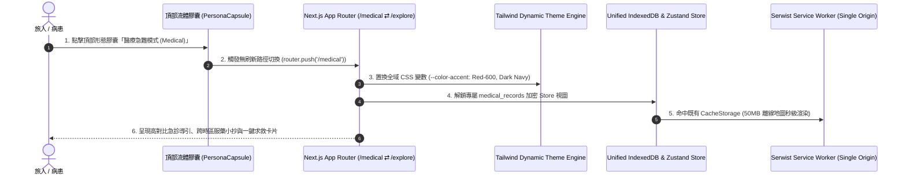

# 🏛️ 單一源多形態架構規格書 (Single-Origin Multi-Persona Routing Architecture Spec - SPEC-ARCH-002)

> **規格代碼**：`SPEC-ARCH-002`  
> **關聯決策**：`AD-196` (Single-Origin Dynamic Persona Routing)  
> **前置規格**：[`SPEC-MED-001`](file:///d:/Project/tabiji/travel-pwa/docs/specs/architecture/offline-emergency-medical-sentinel-spec.md), [`SPEC-DOCS-001`](file:///d:/Project/tabiji/travel-pwa/docs/specs/core-architecture/realtime-collaboration-sync-spec.md)  
> **現行狀態**：🟢 Approved via `/Idea to Spec` & `/grill-me` (2026-10-26)

---

## 1. Problem Statement & Core Value (問題陳述與核心價值)

### 1.1 使用者痛點與背景
使用者提出「能否在主網域 `tabijiapp.com` 前綴加上不同字樣（如 `medical.`, `explore.`, `transit.`）代表不同服務與多樣外貌」之構想。
經架構審查與 W3C 規範驗證：
- **子網域前綴方案（Subdomain Matrix）存在四大致命硬傷**：
  1. **W3C Service Worker Scope 隔離**：`medical.tabijiapp.com` 無法共享主站的 Service Worker 快取，50MB 離線地圖瓦片需重複下載。
  2. **IndexedDB 同源分區隔離 (Storage Partitioning)**：用戶在主站儲存的行程與時光膠囊，切換至子網域無法直接讀取。
  3. **PWA 安裝碎片化**：瀏覽器以 Origin 判定 PWA 實體，用戶被迫安裝 3–5 個不同 App 圖示。
  4. **Google SEO 權重稀釋**：PageRank 被強制拆解為弱勢孤島。

### 1.2 核心價值主張
本規格定義 **「單一源多形態架構 (Single-Origin Multi-Persona Architecture)」**：
- 統一在主網域 `tabijiapp.com` 下，透過路徑（`/medical`, `/explore`, `/transit`）實現**千人千面的專屬介面、色彩主題與專業功能模組**。
- **單一 PWA 圖示**：桌面只需安裝一個 Tabiji 應用。
- **全站離線資源與 IndexedDB 100% 共享**：一次快取，處處可用。
- **SEO 權重 100% 匯聚**：所有流量與外鏈均強化 `tabijiapp.com` 之 Domain Authority。

---

## 2. User Journey & Core Flow (使用者旅程與核心流程)

### 2.1 形態切換與資料流動流程圖



### 2.2 形態模式定義 (Persona Manifest)

| 形態代碼 | 路由路徑 | 目標客群與場景 | 視覺主題 (Theme Tokens) | 專屬核心組件 |
| :--- | :--- | :--- | :--- | :--- |
| **`explore`** (預設) | `/explore` 或 `/` | 一般觀光、美食探索、城市漫遊 | `Stone-50` 暖白底、`Emerald-600` 活力綠、微透明毛玻璃 | `MultiDayMasterMap`, `POIPreviewCard`, `BentoWeather` |
| **`medical`** | `/medical` | 慢性病旅人、赴日就醫、突發急症 | `Slate-900` 深藍灰底、`Red-600` 急救紅、高對比夜間防眩 | `ChronopharmacologyCard`, `EmergencyHospitalFinder`, `DoctorMemoSheet` |
| **`transit`** | `/transit` | 機場轉乘、新幹線換乘、長途跨國移動 | `Zinc-950` 極簡深灰、`Amber-500` 警告橘、大號高清晰排版 | `TransitSegmentConnector`, `AirportFlightMatrix`, `OfflineSchedule` |

---

## 3. Architecture & Data Model (架構與資料模型)

### 3.1 狀態管理與切換器 (`frontend/lib/stores/persona-store.ts`)

```typescript
import { create } from 'zustand';
import { persist } from 'zustand/middleware';

export type AppPersona = 'explore' | 'medical' | 'transit';

interface PersonaState {
  currentPersona: AppPersona;
  setPersona: (persona: AppPersona) => void;
  isMedicalUnlocked: boolean;
  setMedicalUnlocked: (unlocked: boolean) => void;
}

export const usePersonaStore = create<PersonaState>()(
  persist(
    (set) => ({
      currentPersona: 'explore',
      setPersona: (persona) =>
        set((state) => ({
          currentPersona: persona,
          isMedicalUnlocked: persona === 'medical' ? state.isMedicalUnlocked : false,
        })),
      isMedicalUnlocked: false,
      setMedicalUnlocked: (unlocked) => set({ isMedicalUnlocked: unlocked }),
    }),
    {
      name: 'tabiji-persona-storage',
      partialize: (state) => ({ currentPersona: state.currentPersona }),
    }
  )
);
```

### 3.2 統一 IndexedDB 結構與隱私遮蔽規範 (`frontend/lib/idb-storage.ts`)

在現有 `tabiji_offline_db` 基礎上，維持單一資料庫實例，新增專屬加密 Store：

```typescript
// IndexedDB Object Stores Topology:
// 1. trips (全形態共享: 行程天數、基本地點坐標)
// 2. offline_tiles (全形態共享: Esri/OSM 50MB 離線地圖瓦片)
// 3. outbox_queue (全形態共享: 離線未同步隊列)
// 4. medical_records (專屬 Store: 慢病用藥、處方箋圖片、緊急聯絡人)

export interface MedicalRecordItem {
  id: string;
  tripId: string;
  medicationName: string;
  dosageSchedule: string; // 跨時區服藥換算結果
  prescriptions: string[]; // 處方箋安全路徑
  emergencyContacts: Array<{ name: string; phone: string; relation: string }>;
  encryptedAtRest: boolean;
}
```

* **形態隱私遮蔽不變量 (Privacy Masking Invariant)**：
  - 當處於 `/explore` 或 `/transit` 模式時，首頁與浮動對話面板中涉及敏感醫療（如疾病診斷、用藥劑量）之文字一律進行遮蔽（Masking），防止同伴共看行程時洩漏個人健康隱私。
  - 當點擊進入 `/medical` 模式時，由使用者指紋/PIN 授權或顯式確認後解鎖完整臨床數值。

---

## 4. Edge Cases & Boundary Conditions (邊界條件與異常處理)

1. **斷網離線環境切換形態**：
   - **行為**：使用者在無網路航班上從 `/explore` 切換到 `/medical`。
   - **防衛**：Serwist Service Worker 預先快取所有形態的靜態殼層（Shell）；切換路徑為純前端客戶端跳轉（Client-Side Navigation），0ms 瞬間渲染，無需向伺服器發送網路請求。
2. **外部深層連結分享 (Deep Linking)**：
   - **行為**：病患將其在日本的急難醫院清單連結 `tabijiapp.com/medical?view=hospital` 發給救護員或家屬。
   - **防衛**：伺服端支援 SSR 靜態預渲染與 OpenGraph 專屬卡片標籤，受贈方點開直接命中醫療專用 Layout，不受發送方本地偏好影響。
3. **PWA 安裝元數據與 Manifest 統一**：
   - Web App Manifest 保持單一源：
     ```json
     {
       "name": "Tabiji - 旅途隨身空間與醫療急難生命線",
       "short_name": "Tabiji",
       "start_url": "/?source=pwa",
       "scope": "/",
       "display": "standalone"
     }
     ```
   - 在單一安裝圖示內，透過頂部膠囊或底欄隨時切換，杜絕多個圖示污染手機桌面。

---

## 5. Acceptance Criteria (驗收標準清單)

```markdown
- [ ] AC-1: 訪問 `tabijiapp.com/medical` 與 `tabijiapp.com/explore` 均由單一 Origin 託管，零 CORS 跨域 Preflight 損耗。
- [ ] AC-2: 在 `/explore` 模式下下載的 Esri 離線地圖瓦片，在 `/medical` 模式下打開急診地圖時可 0ms 直接讀取，無需重複下載。
- [ ] AC-3: 頂部導覽列提供流體切換膠囊，點擊後於 150ms 內平滑置換 Tailwind 變數主題（暖大地色 ⇄ 急難高對比深藍/紅）。
- [ ] AC-4: 行程資料與醫療紀錄存於單一 IndexedDB 實例中，`/explore` 模式自動隱私遮蔽敏感藥物名稱與劑量。
- [ ] AC-5: Google 爬蟲可完整抓取所有形態子路徑，PageRank 與外鏈權重 100% 累積至主網域 `tabijiapp.com`。
```
