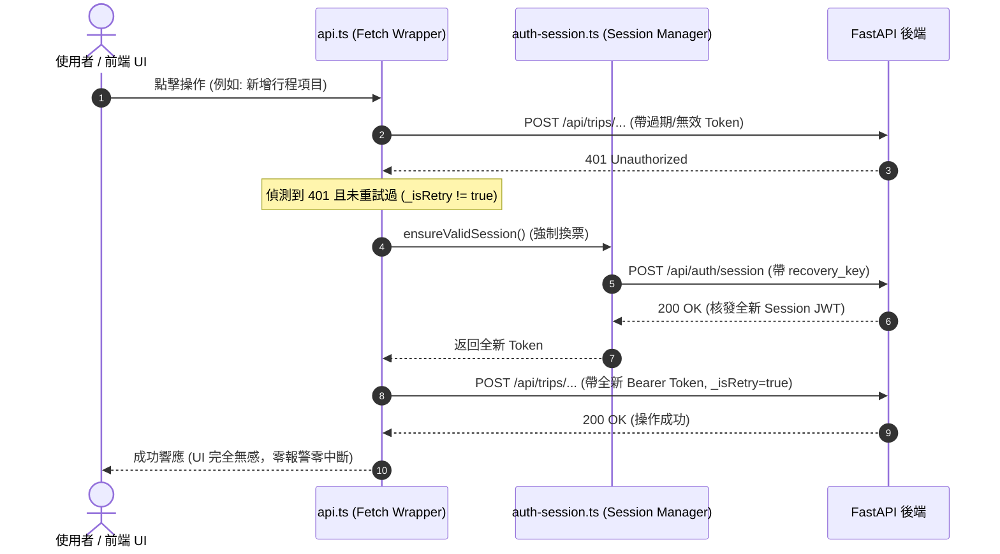

# 📋 Engineering Specification: 401 Zero-Disconnection Architecture (全棧 401 零斷線閉環防禦)

> **規格版本**: v1.0.0  
> **狀態**: Ready for Implementation  
> **核心負責領域**: `state_cache`, `backend_concurrency`, `devops_security`  
> **前置調研與對話結論**: 經 `/grill-me` 雙軌決策樹確認，全面覆蓋前端 API、Session 金鑰治理、後端 Key 碰撞隔離、SW 網路隔離與 SSE 串流重連。

---

## 1. Problem Statement & Core Value (問題陳述與核心價值)

### 使用者痛點 (User Problem)
在 PWA 長時間使用、手機背景休眠切回前景、網路從離線恢復、或後端密鑰重啟等場景下，客戶端持有的 JWT 可能過期或暫時失效。現有系統雖然具備 `hooks.ts` 的 SWR 重試，但在以下 5 個關鍵盲區中仍會觸發 401 中斷：
1. **API 層未實作 401 重試** (`frontend/lib/api.ts`): 收到 401 後僅清除本地 Token 並非同步發起背景換票，但當前請求直接返回 401，導致所有 CRUD 操作（建立、編輯、刪除行程與項目）立即拋錯中斷。
2. **恢復金鑰覆寫遺漏** (`frontend/lib/auth-session.ts`): 當本地 `user_uuid` 為歷史無效格式時，後端生成新 UUID，但前端因 `!storedKey` 為假而未更新 localStorage，導致往後每次換票持續脫節。
3. **後端 API Key 與 JWT 提取碰撞** (`backend/utils/deps.py`): `get_gemini_key` 會從 `Authorization: Bearer <key>` 抓取，若前端未帶 BYOK Key，FastAPI 將 Session JWT 誤認為 Gemini Key 轉發給 Google GenAI，引發無效金鑰 400/401 異常。
4. **Service Worker 缺少 Auth 端點顯式隔離** (`frontend/app/sw.ts`): 未明確將 `/api/auth/` 列入 `NetworkOnly`，存在被快取策略干擾換票之潛在風險。
5. **SSE 串流連線無 401 重連** (`frontend/lib/sse-parser.ts` & `frontend/components/chat-widget.tsx`): 串流握手收到 401 直接拋錯終止，用戶必須重新點擊送出。

### 成功指標 (Success Metric)
- **401 脫節率降為 0**：在 Token 過期、後端重啟金鑰變更、或長時間閒置後，全站任何 API 調用與 AI 串流連線 100% 透明重試並成功返回數據。
- **測試覆蓋率 100%**：新增 401 自動重試、金鑰自癒與防碰撞單元測試，全棧測試保持全綠。

---

## 2. User Journey & Core Flow (使用者旅程與操作流程)



---

## 3. Architecture & Data Model (架構與變更細節)

### 3.1 前端 API 代理層 (`frontend/lib/api.ts`)
- 在模組封裝之 `fetch` 中實作透明單次重試邏輯：
  ```typescript
  let res = await activeFetch(input, init);
  if (res.status === 401 && typeof window !== "undefined" && !(init as any)?._isRetry) {
      console.warn("⚠️ [API] Received 401 Unauthorized, refreshing token and retrying 1-time...");
      localStorage.removeItem("tabiji_session_token");
      const freshToken = await ensureValidSession().catch(() => null);
      if (freshToken) {
          const retryInit = {
              ...init,
              _isRetry: true,
              headers: {
                  ...(init?.headers instanceof Headers ? Object.fromEntries(init.headers.entries()) : (Array.isArray(init?.headers) ? Object.fromEntries(init.headers) : init?.headers)),
                  Authorization: `Bearer ${freshToken}`
              }
          };
          res = await activeFetch(input, retryInit);
      }
  }
  return res;
  ```

### 3.2 會話管理器金鑰校正 (`frontend/lib/auth-session.ts`)
- 修正 `ensureValidSession` 的覆寫邏輯：
  ```typescript
  if (data.user_id && (!storedKey || data.is_new)) {
      localStorage.setItem(RECOVERY_KEY, data.user_id);
  }
  ```

### 3.3 後端金鑰防碰撞守護 (`backend/utils/deps.py`)
- 加固 `get_gemini_key`：明確排除 JWT 格式（以 `ey` 開頭且包含兩點）的 `Authorization` 標頭：
  ```python
  if not final_key and auth_header:
      token_cand = auth_header.split(" ")[1] if auth_header.startswith("Bearer ") else auth_header
      # 🛡️ 守衛：若為 JWT 憑證 (包含兩點且以 ey 開頭)，絕不可誤判為 Gemini Key
      if not (token_cand.startswith("ey") and token_cand.count(".") == 2):
          final_key = token_cand
  ```

### 3.4 Service Worker 網路隔離 (`frontend/app/sw.ts`)
- 在 `runtimeCaching` 的 `NetworkOnly` 規則中，加入 `/api/auth/` 端點防護：
  ```typescript
  const isAuthApi = url.pathname.startsWith("/api/auth/");
  return isSupabaseAuth || isSensitiveApi || isAuthApi;
  ```

### 3.5 SSE 與 AI 串流連線透明重試 (`frontend/lib/sse-parser.ts` & `chat-widget.tsx`)
- 在串流握手遭遇 401 時，清除過期 Token，重新取得 `freshToken` 並重試連線 1 次。

---

## 4. Edge Cases & Boundary Conditions (邊界條件與異常處理)

1. **無限 401 循環防禦**：
   - 強制注入 `_isRetry: true` 旗標，單一請求至多重試 1 次。若第二次仍為 401，則正常返回並拋出錯誤。
2. **併發請求風暴防禦**：
   - 依託 `auth-session.ts` 現有的 `inFlightSessionPromise`，無論瞬間有 10 個或 50 個請求同時收到 401，後端僅會收到 1 次換票請求，所有重試請求共享同一個全新 JWT。
3. **完全斷網與離線模式**：
   - 若 `navigator.onLine === false`，`ensureValidSession()` 靜默返回 `null`，離線請求由 `offlineFetch` 排入 IndexedDB 隊列，不觸發報警。

---

## 5. Acceptance Criteria (驗收標準清單)

- [ ] **AC-1**: 當使用過期或無效的 `tabiji_session_token` 發起 `itemsApi.create` 時，系統自動透明換發並重試成功（返回 200/201，不拋出 401 錯誤）。
- [ ] **AC-2**: 當 `user_uuid` 格式不合規且後端生成 `is_new: true` 時，`localStorage` 中的 `user_uuid` 被正確更新為最新 UUID。
- [ ] **AC-3**: 當前端帶有 Session JWT 訪問 `/api/chat` 或 `/api/agents` 且未提供 `X-Gemini-API-Key` 時，後端返回明確的「需提供 Gemini API Key」401 提示，絕不將 JWT 誤轉發給 Google GenAI。
- [ ] **AC-4**: Service Worker 遇到 `/api/auth/*` 請求時 100% 執行 `NetworkOnly`，絕不快取換票響應。
- [ ] **AC-5**: SSE 即時串流握手若遇 401，自動換票並重連 1 次，對話串流正常啟動。
- [ ] **AC-6**: 雙端全量測試 100% 通過（TypeScript 0 錯誤、ESLint 0 錯誤、Vitest 82 套件、Pytest 215 用例全綠）。
