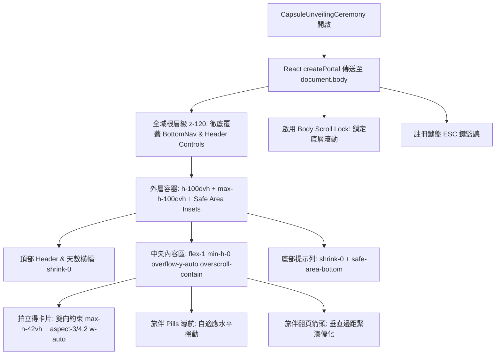

# 📮 旅伴時光膠囊破印盛典：全域層級傳送 (Portal) 與動態視窗適配工程規格書
# Engineering Specification: Capsule Unveiling Portal & Dynamic Viewport Resilience

> **狀態**: 已核准 (Approved by Ryan)  
> **版本**: 1.0.0  
> **日期**: 2026-10-14  
> **關聯組件**: `frontend/components/itinerary/CapsuleUnveilingCeremony.tsx`, `frontend/components/views/itinerary-view.tsx`

---

## 1. 背景與現有架構問題診斷 (Context & Problem Diagnosis)

### 1.1 問題 A：Stacking Context 限制導致四大導覽列與頂部按鈕穿透
- **現狀**：`CapsuleUnveilingCeremony` 直接於 `ItineraryView` 內部渲染，而 `ItineraryView` 在 `app-shell.tsx` 中被包裹於 `<motion.div className="w-full h-full flex flex-col">` 內。
- **機理**：Framer Motion 的 `motion.div` 帶有 CSS `transform` 或 `opacity`，會建立獨立的 **CSS Stacking Context（層疊上下文）**。此時，無論盛典組件設定多高的 `z-index`（如 `z-100` 或 `z-9999`），其層級範圍均被硬性囚禁於 `ItineraryView` 內部。
- **後果**：`app-shell.tsx` 同層級渲染的 `BottomNav`（四大導覽列，`z-100`）、`AIStatusButton`（`z-100`）與 `NotificationBell`（`z-100`）擁有較高的根層級，直接浮現並穿透於盛典視圖之上，造成嚴重的 UI 遮擋。

### 1.2 問題 B：固定寬高比撐大與高度溢出截斷 (Clipping Defect)
- **現狀**：中央 3D 拍立得卡片使用 `w-full max-w-75 sm:max-w-85 aspect-[3/4.2]`。
- **機理**：卡片寬度達 340px 時，卡片高度硬性擴展至 476px。加上頂部標題列 (~80px)、天數橫幅 (~50px)、旅伴 Pills (~36px)、切換箭頭 (~36px) 及底部小提示 (~50px)，累加高度超過 720px。
- **後果**：在一般手機直向視窗（尤其含網址列或底部虛擬手勢條時）或小視窗環境下，因外層 `overflow-hidden`，底部的旅伴 Pills 露出半截、切換箭頭與底部小提示完全沉入視窗外部被裁切。

---

## 2. 架構解決方案 (Architectural Solution)



### 2.1 全域層級隔離 (Portal & Stacking Isolation)
1. **傳送至 `document.body`**：
   引入 `createPortal`，在 Client-side 且 `mounted === true` 時將盛典直接傳送至 `document.body`，與專案內的 `DialogPortal` / `Radix UI` 維持一致的架構水準。
2. **層級標記**：
   設置 `z-[120]`，高於 `BottomNav` (`z-100`)、`AIStatusButton` (`z-100`) 及一般的 `z-110` 彈窗。

### 2.2 沉浸式互動守衛 (Immersive Interaction Guards)
1. **Body Scroll Lock**：
   盛典開啟時，自動將 `document.body.style.overflow = "hidden"`，關閉時復原。
2. **鍵盤 ESC 退出**：
   監聽 `keydown` 事件，按下 `Escape` 鍵時調用 `onClose()`。
3. **專注關閉**：
   保留右上角 `X` 按鈕作為主要關閉觸發，背景不支援任意點擊關閉，避免誤觸打斷破印回顧。

### 2.3 視窗動態自適應 (Dynamic Viewport & Anti-Clipping)
1. **動態視窗單位 (`100dvh`)**：
   使用 `h-[100dvh] max-h-[100dvh]` 替代 `inset-0`，精確鎖定動態視窗高度。
2. **卡牌雙向縮放 (Bidirectional Constraint)**：
   ```tsx
   className="relative w-full max-w-75 sm:max-w-85 max-h-[42vh] aspect-[3/4.2] flex items-center justify-center"
   ```
   確保高度不超過視窗 42%，自適應等比縮放，為下方旅伴 Pills 與導航騰出充足空間。
3. **滾動保底 (Scrollable Resilience)**：
   中央內容容器配置 `flex-1 min-h-0 overflow-y-auto overscroll-contain scrollbar-none`，即使在極端超小高度螢幕（如橫向手機或老舊小螢幕）下，旅伴 Pills 與箭頭永遠可滾動抵達，絕不截斷。
4. **安全區適配 (Safe Area Insets)**：
   底部留白使用 `pb-[max(env(safe-area-inset-bottom,12px),12px)]`，確保符合 iOS Home Indicator 規範。

---

## 3. 邊際情況防禦矩陣 (Edge Cases & Resilience Matrix)

| 邊際情況 | 潛在風險 | 防禦策略 |
| :--- | :--- | :--- |
| **SSR / Hydration 未掛載** | `document.body` 在伺服端渲染時為 `undefined` | 引入 `useSyncExternalStore` 或 `useState + useEffect (mounted)`，僅在客戶端執行 `createPortal` |
| **超小高度螢幕 (極端 < 500px)** | 卡片 + Pills 超過螢幕總高度 | `min-h-0 + overflow-y-auto` 彈性滾動，永遠保證所有內容可見 |
| **組件卸載殘留 Body Lock** | 使用者在盛典開啟狀態觸發路由跳轉 | `useEffect` 返回清理函數，必定重置 `document.body.style.overflow = ""` |
| **多旅伴橫向長名撐開容器** | 旅伴姓名過長破壞排版 | Pills 容器使用 `overflow-x-auto scrollbar-none max-w-full px-4`，文字加上 `truncate max-w-[120px]` |
| **快速按 ESC 鍵重複觸發** | 狀態未收合或動畫卡死 | AnimatePresence 配合安全狀態管理 |

---

## 4. 驗證標準 (Acceptance Criteria)

1. **零穿透**：破印盛典開啟時，四大導覽列（行程/資訊/工具/個人檔案）與頂部 AI 按鈕、鈴鐺通知 100% 被深色星夜背景覆蓋，無視角洩漏。
2. **零截斷**：在桌面瀏覽器、手機瀏覽器（包括 iPhone Safari 與 Android Chrome）下，卡片、旅伴 Pills（`[ 🥳 Owner ]` 等）、切換箭頭（`◀ 1 / N ▶`）與底部小提示完整可見，無任何裁切。
3. **點擊與翻轉正常**：旅伴 Pills 與左右箭頭點擊切換、卡片 3D 翻轉互動完全順暢。
4. **型別與測試 0 錯誤**：`tsc --noEmit` 0 錯誤，全套單元測試保持綠燈。
