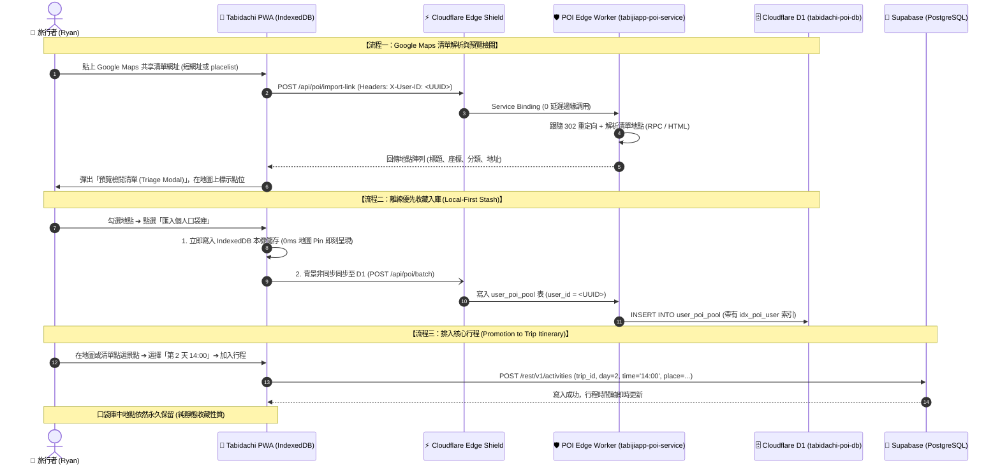

# 📋 Feature Specification: Cloudflare D1 POI Edge Microservice & Local-First Hybrid Architecture

> **Feature Name**: `cloudflare-d1-poi-service`  
> **Author**: Ryan Su (Lead) & `@architect`  
> **Status**: APPROVED & SPECIFIED (via `/Idea to Spec` & `/grill-me`)  
> **Version**: 2.0.0  
> **Target Date**: 2026-10-20  

---

## 1. Problem Statement & Core Value (問題陳述與核心價值)

### 1.1 User Problem
- **全球景點收集痛點**：旅行者在社群、地圖上隨手收集的想去景點，若每次存取都要喚醒冷啟動的容器或跨國查詢關聯資料庫，會造成高昂延遲（>1000ms）。
- **離線與即時體驗**：使用者需要在地鐵、飛機或弱網環境下 0ms 即時標記與查看「個人景點口袋名單 (POI Pocket)」，並保有 Google Maps 收藏夾般的純靜態永久留存特性。
- **身分與資料割裂疑慮**：系統使用單一 `user_uuid` 作為身分識別，需在 Cloudflare D1 與 Supabase 之間建立清晰的職責劃分（Polyglot Persistence），絕不在邊緣建立多餘的 User 表。

### 1.2 Core Value & Success Metrics
- **0ms 本地響應**：Local-First 本地優先，IndexedDB 瞬時渲染。
- **sub-10ms 邊緣存取**：全球 330+ Cloudflare 邊緣節點直出個人的 POI 口袋庫，免去後端資料庫負擔。
- **零全表掃描風險**：D1 嚴格執行複合索引，防禦 500 萬行掃描巨坑。
- **單一身分貫穿**：以 `user_uuid` 錨定 D1 的 `user_id`，加入行程時無縫寫入 Supabase PostgreSQL。

---

## 2. User Journey & Core Flow (使用者旅程與操作流程)



---

## 3. Architecture & Data Model (架構與資料模型)

### 3.1 Cloudflare D1 資料庫 Schema (`schema.sql`)
- **資料庫名稱**: `tabidachi-poi-db`
- **資料庫 UUID**: `cefda064-d8d5-4501-9f0f-a525b0a387dd`

```sql
CREATE TABLE IF NOT EXISTS user_poi_pool (
    id TEXT PRIMARY KEY,
    user_id TEXT NOT NULL,
    title TEXT NOT NULL,
    address TEXT,
    lat REAL NOT NULL,
    lng REAL NOT NULL,
    google_place_id TEXT,
    category TEXT DEFAULT 'attraction',
    rating REAL,
    user_notes TEXT,
    source_url TEXT,
    is_pinned INTEGER DEFAULT 1,
    pin_color TEXT DEFAULT '#E56E25',
    created_at INTEGER NOT NULL,
    updated_at INTEGER NOT NULL
);

-- 🛡️ 官方防全表掃描巨坑複合索引 (Composite Index)
CREATE INDEX IF NOT EXISTS idx_poi_user_created 
ON user_poi_pool(user_id, created_at DESC);

-- 防止同一使用者重複收藏同一個座標點
CREATE UNIQUE INDEX IF NOT EXISTS idx_poi_user_coords 
ON user_poi_pool(user_id, lat, lng);
```

### 3.2 邊緣微服務認證與身分模型
- **身分識別**:
  1. `X-User-ID`: 必須符合 RFC 4122 標準 UUIDv4 正則：
     ```regex
     ^[0-9a-f]{8}-[0-9a-f]{4}-4[0-9a-f]{3}-[89ab][0-9a-f]{3}-[0-9a-f]{12}$
     ```
  2. `Authorization: Bearer <token>`: 若提供 JWT，透過 Web Crypto API 驗證簽名。
  3. 拒絕未經簽名之偽造 JWT，非法身分直接回傳 `401 Unauthorized`。

### 3.3 邊緣 API 端點規格
| 方法 | 路徑 | 說明 | 參數 / Body |
| :--- | :--- | :--- | :--- |
| `GET` | `/api/poi/list` | 獲取個人 POI 口袋清單 | Header: `X-User-ID`，Query: `limit=100`, `category` |
| `POST` | `/api/poi/import-link` | 解析 Google Maps 連結 | Body: `{ url: string }` |
| `POST` | `/api/poi/batch` | 批量儲存 POI 至 D1 | Body: `{ pois: POIItem[] }` |
| `DELETE`| `/api/poi/:id` | 刪除單一 POI | Header: `X-User-ID` (僅限刪除自己的 POI) |
| `PATCH` | `/api/poi/:id` | 更新備註、分類或釘選色 | Body: `{ user_notes?, category?, pin_color? }` |

---

## 4. Edge Cases & Boundary Conditions (邊界條件與防禦機制)

1. **離線網路中斷 (Offline Resiliency)**：
   - 使用者在離線時的所有操作（新增、刪除、編輯），由 `usePoiPool` Hook 寫入 IndexedDB 的 `outbox` 待同步隊列。
   - 監聽 `window.addEventListener('online')`，恢復連線後自動執行差量上傳至 D1。
2. **D1 行數掃描配額防禦 (Quota Defense)**：
   - 所有查詢強制注入 `LIMIT 100`。
   - 所有查詢一律強制透過 `idx_poi_user_created` 索引命中，禁絕全表掃描。
3. **邊緣故障自動容錯降級 (Edge Shield Failover)**：
   - 在 `edge-shield/worker.js` 中，透過 `try/catch` 包裹 `env.POI_SERVICE.fetch(request)`。
   - 若 D1 或 Worker 回傳 5xx 或拋出未捕捉異常，自動降級回源轉發給 Python FastAPI 後端（Cloud Run），確保業務永不中斷。

---

## 5. Acceptance Criteria (驗收標準清單)

- [ ] **AC-1 (D1 Schema 就緒)**: `schema.sql` 成功套用於線上 `tabidachi-poi-db`，複合索引命中且無報錯。
- [ ] **AC-2 (Worker 安全部署)**: `tabijiapp-poi-service` 包含 UUIDv4 身分校驗，成功部署至 Cloudflare 網路。
- [ ] **AC-3 (Service Binding 聯通)**: `tabijiapp-edge-shield` 成功綁定 `POI_SERVICE`，`/api/poi/*` 在邊緣直接響應。
- [ ] **AC-4 (預覽檢閱模式)**: 貼上 Google Maps 共享清單，成功解析多筆地點並彈出 Triage Modal 供使用者勾選。
- [ ] **AC-5 (純靜態永久收藏)**: 景點加入行程後，口袋庫中依然完好保留該景點。
- [ ] **AC-6 (自動容錯驗證)**: 當 POI Worker 模擬拋出錯誤時，Edge Shield 能自動降級轉發至 Cloud Run。
