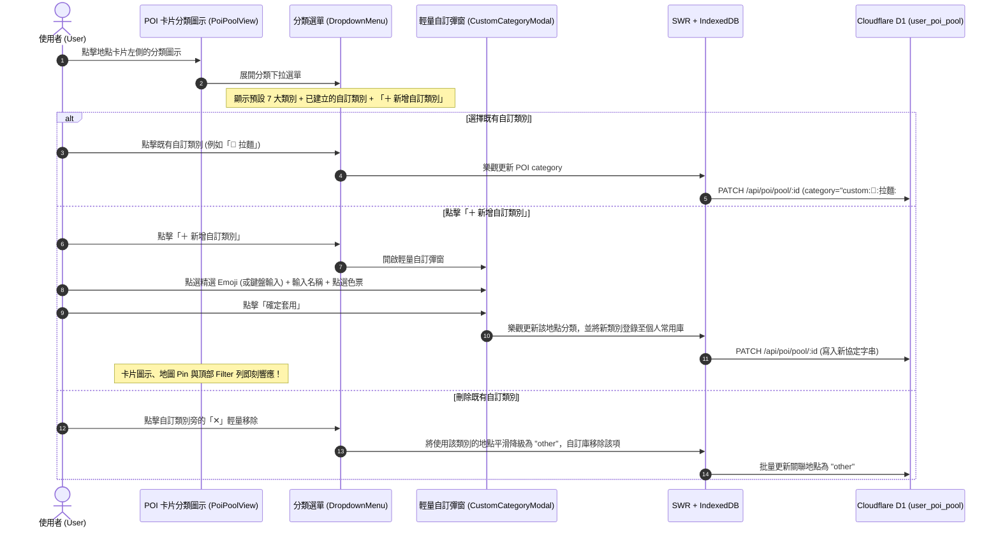

# 標籤革命：自訂地點分類與表情符號/色票工程規格書
# (Feature Spec: Custom POI Categories & Emoji/Color Picker)

> **版本號**: `v1.0.0`  
> **更新日期**: `2026-10-21`  
> **狀態**: `Draft Ready for Review`  
> **作者**: Tabidachi Core Architecture Team  
> **前置共識**: 經由 `/grill-me` 雙向面試確定 5 大核心設計決策（個人共用類別庫、輕量彈出視窗、自包含協定字串、全域動態渲染、內建精選盤 + 輕量移除）。

---

## 1. Problem Statement & Core Value (問題陳述與核心價值)

### 1.1 使用者痛點 (User Problem)
目前 Tabidachi 景點池（POI Pool）僅提供 7 種固定預設分類（景點 `attraction`、美食 `food`、咖啡 `cafe`、購物 `shopping`、住宿 `hotel`、交通 `transport`、全部 `other`）。在深度旅程中，使用者經常有更細膩、個人化的地點整理需求：
1. **旅遊細分維度不足**：例如日本旅行中，使用者強烈希望區分「拉麵 🍜」、「居酒屋 🍶」、「溫泉 ♨️」、「動漫扭蛋 🎮」、「相機拍照點 📷」、「伴手禮 🎁」、「神社朱印 ⛩️」。
2. **缺乏視覺辨識度**：固定圖標讓地圖與列表顯得單一，無法一眼區隔特定愛好行程。

### 1.2 核心價值與指標 (Success Metric)
- **零遷移無感升級 (Zero-Migration)**：無需改動 Cloudflare D1 Schema，既有 7 大類別與舊資料完全向前相容（100% Backward Compatibility）。
- **完全離線自主 (Self-contained)**：分類協定自我攜帶視覺與名稱元數據，離線狀態或跨裝置無需額外資料表查詢。
- **靈魂視覺體驗**：地圖 Pin 標記與卡片即時無縫套用動態 Emoji 與主題色票，篩選列動態響應。

---

## 2. User Journey & Core Flow (使用者旅程與操作流程)



---

## 3. Architecture & Data Model (架構與資料模型)

### 3.1 自包含協定 (Self-contained Protocol)
為避免繁重資料庫遷移，自訂分類採用具備原子解碼能力的字串協定：

$$\text{Category Format} = \begin{cases} 
\text{"attraction" | "food" | "cafe" | "shopping" | "hotel" | "transport" | "other"} & \text{(預設系統類別)} \\
\text{"custom:"} + \langle\text{emoji}\rangle + \text{":"} + \langle\text{name}\rangle + \text{":"} + \langle\text{colorHex}\rangle & \text{(自訂類別協定)}
\end{cases}$$

**範例**：
- `custom:🍜:拉麵:#F59E0B`
- `custom:⛩️:神社寺廟:#EF4444`
- `custom:♨️:秘湯溫泉:#06B6D4`
- `custom:📷:絕景拍照點:#8B5CF6`

### 3.2 協定解析器 (Parser & Serializer Specification)

```typescript
export interface ParsedCategory {
    isCustom: boolean
    key: string              // 完整 key，例如 "custom:🍜:拉麵:#F59E0B" 或 "food"
    label: string            // 顯示文字，例如 "拉麵" 或 "美食"
    emoji?: string           // "🍜"
    color: string            // "#F59E0B" 或 Tailwind 類別映射
    bg: string               // 背景色/容器樣式
    icon?: React.ElementType // 預設類別時的 Lucide 元件
}

export function parseCategory(catStr: string | null | undefined): ParsedCategory {
    if (!catStr) return parseCategory("other")

    if (catStr.startsWith("custom:")) {
        const parts = catStr.split(":")
        // custom:<emoji>:<name>:<color>
        const emoji = parts[1] || "📍"
        const label = parts[2] || "自訂類別"
        const color = parts[3] || "#E56E25"
        return {
            isCustom: true,
            key: catStr,
            label,
            emoji,
            color,
            bg: `${color}1A`, // 10% alpha for background pill
        }
    }

    // 系統預設類別映射
    const cm = CATEGORY_MAP[catStr as POICategory] || CATEGORY_MAP.other
    return {
        isCustom: false,
        key: catStr,
        label: cm.labelKey, // i18n key
        color: cm.color,
        bg: cm.bg,
        icon: cm.icon,
    }
}
```

### 3.3 儲存與快取層 (Storage Compatibility)
1. **Cloudflare D1 (`user_poi_pool`)**:
   - `category` 欄位原本即為 `TEXT`，無需執行 `ALTER TABLE`，天然支持寫入 `custom:...` 字串。
2. **本機快取 (`IndexedDB` & `SWR`)**:
   - `POIItem.category` 擴充型別定義為 `POICategory | (string & {})`，完整相容 TypeScript。
3. **自訂類別字典記憶 (`tabidachi_custom_categories_registry`)**:
   - 存於本機 `idb-keyval` / `localStorage`，同時自動在每次渲染時從當前使用者的全量 POI 中聚合同步（Dynamic Harvest），確保即便跨裝置換手機，只要拉取 POI 清單即可 100% 重建所有歷史自訂類別！

---

## 4. UI/UX Component Architecture (元件與視覺架構)

### 4.1 輕量自訂彈窗 (`CustomCategoryModal.tsx`)
1. **Emoji 選擇器模組**：
   - **精選旅遊 Emoji 快捷網格 (Quick Grid)**:
     - 美食: `🍜` `🍣` `🍱` `🍢` `🍧` `☕` `🍵` `🍺` `🍶` `🥐` `🥩` `🍦`
     - 觀光: `⛩️` `🏯` `🎡` `🎢` `🎨` `📷` `🌸` `🍁` `♨️` `🎆` `🗼` `🏖️`
     - 購物: `🛍️` `🛒` `🎁` `👟` `💊` `📚` `🎮` `💄` `🕶️` `🧸`
     - 戶外: `⛰️` `🏕️` `🚴` `🛹` `🎿` `🤿` `🎣` `🚂` `✈️`
   - **自由輸入槽 (Custom Emoji Input)**:
     - 支援使用者透過手機/電腦原生輸入法貼上任何 Emoji 或單一文字。
2. **類別名稱輸入框**：
   - 最大字數限制：10 字（避免頂部 Filter 列或卡片溢位）。
   - 預設 Placeholder: `例如：拉麵、古著、拍照景點`。
3. **8 款精選主題色票 (Color Palette)**:
   - 蜜柑橘 `#E56E25` (Tabidachi 品牌色)
   - 琥珀黃 `#F59E0B`
   - 翡翠綠 `#10B981`
   - 青空藍 `#0EA5E9`
   - 琉璃靛 `#6366F1`
   - 紫羅蘭 `#8B5CF6`
   - 櫻花粉 `#EC4899`
   - 玄石墨 `#64748B`

### 4.2 POI 卡片圖示與選單 (`PoiPoolView.tsx`)
- 點擊卡片左側圖示時，下拉選單包含：
  1. 系統預設 7 大類別。
  2. ─── 分隔線 ───
  3. 使用者已建立之自訂類別（右側提供輕量「✕」可移除）。
  4. ─── 分隔線 ───
  5. `＋ 自訂新類別...` 按鈕（觸發彈窗）。

### 4.3 地圖 Pin 標記 (`PoiPoolMap.tsx` & `day-map.tsx`)
- 當地點屬於自訂類別時：
  - 圓標內部直接呈現清晰的該自訂 Emoji（例如 `🍜`，字級 `text-sm sm:text-base`）。
  - 圓標邊框與懸浮光暈套用該類別專屬的 `colorHex`。

### 4.4 頂部篩選標籤列 (`PoiFilterTabs`)
- 動態從目前景點池中提取所有使用中的自訂類別，生成與預設分類相同風格的膠囊切換標籤：
  - `[ 全部 ]` `[ 📌 已釘選 ]` `[ 景點 ]` `[ 美食 ]` ... `[ 🍜 拉麵 ]` `[ ⛩️ 神社 ]`

---

## 5. Edge Cases & Boundary Conditions (邊界防禦)

| 邊界場景 | 潛在威脅 | 防禦規範 |
| :--- | :--- | :--- |
| **冒號注入 (Colon Injection)** | 使用者在名稱輸入 `custom:a:b:c` 破壞協定解析 | 解析時限制最多分割 4 塊，名稱輸入框過濾掉 `:` 字元或予以轉義。 |
| **超長名稱或空白** | 造成 Filter 標籤列或地圖標籤破版 | 輸入限制 `trim()` 後 1 至 10 個字元；空白時禁止提交。 |
| **多字元/複合 Emoji** | 含有修飾字元 (如膚色、ZWJ) 的 Emoji 長度問題 | 採用原生 Unicode 字符分割，安全取前段有效字符單元。 |
| **自訂類別遭刪除** | 池中既有地點失去對應分類資訊 | 刪除自訂類別時，發起批量樂觀更新將使用該類別的地點重設為 `other`。 |
| **離線建立與同步** | 離線斷網時自訂分類無法立即傳至伺服器 | 先行寫入 IndexedDB 本機快取，SWR 背景重連時自動執行排隊同步。 |

---

## 6. Acceptance Criteria (驗收標準清單)

- [ ] **AC-1**: 點擊任一地點卡片左側的分類圖標，下拉選單最下方可見「＋ 自訂新類別...」選項。
- [ ] **AC-2**: 點擊「＋ 自訂新類別...」開啟輕量彈窗，可點選精選 Emoji、鍵盤輸入 Emoji、輸入名稱並挑選 8 款色票之一。
- [ ] **AC-3**: 儲存自訂類別後，當前地點分類即刻變更為該 Emoji 與色票，且無頁面重新整理（樂觀更新）。
- [ ] **AC-4**: 新增的自訂類別會出現在分類選單的「自訂類別」區塊中，其他地點卡片可直接點選重複套用。
- [ ] **AC-5**: 頂部篩選標籤列（Filter Pills）會動態出現該自訂類別（如 `🍜 拉麵`），點擊可精準過濾屬於該類別的地點。
- [ ] **AC-6**: 在地圖模式下（`PoiPoolMap`），屬於自訂類別的地點 Marker 圓標居中顯示對應 Emoji，且帶有自訂色票邊框/光暈。
- [ ] **AC-7**: 在下拉選單中點擊自訂類別旁的「✕」刪除鈕，會彈出確認提示，確認後使用該類別的地點平滑降級為預設「全部/其他」類別。
- [ ] **AC-8**: 重新整理頁面或離線重啟後，自訂類別元數據與地點關聯 100% 完整保留無失真。
