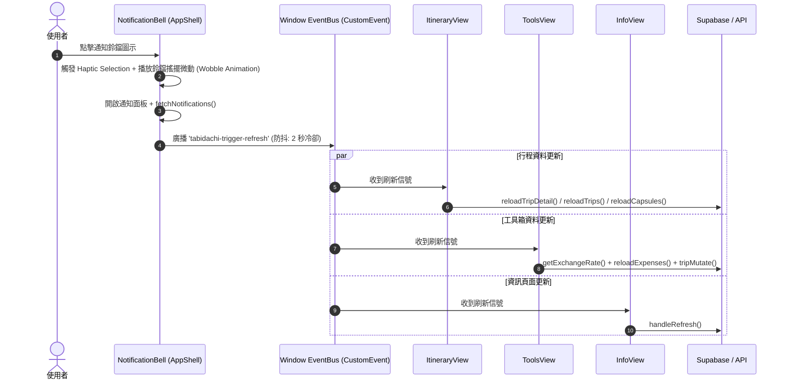

# Feature Specification: 全域通知連動重新整理與標頭極致瘦身 (Notification-Bound Global Refresh)

> **版本**: 1.0.0  
> **狀態**: Approved via Grill-me (2026-10-21)  
> **模組範疇**: `frontend/components/notifications/notification-bell.tsx`, `itinerary-view.tsx`, `ItineraryHeader.tsx`, `TabijiHomeDashboard.tsx`, `tools-view.tsx`, `info-view.tsx`

---

## 1. Problem Statement & Core Value (問題陳述與核心價值)

### 1.1 使用者痛點 (User Problem)
- **標頭元素擁擠 (Header Overcrowding)**:
  在行動端 (375px~390px 寬度)，`ItineraryHeader` 同時容納了返回按鈕、旅伴頭像列表、分享按鈕、全域景點口袋清單 (`Bookmark`)、以及獨立的重新整理按鈕 (`ZenRenew`)。五組圖示橫向並排造成視覺壓迫感極高，點擊觸控熱區互相壓縮（小於 44px 規範）。
- **心智負擔與多頭管理 (Cognitive Load)**:
  使用者在各個分頁（行程、工具箱、資訊）都有各自的重新整理按鈕，而右上角的「通知鈴鐺」本身每次點擊其實就是一次「我想看最新動態/最新狀態」的自然意圖。如果點擊通知鈴鐺就能同步完成全站資料更新，使用者無需在各個頁面尋找特定的刷新按鈕。

### 1.2 核心價值 (Core Value)
- **優雅一體化 (Unified Elegance)**: 點擊右上角常駐的通知鈴鐺，一方面展開通知面板檢視通知，一方面在背景非同步廣播全域重新整理信號。
- **標頭極致減壓 (Extreme Decluttering)**: 徹底自 `ItineraryHeader`、`TabijiHomeDashboard`、`ToolsView`、`InfoView` 移除 `ZenRenew` 按鈕，保留充裕的視覺留白與呼吸感。
- **防干擾無感設計 (Silent & Smooth UX)**: 鈴鐺點擊時播放輕微的擺動微動畫（Bell Wobble）與震動反饋（Haptic Feedback），更新在背景安靜完成，不跳出多餘 Toast 遮擋通知視圖。

---

## 2. User Journey & Core Flow (使用者旅程與操作流程)

### 2.1 使用者操作旅程


---

## 3. Architecture & Data Model (架構與協定)

### 3.1 全域廣播協定 (Event Protocol)
- **事件名稱**: `tabidachi-trigger-refresh`
- **事件細節 (detail)**:
  ```typescript
  export interface TabidachiRefreshEventDetail {
      timestamp: number
      source: "notification-bell" | "system"
  }
  ```
- **發送端 (`notification-bell.tsx`)**:
  ```typescript
  const lastRefreshRef = useRef<number>(0)
  
  const triggerGlobalRefresh = () => {
      const now = Date.now()
      if (now - lastRefreshRef.current < 2000) return // 2 秒防抖節流
      lastRefreshRef.current = now
      
      if (typeof window !== "undefined") {
          window.dispatchEvent(
              new CustomEvent<TabidachiRefreshEventDetail>("tabidachi-trigger-refresh", {
                  detail: { timestamp: now, source: "notification-bell" }
              })
          )
      }
  }
  ```

### 3.2 接收端 (Receivers)
1. **`itinerary-view.tsx`**:
   - 當處於行程詳情 (`activeTripId` 存在)：同時執行 `reloadTripDetail()` 與 `reloadCapsules()`。
   - 當處於旅程清單 (`activeTripId === null`)：執行 `reloadTrips()`。
2. **`tools-view.tsx`**:
   - 監聽並執行即時匯率取得 `getExchangeRate`、費用清單重驗證 `reloadExpenses()` 與旅程變更 `tripMutate()`。
3. **`info-view.tsx`**:
   - 監聽並執行機票、住宿、備忘與行李清單重驗證 `handleRefresh()`。

### 3.3 標頭減法重構 (Decluttering Matrix)
| 組件 | 原始狀態 | 重構後狀態 | 收益 |
| :--- | :--- | :--- | :--- |
| `ItineraryHeader.tsx` | 5 組按鈕 (Back, Members, Share, Bookmark, ZenRenew) | 4 組按鈕 (Back, Members, Share, Bookmark) | 標頭寬度釋出 44px，完全消除重疊與誤觸 |
| `TabijiHomeDashboard.tsx` | Bookmark + ZenRenew | 僅保留 Bookmark 口袋按鈕 | 簡潔現代，首屏呼吸感提升 |
| `ToolsView.tsx` | 標頭包含 ZenRenew | 移除 ZenRenew，由頂部常駐鈴鐺統一調度 | 標題與匯率卡片對齊更俐落 |
| `InfoView.tsx` | 標頭包含 ZenRenew | 移除 ZenRenew，由頂部常駐鈴鐺統一調度 | 減少重複的按鈕語意 |

---

## 4. Edge Cases & Boundary Conditions (邊界條件與異常處理)

1. **頻繁連續點擊 (Rapid Tapping / Debounce)**:
   - 設置 `2000ms` 冷卻節流。使用者若在 2 秒內反覆開關鈴鐺，鈴鐺開關與動畫正常響應，但底層網路請求不會重複噴發。
2. **離線狀態 (Offline Mode)**:
   - 網路中斷時點擊鈴鐺，SWR 自動讀取 IndexedDB / LocalStorage 快取，並由頂部常駐的 `SyncStatusCapsule` 提示離線狀態，不報錯崩潰。
3. **無活躍行程 (Empty State / No Trip Selected)**:
   - 若 `activeTripId` 為空，`itinerary-view.tsx` 僅刷新旅程列表 `reloadTrips()`，不會對 null 發出無效請求。
4. **組件卸載與記憶體洩漏防護 (Memory Leak Prevention)**:
   - 所有的 `window.addEventListener('tabidachi-trigger-refresh', ...)` 均必須在 `useEffect` 的 cleanup 函式中精準 `removeEventListener`。

---

## 5. Acceptance Criteria (驗收標準清單)

- [ ] **AC-1 (互動連動)**: 點擊右上角 `NotificationBell` 時，通知面板順利展開，同時觸發鈴鐺擺動微動畫與 Haptic Selection。
- [ ] **AC-2 (全域重新整理)**: 點擊 `NotificationBell` 時，行程清單/行程細節、工具箱費用/匯率、資訊頁面均能同步發起 SWR 重新驗證。
- [ ] **AC-3 (防抖機制)**: 連續於 1 秒內快速點擊 3 次通知鈴鐺，`tabidachi-trigger-refresh` 於 2 秒內僅發送 1 次實際請求。
- [ ] **AC-4 (標頭瘦身)**: `ItineraryHeader.tsx` 與 `TabijiHomeDashboard.tsx` 不再渲染 `ZenRenew` 按鈕，標頭無按鈕溢出或擠壓。
- [ ] **AC-5 (子頁面瘦身)**: `ToolsView.tsx` 與 `InfoView.tsx` 不再渲染 `ZenRenew` 按鈕，介面留白充足。
- [ ] **AC-6 (型別與回歸守護)**: `npx tsc --noEmit` 0 型別錯誤，現有 Vitest 測試套件 100% 通過，並補齊通知連動自動化單元測試。
