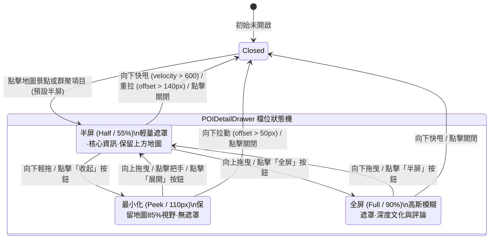

# 規格說明書：地圖景點抽屜 (POIDetailDrawer) 融合 iOS 原生智慧底抽物理學與三檔位手勢架構

> **規範等級**：Master-Level System Specification  
> **建立日期**：2026-10-21  
> **關聯檔案**：`frontend/components/POIDetailDrawer.tsx`、`frontend/components/day-map.tsx`、`frontend/components/itinerary/MultiDayMasterMap.tsx`、`frontend/components/FullscreenMapModal.tsx`、`frontend/components/itinerary/IOSBottomSheet.tsx`

---

## 1. Problem Statement & Core Value (問題陳述與核心價值)

### 1.1 現有痛點 (Pain Points)
1. **抽屜手勢缺失 (Missing Gesture Physics)**：
   目前 `POIDetailDrawer` 僅依賴一個按鈕點擊切換 `isMinimized` 狀態，缺少流暢的連續手勢拖曳（`drag="y"`）與 Apple 彈簧物理吸附，與使用者在「每日智慧看板」(`IOSBottomSheet`) 獲得的絲滑手勢體驗割裂。
2. **檔位生硬與地圖遮蔽矛盾 (Binary Detent Dilemma)**：
   景點抽屜原本只有「85vh 全開」或「110px 最小化」兩種極端狀態。當使用者想一邊看地圖上方路線/圖釘、一邊檢視景點核心資訊時，85vh 會將地圖完全遮蔽，而 110px 資訊量又過少（只顯示名稱與地址）。
3. **把手視覺過時 (Outdated Handle Bar)**：
   舊版抽屜在把手下方留有「展開/收合」文字標籤，視覺過時且缺乏現代 iOS 導航控制美感。

### 1.2 核心價值 (Core Value)
將 `IOSBottomSheet` 的成熟手勢引擎融入 `POIDetailDrawer`，同時保留並升級原版深受好評的「收起/最小化 (Peek)」特色，打造出完美的 **三檔位 (Peek ➔ Half ➔ Full) 階梯式抽屜**：
- **Peek 檔位 (~110px)**：收起特色極致呈現，地圖 85%+ 視野保留，無遮罩手勢穿透。
- **Half 檔位 (~55%)**：預設開啟檔位，上方保留地圖視野與圖釘，下方完整呈現 POI 核心資訊與快速排程按鈕。
- **Full 檔位 (~90%)**：深度閱讀文化典故、營業時間、詳細評論與排程時間微調。
- **指標**：TypeScript 0 錯誤、ESLint 0 錯誤、前端單元測試 100% 通過。

---

## 2. User Journey & Core Flow (使用者旅程與操作流程)



---

## 3. Architecture & Data Model (架構與元件設計)

### 3.1 檔位型別與物理參數
```typescript
export type POIDrawerDetent = "peek" | "half" | "full"

const SPRING_CONFIG = {
  type: "spring",
  stiffness: 380,
  damping: 32,
  mass: 0.8,
} as const
```

### 3.2 視窗高度映射表 (Height Mapping)
| 檔位 (Detent) | 容器內部模式 (`isInternal=true`) | 全屏浮層模式 (`isInternal=false`) | 說明 |
| :--- | :--- | :--- | :--- |
| **`"peek"`** | `h-[115px]` | `h-[115px]` | 最小化：露出一行標題、類別與地址，無遮罩 |
| **`"half"`** | `h-[55%] min-h-[380px]` | `h-[58vh] min-h-[380px]` | 預設：平衡地圖視野與 POI 核心資訊 |
| **`"full"`** | `h-[92%]` | `h-[90vh]` | 全屏：深度瀏覽 AI 總結、必點項目、營業時間 |

### 3.3 手勢判定狀態機 (`handleDragEnd`)
```typescript
const handleDragEnd = (_: MouseEvent | TouchEvent | PointerEvent, info: PanInfo) => {
  const { offset, velocity } = info

  // 1. 快速向下甩動 (velocity.y > 600) 或超出重拉閾值 -> 直接關閉
  if (velocity.y > 600 || offset.y > 150) {
    haptic.tap()
    onClose()
    return
  }

  // 2. Full 檔位邏輯
  if (detent === "full") {
    if (offset.y > 50 || velocity.y > 200) {
      setDetent("half")
    }
    return
  }

  // 3. Half 檔位邏輯
  if (detent === "half") {
    if (offset.y < -50 || velocity.y < -250) {
      setDetent("full")
    } else if (offset.y > 60 || velocity.y > 250) {
      setDetent("peek")
    }
    return
  }

  // 4. Peek 檔位邏輯
  if (detent === "peek") {
    if (offset.y < -30 || velocity.y < -200) {
      setDetent("half")
    } else if (offset.y > 50) {
      onClose()
    }
    return
  }
}
```

### 3.4 頂部把手操作列 (Handle Bar & Controls)
- 頂部居中：iOS Drag Pill（`w-11 h-1.5 rounded-full bg-slate-300/80 dark:bg-slate-600/80`）。
- 點擊把手橫條本身：在 `peek` 與 `half` 之間快速切換（保留原本手感）。
- 左右操作組：
  - 左側：微型標籤（單點顯示「📍 景點資訊」，群聚顯示「📑 群聚清單 (N)」）。
  - 右側：
    - 快速檔位切換按鈕（例如在 `half` 時顯示「全屏」，在 `full` 時顯示「半屏」，在 `peek` 時顯示「展開」）。
    - 圓形關閉按鈕（`X`）。

---

## 4. Edge Cases & Boundary Conditions (邊界條件與異常處理)

1. **拖曳與內容滾動衝突 (Drag vs Scroll Collision)**：
   - 僅將 `drag="y"` 與手勢監聽綁定於頂部 Handle Bar 區域（`pt-2.5 pb-2`）。
   - 下方長內容區使用標準 `overflow-y-auto`，確保使用者滑動文章時不會意外觸發抽屜關閉。
2. **地圖容器內部絕對定位 (`isInternal=true`)**：
   - 依賴 `isInternal ? 'absolute' : 'fixed'`，所有遮罩與主面板均受限於地圖父容器的 `overflow-hidden`，徹底杜絕全螢幕溢出與捲軸污染。
3. **POI 切換與狀態重置 (State Cleanse on POI Switch)**：
   - 當更換選中景點 (`poi.name` 改變) 或重新開啟時，自動將檔位重置為預設的 `"half"`，保證最佳初次閱讀體驗。
4. **群聚點聚合模式 (Cluster View Compatibility)**：
   - 當 `poi.type === 'cluster'` 時，同樣支援三檔位，且點擊具體子景點後平滑切換為該景點的半屏模式。

---

## 5. Acceptance Criteria (驗收標準清單)

- [ ] **AC-1**: 點擊每日景點地圖或總覽地圖中的景點標記時，抽屜預設以半屏（Half, ~55%）平滑彈簧動畫展開。
- [ ] **AC-2**: 抓住頂部把手向上拖曳，抽屜平滑吸附至全屏（Full, ~90%）；向下拉動平滑退回半屏；再向下拉動平滑收起為最小化（Peek, ~110px）。
- [ ] **AC-3**: 最小化（Peek）檔位保留原本特色，露出一行標題與類別，無背景遮罩，地圖完全可平移縮放。
- [ ] **AC-4**: 向下快速甩動把手（velocity.y > 600）或向下重拉，抽屜流暢關閉。
- [ ] **AC-5**: 頂部包含 iOS Drag Pill、檔位切換按鈕（全屏/半屏/展開）與圓形關閉按鈕。
- [ ] **AC-6**: 靜態檢查 `npx tsc --noEmit` 0 錯誤、`npm run lint` 0 錯誤。
- [ ] **AC-7**: 前端全量單元測試 `npx vitest run` 100% 通過。
