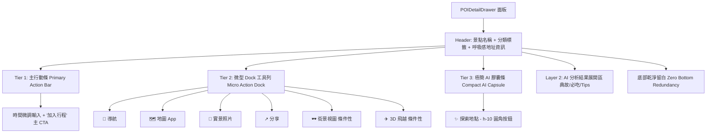

# POIDetailDrawer 雙層功能矩陣與微型 Dock 視覺架構規格說明書 (Spec)

> **版本**: 1.0.0  
> **狀態**: APPROVED (訪談共識收斂完成)  
> **關聯核心組件**: `frontend/components/POIDetailDrawer.tsx`  
> **測試規範**: `frontend/__tests__/poi-detail-drawer-physics-sentinel.test.tsx`

---

## 1. 核心痛點與架構重構動機 (Motivation & Problem Statement)

### 1.1 現狀硬傷 (Visual & Architectural Flaws)
1. **底部幽靈按鈕截斷 (Bottom Button Cutoff)**:
   - 抽屜最底層放置了兩個粗糙的幽靈按鈕：`[🖼 尋找更多照片]` 與 `[↗ 在 Google Maps 開啟]`。
   - 在半屏（Half Detent）視口高度下，這兩個按鈕會卡在抽屜底部圓角邊緣被生硬裁切，視覺極度破碎。
2. **資訊架構語意重複 (Redundant Actions)**:
   - 上方已有「導航」按鈕，底部又放「在 Google Maps 開啟」，兩者皆跳轉至 Google Maps，造成功能冗餘與混亂。
3. **功能性按鍵垂直層次散落 (Scattered Functional Actions)**:
   - 加入行程、導航、次要工具、AI 探索、照片搜尋、地圖開啟散落在 4 個不同高度層級，使用者需要上下尋找。

---

## 2. 頂級美學設計體系：雙層功能矩陣 (Dual-Tier Functional Matrix)



### 2.1 Tier 1: 主行動條 (Primary Action Bar)
- 保持第一優先級：左側時鐘圖標搭配時間微調輸入（原生 `<input type="time">`），右側高彩度漸層「＋ 加入行程」主 CTA。
- 若 `!onAddToItinerary`，自動無縫降級為全寬主要導航按鈕，維持介面閉環。

### 2.2 Tier 2: 流暢微型 Dock 工具列 (Micro Action Dock)
- **佈局拓撲**:
  ```tsx
  <div className="flex gap-2.5 overflow-x-auto no-scrollbar scroll-smooth py-1 px-0.5 touch-pan-x w-full">
  ```
- **手勢隔離不變量**: 外層內容滾動為 `touch-pan-y`，微型 Dock 本身宣告 `touch-pan-x`，兩者軸向嚴格正交解耦，零手勢死鎖。
- **工具項目清單**（每個項目寬度固定 64px~68px，`shrink-0`，縱向圖標在上、10~11px 微縮文字在下）：
  1. **導航 (`tc_navigate`)**: 呼叫 `handleNavigate`（Google Maps 路線導航；僅在有加入行程按鈕時出現於此）。
  2. **地圖 (`poi_open_gmaps`)**: 呼叫 `openExternalLink(https://www.google.com/maps/search/?api=1&query=${poi.lat},${poi.lng})`，於 Google Maps App 中查看評分與星級。
  3. **照片 (`poi_more_photos`)**: 呼叫 `handleViewPhotos`，搜尋 Google 實景相片。
  4. **分享 (`share`)**: 呼叫 `handleShare`，調用原生 Web Share API 或複製。
  5. **街景 (`mapillary_streetview`)**: 條件性啟用（`isMapillaryAvailable() && onOpenStreetView`）。
  6. **3D 飛越 (`flyover_poi`)**: 條件性啟用（`onFlyover`）。

### 2.3 Tier 3: 極簡 AI 膠囊條 (Compact AI Capsule, h-10)
- 高度鎖定為 `h-10`（40px），圓角膠囊造型，柔和紫靛色微漸層邊框與背景（`bg-purple-50/60 dark:bg-purple-950/20 border border-purple-200/50 dark:border-purple-800/40 text-purple-700 dark:text-purple-300`）。
- 節省垂直空間，點擊流暢展開維基典故、必吃推薦與旅行指南。

### 2.4 底部導流層徹底清理 (Zero Redundancy Bottom)
- 徹底刪除原本最底部的 `[🖼 尋找更多照片]` 與 `[↗ 在 Google Maps 開啟]` 區塊。
- 底部保留乾淨、高階的負空間（Negative Space，`pb-6`），完全消除在手機端被截斷的視覺瑕疵。

---

## 3. 驗收標準與測試契約 (Acceptance Criteria)

1. **視覺驗收**:
   - 半屏（Half Detent）時，第一屏由上而下依序為：Header ➔ 基礎資訊 ➔ 主行動條 ➔ 微型 Dock 工具列 ➔ AI 探索膠囊條。
   - 底部無任何被邊緣裁切的按鈕，視口舒適舒展。
2. **功能驗收**:
   - 點擊「地圖」正確開啟 Google Maps 地點檢視。
   - 點擊「照片」正確開啟 Google Images 搜尋。
   - 點擊「導航」正確開啟導航路線。
3. **靜態與單元測試**:
   - `npx tsc --noEmit` 0 錯誤。
   - `npm run lint` 0 警告。
   - `npm test` 81 檔單元測試 100% 通過。
