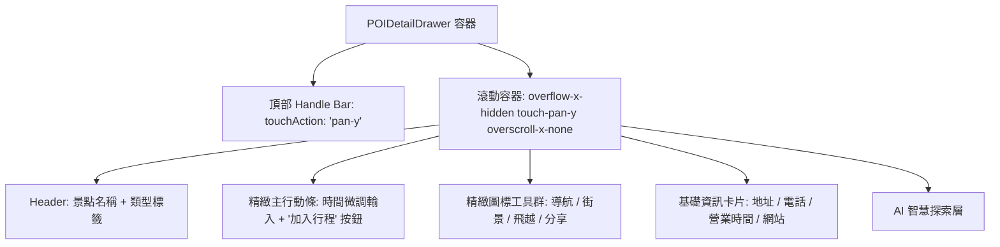

# POIDetailDrawer 手機端滾動軸向鎖定與現代極簡精緻化排版規格說明書 (Spec)

> **版本**: 1.0.0  
> **狀態**: APPROVED (共識收斂完成)  
> **關聯核心組件**: `frontend/components/POIDetailDrawer.tsx`, `frontend/components/day-map.tsx`, `frontend/components/itinerary/MultiDayMasterMap.tsx`  
> **測試規範**: `frontend/__tests__/poi-detail-drawer-physics-sentinel.test.tsx`

---

## 1. 核心問題與根因分析 (Root Cause Analysis)

### 1.1 手機端垂直滑動引發水平搖晃 (Bidirectional Gesture Leak)
- **現象**: 使用者在每日景點地圖（`day-map.tsx`）與總覽地圖（`MultiDayMasterMap.tsx`）點開景點詳情抽屜（`POIDetailDrawer.tsx`）時，上下滑動瀏覽景點資訊，抽屜內容會左右晃動，甚至引發橫向滾動。
- **根本原因 1: 滾動容器缺乏 X 軸鎖定**:
  - `POIDetailDrawer.tsx` 內容容器（行 407, 451）僅設定 `overflow-y-auto`，未設置 `overflow-x-hidden`、`touch-action: pan-y` 及 `overscroll-behavior-x: none`。在 iOS Safari / WebKit 與 Android Chrome 下，非絕對垂直的手勢會被瀏覽器判定為雙向 pan，導致抽屜水平飄移。
- **根本原因 2: 次要按鈕橫向撐破容器 (Horizontal Content Burst)**:
  - 行 543 的次要按鈕組 `<div className="flex gap-2 mt-2">` 同時容納「分享」、「街景視圖」、「3D 飛越」三顆按鈕，每顆設定 `flex-1` 且包含圖標與完整文字。
  - 在 iPhone 13/14/15/16 等常見 360px ~ 393px 寬度螢幕上，扣除外層 `px-6` (48px) 後，可用內容寬度僅 312px ~ 345px。三顆按鈕外加 padding 與文字，總寬度超過 340px，強制撐破內容寬度，產生實質性的 X 軸 Overflow。

### 1.2 第一屏資訊密度過載與排版呼吸感缺失
- **現象**: 半屏（Half Detent: 56%/58vh）展開時，標題、地址、電話、網址、營業時間、大時間選擇器卡片、主按鈕列、次按鈕列、AI 探索按鈕連續堆疊，佔據逾 240px 垂直高度，擠壓實際景點內文，缺乏現代應用的高級感與留白。

---

## 2. 系統架構與設計規範 (Architectural Invariants)



### 2.1 滾動軸向絕對約束 (Axis Constraints)
1. **容器不變量 (Container Invariants)**:
   - 所有的內容滾動區（Cluster List 與 POI Detail）必須宣告：
     ```tsx
     className="flex-1 min-h-0 overflow-y-auto overflow-x-hidden touch-pan-y overscroll-x-none px-5 pb-6 space-y-4"
     style={{ touchAction: "pan-y" }}
     ```
   - 頂部拖曳把手區域（Drag Handle Bar）增加：
     ```tsx
     style={{ touchAction: "pan-y" }}
     ```
   - 徹底隔離任何水平手勢冒泡，消滅任何非意圖的橫向位移。

### 2.2 介面現代極簡精緻化重構 (Modern Refined Layout)

#### A. 主行動條 (Primary Action Bar)
- 將原本突兀的獨立大卡片「時間選擇器」與「＋ 加入行程」整合為單一高質感主行動條：
  - 左側：時間選擇輸入框，搭配時鐘圖標與精緻底色（`bg-slate-100 dark:bg-slate-800/80`），支援點擊微調。
  - 右側：漸層高彩度「＋ 加入行程」按鈕（`bg-gradient-to-r from-indigo-500 via-indigo-600 to-purple-600 hover:brightness-105 active:scale-[0.98]`），提供主要轉換行動（CTA）。

#### B. 精緻圖標工具群 (Refined Icon Action Bar)
- 將「導航」、「街景」（若啟用）、「3D 飛越」（若啟用）、「分享」重構成一排均勻分布的圖標按鈕群：
  - 使用 `grid grid-cols-4 gap-2` 或依啟用數量自適應 `grid-flow-col`，並對每個單元強制設定 `min-w-0` 與 `truncate`。
  - 每個按鈕採縱向排列（Icon 在上、精緻微縮標籤 11px 在下）或緊湊橫向，採用柔和微光感圓角卡片風格（`bg-slate-50 dark:bg-slate-800/60 hover:bg-slate-100 dark:hover:bg-slate-800 rounded-xl border border-slate-100 dark:border-slate-800/80`）。
  - 各功能維持專屬品牌語意色彩（導航: Indigo, 街景: Emerald, 飛越: Sky/Violet, 分享: Slate）。
  - **最大寬度約束**: 任何狀態下工具列總寬度嚴格限制為 `w-full max-w-full`，徹底杜絕撐破。

#### C. 資訊卡片呼吸感優化
- 地址、電話、網站、營業時間以精緻的微卡片容器包裹，行距由緊湊的 `space-y-2` 調整為具呼吸感的 `space-y-2.5`，圖標尺寸統一 `w-4 h-4` 並維持 `shrink-0`。

---

## 3. 測試與質量守護 (Verification & Sentinel Tests)

1. **單元測試守護 (`frontend/__tests__/poi-detail-drawer-physics-sentinel.test.tsx`)**:
   - **TC-5**: 驗證抽屜內容滾動容器必須具備 `overflow-x-hidden`、`touch-pan-y` 與 `overscroll-x-none` 樣式屬性契約。
   - 保留既有 TC-1 ~ TC-4 檔位與物理吸附不變量。
2. **型別與 Lint 門禁**:
   - `npx tsc --noEmit` 0 錯誤。
   - `npm run lint` 0 錯誤。
   - `npx vitest run` 81 檔全部通過。
   - `pytest backend/tests/test_root_hygiene_sentinel.py` 100% 通過。
