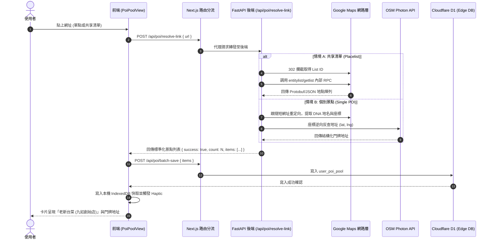

# Feature Specification: POI 統一網址解析引擎與多地點共享清單萃取 (Universal Link Resolver)

> **版本**: 1.0.0  
> **狀態**: 已完成訪談梳理 (Grill-Me Completed) ➔ 待使用者核准實施  
> **關聯議題**: 修正 POI 口袋庫 Google Maps 網址解析退化（URL 編碼字串與地址遺失）問題，回歸後端單一真實之源。

---

## 1. Problem Statement & Core Value (問題陳述與核心價值)

### 1.1 使用者痛點 (User Problem)
1. **地名退化為未解碼網址**：使用者在 POI 口袋庫（`PoiPoolView`）貼上 Google Maps 景點網址（例如老新台菜），卡片標題顯示為 `%E8%80%81%E6%96%B0%E5%8F%B0%E8%8F%9C+(%E4%B9%9D%E5%A6%82%E5%89%B5%E5%A7%8B%E5%BA%97)`，破壞視覺體驗。
2. **街道門牌地址遺失**：過去在行程中可正常反查出「401台中市東區自由路三段213號」等結構化門牌地址，但當前 POI 口袋庫解析出的 `address` 恆為 `null`。
3. **共享清單 (Placelist) 無法批量收納**：使用者自 Google Maps 匯出的多地點共享清單無法穩定一次萃取，導致旅遊行前靈感碎片化。
4. **架構割裂與重複造輪子**：後端原本即具備經過多次回歸驗證的 `link_resolver.py`，但在 POI 口袋庫初期實作時，於 Cloudflare Worker 上手刻了殘缺的微型解析邏輯，產生雙重維護與功能退化。

### 1.2 核心價值與成功指標 (Success Metric)
- **單點地名清洗率 100%**：解析任何 Google Maps 短網址或長網址，標題皆為純淨繁體中文，絕無 `%` 跳脫符號或 `- Google 地圖` 冗餘後綴。
- **門牌地址命中率 ≥ 95%**：單點自動透過 OSM Photon 逆向反查中文門牌地址。
- **共享清單萃取能力**：貼上 Google Maps 清單短網址或 `placelists/list/` 網址，能一次性自動萃取清單內全部地點（標題、門牌地址、座標、使用者備註）。
- **後端單一真實之源 (Single Source of Truth)**：全系統（活動編輯器、行程飯店、POI 口袋庫）統一透過後端解析引擎，Cloudflare Worker 僅專注於 D1 儲存。

---

## 2. User Journey & Core Flow (使用者旅程與操作流程)

### 2.1 使用者操作流程
```
[使用者於 POI 口袋庫貼上 Google 地圖網址]
                │
                ▼
[前端 usePoiPool 呼叫 /api/poi/resolve-link]
                │
                ▼
       [FastAPI 後端 link_resolver]
                │
     ┌──────────┴──────────┐
     │                     │
[情境 A: 單一景點網址]   [情境 B: 共享清單網址 (Placelist)]
     │                     │
     ├─ 跟隨 302 重定向     ├─ 萃取 List Token (1bXRlr5...)
     ├─ DNA 地名還原        ├─ 直連 entitylist/getlist RPC
     ├─ 獵捕 OG 首圖       ├─ 批次解析 N 個地點實體
     └─ Photon 逆向門牌地址 └─ 帶有街道地址、備註與座標
     │                     │
     └──────────┬──────────┘
                │
                ▼ (回傳標準化 POIItemDTO 陣列)
[前端取得解析陣列 ➔ 呼叫 D1 批次寫入端點 /api/poi/batch]
                │
                ▼
[本地 IndexedDB 立即灌水 ➔ 畫面即時渲染卡片 ➔ 提示「成功匯入 N 個景點！」]
```

### 2.2 系統互動時序圖 (Mermaid Sequence Diagram)


---

## 3. Architecture & Data Model (架構與資料模型)

### 3.1 端點規劃 (API Endpoints)

#### 1. 解析端點：`POST /api/poi/resolve-link` (由 FastAPI 承載)
- **請求格式**:
  ```json
  {
    "url": "https://maps.app.goo.gl/mXQjEKhJSDfJkWi17"
  }
  ```
- **回應格式 (單點範例)**:
  ```json
  {
    "success": true,
    "mode": "single",
    "count": 1,
    "items": [
      {
        "title": "老新台菜 (九如創始店)",
        "address": "807台灣高雄市三民區九如二路227號",
        "lat": 22.6406778,
        "lng": 120.3074861,
        "category": "food",
        "source_url": "https://maps.app.goo.gl/mXQjEKhJSDfJkWi17",
        "image_url": "https://maps.google.com/...",
        "user_notes": null
      }
    ]
  }
  ```
- **回應格式 (共享清單範例)**:
  ```json
  {
    "success": true,
    "mode": "placelist",
    "count": 28,
    "items": [
      {
        "title": "幸福花園",
        "address": "401台中市東區自由路三段213號",
        "lat": 24.1378,
        "lng": 120.6912,
        "category": "attraction",
        "source_url": "https://www.google.com/maps/place/...",
        "user_notes": "必拍打卡點"
      }
    ]
  }
  ```

#### 2. 口袋庫批次寫入端點：`POST /api/poi/batch-save` (由 Cloudflare D1 承載)
- 接收標準化 `items` 陣列，以 D1 `batch()` 在邊緣一次性原子插入，保持既有高效特性。

### 3.2 既有路由分流器調整 (`frontend/app/api/poi/[...path]/route.ts`)
- 將 `resolve-link` 路徑劃分至後端 FastAPI。
- 將 `all`, `add`, `batch-save`, `:id`, `:id/note`, `:id/pin`, `:id/category` 劃分至 Cloudflare D1。

---

## 4. Edge Cases & Boundary Conditions (邊界條件與異常處理)

1. **私人清單 (Private Placelist)**：
   - 當 Google 重定向至登入頁或 RPC 回傳空陣列時，後端拋出 `ERROR_CODE: PRIVATE_LIST`。
   - 前端提示使用者：「此清單設為私人權限。請在 Google Maps 改為『知道連結的人即可查看』後再貼上」。
2. **畸形或無效的短網址**：
   - 經由 `is_safe_url` 守門，阻擋 SSRF 內網攻擊網址。
   - 若無法提取有效座標，回傳友善錯誤，前端 Toast 提示「無法自此網址提取地點座標」。
3. **Photon 反查連線超時**：
   - 預設超時 3.0 秒，若 Photon 失敗則降級為 Google 原始 og:description 地址，若兩者皆無則保留空字串，絕不阻塞主流程。
4. **URL 編碼混雜特殊字元**：
   - 嚴格執行 `decodeURIComponent(place.replace(/\+/g, " "))`，並進行 `strip()` 清理不可見空白字元。

---

## 5. Acceptance Criteria (驗收標準清單)

```markdown
- [ ] AC-1: Given 使用者輸入單一 Google 地圖短網址 (如老新台菜)，When 點擊解析匯入，Then 卡片標題必須正確顯示「老新台菜 (九如創始店)」，且地址欄必須顯示對應門牌地址，標題不得含有 "%" 編碼字元。
- [ ] AC-2: Given 使用者貼上 Google Maps 共享清單網址，When 執行匯入，Then 系統必須透過 entitylist/getlist 一次性萃取出清單內全部地點，並批次存入 D1 口袋庫。
- [ ] AC-3: Given 任何解析失敗或私人清單情境，When 匯入被拒絕，Then 必須有清楚明確的中文 Toast 錯誤提示，不可出現白屏或未捕獲之 TypeError。
- [ ] AC-4: Given 完成所有變更後，Then 執行 `npx tsc --noEmit`、`npm test` 與 `pytest backend/tests` 必須全部通過（0 errors）。
```
