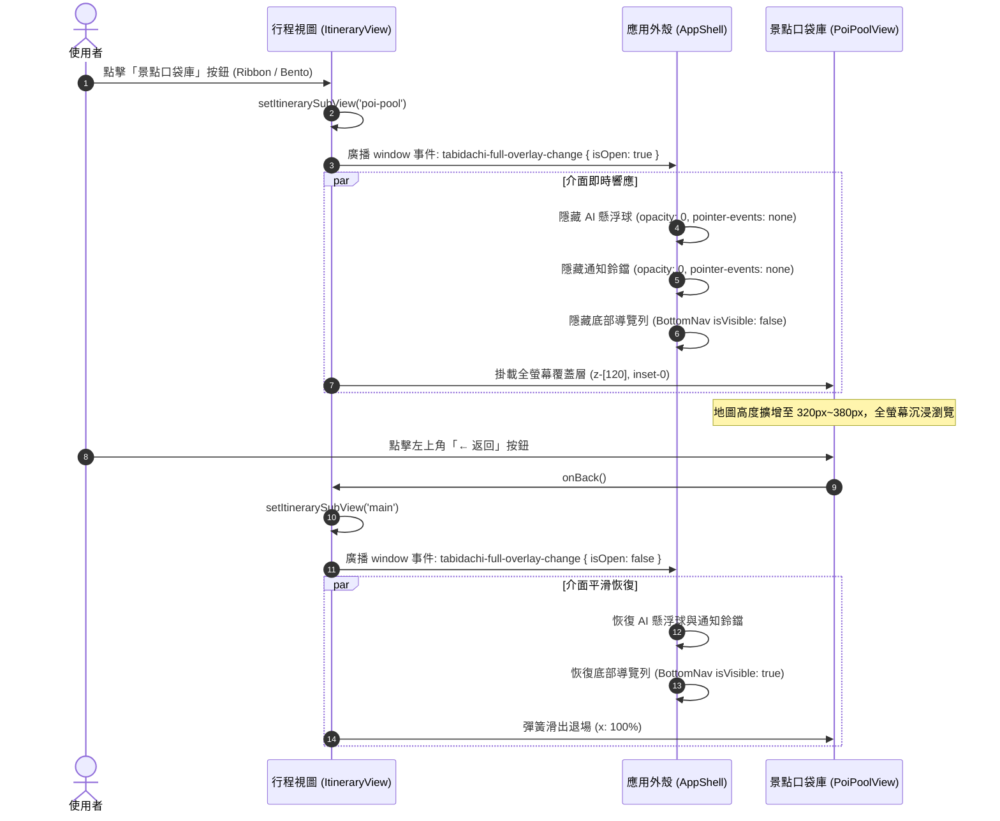

# 景點口袋庫 (POI Pool) 沉浸式全螢幕檢視與地圖擴展工程規格書 (Mini Design Doc)

> **規格版本**: v1.0.0  
> **建立日期**: 2026-10-19  
> **觸發指令**: `/Idea to Spec` + `/grill-me`  
> **狀態**: 待確認核准 (Pending Approval)

---

## 1. Problem Statement & Core Value (問題陳述與核心價值)

### 1.1 使用者痛點 (User Problem)
當使用者點擊「景點口袋庫 (POI Pool)」進入地點清單與總覽地圖時：
1. **全域 UI 衝突與干擾**：全域的左上角「AI 助理狀態懸浮鈕 (`AIStatusButton`)」與右上角「通知鈴鐺 (`NotificationBell`)」層級過高 (`z-100`)，直接遮擋口袋庫頂部標題與統計徽章。
2. **空間擠壓**：常駐於視窗底部的導覽列 (`BottomNav`) 佔用約 80px 高度，導致上方地圖高度被壓縮至僅 230px，視野狹窄難以綜觀多個景點的地理分布。

### 1.2 核心目標與成功指標 (Success Metrics)
- **進入口袋庫時 100% 沉浸全螢幕**：左上角 AI 懸浮鈕、右上角通知鈴鐺、底部導覽列完全不出現。
- **地圖視野大幅擴增**：利用釋放的底部與頂部空間，將地圖高度由 230px 擴展至 300px~380px (或 ~40vh)，提供如 Google Maps Saved Places 般充裕的探索視野。
- **平滑轉場與防穿透**：進入與退出時具備雙向彈簧動畫，零幽靈點擊（Ghost Click），退出後全域導航與按鈕完整恢復。

---

## 2. User Journey & Core Flow (使用者旅程與操作流程)



---

## 3. Architecture & Data Model (架構與變更設計)

### 3.1 層級與事件設計 (Two-Tier Isolation Defense)

1. **第一重物理層級防禦 (CSS Stacking Context)**：
   - 將 `itinerary-view.tsx` 中的 `poi-pool` 覆蓋層容器 z-index 由 `z-50` 提升至 `z-[120]`。
   - 高於 `AIStatusButton` (`z-100`)、`NotificationBell` (`z-100`) 與 `BottomNav` (`z-100`)，確保物理渲染永遠置頂。

2. **第二重動態生命週期廣播 (Event-Driven State Coordination)**：
   - 透過全域事件 `tabidachi-full-overlay-change` 協調 `AppShell`：
   ```typescript
   // 進入時
   window.dispatchEvent(new CustomEvent('tabidachi-full-overlay-change', { detail: { isOpen: true } }))
   // 退出時
   window.dispatchEvent(new CustomEvent('tabidachi-full-overlay-change', { detail: { isOpen: false } }))
   ```
   - `AppShell` 狀態機維護 `isOverlayActive: boolean`：
     - AI 懸浮球與通知鈴鐺：`<motion.div animate={{ opacity: isOverlayActive ? 0 : 1, y: isOverlayActive ? -20 : 0 }}>`
     - 底部導覽列：`isVisible={isNavVisible && !isOverlayActive}`

### 3.2 地圖空間尺寸優化 (Map Sizing)
- 在 [PoiPoolView.tsx](file:///d:/Project/tabiji/travel-pwa/frontend/components/poi/PoiPoolView.tsx) 中：
  - 地圖展開高度由 `h-57.5 sm:h-70` (230px/280px) 升級為 `h-75 sm:h-95` (300px ~ 380px)，或響應式 `h-[38vh]`。
  - 完整釋放被導覽列遮蔽的底部 80px，使景點清單捲動區域同步增加。

---

## 4. Edge Cases & Boundary Conditions (邊界條件與異常處理)

1. **瀏覽器上一頁手勢 (Browser Back / PopState)**：
   - 若使用者在 Android 或 iOS 上觸發邊緣滑動上一頁，需監聽並同步觸發 `setItinerarySubView('main')`，防止全域按鈕滯留在隱藏狀態。
2. **組件意外卸載 (Unmount Safety)**：
   - 在 `ItineraryView` 的 `useEffect cleanup` 中，確保在組件卸載時自動發送 `{ isOpen: false }`，保證退出頁面時導覽列必定復原。
3. **安全區域邊距 (Safe Area Insets)**：
   - 移除 `BottomNav` 後，景點口袋庫底端須注入 `pb-[max(env(safe-area-inset-bottom),1rem)]`，杜絕 iOS Home Bar 遮擋最底層景點卡片。

---

## 5. Acceptance Criteria (驗收標準清單)

- [ ] **AC-1 (進入隱藏)**：點擊進入景點口袋庫時，左上角 AI 狀態懸浮鈕、右上角通知鈴鐺及底部導覽列立即平滑隱藏，且不殘留任何點擊判定。
- [ ] **AC-2 (地圖尺寸)**：景點口袋庫頂部地圖展開時高度明顯加大至 300px~380px，能完整俯瞰所有釘選地點。
- [ ] **AC-3 (平滑返回)**：點擊左上角「←」返回按鈕後，口袋庫向右滑出，主行程頁面之 AI 懸浮鈕、通知鈴鐺與底部導覽列 100% 正常恢復顯示。
- [ ] **AC-4 (品質關卡)**：變更後執行 `npx tsc --noEmit` 與 `npx eslint` 保持 0 錯誤底線，回歸測試全數通過。
