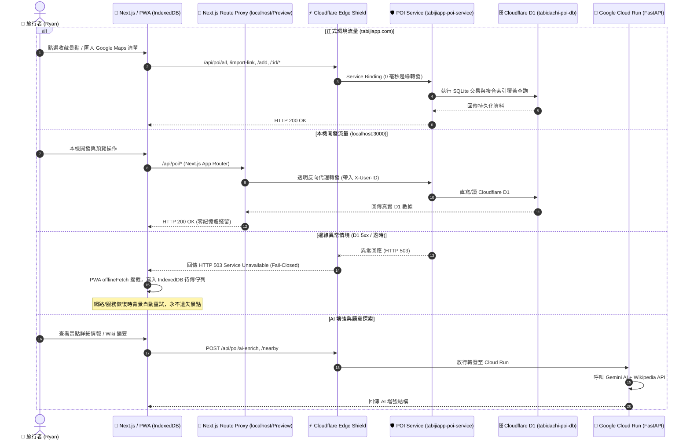

# 📋 Feature Specification: POI 景點口袋庫 D1 單一真理源架構收斂 (POI Pool D1 SSOT Convergence)

> **Feature Name**: `poi-pool-ssot-d1-convergence`  
> **Author**: Ryan Su (Lead) & `@architect`  
> **Status**: APPROVED (via `/Idea to Spec` & `/grill-me`)  
> **Version**: 1.0.0  
> **Target Date**: 2026-10-21  

---

## 1. Problem Statement & Core Value (問題陳述與核心價值)

### 1.1 User Problem
- **三方儲存架構割裂與假持久化**：
  過去 POI 景點口袋庫在系統中存在三套實作：
  1. **Cloudflare D1 (`tabijiapp-poi-service`)**：線上正式環境真正持久化的 D1 資料庫（通過 4/4 驗收）。
  2. **Google Cloud Run (`backend/routers/poi.py`)**：呼叫不存在的 Supabase `poi_items` 資料表，404 報錯後被 `except: pass` 吞掉，寫入 Python 記憶體字典 `POI_POOL_STORE`（容器重啟即滅）。
  3. **Next.js 本機端 (`frontend/app/api/poi/[...path]/route.ts`)**：維護一份 `GLOBAL_POI_MEMORY_STORE`，本機開發與預覽環境重啟即失。
- **邊緣假降級陷阱**：
  Edge Shield 在 POI 服務異常時容錯降級轉發給 Cloud Run，造成「前端以為成功儲存，實則被丟入暫時記憶體黑洞」的靜默資料遺失風險。

### 1.2 Core Value & Success Metrics
- **D1 單一真理源（SSOT）**：Cloudflare D1 為景點口袋庫唯一的權威資料庫。
- **本機/線上 100% 同態**：本機開發與預覽環境透過 Next.js 透明轉發代理直通 D1 微服務，徹底消滅 Node.js 與 Python 的無效記憶體字典。
- **邊緣閉環與 PWA 離線佇列守護**：邊緣若發生瞬時不可用，回傳 503 觸發客戶端 IndexedDB `offlineFetch` 離線佇列自動重試，絕不丟失使用者收藏。
- **後端專注 AI 職責分離**：Cloud Run 剔除約 350 行重複 CRUD 代碼，專注於 Gemini AI 豐富化 (`/ai-enrich`)、周邊探尋 (`/nearby`) 與語意推薦 (`/recommend`)。

---

## 2. Architecture & Data Flow (架構與資料流)

---

## 3. Detailed Component Refactoring (模組重構明細)

### 3.1 前端：`frontend/app/api/poi/[...path]/route.ts`
- **重構前**：374 行，內含 `GLOBAL_POI_MEMORY_STORE`、重複的 Google Maps 重定向與正則提取邏輯。
- **重構後**：約 50 行的輕量化透明代理（Transparent Reverse Proxy）。
  - 將所有 HTTP 方法（`GET`, `POST`, `PATCH`, `DELETE`）轉發至：
    `const targetBase = process.env.CLOUDFLARE_POI_SERVICE_URL || "https://tabijiapp.com/api/poi";`
  - 完整保留並傳遞 `X-User-ID`、`Authorization`、`Content-Type` 與請求 Body。
  - 徹底移除 Node.js 進程中的記憶體字典。

### 3.2 邊緣層：`cloudflare/edge-shield/worker.js`
- **重構前**：
  若 `env.POI_SERVICE` 回傳 >= 500 或捕獲例外，執行 `failing over to Cloud Run...`。
- **重構後**：
  消除對 Cloud Run 的降級轉發，回傳明確的 `503 Service Unavailable` JSON 格式，包含 `{ error: "POI_SERVICE_UNAVAILABLE", retry_after: 5 }`，交由前端 `offlineFetch` 佇列保護。

### 3.3 後端：`backend/routers/poi.py`
- **重構前**：
  845 行，包含 `POI_POOL_STORE`、`get_user_pois`、`save_user_poi`、`delete_user_poi` 及 `/poi/all`、`/poi/import-link`、`/poi/add` 等 CRUD 端點。
- **重構後**：
  刪除第 480～845 行的無效 CRUD，僅保留前 479 行的：
  - `POST /api/poi/ai-enrich`
  - `POST /api/poi/enrich`
  - `POST /api/poi/nearby`
  - `POST /api/poi/recommend`
  - `POST /api/poi/smart-search`
  徹底拔除對不存在的 Supabase `poi_items` 表的呼叫與 `except: pass` 程式碼氣味。

---

## 4. Edge Cases & Boundary Conditions (邊界條件與異常處理)

1. **未認證身分防禦 (Auth Boundary)**：
   - D1 微服務嚴格校驗 `X-User-ID` 是否符合 RFC 4122 UUIDv4 規格。若不合法直接拒絕（401 Unauthorized）。
   - 前端代理確保 Headers 原樣傳遞，不篡改身分。
2. **網路斷線與離線優先 (Offline-First)**：
   - 前端 `usePoiPool` 已整合 `idb-keyval` 本機快取，斷網時 0ms 直接自 IndexedDB 載入。
   - 寫入失敗時觸發 `offlineFetch` 將新增/釘選/備註操作存入佇列，連線恢復時自動發送。
3. **Google 地圖連結批次寫入上限 (D1 SQLite Limit)**：
   - D1 單一交易限制上限為 100 條語句。
   - `cloudflare/poi-service/worker.js` 已具備 `CHUNK_SIZE = 90` 的分塊批次寫入邏輯，防範上限溢位。

---

## 5. Acceptance Criteria (驗收標準清單)

- [ ] **AC-1 (線上 D1 驗收)**：執行 `python scripts/verify_cloudflare_d1_poi.py`，全數通過 4/4 邊緣身分、讀取、寫入與刪除測試。
- [ ] **AC-2 (本機同態代理驗收)**：本機 Next.js 呼叫 `/api/poi/all`，透過透明代理取得與生產環境 D1 完全相同的即時景點數據。
- [ ] **AC-3 (後端純粹化驗收)**：`backend/routers/poi.py` 移除無效 CRUD 後，執行 `pytest backend/` 全數測試通過，無任何 `POI_POOL_STORE` 殘留。
- [ ] **AC-4 (前端靜態驗證)**：執行 `npx tsc --noEmit` 0 型別錯誤，`npm run lint` 0 違規。
- [ ] **AC-5 (邊緣無假降級)**：`cloudflare/edge-shield/worker.js` 不再將 POI 儲存請求轉發給 Cloud Run。
