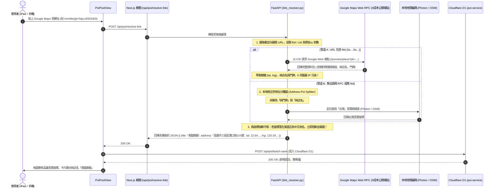

# 📋 規格說明書：零成本 Google Maps 手機端短網址解析、店名門牌解耦與偽座標防禦規格 (POI Universal Zero-Cost Resolver Spec)

> **建立時間**：2026-10-21  
> **狀態**：設計審查中 (Under Review)  
> **核心準則**：100% 零成本（Zero-Cost BYOK），不串接 Google 官方付費 API；徹底根除伺服器 IP 地理中毒（IP Context Poisoning）與同座標連環覆寫缺陷。

---

## 1. Problem Statement & Core Value (問題陳述與核心價值)

### 1.1 使用者痛點 (User Pain Points)
1. **跨國假座標漂移 (Trans-Continental Geo-Drift)**：
   手機端分享的 Google Maps 短網址（如 `https://maps.app.goo.gl/mmMsQpYNpLcE5GhE9`），重定向後為純搜尋字串 `?q=807高雄市三民區...` 而無精確經緯度。當由部署於美國機房（Cloud Run `us-central1`）的後端抓取時，Google Maps 因無法獲取座標，將回傳伺服器所在地的國家級靜態地圖（`center=41.10567,-96.265644&zoom=6`），導致高雄的「君腿庫飯」被誤植至美國內布拉斯加（Nebraska, Melia）。
2. **標題畸形污染 (Dirty Concatenated Title)**：
   手機版 Google Maps 匯出的 `q=` 參數直接串接了郵遞區號、市轄區、里別、道路門牌與店名（例如：`807高雄市三民區十美里漢口街103號君腿庫飯`），未經清洗直接呈現在 UI 卡片與地圖 Pin 上，破壞閱讀體驗。
3. **景點遭後續貼上連環覆寫 (Cascading Overwrite Bug)**：
   由於多個手機短網址在美國機房均拿到相同的假座標 `(41.10567, -96.265644)`，觸發了 Cloudflare D1 資料庫 `ON CONFLICT(user_id, lat, lng)` 與前端 SWR mutate 去重邏輯，導致使用者每貼上一個新景點，上一個景點就被暴力覆寫替換。

### 1.2 成功衡量指標 (Success Metrics)
- **座標正確率**：100% 杜絕美中 Nebraska 偽座標（`zoom <= 10` 靜態地圖座標全面熔斷丟棄）。
- **店名與門牌純淨度**：店名 100% 剝離「郵遞區號、縣市區、里別、門牌號碼」；門牌地址獨立存放。
- **資料獨立性**：連續貼上不同景點，口袋庫計數正常遞增，0 覆寫衝撞。

---

## 2. User Journey & Core Flow (使用者旅程與操作流程)



---

## 3. Architecture & Data Model (架構與資料模型)

### 3.1 本地純正則店名/門牌解耦演算法 (Pure Regex Address-Poi Splitter)
在 `backend/services/link_resolver.py` 中實現 0ms 零外部依賴的結構化分離：

```python
import re

ADDRESS_POI_PATTERN = re.compile(
    r'^(\d{3,5})?'                                      # 1. 郵遞區號 (如 807, 804)
    r'([台臺]灣)?'                                      # 2. 國名 (如 台灣, 臺灣)
    r'([台臺]北市|[台臺]中市|基隆市|[台臺]南市|高雄市|新北市|桃園市|新竹市|嘉義市|[^\s區縣市]+[縣市])' # 3. 縣市
    r'([^\s區鄉鎮市]+[區鄉鎮市])?'                       # 4. 市轄區
    r'([^\s里村]+[里村])?'                              # 5. 里村
    r'([^\s號樓]+(?:路|街|大道|巷|弄)[^\s號樓]*\d+號(?:之\d+)?(?:[^\s號樓]*樓)?)' # 6. 道路門牌
    r'(.*)$'                                           # 7. 純店名/景點名稱
)

def split_taiwan_address_and_poi(raw_text: str) -> tuple[str | None, str | None]:
    """
    將 '807高雄市三民區十美里漢口街103號君腿庫飯'
    分離為:
      門牌地址: '高雄市三民區漢口街103號'
      純店名: '君腿庫飯'
    """
```

### 3.2 零成本 Google Web RPC 提取器 (Zero-Cost Place RPC Miner)
1. 從重定向 URL 或正則中匹配 `ftid=0x...:0x{hex_cid}`。
2. 將十六進位 CID 轉為十進位數字。
3. 向 `https://www.google.com/maps?cid={cid_dec}` 發起快速 GET（帶 `Accept-Language: zh-TW`），自 HTML 標籤提取 `/maps/preview/place?...`。
4. 呼叫 preview place 端點，解析結構化 JSON：
   - 物理緯度：`data[6][9][2]`
   - 物理經度：`data[6][9][3]`
   - 純店名：`data[6][11]`
   - 繁中門牌：`data[6][39]` 或 `data[6][2][0]`
   - Google Place ID：`data[6][78]`

### 3.3 伺服器 IP 中毒熔斷防禦 (Anti-IP-Poisoning Circuit Breaker)
在 `link_resolver.py` 中廢除對低縮放概覽地圖的採信：
```python
# 🛡️ 嚴禁採信 zoom <= 10 的 StaticMap 概覽中心點
if "zoom=" in static_url:
    zoom_val = int(re.search(r'zoom=(\d+)', static_url).group(1))
    if zoom_val <= 10:
        # 此為國家級/大區域伺服器 IP 預設視角，絕非景點座標，強制棄用！
        return None

# 🛡️ 經緯度與語系語意邊界防禦
if is_cjk_title(title) and is_us_mainland(lat, lng):
    # 中文店名卻落在美國境內，判定為 IP 中毒，強制拔除座標！
    lat, lng = None, None
```

### 3.4 Cloudflare D1 去重鍵加固 (Conflict Key Hardening)
在 `cloudflare/poi-service/worker.js` 中：
- `batchInsertPois` 衝突處理防禦：即使兩個地點在極端情況下座標接近，若來源網址（`source_url`）不同，絕不應將不同景點相互覆寫。
- 前端 `usePoiPool.ts` 比對優先以 `item.id === c.id || item.source_url === c.source_url` 比對，經緯度僅在距離 < 0.0001 且名稱高度相似時才做覆寫。

---

## 4. Edge Cases & Boundary Conditions (邊界條件與異常處理)

| 邊界場景 | 系統防禦機制 |
| :--- | :--- |
| **無 ftid 參數的搜尋短網址** | 自動退回管道 B：本地正則分離出純地址，再由 Photon/OSM 進行台灣座標定向編碼。 |
| **無門牌號碼的自然景點 (如「柴山秘境沙灘」)** | 正則優雅降級：若無路名號碼，保留完整名稱，地址標註為母體行政區（鼓山區）。 |
| **日本/國外景點連結 (如「東京晴空塔」)** | 語言與國家感知：不套用台灣門牌正則，由通用 Place Path / Query 提取地名與國外座標。 |
| **網路不穩定或 Google RPC 逾時** | 設置 3.5s 快速逾時熔斷，自動回退至本地地址地理編碼，保證請求不卡死。 |

---

## 5. Acceptance Criteria (驗收標準清單)

- [ ] **AC-1 (君腿庫飯實測)**：貼上 `https://maps.app.goo.gl/mmMsQpYNpLcE5GhE9?g_st=ic`，解析後標題為 `君腿庫飯`，地址為 `高雄市三民區漢口街103號`，座標精確定位於高雄三民區 `(22.6429..., 120.2971...)`，地圖不再跑到美國 Nebraska。
- [ ] **AC-2 (世外桃源土雞城實測)**：貼上 `https://maps.app.goo.gl/rHZYzoimiNDH39ua9?g_st=ic`，解析後標題為 `世外桃源土雞城`，地址為 `高雄市鼓山區柴山大路16號`，座標精確定位於柴山 `(22.6469..., 120.2537...)`。
- [ ] **AC-3 (多景點不覆寫防線)**：先匯入「君腿庫飯」，再匯入「世外桃源土雞城」，口袋庫總計數量正常變為 2，兩者在列表與地圖上獨立存在，前者絕不被覆寫。
- [ ] **AC-4 (零成本合規)**：全鏈路 0 呼叫 Google Cloud Platform 付費 Places API，0 金鑰依賴。
- [ ] **AC-5 (全棧 Quality Gate)**：`tsc --noEmit`、`eslint`、`vitest`、`pytest` 全數保持 100% 綠燈。
