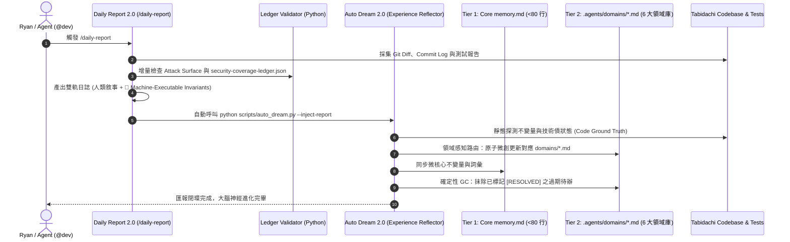

# 規格說明書：御三家前沿架構融合 (Mantis ✕ Cloudflare ✕ Harness²) — Memory、Daily Report 與 Auto Dream 2.0 系統演進

> **規範等級**：Master-Level System Architecture Specification  
> **建立日期**：2026-10-21  
> **關聯實體**：`.agents/memory.md`、`.agents/domains/*.md`、`scripts/auto_dream.py`、`.agents/workflows/daily-report.md`、`docs/security/security-coverage-ledger.json`、`backend/tests/test_root_hygiene_sentinel.py`

---

## 1. Problem Statement & Core Value (問題陳述與核心價值)

### 1.1 現有系統痛點 (Pain Points)
1. **大腦記憶單體膨脹與指令腐爛 (Flat Monolith Memory Bloat)**：
   - 現有 `.agents/memory.md` 累積達 608 行 (168KB)，包含 6 大類別、數十個架構決策與 56 個 Failed Paths。每次對話啟動時全量載入，浪費昂貴的 Prompt Prefix 快取空間；且 `auto_dream.py` 進行全文覆寫時，歷史細節容易因上下文視窗限制而遺失或模糊化。
2. **Auto Dream 粗暴覆寫與缺乏實證探測 (Unchecked Compaction & Stale Debt)**：
   - 現有 `auto_dream.py` 僅在閒置 15 分鐘後將整包日誌與舊 memory 丟給 LLM 重新摘要覆寫，缺乏 **Google Research Harness²** 的 Propose–Probe–Compose (PPC) 探測機制。技術債與真實代碼脫節（例如 `poi_items` 早已在代碼中拔除，卻在記憶與報告中連掛 3 個 Session）。
3. **Daily Report 純人類敘事缺乏機器可執行性 (Non-Executable Journaling)**：
   - 每日報告產出的深度決策與踩坑經驗缺乏標準化機器可讀區塊，無法確定性自動回灌到 Agent 系統與代碼守衛中。
4. **資安台帳缺乏確定性靜態門禁 (Missing Deterministic Ledger Guard)**：
   - `security-coverage-ledger.json` 曾出現 `id` 與 `target_id` 多態鍵名與統計數值失配，且候選假說曾因敏感黑話觸發雲端安全過濾器攔截。

### 1.2 核心價值 (Core Value)
融合 **Google Mantis**（Critic 降噪、最小補丁、知識顧問庫）、**Cloudflare Security Audit**（確定性驗證腳本、累積式台帳）與 **Google Research Harness²**（任務層級 PPC、領域不變量知識分庫、經驗反射器）：
- **記憶精簡 85%+**：核心 `memory.md` 降至 <80 行，領域決策下放至 6 大領域庫，按需延遲載入。
- **神經反射閉環**：每日報告產出「機器可執行不變量」，由 Auto Dream 2.0 自動路由分流寫入領域庫，並自動執行確定性 GC 清理已解決技術債。
- **確定性零漂移守門**：以零依賴 Python 驗證器納入日常 `pytest`，百分之百保障資安台帳數值與格式不變量。

---

## 2. User Journey & Architecture Flow (架構工作流程)



---

## 3. Architecture & Data Model (架構與資料模型)

### 3.1 三層遞歸大腦記憶體系 (Three-Tier Memory Architecture)

```
.agents/
├── memory.md                     <-- Tier 1: 微核心憲法 (<80 行，永遠常駐，極速快取)
├── domains/                      <-- Tier 2: 領域知識庫 (按接觸檔案按需延遲載入)
│   ├── map_webgl.md              (圖形、MapLibre、WebGL、手勢、CSP Worker)
│   ├── state_cache.md            (SWR、自癒、Zustand、深層連結、路由)
│   ├── ios_ui.md                 (WebKit 匿名區塊、Framer Motion、Radix Portal)
│   ├── offline_pwa.md            (Service Worker、IndexedDB、快取分流、推送)
│   ├── backend_concurrency.md    (FastAPI、D1、Supabase、探針、時區)
│   └── devops_security.md        (CI/CD、PowerShell 熔斷、Sentinel 攻防)
├── session_history.log           <-- 短期會話日誌 (RAM/快取)
└── security-coverage-ledger.json <-- 資安累積式覆蓋台帳 (Cloudflare 規範)
```

#### Tier 1 (`.agents/memory.md`) 標準規範 (<80 行)
僅包含四個不可妥協的頂層區塊：
1. **[Core Invariants]**：最高階工程憲章（Maker-Checker 物理隔離、In-Memory PoC 標準、TypeScript/Linter 0 錯誤底線）。
2. **[Domain Map]**：6 大領域庫路由表與延遲載入觸發關鍵字。
3. **[Core Failed Paths]**：全域性致命失敗路徑（如 Windows CRLF 破壞、過度工程化陷阱）。
4. **[Core Vocabulary]**：核心架構術語（Slerp, Opaque Response, Double-Checked Healing 等）。

### 3.2 確定性台帳守護器 (`scripts/validate_security_ledger.py`)
- **無依賴純 Python 3 實作**。
- **校驗不變量**：
  1. 所有條目必須具有唯一的 `"id"`，嚴禁 `"target_id"`。
  2. 條目狀態必須在枚舉集合內：`["DISMISSED", "VULNERABLE_CONFIRMED", "REMEDIATED", "VERIFIED_BY_POC"]`。
  3. 數學守恆：`total_targets == audited_targets == (verified_vulnerabilities + remediated_vulnerabilities + dismissed_hypotheses)`。
- **整合掛載點**：直連 `backend/tests/test_root_hygiene_sentinel.py`，使每次 `pytest` 與 `/test` 必須強制通過。

### 3.3 Daily Report 2.0 雙軌輸出規範
在 `docs/journals/YYYY-MM-DD-daily-report.md` 結尾固定包含機器可執行結構化區塊：
```markdown
## 🧬 Machine-Executable Invariant Rules (Auto Dream Ingestion Block)
```json
[
  {
    "domain": "state_cache",
    "type": "INVARIANT_RULE",
    "id": "INV-STATE-014",
    "title": "Module-Scoped Throttle Export & Test Reset Guard",
    "rule": "Every module-level throttle singleton must export an explicit __reset...ForTesting() interface to prevent cross-test state leakage."
  },
  {
    "domain": "backend_concurrency",
    "type": "TECHNICAL_DEBT_RESOLUTION",
    "id": "DEBT-POI-001",
    "status": "RESOLVED",
    "commit": "8bc30e9",
    "resolution": "Excised legacy in-memory POI CRUD; converged completely to Cloudflare D1."
  }
]
```
```

### 3.4 Auto Dream 2.0 領域感知路由與 GC 引擎 (`scripts/auto_dream.py`)
- 支援 `--inject-report <path>` 與 `--daemon` 雙模。
- 讀取日誌中的 `Machine-Executable Invariant Rules`，將規則**精準追加/微創合併至對應的 `.agents/domains/<domain>.md`**。
- 遇 `TECHNICAL_DEBT_RESOLUTION` 且 `status == "RESOLVED"`，自動從該領域的 Technical Debt 清單中將該項目標註為已結案或歸檔，達成確定性垃圾回收。

---

## 4. Edge Cases & Boundary Conditions (邊界條件與異常處理)

1. **Windows 編碼與 Emoji 截斷 (CP950 vs UTF-8)**：
   - 腳本一律顯式宣告 `encoding="utf-8"`，且在 stdout 上掛載 `reconfigure(encoding="utf-8")`，杜絕 Windows 終端拋出 `UnicodeEncodeError`。
2. **無日誌或短日誌保護 (Empty Log Defense)**：
   - 若會話歷史小於 50 字元，Auto Dream 靜默退出，不發動 LLM 調用，杜絕 Token 浪費與記憶空覆寫。
3. **領域分類未匹配 (Fallback Domain Handling)**：
   - 若 LLM 產出的不變量未能精確匹配 6 大領域，自動降級至 `devops_security.md` 或暫存於 `memory.md`，由人類在下次 Daily Report 時校準，不遺失任何信息。
4. **台帳狀態不變量破損熔斷 (Ledger Assertion Break Fast)**：
   - 台帳驗證器一旦發現條目數與統計不合，立即返回 Exit Code 1，阻斷 CI/CD 與 Git Push。

---

## 5. Acceptance Criteria (驗收標準清單)

- [ ] **AC-1 (Memory Tiering)**：`.agents/memory.md` 壓縮至 80 行以內；原 608 行內容完整無損遷移並劃分至 `.agents/domains/` 下 6 個領域檔案。
- [ ] **AC-2 (Deterministic Ledger Guard)**：建立 `scripts/validate_security_ledger.py`；在 `test_root_hygiene_sentinel.py` 中掛載檢查；`pytest` 驗證通過。
- [ ] **AC-3 (Daily Report 2.0)**：`.agents/workflows/daily-report.md` 納入雙軌輸出規範與資安台帳增量檢查步驟。
- [ ] **AC-4 (Auto Dream 2.0 Reflector)**：`scripts/auto_dream.py` 支援解析結構化 Invariant Rules 並原子分流寫入 `domains/*.md`，具備技術債自動結案 GC 能力。
- [ ] **AC-5 (Full Quality Gate)**：全棧 `tsc --noEmit`、`npm run lint`、`vitest`、`pytest` 保持 100% 零錯誤通行。
