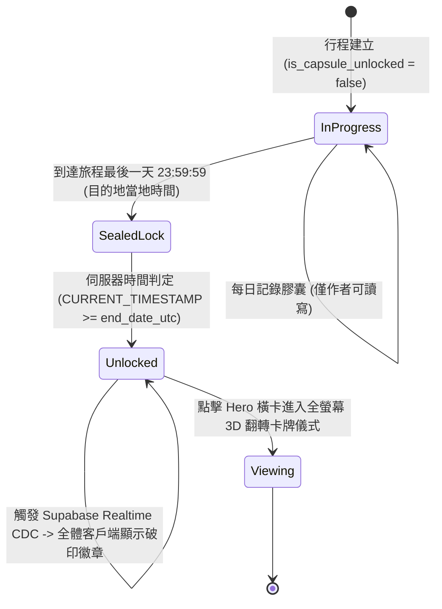
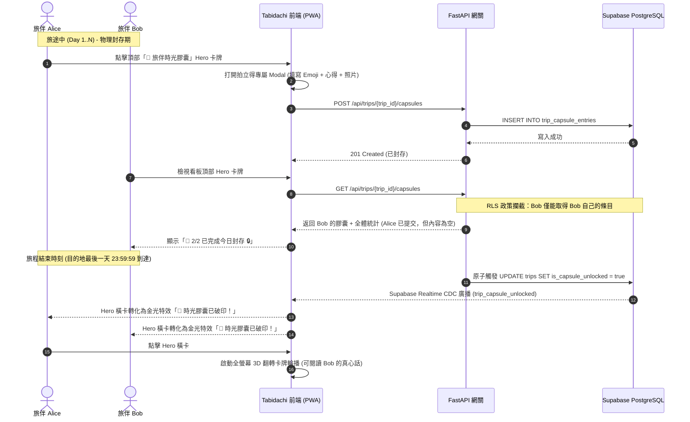

# 旅伴時光膠囊 (Trip Time Capsule) 系統工程規格書

> **文件狀態**: Draft (Approved Design)  
> **版本**: 1.0.0  
> **建立時間**: 2026-10-14  
> **關聯議題**: 旅伴非同步盲盒日記、旅後破印儀式、Bento 看板頂部 Hero 重構  

---

## 1. 問題陳述與核心價值 (Problem Statement & Core Value)

### 1.1 使用者痛點 (User Problems)
1. **即時社交審查與合群壓力 (Real-Time Social Performance Anxiety)**:
   在傳統協同旅行工具中，任何共享備忘錄或筆記均為即時可見。旅伴不敢記錄真實感受（如走得太累、餐廳不如預期、暗中準備的驚喜），導致遊記流於表面客套。
2. **旅程結束後的群組冷卻與心理戒斷 (Post-Trip Blue)**:
   旅行結束後，協同群組通常迅速冷卻，缺乏將旅行記憶進行情感昇華與二次引爆的「儀式感（Ritual）」。

### 1.2 產品核心價值 (Core Value)
* **旅途中各自封存（Sealed & Time-Locked）**：每位旅伴每天獨立記錄當天心得與拍立得照片，旅程結束前其他人 100% 不可見。
* **嚴格物理鎖定（No Early Unlock）**：禁止任何成員或發起人提早破印，確保絕對的神祕感與公平性。
* **旅後全體解鎖（Unveiling Ceremony）**：目的地最後一日 23:59:59 到達時自動破印，解鎖沉浸式全螢幕 3D 翻轉卡牌，比對全體旅伴在同一天的多重視角。

---

## 2. 使用者旅程與操作流程 (User Journey & Core Flow)

### 2.1 階段狀態機 (Capsule Lifecycle State Machine)


### 2.2 核心時序圖 (Sequence Diagram)


---

## 3. 架構與資料模型 (Architecture & Data Model)

### 3.1 資料庫設計 (PostgreSQL Migrations)
```sql
-- 1. 建立行程時光膠囊資料表
CREATE TABLE IF NOT EXISTS public.trip_capsule_entries (
    id UUID PRIMARY KEY DEFAULT gen_random_uuid(),
    trip_id UUID NOT NULL REFERENCES public.trips(id) ON DELETE CASCADE,
    day_number INT NOT NULL, -- 0 表示全行程終局總結，1..N 表示當日心得
    author_id UUID NOT NULL REFERENCES auth.users(id) ON DELETE CASCADE,
    mood_emoji VARCHAR(16) NOT NULL DEFAULT '✨',
    content TEXT NOT NULL,
    photo_url TEXT,
    created_at TIMESTAMPTZ NOT NULL DEFAULT now(),
    updated_at TIMESTAMPTZ NOT NULL DEFAULT now(),
    CONSTRAINT uq_trip_day_author UNIQUE(trip_id, day_number, author_id)
);

-- 2. 擴充 trips 主表
ALTER TABLE public.trips
ADD COLUMN IF NOT EXISTS end_date_utc TIMESTAMPTZ,
ADD COLUMN IF NOT EXISTS is_capsule_unlocked BOOLEAN NOT NULL DEFAULT false;

-- 3. 建立複合索引
CREATE INDEX IF NOT EXISTS idx_capsule_trip_day 
ON public.trip_capsule_entries(trip_id, day_number);

-- 4. 啟用 RLS
ALTER TABLE public.trip_capsule_entries ENABLE ROW LEVEL SECURITY;

-- 5. RLS SELECT 政策 (物理級資料隔離)
CREATE POLICY "Capsule read security isolation"
ON public.trip_capsule_entries
FOR SELECT USING (
    auth.uid() = author_id -- 作者永遠可讀自己的條目
    OR (
        EXISTS (
            SELECT 1 FROM public.trips t
            JOIN public.trip_collaborators tc ON tc.trip_id = t.id
            WHERE t.id = trip_capsule_entries.trip_id
              AND tc.user_id = auth.uid()
              AND t.is_capsule_unlocked = true
              AND CURRENT_TIMESTAMP >= t.end_date_utc
        )
    )
);

-- 6. RLS 寫入與更新政策 (一旦解鎖後物理凍結，不可再竄改)
CREATE POLICY "Capsule author insert policy"
ON public.trip_capsule_entries
FOR INSERT WITH CHECK (
    auth.uid() = author_id
    AND NOT EXISTS (
        SELECT 1 FROM public.trips
        WHERE id = trip_capsule_entries.trip_id
          AND (is_capsule_unlocked = true OR CURRENT_TIMESTAMP >= end_date_utc)
    )
);

CREATE POLICY "Capsule author update policy"
ON public.trip_capsule_entries
FOR UPDATE USING (
    auth.uid() = author_id
    AND NOT EXISTS (
        SELECT 1 FROM public.trips
        WHERE id = trip_capsule_entries.trip_id
          AND (is_capsule_unlocked = true OR CURRENT_TIMESTAMP >= end_date_utc)
    )
);
```

### 3.2 後端 API 端點 (FastAPI Specification)

| 方法 | 路徑 | 說明 | 鑑權 | 邊界約束 |
| :--- | :--- | :--- | :--- | :--- |
| `GET` | `/api/trips/{trip_id}/capsules` | 取得膠囊清單與全體進度元資料 | 必要 | 旅途中旅伴僅返回 metadata (頭像、已提交)，不返回他人 content 與 photo |
| `POST` | `/api/trips/{trip_id}/capsules` | 提交/更新當日膠囊 (Upsert) | 必要 | 目的地已過最後一日 23:59:59 則拋出 403 凍結拒絕 |
| `POST` | `/api/trips/{trip_id}/capsules/photo` | 上傳拍立得照片 | 必要 | 限制單檔 10MB，轉為 WebP |

---

## 4. 前端 UI 組件架構與看板佈局 (UI Architecture)

### 4.1 看板佈局重構拓撲 (`ItineraryDashboardHub.tsx`)
```
┌────────────────────────────────────────────────────────┐
│ [ItineraryDashboardHub]                                │
│                                                        │
│  ┌──────────────────────────────────────────────────┐  │
│  │ 📮 旅伴時光膠囊 (頂部第一順位滿版橫卡 Hero Card)   │  │
│  │  ├ 旅途中: 倒數計時膠囊 + 👥 2/3 人已封存今日心得│  │
│  │  └ 旅程後: 金光微粒特效「🎉 已破印！點擊啟動儀式」│  │
│  └──────────────────────────────────────────────────┘  │
│                                                        │
│  ┌─────────────────────────┐  ┌─────────────────────┐  │
│  │ 💡 重點提醒 (3 條)      │  │ ✅ 行前清單 (80%)   │  │
│  └─────────────────────────┘  └─────────────────────┘  │
│  ┌─────────────────────────┐  ┌─────────────────────┐  │
│  │ 🎫 交通票券             │  │ 💰 預估花費         │  │
│  └─────────────────────────┘  └─────────────────────┘  │
│                                                        │
│  ┌──────────────────────────────────────────────────┐  │
│  │ 🤖 AI 深度審核報告 (移至看板底部滿版橫卡)        │  │
│  └──────────────────────────────────────────────────┘  │
└────────────────────────────────────────────────────────┘
```

### 4.2 拍立得專屬編輯抽屜 (`PolaroidCapsuleModal.tsx`)
* **視圖表現**：全螢幕 Inset 擬真拍立得卡片，具備復古白框（Drop Shadow + Grain Texture）。
* **輸入控件**：
  1. **心情標籤選擇器**：5 個精選 Mood Emoji（🥳 嗨翻、🤩 驚艷、😴 累趴、🤯 震撼、🍜 美食）。
  2. **拍立得照片上傳區**：單張上傳，支援拖曳或相機拍照，實時填入拍立得相框。
  3. **文字告白區**：字數限制 500 字，帶有剩餘字數指示器與軟鍵盤防遮擋 (`100dvh` + `visualViewport` 吸附)。
  4. **封印按鈕**：`🔒 封存進時光膠囊`，點擊播放鎖頭閉合與光暈動畫，伴隨 haptic 反饋。

### 4.3 旅後全螢幕 3D 翻轉破印儀式 (`CapsuleUnveilingCeremony.tsx`)
* **觸發條件**：`is_capsule_unlocked === true` 且使用者點擊看板頂部 Hero 橫卡。
* **介面結構**：
  * 全螢幕暗色沉浸背景（黑色磨砂玻璃 `backdrop-blur-2xl` + 金色微粒 Floating Particles）。
  * 頂部天數切換條（Day 1, Day 2 ... Finale 總結）。
  * 中央 **3D 翻轉卡牌（Perspective Flip Card）**：
    * **正面（Photo Face）**：拍立得照片大圖 + 拍攝者頭像 + 心情 Emoji。
    * **背面（Letter Face）**：手寫字體質感的心得短評文字 + 提交時間。
    * 支援點擊卡牌翻轉、左右滑動切換其他旅伴的同一天視角。

---

## 5. 邊界條件與異常處理 (Edge Cases & Boundaries)

| 異常情境 | 系統應對邏輯 |
| :--- | :--- |
| **旅伴途中離線 (Offline Mode)** | 膠囊心得與本機照片暫存於 IndexedDB，網路恢復時自動同步後端。 |
| **跨時區偏移 (Timezone Skew)** | 伺服器嚴格錨定目的地時區末日 23:59:59 換算為 UTC，無視客戶端手機時鐘竄改。 |
| **某位旅伴某天未填寫 (Missing Entry)** | 解鎖儀式中該旅伴當天顯示「📭 這一天留白了」，不拋錯、不中斷翻轉流程。 |
| **手動提早解鎖攻擊 (Early Breach Attempt)** | 後端所有 API 無任何手動解鎖參數，端點對未達標之解鎖請求強行回傳 403。 |
| **解鎖後嘗試修改 (Post-Unlock Tampering)** | RLS 政策與 FastAPI 寫入防護生效，一旦解鎖即觸發唯讀凍結。 |

---

## 6. 驗收標準清單 (Acceptance Criteria)

- [ ] **AC-1**: 頂部滿版橫卡成功替換為「📮 旅伴時光膠囊」，原「AI 深度審核報告」移至 2x2 Bento 看板下方。
- [ ] **AC-2**: 旅途中點擊「時光膠囊」橫卡，能平滑開啟「拍立得專屬 Modal」，支援 Emoji、500字心得與單張照片上傳。
- [ ] **AC-3**: 旅途中作者僅能查看與編輯自己的膠囊；調用 API 或 F12 檢視時，無法取得其他旅伴的內容與照片（RLS 驗證 100% 阻斷）。
- [ ] **AC-4**: 系統嚴格禁止任何角色（包括行程建立者）提早破印解鎖。
- [ ] **AC-5**: 當目的地結束日期 23:59:59 (UTC) 到達時，頂部橫卡自動切換為金色破印提示狀態。
- [ ] **AC-6**: 點擊已破印的橫卡，能流暢彈出「全螢幕 3D 翻轉卡牌輪播」，支援正反面翻轉與多旅伴視角比對。
- [ ] **AC-7**: 支援逐日天數（Day 1..N）切換與末日「終局總結短評」檢視。
- [ ] **AC-8**: 靜態代碼維持 `tsc --noEmit` 0 錯誤、ESLint 0 錯誤。
