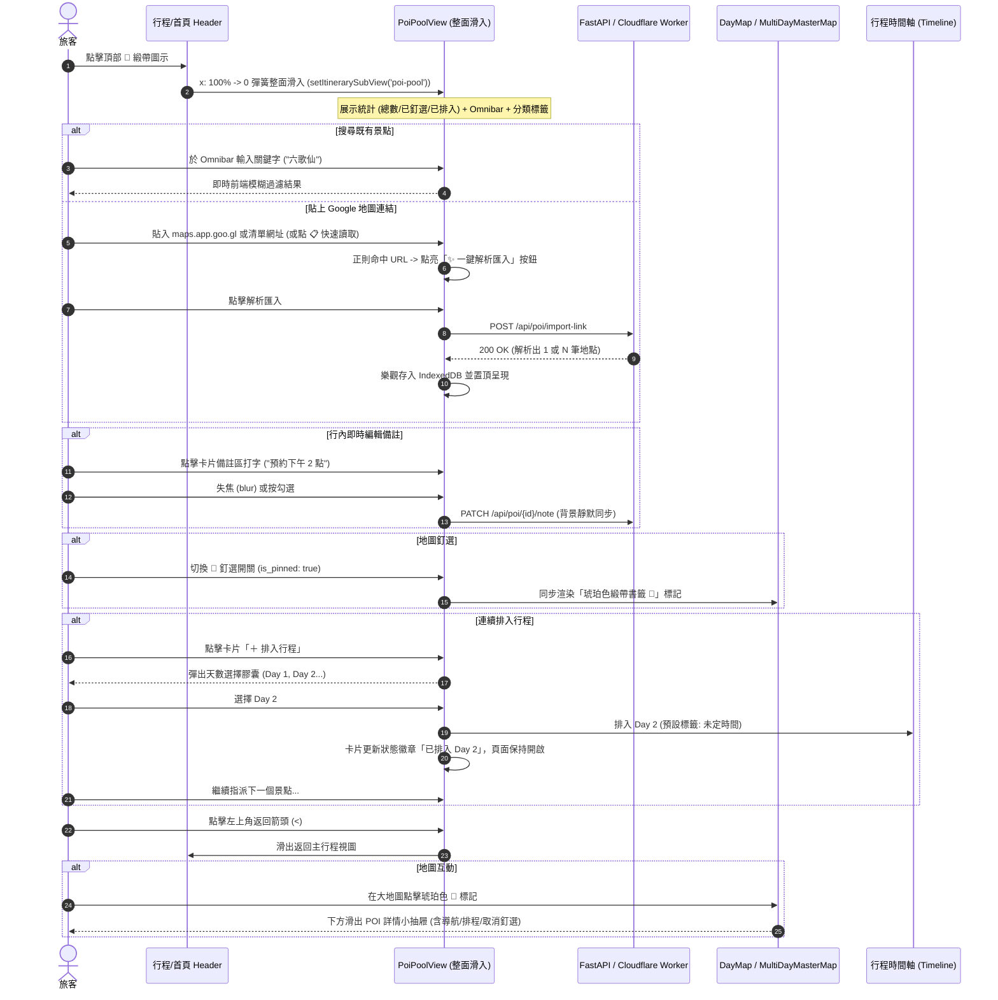

# Tabidachi 全域景點口袋庫規格書 (Universal POI Pool & Stash Hub Spec)

**規格書識別碼**: `SPEC-FEAT-POI-POOL-2026-10-19`  
**遵循標準**: `/Idea to Spec` 系統工程規格書  
**當前狀態**: `APPROVED_BY_INTERVIEW` (經 `/grill-me` 深度訪談定案)  
**關聯模組**: `PoiPoolView.tsx`, `usePoiPool.ts`, `backend/routers/poi.py`, `DayMap.tsx`, `MultiDayMasterMap.tsx`

---

## 一、 問題陳述與核心價值 (Problem Statement & Core Value)

### 1.1 使用者痛點 (User Problem)
1. **零碎靈感無法收納**：旅客在 Google Maps 存了大量星號標記、共享清單（Placelists），在出發前難以直覺搬遷與分類整理至具體行程中。
2. **窄側邊抽屜操作壓迫**：既有右側 Drawer 寬度受限（尤其在行動裝置上），當使用者嘗試瀏覽 20+ 個景點、編輯多行自訂筆記（如「必點厚切牛舌、只收現金」）時，鍵盤彈起即遮擋畫面，操作體驗破碎。
3. **排程中斷摩擦力高**：傳統「加入行程後立即關閉抽屜」的設計，迫使旅客每排一個地點就得重新點擊一次圖示，嚴重打斷「批次分流」的流暢感。

### 1.2 核心價值與成功衡量指標 (Success Metrics)
* **無邊界操作空間**：點擊緞帶圖示後比照「行程設定（⚙️）」進行 **全螢幕整面滑入（Full-Page Slide-In Subview）**，提供完整寬度的視覺餘裕與清晰排版。
* **智慧全能入口 (Smart Omnibar)**：搜尋與匯入合一，打字即過濾既有庫存，貼上 Google Maps 網址（單點或共享清單）即自動點亮「✨ 一鍵解析匯入」。
* **極速連續排程**：排入指定天數後留在景點庫，卡片標記「已排入 Day X」，允許連續指派多筆景點。
* **效能與離線指標**：
  - 轉場動畫維持 60fps 原生彈簧手感（Spring stiffness 420, damping 32）。
  - 100% 離線可用：IndexedDB 樂觀更新 + `offlineFetch` 佇列同步。
  - Google Maps 連結與清單解析成功率 $\ge 98\%$。

---

## 二、 使用者旅程與核心流程 (User Journey & Core Flows)



---

## 三、 架構與資料模型 (Architecture & Data Model)

### 3.1 視圖拓撲 (View Topology)
於 `frontend/components/views/itinerary-view.tsx` 擴充子視圖路由：
```typescript
type ItinerarySubView = 'main' | 'settings' | 'poi-pool';
```
當 `itinerarySubView === 'poi-pool'` 時，以全尺寸容器渲染 `PoiPoolView`：
```tsx
<AnimatePresence>
    {itinerarySubView === 'poi-pool' && (
        <motion.div
            key="poi-pool-view"
            initial={{ opacity: 0, x: "100%" }}
            animate={{ opacity: 1, x: 0 }}
            exit={{ opacity: 0, x: "100%" }}
            transition={{ type: "spring", stiffness: 420, damping: 32 }}
            className="absolute inset-0 z-50 w-full h-full overflow-y-auto overscroll-contain bg-[#F6F5EE] dark:bg-[#121A18] gpu-layer-accelerated"
        >
            <PoiPoolView
                userId={userId}
                currentTrip={currentTrip}
                totalDays={totalDays}
                onBack={() => setItinerarySubView('main')}
                onAddToTrip={(poi, dayNum) => handleAddPoiToTrip(poi, dayNum)}
            />
        </motion.div>
    )}
</AnimatePresence>
```

### 3.2 資料模型定義 (Data Types)
```typescript
export type POICategory =
    | "attraction"   // 景點 / 寺廟 / 地標
    | "food"         // 餐廳 / 料理
    | "cafe"         // 咖啡廳 / 甜點
    | "hotel"        // 住宿 / 飯店
    | "shopping"     // 購物 / 商場
    | "transport"    // 車站 / 機場
    | "other";

export interface POIItem {
    id: string;               // poi_xxxxxxxxxxxx
    user_id: string;          // 訪客 UUID 或會員 ID
    title: string;            // 地點名稱
    address: string;          // 地址或原始輸入
    lat: number;              // 緯度
    lng: number;              // 經度
    google_place_id?: string | null;
    category: POICategory;
    rating?: number | null;
    user_notes: string;       // 使用者個人備註 (支援行內編輯)
    source_url?: string | null;
    is_pinned: boolean;       // 是否釘選至全域地圖
    pin_color: string;        // 預設琥珀色 #E56E25
    scheduled_trips?: {       // 排入紀錄反查
        trip_id: string;
        day: number;
    }[];
    created_at: number;
    updated_at: number;
}
```

### 3.3 後端 RESTful 端點架構 (`backend/routers/poi.py`)
| 方法 | 路徑 | 請求主體 / 參數 | 回應 / 行為 |
| :--- | :--- | :--- | :--- |
| `GET` | `/api/poi/all` | Header: `X-User-ID` | 回傳該使用者所有已存 POI 清單陣列 |
| `POST` | `/api/poi/import-link` | `{ url: string }` | 追蹤轉址、解析單點或共享清單，自動分類並持久化 |
| `POST` | `/api/poi/add` | `POIItem` 部分欄位 | 手動快速新增自訂景點 |
| `PATCH`| `/api/poi/{id}/note` | `{ note: string }` | 行內修改景點自訂備註 |
| `PATCH`| `/api/poi/{id}/pin` | `{ is_pinned: boolean }`| 切換地圖釘選狀態 |
| `DELETE`| `/api/poi/{id}` | 無 | 自口袋清單中移除 |

---

## 四、 邊界條件與異常防護 (Edge Cases & Boundaries)

| 邊界面向 | 潛在異常或情境 | 防禦機制與優雅處理 |
| :--- | :--- | :--- |
| **離線環境操作** | 飛機上或地下鐵無網路連線 | 前端以 SWR + IndexedDB 樂觀更新，API 呼叫經由 `offlineFetch` 寫入本機同步佇列，連線恢復自動同步。 |
| **超長共享清單 (50+ 景點)** | 使用者貼入包含數十個景點的大型 Google Maps 清單 | 後端以流式正則提取 `title` 與 `[null,null,lat,lng]`，前端以分頁或虛擬列表平滑載入，避免渲染卡頓。 |
| **重複景點過濾** | 匯入同一景點兩次 | 依據座標 50 公尺半徑或精確名稱偵測重複；重複項目自動更新最新連結，不重複堆疊幽靈卡片。 |
| **行動端軟鍵盤彈起** | 編輯行內備註時畫面被鍵盤頂起變形 | 容器外層採用 `h-dvh` 與 `overflow-y-auto`，編輯區域滾動至視窗正中（`scrollIntoView({ block: 'nearest' })`）。 |
| **無效或非地圖網址** | 貼入一般新聞或非地圖連結 | 正則即時檢查；若無法解析，清楚提示「未偵測到地點座標，請確認是否為 Google 地圖分享連結」。 |

---

## 五、 驗收標準清單 (Acceptance Criteria)

- [ ] **AC-1 (整面滑入)**：點擊行程頂部 🔖 緞帶圖示，以全螢幕流暢滑入 `PoiPoolView`，頂部具有返回按鈕、景點總覽統計與清晰的標題。
- [ ] **AC-2 (智慧 Omnibar)**：輸入文字時即時過濾景點名稱/備註；貼入 Google Maps 連結時，按鈕動態轉化為「✨ 解析匯入」，支援點擊 📋 快速讀取剪貼簿。
- [ ] **AC-3 (單點與清單解析)**：貼上 Google Maps 單點或共享清單（Placelists）均能正確解析店名與經緯度，並存入口袋庫。
- [ ] **AC-4 (行內即時筆記)**：點擊卡片備註區可直接輸入文字，失焦（blur）後即時儲存，無多餘彈窗打斷。
- [ ] **AC-5 (連續排程不關閉)**：點擊卡片「＋ 排入行程」可選擇天數，成功將該景點排入行程（時間預設為「未定時間」），卡片顯示「已排入 Day X」，頁面保持開啟供後續操作。
- [ ] **AC-6 (地圖釘選聯動)**：切換卡片 📌 開關，DayMap 與 MultiDayMasterMap 即時顯示琥珀色書籤標記 🔖；點擊標記喚起下方詳情小抽屜。
- [ ] **AC-7 (資訊與工具頁按鈕守恆)**：資訊頁（Info）與工具頁（Tools）的重新整理按鈕完好保留，行程標題編輯鉛筆如期隱藏。
- [ ] **AC-8 (型別與代碼衛生)**：全棧代碼通過 `tsc --noEmit` 0 錯誤、`eslint` 0 警告，後端測試 100% 通過。
