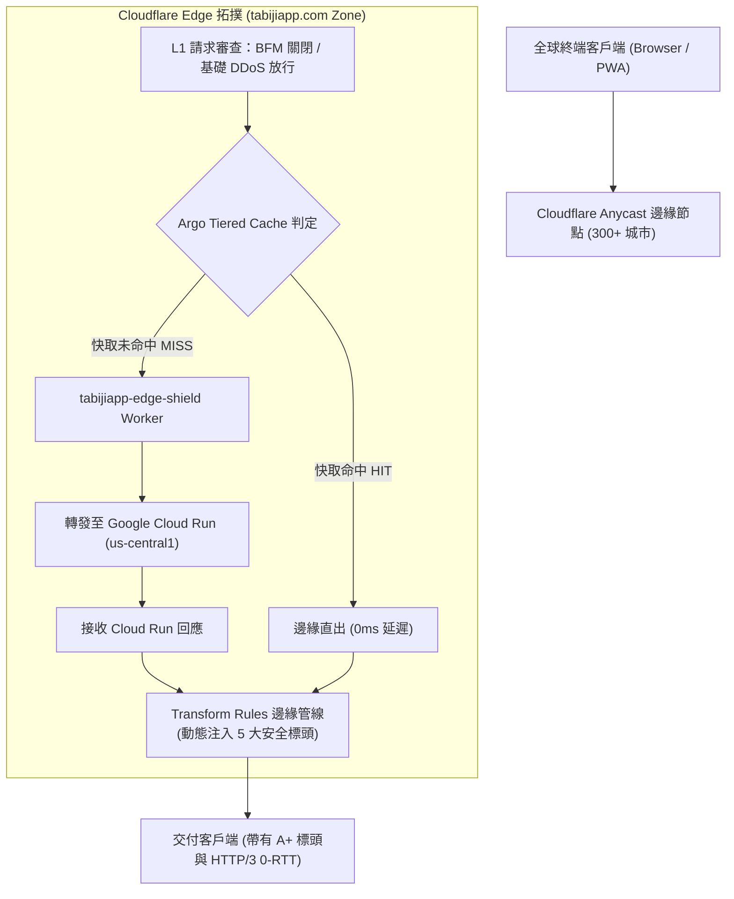

# 📋 Specification: Cloudflare Phase 1 零代碼即刻生效防護與加速規格書 (Zero-Code Hardening & Acceleration)

> **領域模組**：`infra / edge-network`  
> **關聯網域**：`tabijiapp.com`, `www.tabijiapp.com`  
> **實施週期**：Phase 1 即刻落地  
> **交付模式**：規格標準 (Spec) + 控制台精確對照清單 (Dashboard Checklist) + 自動化驗收腳本 (Automated Verifier)  

---

## 1. Problem Statement & Core Value (問題陳述與核心價值)

### 1.1 使用者與系統痛點
1. **源站穿透負載與 Cold Start 成本**：Cloud Run 每次冷啟動需耗費 1.5s~3s，直接將全球分散流量打至 us-central1 源站會增加非必要算力與延遲。
2. **安全防護評級與合規隱患**：原生 Next.js / FastAPI 若未手動逐一配置防禦標頭，在 Mozilla Observatory 與 SecurityHeaders.com 評級僅為 D 或 F，存在 MIME 混淆嗅探、Clickjacking 與降級攻擊風險。
3. **商業信譽與聯絡專業度**：目前對外聯絡依賴個人免費信箱，缺少主網域官方郵件別名（`contact@tabijiapp.com`、`support@tabijiapp.com`）。
4. **致命黑洞風險**：若誤觸 Cloudflare 免費版的 **Bot Fight Mode (BFM)** 或 **Rocket Loader**，會直接引發 `/api/*` 被誤殺攔截（403 Forbidden）以及 Next.js 16 / React 19 水合崩潰白屏。

### 1.2 成功量化指標 (Success Metrics)
- **快取命中率提升**：開啟 Argo Tiered Cache 後，多層快取使靜態與虛擬快取請求之源站穿透率降低 $\ge 60\%$。
- **安全標頭 A+ 滿分**：全站所有對外回應自動攜帶 5 大安全標頭，SecurityHeaders 達 **A+**。
- **商務信箱 100% 投遞**：寄往 `contact@tabijiapp.com` 與 `support@tabijiapp.com` 之郵件在 5 秒內無失真轉發至個人信箱。
- **零 API 誤殺與零水合崩潰**：BFM 與 Rocket Loader 維持關閉狀態，API 正常率保持 100%。

---

## 2. 系統架構與邊緣規則拓撲 (Edge Architecture Topology)



---

## 3. 具體配置標準與控制台操作對照清單 (Dashboard Action Checklist)

請登入 [Cloudflare Dashboard](https://dash.cloudflare.com/)，選擇網域 **`tabijiapp.com`**，依序執行以下 4 大區塊操作：

### 區塊 A：開啟 Argo Tiered Cache (分層快取)
- **路徑**：`Caching` -> `Tiered Cache`
- **操作**：
  1. 將 **Tiered Cache** 開關切換為 **Enabled (開啟)**。
  2. 拓撲選擇：**Smart Tiered Cache Topology (自動智慧拓撲)**。
- **原理**：Cloudflare 會自動將全球 300+ 個邊緣節點組織為多層架構，低命中率的周邊節點會先向上游主要 Tier 節點拉取快取，避免所有節點同時穿透回 Cloud Run 源站。

---

### 區塊 B：配置 Transform Rules 動態注入 5 大安全標頭
- **路徑**：`Rules` -> `Transform Rules` -> 選擇分頁 **`Modify Response Header`**
- **操作**：
  1. 點擊 **Create rule**。
  2. **Rule name**：`Set-Production-Security-Headers`。
  3. **When incoming requests match**：選擇 **Custom filter expression**。
  4. **Field / Value** 填寫：`Hostname equals tabijiapp.com` OR `Hostname equals www.tabijiapp.com`。
     *(Expression Editor: `http.host in {"tabijiapp.com" "www.tabijiapp.com"}`)*
  5. **Modify response headers** -> 依序新增 5 個動作：
     - **Set dynamic** / **Set static**：選擇 **Set static**。
     - Header 1: `Strict-Transport-Security` = `max-age=31536000; includeSubDomains; preload`
     - Header 2: `X-Content-Type-Options` = `nosniff`
     - Header 3: `X-Frame-Options` = `SAMEORIGIN`
     - Header 4: `Referrer-Policy` = `strict-origin-when-cross-origin`
     - Header 5: `Permissions-Policy` = `camera=(), microphone=(), geolocation=(self)`
  6. 點擊 **Deploy** 部署。

---

### 區塊 C：避坑配置確認 (Speed & Security Defense)
- **1. 關閉 Rocket Loader & Auto Minify**：
  - **路徑**：`Speed` -> `Optimization` -> `Content Optimization`
  - **確認**：
    - **Rocket Loader**：務必設為 **OFF (關閉)** *(避免重寫 script 破壞 React 19 / Turbopack 水合)*。
    - **Auto Minify**：JavaScript, CSS, HTML 全數保持 **不勾選** *(Next.js 已於構建時完成最佳化)*。
- **2. 關閉免費版 Bot Fight Mode**：
  - **路徑**：`Security` -> `Bots`
  - **確認**：
    - **Bot Fight Mode**：務必保持 **OFF (關閉)** *(避免免費版全局黑箱將 PWA / App API 請求判定為機器人拋出 403)*。
- **3. 開啟 Early Hints & HTTP/3**：
  - **路徑**：`Speed` -> `Optimization` -> `Protocol Optimization`
  - **確認**：
    - **Early Hints (103)**：設為 **ON (開啟)** *(預先推送 CSS/JS Chunk 預載入)*。
    - **HTTP/3 (with QUIC)**：設為 **ON (開啟)**。
    - **0-RTT Connection Resumption**：設為 **ON (開啟)**。

---

### 區塊 D：配置 Email Routing 商業雙信箱別名
- **路徑**：`Email` -> `Email Routing`
- **操作**：
  1. 初次進入點擊 **Get Started**，系統會提示自動在 DNS 新增 MX 記錄與 SPF 驗證記錄（一鍵確認即可）。
  2. 綁定**目標個人信箱 (Destination address)**：輸入個人常用 Gmail，至信箱收取驗證信並點擊確認。
  3. 新增自訂別名規則 (Routing rules -> Create address)：
     - 別名 1：`contact` @ `tabijiapp.com` -> 轉發至目標 Gmail。
     - 別名 2：`support` @ `tabijiapp.com` -> 轉發至目標 Gmail。
  4. 狀態顯示 **Active** 即完成。

---

## 4. Edge Cases & Boundary Conditions (邊界條件與異常處理)

1. **Permissions-Policy 邊界**：
   - 標頭中宣告 `geolocation=(self)`，允許同源網域呼叫瀏覽器原生 GPS 定位，確保 Tabidachi 首頁與地圖能精確取得使用者出發座標；嚴禁誤設為 `geolocation=()` 導致離線地圖定位失效。
2. **X-Frame-Options 邊界**：
   - 宣告 `SAMEORIGIN` 允許站內彈窗或同源 iframe 嵌套，但徹底杜絕跨網域 Clickjacking 劫持。
3. **Strict-Transport-Security (HSTS) 預載邊界**：
   - 包含 `preload` 旗標後，一旦提交至 Chrome HSTS Preload List，瀏覽器將強制永遠以 HTTPS 連線。Tabidachi 已全面走 HTTPS，具備 100% 相容性。

---

## 5. Acceptance Criteria (驗收標準清單)

```markdown
- [ ] AC-1: Given 發送 GET 請求至 https://tabijiapp.com，when 檢查 Response Headers，then 必須包含 Strict-Transport-Security、X-Content-Type-Options 等 5 項安全標頭。
- [ ] AC-2: Given 外部發送郵件至 contact@tabijiapp.com，when 寄出後，then 個人信箱應於 5 秒內收到原始轉發信件。
- [ ] AC-3: Given 前端發送 POST 請求至 /api/ai/parse-receipt，when 經由邊緣轉發，then 絕不被 Cloudflare Bot Fight Mode 攔截為 403。
- [ ] AC-4: Given 使用者以 Chrome/Safari 開啟首頁，when 檢查控制台，then 絕不出現 Rocket Loader 引發之 React Hydration failed 警告。
```
