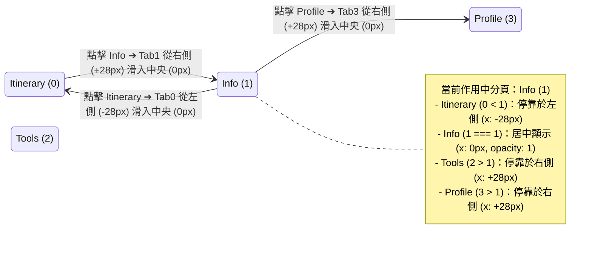
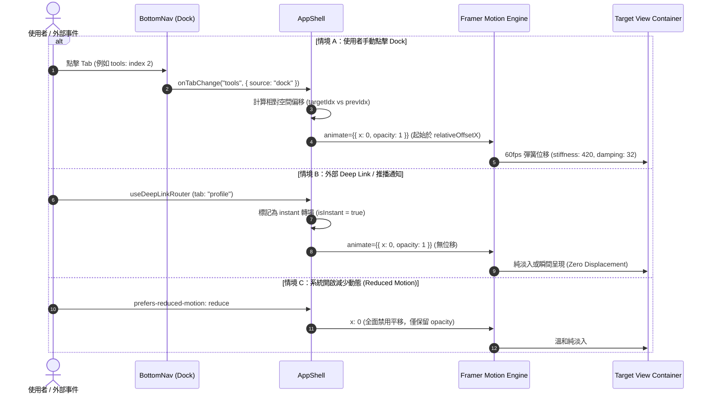

# 🧭 四大 Dock 視圖切換方向感知與原生無縫轉場工程規格書 (Dock Direction-Aware Transition & Native Parity Specification)

> **版本**：1.0.0  
> **狀態**：APPROVED (Ready for Implementation)  
> **作者**：Ryan Su (@architect)  
> **對齊系統**：Tabidachi Design System, Next.js 16, React 19, Tailwind CSS v4, Framer Motion v12, Apple HIG  
> **追蹤標籤**：#DockMotionParity #ZeroRemount #NativeParity

---

## 1. Problem Statement & Core Value (問題陳述與核心價值)

### 1.1 使用者痛點與現狀真因 (User Problem & Root Causes)

在 Tabidachi PWA 中，底部常駐 Dock（`BottomNav`）承載著四大核心視圖的切換：
`itinerary` (0: 行程) ⇄ `info` (1: 資訊) ⇄ `tools` (2: 工具) ⇄ `profile` (3: 個人)。

目前使用者反饋在切換分頁時存在明顯反直覺現象：
- **從左到右切換**（如 0 ➔ 1）：頁面自右向左滑入（符合視覺認知）。
- **從右到左切換**（如 3 ➔ 2 或 1 ➔ 0）：**頁面仍然自右向左滑入**（嚴重破壞空間連續性與物理直覺）。

經過代碼庫深度審查，確認造成此問題的三大底層根因：
1. **元件事件斷鏈 (Decoupled Handler Bypass)**：
   `app-shell.tsx` 內部定義了具備方向計算的 `handleTabChange(nextTab)`，但傳遞給 `<BottomNav>` 的 props 卻為 `onTabChange={setActiveView}`。當使用者於 Dock 點擊時，直接呼叫了 `setActiveView`，完全繞過了 `handleTabChange`，導致 `direction` 狀態自初始值 `1` 起便永遠被凍結，從未動態更新。
2. **歷史座標污染與 Framer Motion 鎖死 (Motion Value State Pollution)**：
   在既有設計中，非作用中（inactive）視圖透過 `<motion.div animate={{ x: direction * 28 }}>` 暫停。若僅單純修復 `handleTabChange`，已掛載且隱藏的非作用中視圖在先前切換中已被賦予 `x = +28px`；當使用者由右向左切換時，目標視圖從既有的 `+28px` 動畫至 `0px`，在畫面上**依然呈現由右向左滑入**。
3. **未區分操作觸發意圖 (Trigger Context Blindness)**：
   外部 Deep Link、推播跳轉與內部全域事件（如 `navigate-to-profile`）目前與手動點擊共用邏輯。依據 Apple HIG，外部跳轉屬於「上下文瞬移 (Context Jump)」，不應帶有橫向實體位移，否則會產生多餘的視差干擾。

### 1.2 核心價值與成功指標 (Success Metrics)

- **100% 空間直覺自洽 (Directional Fidelity)**：
  - 由左向右切換（`targetIdx > currentIdx`）：新視圖從右側（`+28px`）滑入至中央（`0px`）。
  - 由右向左切換（`targetIdx < currentIdx`）：新視圖從左側（`-28px`）滑入至中央（`0px`）。
- **零開銷與零狀態摧毀 (Zero-Remount Preservation)**：
  - 嚴格維持 Decision #38 規範，四大主頁面常駐且不銷毀，達成 0 重複 API 請求、100% 地圖 WebGL Context 存活與滾動位置保留。
- **iOS 原生分頁規範對齊 (Native Parity)**：
  - 手動 Dock 點擊：啟用方向感知微動效（`±28px` 彈簧滑入）。
  - Deep Link / 推播 / 外部事件：純上下文切換（`x: 0`，無位移）。
  - 首屏冷啟動：靜態立顯（`x: 0`，無進場滑動）。
  - 無障礙減敏：`prefers-reduced-motion` 啟動時自動降級為無位移純淡入。

---

## 2. User Journey & Core Flow (使用者旅程與操作流程)

### 2.1 空間拓撲狀態轉換圖 (Spatial Index State Machine)

四個分頁具有全域固定的物理空間索引：
`itinerary` (0) < `info` (1) < `tools` (2) < `profile` (3)

每個頁面相對於當前啟用頁面（`activeTab`）的空間座標，由純函數直接映射，杜絕歷史狀態殘留：



### 2.2 觸發源行為分流時序圖 (Sequence Flow)



---

## 3. Architecture & Motion Model (幾何架構與動效模型)

### 3.1 相對空間索引拓撲純函數 (Stateless Relative Spatial Offset)

捨棄依賴易變狀態（mutable state）紀錄的 `direction`（`1 | -1`），全面升級為**純函數空間拓撲計算**：

```typescript
export const TAB_INDICES: Record<string, number> = {
    itinerary: 0,
    info: 1,
    tools: 2,
    profile: 3,
};

export const MOTION_CONFIG = {
    offsetPx: 28, // 嚴格固化 ±28px 微動效
    spring: {
        type: "spring" as const,
        stiffness: 420,
        damping: 32,
    },
};

/**
 * 依據目標分頁相對於當前分頁的拓撲位置計算初始/待命 X 軸位移
 * @param tabId 視圖本身 ID
 * @param activeTab 目前正在顯示的 Tab ID
 * @param isInstant 是否為無位移切換（Deep Link / 減敏模式）
 */
export function getTabSpatialOffset(
    tabId: string,
    activeTab: string,
    isInstant: boolean = false
): number {
    if (isInstant || tabId === activeTab) return 0;
    
    const tabIdx = TAB_INDICES[tabId] ?? 0;
    const activeIdx = TAB_INDICES[activeTab] ?? 0;
    
    // 若 tabIdx < activeIdx：該頁面位於當前頁面左側，待命座標為 -28px
    // 若 tabIdx > activeIdx：該頁面位於當前頁面右側，待命座標為 +28px
    return tabIdx > activeIdx ? MOTION_CONFIG.offsetPx : -MOTION_CONFIG.offsetPx;
}
```

#### 數學自洽性證明 (Mathematical Consistency)
- 當使用者在 `profile` (3) 點選 `itinerary` (0) 時：
  - `itinerary` 的靜態座標為：`0 < 3` ➔ `-28px`（已停靠於左側）。
  - 切換為作用中時，目標座標為 `0px`。
  - 動畫軌跡：`-28px` ➔ `0px`（**由左向右滑入**，完全符合直覺）。
- 當使用者在 `itinerary` (0) 點選 `tools` (2) 時：
  - `tools` 的靜態座標為：`2 > 0` ➔ `+28px`（已停靠於右側）。
  - 切換為作用中時，目標座標為 `0px`。
  - 動畫軌跡：`+28px` ➔ `0px`（**由右向左滑入**，完全符合直覺）。

### 3.2 轉場觸發意圖狀態機 (Transition Intent Model)

在 `AppShell` 中引入轉場來源標記（`transitionSource`），區分手動操作與程式跳轉：

```typescript
type TabTransitionSource = 'dock' | 'instant' | 'deeplink';

interface TabChangeOptions {
    source?: TabTransitionSource;
}
```

- **`dock`**：手動點擊底部導航欄，啟用 `±28px` 彈簧滑入。
- **`instant` / `deeplink`**：外部推播跳轉、深層連結或冷啟動，強制 `offset = 0`，平滑直達。

### 3.3 元件通信架構修正 (BottomNav ➔ AppShell)

修復 `app-shell.tsx` 第 273 行之事件阻斷問題：

```diff
- <BottomNav 
-     activeTab={activeView} 
-     onTabChange={setActiveView} 
- />
+ <BottomNav 
+     activeTab={activeView} 
+     onTabChange={(nextTab) => handleTabChange(nextTab, { source: 'dock' })} 
+ />
```

### 3.4 視圖容器動畫配置 (Zero-Remount Motion Container)

維持常駐 DOM 結構，透過純 CSS `className="hidden"` 隔離背景排程，並在各視圖外層套用空間感知動畫：

```tsx
{/* 範例：ItineraryView Container */}
<div className={activeView === "itinerary" ? "flex-1 h-full min-h-0 overflow-hidden" : "hidden"}>
    {(activeView === "itinerary" || shouldPreheat) && (
        <motion.div
            initial={false}
            animate={{
                opacity: activeView === "itinerary" ? 1 : 0.7,
                x: activeView === "itinerary" 
                    ? 0 
                    : getTabSpatialOffset("itinerary", activeView, isReducedMotion || isInstant)
            }}
            transition={MOTION_CONFIG.spring}
            className="w-full h-full flex flex-col transform-gpu will-change-transform"
        >
            <ItineraryView />
        </motion.div>
    )}
</div>
```

---

## 4. Edge Cases & Boundary Conditions (邊界條件與異常處理)

### 4.1 首屏冷啟動 (Cold Start Hydration)
- **邊界狀況**：App 首次啟動水合掛載時，預設視圖（`itinerary`）若觸發動畫，會產生非預期的橫向抖動。
- **處置規範**：宣告 `initial={false}`，且首次渲染時 `isInstant` 預設為 `true`，直至客戶端完全水合（Mount 後 100ms）才解鎖動態滑動。

### 4.2 跨越 3 格之非相鄰跳轉 (Non-Adjacent Tab Jump: 0 ➔ 3)
- **邊界狀況**：使用者從第一頁直接點選第四頁。
- **處置規範**：依據訪談共識，**維持固定 ±28px 微動效**，不因跨越多格而放大位移幅度，確保介面沉穩、簡約且節奏嚴格一致。

### 4.3 高頻連續點擊狂打 (Rapid Multi-tab Thrashing)
- **邊界狀況**：使用者在 500ms 內連續快速點擊 0 ➔ 1 ➔ 2 ➔ 3。
- **處置規範**：
  - Framer Motion 原生 Spring 動能具備自然的速度延續（Velocity Hand-off），不會引發幾何撕裂。
  - 配合 `BottomNav` 內建之 `haptic.selection()` 原生震動與 `active:scale-95` 反饋，提供即時手感確認。

### 4.4 離線背景預熱 (Stealth Preheat Synchronization)
- **邊界狀況**：`shouldPreheat === true` 啟動時，未被啟用的 3 個視圖在背景靜默掛載。
- **處置規範**：預熱掛載時，各視圖依據自身相對於目前 `activeTab` 之索引值正確停泊在 `-28px` 或 `+28px`，確保隨後被點擊喚醒時，起始位移即為正確方向，絕無先跳至 `+28px` 再反向補正之瑕疵。

### 4.5 無障礙偏好 (Accessibility & prefers-reduced-motion)
- **邊界狀況**：使用者在 iOS / Android 系統設定中開啟「減少動態效果 (Reduce Motion)」。
- **處置規範**：透過 Framer Motion 之 `useReducedMotion()` 監控，當啟用時強制所有 X 軸位移歸零（`x: 0`），僅保留柔和的透明度漸變（`opacity: 0.7 ➔ 1`）。

---

## 5. Acceptance Criteria & Test Matrix (驗收標準與測試矩陣)

### 5.1 驗收標準清單 (Acceptance Criteria)

```markdown
- [ ] AC-1: Given 使用者位於「行程」(0)，When 點擊「資訊」(1) 或右側任一 Tab，Then 新頁面必須由螢幕右側向左平滑滑入 (x: +28px ➔ 0px)。
- [ ] AC-2: Given 使用者位於「個人」(3)，When 點擊「工具」(2) 或左側任一 Tab，Then 新頁面必須由螢幕左側向右平滑滑入 (x: -28px ➔ 0px)。
- [ ] AC-3: Given 使用者位於任一頁面，When 連續跨格切換 (如 0 ➔ 3 或 3 ➔ 0)，Then 動態位移幅度均固定為 ±28px，保持視覺節奏一致。
- [ ] AC-4: Given 外部 Deep Link 或推播通知喚醒導航，When 切換至指定分頁，Then 該分頁必須直接瞬移呈現 (x: 0)，不產生橫向滑動。
- [ ] AC-5: Given 系統環境啟用 prefers-reduced-motion: reduce，When 於 Dock 切換任何分頁，Then 頁面切換完全無橫向位移 (x: 0)，僅呈現純淡入淡出。
- [ ] AC-6: Given 頁面切換過程中，When 檢查 DOM 結構與生命週期，Then 四大主頁面必須維持常駐且不發生 Unmount / Re-mount，保留滾動位置與地圖狀態。
```

### 5.2 自動化測試規劃 (Vitest Test Suite)

新增單元與整合測試套件 `frontend/__tests__/dock-direction-transition.test.tsx`：
1. **TC-1: 相對空間拓撲純函數斷言**
   - 驗證 `getTabSpatialOffset` 在 `tabIdx > activeIdx` 時回傳 `+28`。
   - 驗證 `getTabSpatialOffset` 在 `tabIdx < activeIdx` 時回傳 `-28`。
   - 驗證當 `isInstant = true` 時回傳 `0`。
2. **TC-2: BottomNav onTabChange 委派驗證**
   - 渲染 `AppShell`，模擬點擊 `BottomNav` 按鈕，斷言 `handleTabChange` 正確接收 `source: 'dock'` 並派發對應空間座標。
3. **TC-3: Deep Link 瞬移行為驗證**
   - 觸發 `tabidachi-deep-link` 或內部導航事件，斷言轉場旗標為 `instant`，視圖 X 軸位移為 `0`。
4. **TC-4: Reduced Motion 降級驗證**
   - 模擬 `prefers-reduced-motion` 媒體查詢為真，斷言所有 Tab 的計算位移均強制為 `0`。
